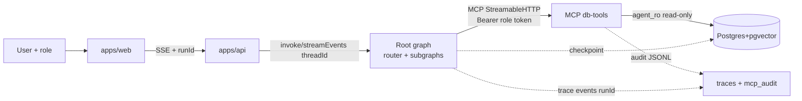
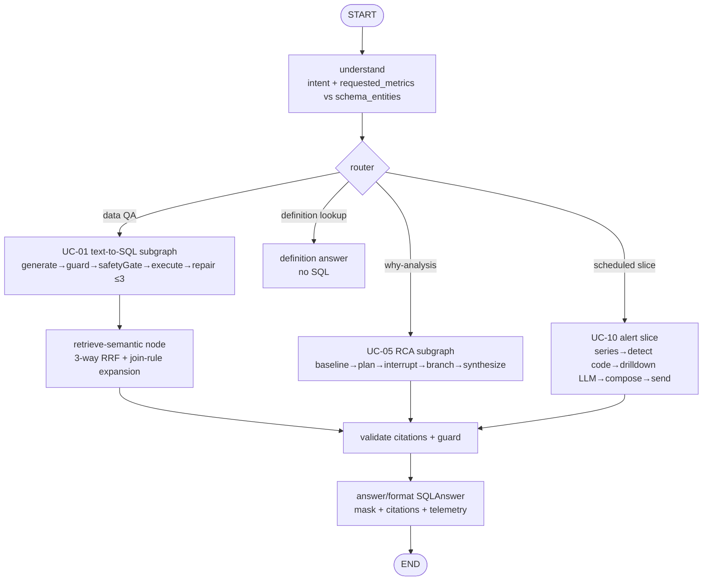

# Architecture Research

**Domain:** TypeScript LangGraph.js analytics agent ("agent = model + harness") with MCP db-tools over read-only PostgreSQL
**Researched:** 2026-10-26
**Confidence:** HIGH (LangGraph.js + MCP SDK claims verified against current official docs; UC-plan/PRD requirements cross-checked)

## Recommended Architecture

### System Overview

```
┌─────────────────────────────────────────────────────────────────┐
│  PRESENTATION  apps/web (React+Vite)                             │
│  chat + streaming progress · role switcher · plan approval (UC-05/07) │
│  dictionary/metrics admin (UC-02) · alerts list + run-now (UC-10) │
│  audit viewer (UC-09) · debug SQL/citations viewer                │
└──────────────────────────────┬──────────────────────────────────┘
                               │ HTTPS/SSE (EventSource), X-Run-Id
┌──────────────────────────────▼──────────────────────────────────┐
│  ORCHESTRATION  apps/api (Express)                               │
│  POST /api/ask → creates threadId+runId → graph.invoke/streamEvents │
│  GET /api/stream/:runId (SSE) · POST /rca/plan/:thread/resume     │
│  POST /api/semantic/reindex · GET /api/alerts · authZ (role→token)│
└──────────────┬───────────────────────────────┬──────────────────┘
               │ in-process invoke             │ MCP over HTTP (bearer)
┌──────────────▼───────────────┐  ┌────────────▼──────────────────┐
│  AGENT  packages/agent       │  │  DATA PLANE packages/mcp-server│
│  LangGraph.js root graph     │  │  db-tools (UC-09)              │
│  understand→retrieve→        │  │  auth→zod→sqlGuard→AccessPolicy │
│  generate→validate→execute→  │  │  →executor→PII-scan→audit       │
│  answer (+ UC subgraphs)     │  │  resources: data-dictionary,   │
│  MCP client (per-role token) │  │  metrics; tools ×5             │
└──────────────┬───────────────┘  └────────────┬──────────────────┘
               │ shared checkpointer (PG)      │ Pool(agent_ro) + Pool(indexer)
┌──────────────▼──────────────────────────────▼──────────────────┐
│  STATE + DATA  PostgreSQL 16 + pgvector (docker/)              │
│  business schema · semantic_chunks · checkpoints (+stores)      │
│  app_state.alert_history · audit logs (JSONL mirror)            │
│  roles: owner / agent_ro (read-only) / indexer                  │
└─────────────────────────────────────────────────────────────────┘
  CROSS-CUTTING: packages/contracts (zod) · packages/access-policy
               policies/*.yaml · semantic/*.yaml · skills/*/
               evals/ (vitest + EX/grader) · traces/*.jsonl (runId)
```





### Component Boundaries

| Component | Responsibility (owns) | Communicates With |
|-----------|----------------------|-------------------|
| `apps/web` | Chat UI, role switch, SSE rendering, plan-approval dialog, dictionary/alert/audit pages. No SQL parsing, no DB. | `apps/api` only (REST+SSE). Imports types from `@shop/contracts` only. |
| `apps/api` | HTTP boundary: creates `threadId`/`runId`, maps session role→MCP bearer, streams `graph.streamEvents`, exposes resume/reindex/alert endpoints. No LLM prompts, no SQL AST. | `packages/agent` (in-process invoke), `packages/mcp-server` (as MCP client), Postgres (alert_history read). |
| `packages/agent` | LangGraph.js root graph + UC subgraphs, nodes, retriever (dense+BM25+alias RRF), citation validator, MCP client wrapper, skills' prompt templates. Never opens a `pg.Pool` to business tables. | MCP server via `StreamableHTTPClientTransport`; checkpointer PG; contracts for zod I/O. |
| `packages/mcp-server` | Sole DB gateway: 5 tools + 2 resources, `requireBearerAuth` + scope check, zod I/O validation, `sqlGuard` (pgsql-parser), `resolveColumns`, `AccessPolicy.apply`, read-only executor (`BEGIN READ ONLY`, `SET LOCAL statement_timeout`, `pg-cursor` maxRows+1), PII post-scan, pino audit. | Postgres via `agent_ro` pool only. Exports nothing importable by agent except types. |
| `packages/access-policy` | `AccessPolicy` interface + `ColumnScopePolicy` (mask/deny by scope) + future `RbacPolicy` (UC-08 row filter injection). Pure functions on SQL AST + config; no DB I/O. | Imported by `mcp-server` (enforcement) and by `agent` only for *pre-flight* local gate (UC-01 `LocalQuerySafetyGate`), never as enforcement. |
| `packages/contracts` | Single source of truth: zod schemas for 5 tool I/O, 11 error codes, `SQLAnswer` (+`citations`, `telemetry`), `Alert`, `Subscription`, semantic chunk metadata, trace/audit envelope keyed by `runId`. | Imported by everything. Must have zero runtime deps except `zod`. |
| `policies/` | `mcp_clients.yaml` (token→role/scopes), `sensitive_columns.yaml`, `rbac.yaml`, `subscriptions.yaml` (UC-10). Validated by zod at startup; bad config = server won't boot. | Read by `mcp-server` and `apps/api` (role mapping). |
| `semantic/` + indexer | 6 YAML corpora (tables/columns/metrics/joins/examples/events) + chunker + SHA-256 incremental indexer + BM25 hot-reload. | Writes `semantic_chunks` via `indexer` role; read via retriever + MCP resources. |
| `skills/` | One folder per K2 skill (`text-to-sql`, `anomaly-alert`, `root-cause-analysis`, `pii-safe-query`, …): SKILL.md contract (metadata, when-to-use, I/O, steps, constraints, examples, final check). No executable DB credentials. | Referenced by prompts/evals, never `import`ed as code. |
| `evals/` + `traces/` | `pnpm eval --uc <id>` runner, EX grader, retrieval benchmark, attack suite; JSONL traces with PII redaction, `runId` propagation, token/cost/latency. | Reads contracts + traces; never ships to prod bundle. |

### Allowed Dependency Directions (enforced)

```
contracts ← everything (contracts imports nothing but zod)
access-policy → contracts only (no db, no agent, no mcp-server)
mcp-server → contracts, access-policy, pg/pg-cursor, pgsql-parser, pino, yaml
agent → contracts, access-policy (types + local pre-flight only),
        @langchain/langgraph, @langchain/mcp-adapters|SDK client, retriever deps
        ⛔ MUST NOT import mcp-server/src/db, sqlGuard impl, or pg (ESLint no-restricted-imports)
api → agent, contracts (never mcp-server internals; talks MCP over HTTP)
web → contracts only
```

**Why this shape:** PRD §1.5.2 requires read-only enforcement at the connection layer, not in the prompt. A single MCP gateway (UC-09 F11) plus an ESLint boundary guarantees that killing the agent-side guard still leaves server-side `sqlGuard` + `agent_ro` + masking intact (defense in depth: validator → role → post-scan). It also lets 5 UC owners work in parallel: each owns nodes/skills/evals inside `packages/agent` or pages in `apps/*` without touching the gateway's security core.

## Graph Architecture (LangGraph.js)

**Recommendation: one compiled root graph + per-UC subgraphs, shared base state, single Postgres checkpointer at the root.**

### State design

Use the **current `StateSchema` API** (recommended; `Annotation.Root` and Channels API are legacy/advanced per official docs):

```typescript
// packages/agent/src/state.ts
import { StateSchema, MessagesValue, ReducedValue } from "@langchain/langgraph";
import * as z from "zod";

export const BaseState = new StateSchema({
  runId: z.string(),
  userId: z.string(),
  role: z.enum(["sales_south", "marketing", "hr", "admin"]),
  question: z.string(),
  intent: z.object({
    metric: z.string().nullable(),
    requested_metrics: z.array(z.string()).default([]),
    schema_entities: z.array(z.string()).default([]),
    dimensions: z.array(z.string()).default([]),
    filters: z.record(z.string(), z.unknown()).default({}),
    time_range: z.string().nullable(),
  }),
  semanticContext: z.array(z.string()).default([]), // chunk_ids
  attempts: new ReducedValue(z.array(SqlAttemptSchema).default([]),
    { reducer: (a, b) => [...a, ...b] }),
  events: new ReducedValue(z.array(z.string()).default([]),
    { reducer: (a, b) => [...a, ...b] }),            // SSE fan-out
  status: z.enum(["ok","no_data","cannot_answer","needs_clarification",
                  "restricted","error"]).default("ok"),
  telemetry: TelemetrySchema,
});
```

- Root state = `BaseState` + `MessagesValue` for chat turns (UC-04 later).
- Each subgraph **extends** the base (shared keys flow automatically when added via `addNode(subgraph)`); UC-private scratch (e.g. RCA `plan: PlanStep[]`, UC-10 `slices`) lives in subgraph-only keys so the parent isn't polluted (per-invariant: shared keys auto-sync, private keys don't leak — verified in subgraph docs).
- Reducers: append-only for `attempts`/`events`/trace spans; last-write-wins for scalars. If nodes run in parallel (fan-out), only one writer per key per super-step or use `Overwrite` explicitly.
- Input/output schemas: define narrow `InputState` (`question,userId,role`) and `OutputState` (`SQLAnswer`-shaped) so `invoke` returns only the public contract while internals stay in full state.

### Router + subgraphs

```typescript
const builder = new StateGraph(BaseState)
  .addNode("understand", understandNode)     // intent + requested_metrics vs schema_entities
  .addNode("retrieve", retrieveSemanticNode) // UC-02: 3-way RRF + join expansion + guardrail
  .addNode("text2sql", uc01Subgraph)         // compiled subgraph as node (shared keys)
  .addNode("rca", uc05Subgraph)
  .addNode("alertSlice", uc10Subgraph)       // invoked per (metric × slice) from cron, not chat
  .addNode("answer", answerNode);
builder
  .addEdge(START, "understand")
  .addEdge("understand", "retrieve")
  .addConditionalEdges("retrieve", routeAfterRetrieve, // "unknown_term"→answer(cannot_answer),
    { data_query: "dispatch", definition_lookup: "answer", unknown_term: "answer" })
  .addConditionalEdges("dispatch", dispatchByIntent, { text2sql: "text2sql", rca: "rca", alert: "alertSlice" })
  .addEdge("text2sql", "answer").addEdge("rca", "answer").addEdge("alertSlice", "answer")
  .addEdge("answer", END);
export const graph = builder.compile({ checkpointer });
```

| UC subgraph | Internal shape | Router trigger |
|-------------|---------------|----------------|
| UC-01 text-to-SQL loop | Linear chain with self-repair: `generate → localGuard(sqlGuard+LocalQuerySafetyGate) → execute(run_query) → diagnose → repair (≤3 attempts total)` + zero-row diagnostic (1 extra `SELECT DISTINCT` probe) + clarify gate (≤2 rounds). | Default for ad-hoc questions (`requested_metrics` grounded or no metric needed). |
| UC-02 retrieve node | Not a full subgraph — a **shared node** every path calls: hybrid retrieve → two-tier guardrail → citation validator (≤2 format retries). Also backs `search_semantic_layer` MCP tool and `semantic://` resources. | Always after `understand`; its 3-way route (`data_query/definition_lookup/unknown_term`) short-circuits before generation. |
| UC-05 RCA plan/branch | `validate_baseline → create_plan → [interrupt: human_review] → execute_step ⇆ evaluate_branch (Send fan-out per branch, prune \|contrib\|<30%, depth≤4, queries≤20, per-step retry≤2→failed)` → `synthesize_report` (attribution Σ within ±5%). Implemented with `Send` API for dynamic branch fan-out (map-reduce pattern). | Question matches why/delta pattern ("vì sao…giảm"). |
| UC-10 scheduled workflow | **Separately compiled graph** (same node library, own entry): `loadSubscriptions → per-slice: buildSeriesSQL(RBAC WHERE injected) → run_query → detectAnomaly(pure code, trimmed mean/std, sigma_eff, min_support) → [if anomaly] drillDown LLM (1–2 dims, sqlGuard) → composeAlert(6 fields) → route(critical→send now / else digest) → writeHistory(only after send OK)`. Invoked by `node-cron` 07:00 + CLI `--manual`, one `threadId` per (date), one checkpoint per slice. | Cron/CLI only; never from chat router (chat can query alert_history read-only). |

**Why subgraphs, not separate graphs (except UC-10):** official docs list exactly this use — independent teams own subgraphs behind a stable input/output interface while the parent wires them without knowing internals; per-invocation persistence (default) gives each call a fresh namespace yet inherits the parent checkpointer so `interrupt` works across nesting.

### Checkpointer, thread/run IDs

- **One checkpointer, at the root:** `PostgresSaver.fromConnString(pgUri, { schema: "langgraph" })` + `await checkpointer.setup()` on boot (creates tables/migrations; must be called once). All subgraphs use default (per-invocation: inherit parent, no own checkpointer) — this is the recommended mode and supports interrupts + resume. Only opt a subgraph into per-thread (`compile({checkpointer:true})`) if it needs cross-call memory (not needed in M1); never use `false` (stateless kills interrupts/durability).
- **IDs:** `threadId` = conversation or scheduled-run scope (`chat:{userId}:{sessionId}`; `alert:{date}`; RCA keeps one `threadId` across plan-edit resumes). `runId` = per-question/per-slice UUID generated in `apps/api`, stored in state, propagated as `X-Run-Id` header → MCP `audit.runId` → every trace event (`thread_id`, `runId`, `checkpoint_ns` available in nodes via `runtime.executionInfo`). Keep `thread_id` <255 chars (Postgres column limit).
- **Resume semantics (verified):** resume with `await graph.invoke(new Command({ resume: value }), { configurable:{thread_id} })`. The node containing `interrupt()` **restarts from its top** — so keep nodes small, side-effect-free before `interrupt`, idempotent, single `interrupt()` per node, no try/catch around it, JSON-serializable payloads. For UC-05 plan review expose `GET /rca/plan/:thread` + `POST …/resume {updated_plan}` which maps to `Command({resume:{updated_plan}})`. For multi-interrupt fan-out, resume with `{interruptId: value}` map.
- **Streaming to web:** `graph.streamEvents(input, { configurable:{thread_id}, version:"v3", subgraphs:true })`; loop `stream.messages` (token deltas incl. nested), `stream.values` (snapshots), `stream.interrupted/stream.interrupts` → emit SSE events (`intent_parsed, schema_retrieved, sql_generated, sql_repaired, query_running, completed/failed, interrupt_waiting`). SSE is the observable contract UC-01/05/10 UIs share.

## End-to-End Data Flow (one question)

```
1. web: user asks (role from switcher) → POST /api/ask {question}
2. api: new runId (uuid), threadId lookup/create; Bearer token for role (map role→token in
   mcp_clients.yaml; never send raw role to MCP); invoke root graph streamEvents(input, {thread_id})
   + forward X-Run-Id on every MCP call; open SSE channel keyed by runId.
3. agent/understand: structured-output intent {metric, requested_metrics, schema_entities, …} (zod).
4. agent/retrieve (UC-02): hybrid retrieve over semantic_chunks
   (dense pgvector <=>  + BM25 in-mem + alias matcher → RRF k=60, w 1.0/1.0/1.5)
   + join_rule expansion (tables overlap ≥2) → guardrail:
     unknown requested_metric → cannot_answer + clarification (no SQL);
     definition_lookup → answer directly with citations.
5. agent/generate (UC-01): LLM → candidate SQL (zod). Local pre-flight: shared sqlGuard parse +
   LocalQuerySafetyGate (sensitive cols, CROSS JOIN/ON-less, large-table time filter,
   LIMIT≤200, 10 s/200-row budget). Fail → normalized error → repair (≤3 attempts).
6. MCP client: StreamableHTTPClientTransport POST /mcp {tool: run_query, args:{sql,maxRows}}
   headers {Authorization: Bearer <role-token>, X-Run-Id}.
7. mcp-server pipeline (authoritative):
   a. requireBearerAuth → AuthInfo{clientId, scopes, role} (401 if bad/missing).
   b. requireScope(tool): run_query needs data:read; sensitive path needs data:sensitive.
   c. zod inputSchema validation (INVALID_PARAMS, message sanitized).
   d. sqlGuard (pgsql-parser, WASM loaded once): single stmt, root SelectStmt (WITH/UNION ok),
      recursive scan denies Insert/Update/Delete/intoClause/lockingClause, denylist FuncCall
      (pg_sleep, pg_read_file, dblink, set_config…), whitelist tables/columns, no pg_catalog.
   e. AccessPolicy.apply: resolveColumns (* expansion, alias, 1-level CTE; fail-closed →
      SENSITIVE_COLUMN_DENIED on sensitive tables); projection-masked via AST rewrite+deparse
      if scope lacks data:sensitive; row filter injected if RbacPolicy present (UC-08).
   f. executor: pool.query BEGIN READ ONLY → SET LOCAL statement_timeout='30s' →
      pg-cursor read(maxRows+1) → truncated flag → ROLLBACK; always release; map pg codes
      (42601/42P01/57014/25006) → 11-code envelope via sanitizeError.
   g. PII post-scan: regex phone/email on rows; mask + piiScanHit flag.
   h. audit: pino JSONL {runId, clientId, scopes, tool, redacted params, rows, ms, decision}.
   i. return {columns, rows, rowCount, truncated, maskedColumns, durationMs} as
      structuredContent (+ text JSON for old clients); isError:true + code on denial.
8. agent: EXPLAIN cost check (UC-07 later: over threshold → interrupt approval), zero-row
   diagnostic (1 probe), citation validator (every citation ∈ catalog + in-context;
   prepend `-- @citations: …` to SQL; ≤2 retries), compose SQLAnswer (answer_text only from
   executed rows, result_preview ≤50 masked rows, status enum, telemetry tokens/cost/latency).
9. api→web SSE: progress events + final SQLAnswer; web renders table/chart/SQL/citations.
10. traces/*.jsonl: every hop above appends {runId, threadId, node, tool, sql attempt,
    policy decision, EXPLAIN cost, rows, tokens, cost, latency, error code} with PII redacted.
    runId joins agent trace ↔ MCP audit ↔ API access log.
```

**Trace events per hop (minimal):** `ask_received, intent_parsed, semantic_retrieved(+chunk_ids,scores), sql_generated(attemptN), guard_verdict, safety_gate_verdict, mcp_call(tool,params_hash), mcp_audit_id, query_executed(rows,ms,truncated,masked), citation_check, answer_completed/failed, alert_sent/queued (UC-10)`.

## Extension Seams (what each UC owner implements)

| Seam | Contract | Owner writes | Must not touch |
|------|----------|--------------|----------------|
| **Node interface** | `GraphNode<typeof BaseState>` — `(state, runtime) => Partial<State> \| Command`; declare consumed/produced keys; private I/O via explicit input schema on `addNode(name, fn, {input})`. Keep nodes pure-ish (no sockets/Pools). | `packages/agent/src/nodes/<uc>*.ts` + register in root builder. Example: `validateBaselineNode`, `createPlanNode`, `humanReviewNode` (single `interrupt`), `executeStepNode`, `evaluateBranchNode` (returns `Send[]`), `synthesizeReportNode`. | Checkpointer setup, router core, other UCs' nodes. |
| **Subgraph registration** | Compiled subgraph with documented input/output `StateSchema`; parent adds via `addNode("name", subgraph)` (shared keys) or wrapper `invoke` + map (different schemas). | `packages/agent/src/subgraphs/uc01.ts, uc05.ts, uc10.ts`. | Root `BaseState` key renames (needs cross-UC RFC). |
| **Tool registration** | Server-side only: `server.registerTool(name, {title, description, inputSchema: z.object(…), outputSchema}, handler)` returning `{content, structuredContent, isError?}`. New tools (e.g. `search_semantic_layer`, `send_alert` is agent-side tool not MCP) need contract entry + scope + eval. | `packages/mcp-server/src/tools/*.ts`. Agent calls via MCP client — never direct import. | Agent must not add DB-touching tools outside MCP. |
| **MCP resources** | `server.registerResource(name, uri|ResourceTemplate, {title, mimeType}, reader)`; role-filter inside reader (sensitive flags). | `semantic://data-dictionary`, `semantic://metrics` (UC-02+UC-09). | Readers must be side-effect-free. |
| **Policy plugin** | `interface AccessPolicy { apply(ast, ctx:{scopes, role}): {sql} \| {deny: code} }`. Composable: `ColumnScopePolicy` (M1) → `RbacPolicy` (UC-08 row filters) chains without server change. Config in YAML + zod. | `packages/access-policy/src/*.ts`. | Server pipeline order (auth→zod→guard→policy→exec→scan→audit) is fixed. |
| **Eval case format** | JSONL `{id, question|input, role/scopes, expected:{status|code|rows|metric…}, tags}` + runner `evals/ucXX/runUcXX.ts` (vitest) + shared `pnpm eval --uc <id>` / `--all`; EX grader normalizes (NULL/bool/unicode/numeric±0.5%/timestamps UTC, dup rows kept, order iff `ordered:true`). ≥5 cases/UC + shared 5 attack cases (§4.3). | `evals/ucXX/cases.jsonl`, graders extend shared EX. Gold SQL/results hidden from agent (`evals/gold/` git-ignored in prod image or access-controlled). | Never import gold into agent code/prompts. |
| **Skill folder** | `skills/<name>/SKILL.md`: name/version/owner, when-to-use, I/O (zod), steps, constraints (attempt caps, read-only, PII, no-bias), 1 success + edge examples, final check. No executable credentials/scripts. | `text-to-sql` (UC-01), `anomaly-alert` (UC-10), `root-cause-analysis` (UC-05), `pii-safe-query` (UC-08). | Skills describe contracts; enforcement stays in code. |
| **UI/API seam** | New pages call existing REST/SSE; new HITL flows reuse `interrupt → __interrupt__ → Command(resume)` + SSE `interrupt_waiting` event. | `apps/web` pages, `apps/api` thin routes. | No direct LangGraph/MCP imports in web. |

## DB Layout & Roles

```sql
-- schemas
business.*        -- ≥8 tables (customers, orders, order_items ≥1M, products,
                  -- categories, sellers, payments, reviews, regions, channels,
                  -- employees, promotions) + FKs + fake PII columns
                  -- + seeded scenarios/anomalies/injection rows (hidden doc)
semantic_chunks   -- chunk_id PK, doc_type, "table", tables[], metric_name,
                  -- aliases[], sensitivity, content, metadata(jsonb),
                  -- content_hash sha256, embedding vector(1024|1536),
                  -- updated_at; HNSW index (vector_cosine_ops)
langgraph.*       -- checkpointer tables (created by PostgresSaver.setup())
                  -- checkpoints, checkpoint_writes, checkpoint_blobs (+ stores)
app_state.*       -- alert_history(fingerprint PK, recipient_id, metric,
                  -- dimension_key, date, direction, severity, sent_at)
                  -- subscriptions mirror (or YAML-first, DB mirror optional)
```

| Role | Granted on | Guards |
|------|-----------|--------|
| `owner` (DDL/admin, CI `data:load` only) | ALL in `business`, `semantic_chunks`, `app_state`, `langgraph` | Password in CI secret; never in app `.env`. |
| `agent_ro` (MCP executor + checkpointer-reader? separate pool) | `GRANT CONNECT + USAGE + SELECT` on business + semantic dict views only; `ALTER ROLE agent_ro SET default_transaction_read_only=on, statement_timeout='30s', idle_in_transaction_session_timeout='10s'`; **no** INSERT/UPDATE/DELETE/DDL; RLS optional later. Defense layer 2: even with `sqlGuard` off, `DELETE` fails with PG 25006. | Pool used exclusively in `mcp-server/src/db.ts`. |
| `indexer` (semantic pipeline + checkpointer writer + alert_history writer) | INSERT/UPDATE/DELETE on `semantic_chunks`, `app_state.*`, `langgraph.*`; SELECT on business (for stats). | Used by `pnpm semantic:index`, api reindex route, alert writer. Agent chat path never uses it. |

**Separation rationale:** business reads (hot, untrusted SQL) run as least-privilege `agent_ro` with DB-level timeout+read-only; writes (index/checkpoint/alerts) use a different credential so a prompt-injection SQL can never escalate to a write even if every TS check is bypassed. Audit JSONL mirrors DB decisions for the report/demo without granting web direct table access (audit page reads via MCP/API, not raw SQL).

Connection guidance: one `pg.Pool` per role per process; `pg-cursor` for `run_query`; `SET LOCAL` per txn (not global `SET`); `always release in finally`; redact DSN/password via `pino` redact + `sanitizeError()` (never leak host/user/path/stack to client).

## Suggested Build Order (with dependency rationale)

| # | Phase | Ships | Why now (unblocks whom) |
|---|-------|-------|-------------------------|
| 0 | **Monorepo + contracts skeleton** — pnpm workspaces, strict tsconfig, ESLint (`no-restricted-imports: agent→mcp-server/db`), vitest, CI (typecheck+lint+test+gitleaks), `packages/contracts` (tool I/O, 11 error codes, `SQLAnswer`+citations+telemetry, trace envelope), CODEOWNERS. | Green CI, shared types. | Everything imports contracts; lint boundary must exist before any agent/DB code lands, otherwise parallel work silently violates the read-only rule. |
| 1 | **Postgres + roles + seed** — `docker-compose` (pgvector:pg16), `initdb/01_roles.sql`, `02_semantic_layer.sql`, one-command `pnpm data:load` (Olist→vi_VN, Faker PII, ≥1M `order_items`, seeded scenarios/anomalies/injection rows; gold hidden). Vitest: `agent_ro` cannot write. | Runnable DB. | UC-01/02/05/10 all need data; role test proves PRD §1.5.2 independently of app code. |
| 2 | **Guard + executor core (no MCP yet)** — `sqlGuard` (pgsql-parser single SelectStmt, denylist, whitelist) + `resolveColumns` stub (FROM/JOIN/*; fail-closed) + `db.ts` read-only executor + `errors.ts` + 30 guard tests. UC-01 imports guard as *library* for local pre-flight only. | Trusted SQL validator. | Agent skeleton needs something to call; proving guard+role before networking isolates failures (parser vs transport). |
| 3 | **Minimal MCP `db-tools`** — `McpServer` + `StreamableHTTPServerTransport` **stateless** (no session IDs; simplest for M1) over Express, `requireBearerAuth` (static YAML verifier, `schema:read/data:read[/data:sensitive]`), 5 tools + zod, `explain_query` (no ANALYZE), audit JSONL with runId. `simpleStatelessStreamableHttp`-style; defer stateful sessions/resumability. | Agent uses MCP from day one (UC-09 F11). | Kills the #1 rework risk: building agent on direct function calls then rewiring to MCP later. External-client demo (TC3) proves server-side enforcement. |
| 4 | **Agent skeleton + root graph** — `BaseState`, `understand→retrieve(stub)→generate→validate→execute→answer` linear path, `PostgresSaver` checkpointer, MCP client (per-role Bearer), SSE streaming in `apps/api`, empty Vite shell. `interrupt` plumbed (no UC-05 logic yet) + resume endpoint. | End-to-end question→SQL→answer over MCP with `runId` traces. | Gives UC-01 a runnable loop, UC-05 the interrupt/checkpoint rails, UC-10 the slice-invoke pattern — all in parallel from here. |
| 5 | **Semantic corpus + indexer + resources** (UC-02 W1–W2) — `semantic/*.yaml` + zod lint, chunker + SHA-256 incremental indexer (`added/updated/skipped/deleted`), `semantic_chunks` HNSW, `semantic://data-dictionary|metrics` resources, `POST /api/semantic/reindex` + BM25 hot-reload check. | Grounded retrieval available. | UC-01 metric questions and UC-05 formula lookup (`getMetricSpec`) depend on it; MCP resources were promised to UC-09 by 03/11. |
| 6 | **Retriever + guardrails + citations** (UC-02 W3–W4) — dense+BM25+alias RRF + join expansion, two-tier unknown-term gate, `CitationValidator` + `-- @citations:` header, `search_semantic_layer` tool, Recall@5 benchmark. | Correct-metric lift. | Must land before UC-01 M4 (repair/clarify) and UC-05 planner so both consume stable `semanticContext` + citation contract. |
| 7 | **UC extensions in parallel** — UC-01 (safety gate, repair≤3, clarify≤2, zero-row probe, EX grader), UC-05 (baseline/plan/Send-branch/attribution, HITL UI), UC-10 (cron+detect+drilldown+dedup+sendAlert queue). Each adds only nodes/subgraph + skills + evals + UI page. | Full UC depth. | No core changes needed; CODEOWNERS per package prevents collisions. Freeze `BaseState` keys + tool signatures before this phase. |
| 8 | **Hardening + regression** — PII post-scan, rate-limit (P2), JWT expiry (P2), EX/retrieval/attack evals ×2 runs (baseline + regression), trace redaction sweep, audit page, report + demo. | Shippable harness + evidence. | Follows PRD §6.3 (≥2 full runs with before/after analysis). |

**Parallel-work rules:** (1) `packages/contracts` + `BaseState` keys are versioned — additive-only during M1; (2) one owner per package dir (CODEOWNERS); (3) `main` protected, feature branches per UC; (4) shared regression `pnpm eval --all` every Friday 24–30/11 window catches cross-UC drift (e.g. metric rename breaks UC-01 EX).

## Anti-Patterns (don't do this)

| Anti-pattern | Why it hurts | Do instead |
|---|---|---|
| Agent imports `pg` / `mcp-server/src/db` directly | Bypasses auth/guard/audit; violates PRD §1.5.2 → UC scored 0 | MCP client over HTTP only; ESLint `no-restricted-imports` + CI test that `DELETE` via raw role fails |
| Prompt-only safety ("don't SELECT salary") | Injection row (`ignore previous instructions…`) or paraphrase defeats it | `sqlGuard` + `ColumnScopePolicy` + `agent_ro` + post-scan; prompt is layer 0, not the gate |
| Stateful MCP sessions in M1 | Session affinity + resumability ops cost; single-node demo doesn't need it | Stateless `StreamableHTTPServerTransport` (verified pattern); add sessions only if notifications/resumability required |
| SELECT * into context | Blows context, leaks PII, breaks EX determinism | `describe_table` + needed columns only; `sample_rows ≤5`; `result_preview ≤50` |
| Gold SQL/results visible to agent | Contaminates EX; repair-rate meaningless | `evals/gold/` excluded from agent context + OpenWiki reads; eval runner injects at grade time only |
| `while(true){interrupt()}` validation loops | Node replays from top on resume → exponential re-execution (official warning) | One `interrupt()` per node + conditional edge loop-back |
| Writing `alert_history` before `send_alert` succeeds | Retry after 5xx/timeout gets dedup-blocked, alert lost | Fingerprint `SHA256(recipient\|metric\|dim\|date\|direction)`; INSERT only after send OK; failures → `failed_alerts_queue.jsonl` |
| Computing stats by pulling full series to Node | 1M-row table × 441 slices = OOM/latency | SQL window aggregates + `simple-statistics` trimmed mean/std in DB where possible; `min_support` + `sigma_eff` floors |

## Scaling Notes

| Scale | Adjustment |
|---|---|
| M1 (team, local Docker) | Single PG, stateless MCP, `MemorySaver`-for-dev + `PostgresSaver`-for-demo; SSE direct from api. Sufficient. |
| Course demo + regression evals | Add `pgbouncer`? No — single pool per role is fine; cap `maxRows`, `statement_timeout=30s`, eval concurrency ≤4. Prune `langgraph` checkpoints older than N days (cron). |
| Beyond course (many users) | Stateful MCP only if client subscriptions needed (multi-node pattern: shared DB for sessions or sticky routing); read replica for `agent_ro`; BM25 index prebuilt at boot; audit JSONL → partitioned PG table. |

## Sources

- LangGraph.js state/graph API (`StateSchema`, `MessagesValue`/`ReducedValue`, `Overwrite`, node/reducer rules): https://docs.langchain.com/oss/javascript/langgraph/use-graph-api (fetched 2026-10-26)
- Subgraphs (shared-keys `addNode(subgraph)` vs wrapper-`invoke` transform; per-invocation default / per-thread `true` / stateless `false`; parent needs checkpointer): https://docs.langchain.com/oss/javascript/langgraph/use-subgraphs (fetched 2026-10-26)
- Interrupts + resume (`interrupt(payload,{responseSchema})`, `new Command({resume})`, same `thread_id`, node-restart/idempotency/single-interrupt/try-catch rules, HITL streaming loop): https://docs.langchain.com/oss/javascript/langgraph/interrupts (fetched 2026-10-26)
- Persistence (checkpointer vs store, `thread_id` <255 chars, `MemorySaver` volatility, unbounded checkpoints): https://docs.langchain.com/oss/javascript/langgraph/persistence (fetched 2026-10-26)
- `PostgresSaver.fromConnString(uri,{schema})` + mandatory `await setup()`: https://langchain-ai.github.io/langgraphjs/reference/classes/langgraph-checkpoint-postgres.PostgresSaver.html and https://reference.langchain.com/javascript/langchain-langgraph-checkpoint-postgres/index/PostgresSaver (fetched 2026-10-26)
- MCP TS SDK v1.x server (`McpServer`, `registerTool(name,{title,description,inputSchema:zod,outputSchema},handler→{content,structuredContent,isError})`, `registerResource`, stateless vs stateful StreamableHTTP, `requireBearerAuth({verifier:{verifyAccessToken}→AuthInfo{token,clientId,scopes,resource,expiresAt}, expectedResource})`): https://ts.sdk.modelcontextprotocol.io/server.html (fetched 2026-10-26); v2 split (`@modelcontextprotocol/server`, `@modelcontextprotocol/express`) noted — team pins v1.x `@modelcontextprotocol/sdk`.
- Runtime thread/run identity (`runtime.executionInfo.threadId/runId`, retry `nodeAttempt`): `use-graph-api` §Access execution info (fetched 2026-10-26)
- Project requirements: `docs/prd.md` §2.4/§4 (reference architecture, harness tools, skills, attack suite, runId/trace); `docs/UC-plan/UC01/02/05/09/10.md`; `.planning/PROJECT.md` (monorepo, roles, ESLint boundary, Node 24).

---
*Architecture research for: SE373 Analytics Agent harness (M1 shared agent skeleton)*
*Researched: 2026-10-26*
