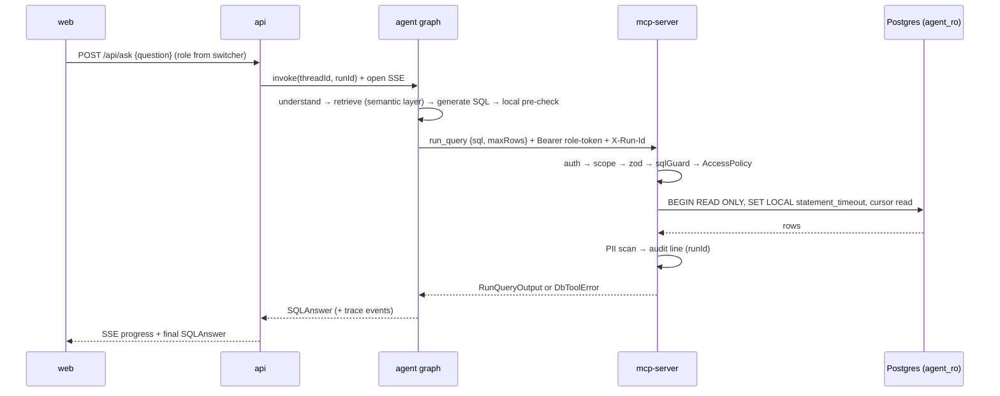
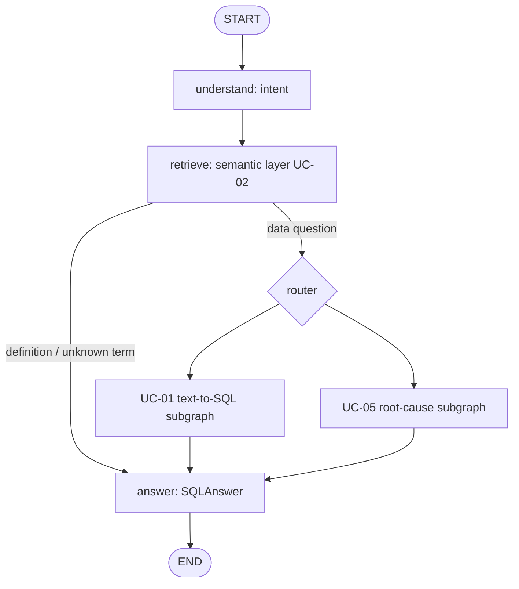

# Analytics Agent — Harness Architecture

How the system is put together, which part each UC owns, and where your code
goes. Read this before writing UC code.

> **Status legend:** ✅ built (on `feat/agent-harness-architecture`, PR #10) ·
> 🔜 planned — the phase number refers to `.planning/ROADMAP.md`.
> Full design notes and sources: `.planning/research/ARCHITECTURE.md`.

## 1. The idea: agent = model + harness

The LLM only proposes. The **harness** decides what is allowed, runs it, and
records it. Safety lives in code, never only in the prompt (PRD §1.5.2):

1. **One DB gateway.** The agent never opens a database connection. Every query
   goes through the MCP server `db-tools` (UC-09), which re-checks everything
   on its own, so even an external MCP client cannot bypass it.
2. **Three independent safety layers:** SQL guard (AST check) → read-only DB
   role → PII scan on results. Switching any one off still leaves the others.
3. **One shared contract package.** All packages speak the same zod schemas
   (`@se373/contracts`); UCs integrate through those shapes, not through each
   other's code.

## 2. Layers

```
 apps/web            React + Vite: chat, role switcher, approvals, audit/alerts pages
     │  HTTP + SSE (X-Run-Id)
 apps/api            Express: creates threadId/runId, maps role → MCP token, streams events
     │  in-process call
 packages/agent      LangGraph.js root graph + one subgraph per UC, MCP client
     │  MCP Streamable HTTP, Authorization: Bearer <role token>
 packages/mcp-server db-tools: auth → zod → sqlGuard → AccessPolicy → read-only
     │               executor → PII scan → audit
 PostgreSQL 16 + pgvector
                     business data · semantic_chunks · langgraph checkpoints · app_state
                     roles: owner / agent_ro (read-only) / indexer

 Cross-cutting: packages/contracts (zod) · packages/access-policy · policies/*.yaml
                semantic/*.yaml · skills/*/ · evals/ · traces/*.jsonl
```

| Component | Owns | Status |
|---|---|---|
| `packages/contracts` | All shared zod schemas (see §5). Imports only `zod`. | ✅ |
| `packages/sql-guard` | Pure guard library: `sqlGuard` + denylist over pgsql-parser AST. Imported by mcp-server (enforcement) and agent (local pre-flight). Never imports DB code. | ✅ guard core · matrix 🔜 Phase 3 |
| `packages/mcp-server` | The only DB gateway: 5 tools + 2 resources, scope auth, SQL guard, read-only executor, audit log | Shell ✅ · logic 🔜 Phase 3–4 |
| `packages/access-policy` | `AccessPolicy` interface + `ColumnScopePolicy` (mask/deny sensitive columns); UC-08 can plug in `RbacPolicy` later. Pure functions, no DB I/O. | Shell ✅ · logic 🔜 Phase 3 |
| `packages/agent` | LangGraph.js root graph, UC subgraphs/nodes, retriever, citation validator, MCP client. **Never imports DB code.** | Shell ✅ · graph 🔜 Phase 5 |
| `apps/api` | HTTP boundary: `runId`/`threadId`, role → bearer token, SSE streaming, resume endpoints | Shell ✅ · logic 🔜 Phase 7 |
| `apps/web` | UI only; talks to `apps/api`, imports types from contracts only | Shell ✅ · UI 🔜 Phase 7 + UCs |
| Postgres + roles + data loader | `docker/`, `pnpm db:up`, `pnpm data:load`, seeded scenarios | 🔜 Phase 2 |
| `packages/data` | Deterministic Olist loader + verifier (operator tooling, owner role; never imported by agent code) | ✅ scaffold + tracer slice |
| Traces + evals | JSONL traces with PII redaction, `pnpm eval --uc <id>`, EX grader, attack suite | 🔜 Phase 6 |

## 3. Who may import whom (enforced)

```
contracts      ← everyone (contracts imports nothing but zod)
sql-guard      → contracts (pure AST validator: pgsql-parser + @pgsql/traverse only, never pg)
access-policy  → contracts
mcp-server     → contracts, access-policy, sql-guard, pg, pg-cursor, pino, yaml
agent          → contracts, access-policy, sql-guard (local pre-flight only), LangGraph, MCP client
api            → agent, contracts            (talks to mcp-server over MCP, never imports it)
web            → contracts only
```

✅ **Enforced by ESLint** (`eslint.config.mjs`, `no-restricted-imports`) for
`packages/agent/**` and `apps/**`: importing `pg`, `pg-cursor`,
`@se373/mcp-server` or `**/mcp-server/src/**` fails `pnpm lint` and CI.

## 4. One question, end to end (target design)



*One `runId` links the web request, every agent trace event, and every MCP audit line.*

The server pipeline order is fixed: **auth → scope → zod → sqlGuard →
AccessPolicy → executor → PII scan → audit**. Errors always come back as one of
the 11 codes in §5, with no host/user/DSN/stack details.

## 5. Shared contracts (`@se373/contracts`) ✅

Import everything from `@se373/contracts`. Full JSON Schemas:
`docs/mcp_interface.md` (generated — run `pnpm docs:interface`, never edit by hand).

| File | Exports | Used by |
|---|---|---|
| `tools.ts` | `ListTables*`, `DescribeTable*`, `ExplainQuery*`, `RunQuery*`, `SampleRows*` (`…InputSchema` / `…OutputSchema` + types). `run_query`: `{sql, maxRows ≤ 1000, default 200}` → `{columns, rows, rowCount, truncated, maskedColumns, durationMs}`; `sample_rows`: `n ≤ 5` | mcp-server (implements), agent (calls) |
| `errors.ts` | `ErrorCodes` (11), `DbToolErrorSchema` `{code, message, retryable}`, `RETRYABLE_CODES`, `dbToolError()` | everyone; UC-01 repair loop reads `code`/`retryable` |
| `answers.ts` | `SQLAnswerSchema` (intent, sql, tablesUsed, citations, attempts ≤ 3, resultPreview ≤ 50, answerText, status `ok｜no_data｜cannot_answer｜error`, telemetry), `SqlAttemptSchema` | UC-01, UC-02, api, web |
| `trace.ts` | `TraceEventSchema` `{runId, threadId, userId, role, node, type, ts, durationMs, payload?}` | every package that logs |
| `semantic.ts` | `SemanticChunkMetadataSchema` (doc_type, table, metric_name, aliases, sensitivity) | UC-02 indexer/retriever |
| `benchmark.ts` | `BenchmarkRowSchema` `{id, question, difficulty, gold_sql, gold_result_path, tags}` | evals |
| `index.ts` | re-exports all of the above + `CONTRACTS_VERSION` (`0.1.0`) | — |

Error codes: `UNAUTHORIZED`, `SCOPE_DENIED`, `INVALID_PARAMS`, `INVALID_SQL`,
`FORBIDDEN_STATEMENT`, `FORBIDDEN_FUNCTION`, `UNKNOWN_TABLE`,
`SENSITIVE_COLUMN_DENIED`, `TIMEOUT` (retryable), `RATE_LIMITED` (reserved,
retryable), `INTERNAL_ERROR` (retryable). Truncation is **not** an error — it is
`truncated: true`.

**Changing contracts — additive-only** (`packages/contracts/README.md`):
new optional fields / new schemas need 1 code-owner review. Removing, renaming,
tightening a type or changing an enum/error code is breaking: bump
`CONTRACTS_VERSION` major **and** get approval from every affected UC owner.
Field names are camelCase.

## 6. Agent graph (🔜 Phase 5)

One compiled **root graph**, a shared base state, one **Postgres checkpointer**
(schema `langgraph`) at the root. Each UC plugs in as a node or subgraph:



*UC-10 alerts run as a separate scheduled graph (cron / `--manual`) built from the same node library.*

- **State:** shared keys (`runId`, `userId`, `role`, `question`, `intent`,
  `attempts`, `status`, `telemetry`, …). UC-private scratch (e.g. the UC-05
  plan) stays in subgraph-only keys. Renaming a shared key needs agreement from
  all UC owners.
- **IDs:** `threadId` = conversation scope (resume across restarts);
  `runId` = one per question, passed as `X-Run-Id` to MCP.
- **Human-in-the-loop:** `interrupt()` + resume with `Command({resume})`
  (UC-05 plan review; UC-07 approvals later).
- **LLM:** one chat-model factory (OpenAI-compatible endpoint from `.env`)
  plus a fake model so tests/CI need no API key.
- **Tool results are untrusted data:** wrapped/delimited in prompts, never
  followed as instructions (seeded injection rows exist in the dataset).

## 7. Database (✅ infra + tracer slice)

Local PostgreSQL 16 + pgvector (`pgvector/pgvector:0.8.7-pg16`), database
**`chosen`**, host port **5433** (avoids clashing with a local Postgres on
5432). A clean clone needs zero setup — every compose variable has a `:-`
default; copy `.env.example` to `.env` only for key-holding runs.

| File | Purpose |
|---|---|
| `docker/docker-compose.yml` | `db` service: pinned image, `pgdata` volume, read-only `./docker/initdb` mount, `pg_isready` healthcheck |
| `docker/initdb/01_roles.sh` | `owner` / `agent_ro` / `indexer` roles + `agent_ro` session defaults (`default_transaction_read_only=on`, `statement_timeout=30s`); env-driven with local-only dev defaults, executable |
| `docker/initdb/02_schemas.sql` | `business`, `semantic`, `langgraph`, `app_state` owned by `owner`; `public`/`TEMP` revokes; least-privilege grants + `ALTER DEFAULT PRIVILEGES` before any data table exists |
| `docker/initdb/03_business.sql` | 12-table FK-linked DDL (customers, orders, products, categories, sellers, `order_items`, payments, reviews, regions, channels, employees, promotions); data loaders never write schema |

| Schema | Contents |
|---|---|
| business | ≥ 8 localized Olist tables (customers, orders, order_items ≥ 1M rows, products, categories, sellers, payments, reviews, regions, channels, employees, promotions); fake PII (`customers.phone/email/address`, `employees.salary`) |
| `semantic` | `semantic_chunks` with pgvector embeddings (UC-02) |
| `langgraph` | checkpointer tables (created by `PostgresSaver.setup()`) |
| `app_state` | audit / alert history (UC-10) |

| Role | Can do |
|---|---|
| `owner` | DDL + data load only (`pnpm data:load`), never used by the app |
| `agent_ro` | `SELECT` on business data only; no TEMP/CREATE; `default_transaction_read_only=on`, `statement_timeout=30s`. Used **only** by mcp-server. |
| `indexer` | writes `semantic`, `langgraph`, `app_state`; never used by the chat path |

Commands: `pnpm db:up` (start, waits healthy) · `pnpm db:down` (stop) ·
`pnpm db:reset` (recreate from scratch — initdb reruns only on an empty
volume) · `pnpm data:load` (COPY-load regions slice so far) ·
`pnpm data:verify` (assert counts/FKs, exit non-zero on failure).
If your shell predates the `docker` group, wrap Docker-touching commands as
`sg docker -c "<command>"` (e.g. `sg docker -c "pnpm db:up"`); the repo
scripts themselves stay plain `docker compose` so they work after re-login.
After changing any role password you must run `pnpm db:reset` — a plain
restart keeps the old server-side passwords.

The **grants** are the real protection — `default_transaction_read_only` can be
switched off by any session, so a test must prove `agent_ro` still cannot write
after `SET default_transaction_read_only=off`. Seeded scenarios and gold SQL are
hidden from the agent (and from OpenWiki).

## 8. Where your UC code goes

| UC | Owner area | You add | You use |
|---|---|---|---|
| UC-01 text-to-SQL | `packages/agent/src/subgraphs/uc01*`, `skills/text-to-sql/`, `evals/uc01/` | generate → pre-check → execute → repair (≤ 3) subgraph, benchmark ≥ 30 questions | `run_query`, `describe_table`, `SQLAnswerSchema`, error codes |
| UC-02 semantic layer | `semantic/*.yaml`, `packages/agent/src/semantic/*`, retrieve node, `evals/uc02/` | corpus, indexer, hybrid retriever, citation validator | `SemanticChunkMetadataSchema`, `SQLAnswer.citations` |
| UC-05 root cause | `packages/agent/src/subgraphs/uc05*`, `skills/root-cause-analysis/` | plan → `interrupt` review → branch → attribution | `run_query`, checkpointer, interrupt/resume |
| UC-09 db-tools (HungPham-VNU) | `packages/mcp-server`, `packages/sql-guard`, `packages/access-policy`, `policies/` | tools, scopes, guard, masking, audit | all of `tools.ts` + `errors.ts` |
| UC-10 alerts | separate scheduled graph in `packages/agent`, `skills/anomaly-alert/`, `evals/uc10/` | subscriptions, detection (code), drill-down, deduped `send_alert` | `run_query`, trace envelope |

**Extension rules**

- Add **your own files**; don't edit another UC's nodes or the shared root
  builder beyond registering your node/subgraph.
- New DB-touching capability = a new **MCP tool** in `packages/mcp-server`
  (contract entry + scope + eval), never a direct DB call from the agent.
- New access rule = an `AccessPolicy` implementation; the server pipeline order
  does not change.
- Each UC: ≥ 5 eval cases under `evals/<uc>/`, a `skills/<name>/SKILL.md`
  (PRD §4.2 contract, no executable scripts or credentials), and trace events
  in the `TraceEventSchema` shape.

## 9. Working in the repo today ✅

```sh
nvm use 24                        # Node ≥ 24
corepack enable                   # pnpm 11.25.0 (pinned)
pnpm install --frozen-lockfile
pnpm typecheck && pnpm lint && pnpm test      # root
pnpm --filter @se373/<pkg> test               # one package
pnpm docs:interface                           # regenerate docs/mcp_interface.md
```

- CI (`.github/workflows/ci.yml`) runs typecheck, lint, test and a gitleaks
  secret scan on every PR; `main` needs a green run and a code-owner review.
- `.github/CODEOWNERS` has `TODO(UC-xx owner)` lines — **replace them with your
  GitHub handle** in your first PR.
- Branch per UC/feature; never push directly to `main`.

## 10. Build order and open decisions

Phases (`.planning/ROADMAP.md`): **1** monorepo + contracts ✅ → **2** Postgres +
seeded data · **3** SQL guard + read-only executor · **6** trace/eval
scaffolding (2, 3, 6 can run in parallel) → **4** MCP server + scopes →
**5** agent skeleton → **7** end-to-end wiring, shells, onboarding.

Open team decisions:

- **K7 coverage gap:** the current UC set (01, 02, 05, 09, 10) covers no K7 —
  someone must take UC-06 (Reviewer) or UC-03 (charts/insights), otherwise −0.5.
- **UC-05 plan** is still written for Python/Pydantic — port to TypeScript/zod.
- **Node version:** the repo enforces Node ≥ 24; UC-09/UC-10 docs still say 22.
