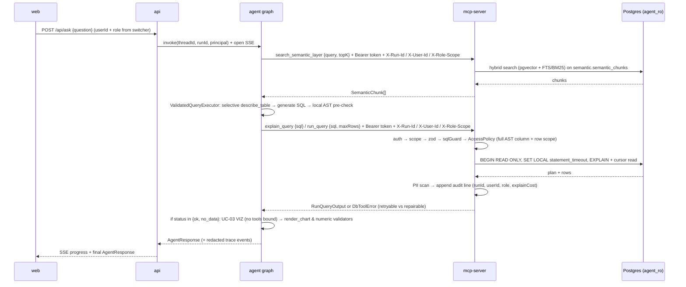
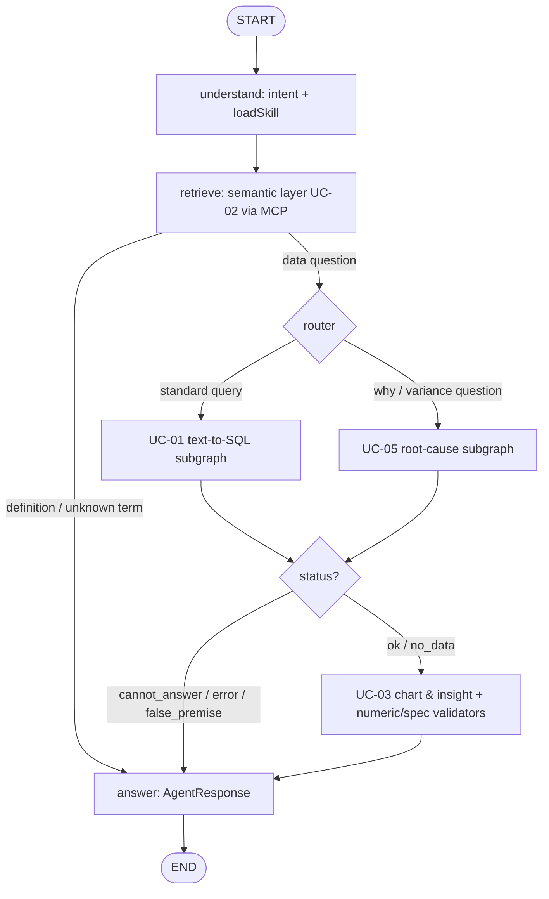

# Analytics Agent — Harness Architecture

How the system is put together, which part each UC owns, and where your code
goes. Read this before writing UC code.

> **Status legend:** ✅ built (on `feat/agent-harness-architecture`, PR #10) ·
> 🔜 planned (see `docs/UC-plan/` and `openwiki/` for detailed per-UC specs).

## 1. The idea: agent = model + harness

The LLM only proposes. The **harness** decides what is allowed, runs it, and
records it. Safety lives in code, never only in the prompt (PRD §1.5.2):

1. **One DB gateway for agent queries.** `packages/agent` never opens a database
   connection or imports a DB driver. Every business-data and semantic-layer
   query from the agent goes through the MCP server `db-tools` (UC-09), which
   re-checks everything on its own, so even an external MCP client cannot bypass
   it.
2. **Three independent safety layers:** SQL guard (AST check across all clauses)
   → read-only DB role (`agent_ro`) → PII scan on both query results and trace
   logs. Switching any one off still leaves the others.
3. **Deterministic verification before answering (K7).** Every numeric claim and
   chart specification produced by the LLM (UC-03) is checked by deterministic
   code validators against the actual query result rows before reaching the user.
4. **One shared contract package.** All packages speak the same camelCase zod
   schemas (`@se373/contracts`); UCs integrate through those shapes, not through
   each other's code.

## 2. Layers

```
 apps/web            React + Vite: chat, chart viewer, role switcher, approvals, alerts pages
     │  HTTP + SSE (X-Run-Id)
 apps/api            Express: creates threadId/runId, injects PostgresSaver + AppStateStore
     │               (harness_state role), maps user/role → MCP principal headers, streams SSE
     │  in-process call (pure state + injected ports)
 packages/agent      LangGraph.js root graph + shared ValidatedQueryExecutor + UC subgraphs,
     │               deterministic validators (citation, chart, numeric), MCP client
     │  MCP Streamable HTTP: Bearer <role token> + X-Run-Id + X-User-Id + X-Role-Scope
 packages/mcp-server db-tools: auth → scope → zod → sqlGuard → AccessPolicy (column + row scope)
     │               → read-only executor (agent_ro) → PII scan → JSONL audit (logs/mcp_audit.jsonl)
 PostgreSQL 16 + pgvector
                     public (business data) · semantic (semantic_chunks) ·
                     langgraph (checkpoints) · app_state (alert dedup / delivery history)
                     roles: owner / agent_ro / indexer / harness_state

 Cross-cutting: packages/contracts (zod) · packages/access-policy · policies/*.yaml
                semantic/*.yaml · skills/*/ · evals/ · traces/*.jsonl · logs/mcp_audit.jsonl
```

| Component | Owns | Status |
|---|---|---|
| `packages/contracts` | All shared camelCase zod schemas (see §5). Imports only `zod`. | Base ✅ · UC-03/05/10 schemas 🔜 |
| `packages/mcp-server` | The only agent DB gateway (`agent_ro` role): 5 DB tools + `search_semantic_layer` (hybrid `pgvector` + FTS/BM25 retriever) + 2 semantic resources, scope auth, SQL guard, `AccessPolicy` enforcement, read-only executor, append-only audit (`logs/mcp_audit.jsonl`) | Shell ✅ · logic 🔜 Phase 3–4 |
| `packages/access-policy` | `AccessPolicy` interface + `ColumnScopePolicy` (full-AST sensitive column deny/mask) + role row-scope filter (e.g. `region`) + shared PII redactor; UC-08 can extend with full `RbacPolicy`. Pure functions, no DB I/O. | Shell ✅ · logic 🔜 Phase 3 |
| `packages/agent` | LangGraph.js root graph, shared `ValidatedQueryExecutor`, UC subgraphs/nodes (UC-01, 02, 03, 05, 10), citation/chart/numeric validators, skill loader, MCP client. **Never imports DB code.** | Shell ✅ · graph 🔜 Phase 5 |
| `apps/api` | HTTP & cron host boundary: `runId`/`threadId`, injects `PostgresSaver` and `AppStateStore` (`harness_state` role), maps user/role → MCP principal context, SSE streaming, resume endpoints | Shell ✅ · logic 🔜 Phase 7 |
| `apps/web` | UI only; talks to `apps/api`, imports types from `@se373/contracts` only | Shell ✅ · UI 🔜 Phase 7 + UCs |
| Postgres + roles + data/semantic loaders | `docker/`, `pnpm db:up`, `pnpm data:load` (`owner` role), `pnpm semantic:index` (`indexer` role), seeded scenarios | 🔜 Phase 2 |
| Traces + evals | JSONL traces with PII redaction, `pnpm eval --all`, `pnpm eval --uc <id>`, EX grader, safety attack suite (`evals/safety/`) | 🔜 Phase 6 |

## 3. Who may import whom (enforced)

```
contracts      ← everyone (contracts imports nothing but zod)
access-policy  → contracts (pure AST & regex functions; zero DB or network I/O)
mcp-server     → contracts, access-policy, pg, pg-cursor, pgsql-parser, pino, yaml
agent          → contracts, access-policy (local pre-check & redaction), LangGraph, MCP client
api            → agent, contracts, access-policy (trace redaction), PostgresSaver & AppStateStore (harness_state only)
web            → contracts only
```

✅ **Enforced by ESLint** (`eslint.config.mjs`, `no-restricted-imports`):
- `packages/agent/**/*.{ts,tsx}` and `apps/**/*.{ts,tsx}` may never import
  `@se373/mcp-server` or `**/mcp-server/src/**`.
- `packages/agent/**/*.{ts,tsx}`, `packages/access-policy/**/*.{ts,tsx}`, and
  `apps/web/**/*.{ts,tsx}` may never import `pg` or `pg-cursor`.
- `apps/web/**/*.{ts,tsx}` may only import workspace types from
  `@se373/contracts` (never `@se373/agent` or `@se373/access-policy`).

## 4. One question, end to end (target design)



*One `runId` and propagated principal context (`userId`, `role`, `scopes`, `rowScope`) link the web request, every agent trace span, and every MCP audit line.*

The server pipeline order is fixed: **auth → scope → zod → sqlGuard →
AccessPolicy → executor → PII scan → audit**.
- **Propagated Principal Context:** `apps/api` (for interactive requests) and
  the scheduled runner (for UC-10 recipient-scoped alerts) pass `Bearer <role token>`
  plus `X-Run-Id`, `X-User-Id`, and `X-Role-Scope` (e.g., regional constraint
  `region = 'Nam'`) so `mcp-server` enforces policy and logs audit trails
  statelessly without losing caller identity.
- `AccessPolicy` (`ColumnScopePolicy` + role row-scope filter) walks the
  **entire parsed SQL AST** (`SELECT`, `WHERE`, `GROUP BY`, `HAVING`,
  `ORDER BY`, `JOIN ON`, subqueries, CTEs) so indirect probing (e.g.,
  `WHERE phone LIKE '090%'` or `AVG(salary)`) is rejected with
  `SENSITIVE_COLUMN_DENIED` when the caller lacks `data:sensitive`, and
  role-scoped queries automatically enforce regional boundaries.
- PII redaction runs both on `RunQueryOutput` in `mcp-server` and on every
  `TraceEvent` payload (including user prompts and SQL literals) before writing
  `traces/*.jsonl` and `logs/mcp_audit.jsonl` (PRD §4.4).
- Errors always come back as one of the frozen codes in §5, with no
  host/user/DSN/stack details.

## 5. Shared contracts (`@se373/contracts`)

Import everything from `@se373/contracts`. Full JSON Schemas:
`docs/mcp_interface.md` (generated — run `pnpm docs:interface`, never edit by hand).

| File | Exports | Used by |
|---|---|---|
| `tools.ts` | `ListTables*`, `DescribeTable*`, `ExplainQuery*`, `RunQuery*`, `SampleRows*`, `SearchSemanticLayer*`, `RenderChart*`, `SendAlert*` (`…InputSchema` / `…OutputSchema` + types). `run_query`: `{sql, maxRows ≤ 1000, default 200}` → `{columns, rows, rowCount, truncated, maskedColumns, explainSummary?, durationMs}`; `sample_rows`: `n ≤ 5` | mcp-server (implements DB/semantic tools), agent (calls + local `render_chart` & `send_alert`) |
| `errors.ts` | `ErrorCodes` (12), `DbToolErrorSchema` `{code, message, retryable, repairable}`, `RETRYABLE_CODES`, `REPAIRABLE_CODES`, `dbToolError()` | everyone; MCP client checks `retryable`, `ValidatedQueryExecutor` checks `repairable` |
| `answers.ts` | `SQLAnswerSchema`, `SqlAttemptSchema`, `InsightReportSchema` (UC-03), `AnalysisPlanSchema` & `RootCauseAnswerSchema` (UC-05), `AnomalyAlertSchema` (UC-10), `AgentResponseSchema` (discriminated union by `kind`) | UC-01, UC-02, UC-03, UC-05, UC-10, api, web |
| `trace.ts` | `TraceEventSchema` `{runId, threadId, spanId?, parentSpanId?, attempt?, userId, role, node, type, ts, durationMs, payload?}` | every package that logs |
| `semantic.ts` | `SemanticChunkMetadataSchema` (`chunkId`, `docType`, `table`, `tables`, `metricName`, `aliases`, `sensitivity`, `additive`, `updatedAt`) | UC-02 indexer/retriever, mcp-server |
| `benchmark.ts` | `BenchmarkRowSchema` `{id, question, difficulty, goldSql, goldResultPath, ordered?, tags}` | evals |
| `index.ts` | re-exports all of the above + `CONTRACTS_VERSION` (`0.1.0`) | — |

### Error codes: `retryable` (transport) vs `repairable` (LLM SQL self-repair)

- **Transport-retryable (`retryable: true`)** — safe for the MCP client to retry
  with backoff without changing the SQL:
  `TIMEOUT`, `RATE_LIMITED` (reserved), `INTERNAL_ERROR`.
- **SQL-repairable (`repairable: true`)** — safe for the `ValidatedQueryExecutor`
  repair loop (≤ 3 attempts) to inspect the diagnostic and regenerate SQL:
  `INVALID_SQL` (syntax error), `UNKNOWN_TABLE` (missing table/column in
  schema), `SQL_EXECUTION_ERROR` (Postgres runtime query error such as bad column
  reference, type mismatch, or invalid date literal, sanitized of DSN details).
- **Hard policy/security errors (`retryable: false`, `repairable: false`)** —
  the agent must **abort immediately** and never attempt to rewrite around them:
  `UNAUTHORIZED`, `SCOPE_DENIED`, `INVALID_PARAMS`, `FORBIDDEN_STATEMENT`,
  `FORBIDDEN_FUNCTION`, `SENSITIVE_COLUMN_DENIED`.
- Result truncation is **not** an error — it sets `truncated: true`.

### Naming & evolution rules (`packages/contracts/README.md`)

- **All field names use `camelCase`** across every schema in `@se373/contracts`
  (including `SemanticChunkMetadataSchema` and `BenchmarkRowSchema`; JSONL
  loader scripts map external snake_case fixture files at the boundary if
  needed).
- **Additive-only changes:** new optional fields or new schemas need 1
  code-owner review. Removing, renaming, tightening a type, or changing an
  enum/error code is breaking: bump `CONTRACTS_VERSION` major **and** get
  approval from every affected UC owner.

## 6. Agent graph (🔜 Phase 5)

One compiled **root graph**, a shared base state, and injected persistence ports
(`PostgresSaver` on schema `langgraph` and `AppStateStore` on schema `app_state`,
both injected by `apps/api` using the `harness_state` role) at the root. Each UC
plugs in as a node or subgraph, sharing a single **`ValidatedQueryExecutor`**
primitive and routing through **UC-03** for K7 verification only when data
queries succeed or return an empty result set:



*UC-10 alerts run as a separate scheduled graph (cron / `--manual`) that reuses `ValidatedQueryExecutor`, injected `AppStateStore` (`app_state.alert_history`), and the `send_alert` tool.*

- **Shared `ValidatedQueryExecutor` primitive:** UC-01 (single query), UC-05
  (baseline check + up to 20 drill-down queries across ≤ 4 levels), and UC-10
  (anomaly drill-down) all invoke the same inner execution primitive:
  `selective describe_table → generate SQL → local AST pre-check → MCP run_query → bounded repair (≤ 3)`.
  This guarantees uniform safety checks, error handling, citation headers, and
  span telemetry across every SQL query in the system.
- **State & checkpoint payload offloading:**
  - Shared keys (`runId`, `userId`, `role`, `question`, `intent`,
    `semanticChunks`, `status`, `insightReport`, `budget`, `telemetry`, …).
    UC-private scratch (e.g., UC-01 `attempts` ≤ 3, UC-05 `analysisPlan`) stays
    in subgraph-only keys and maps into `AgentResponse` at `ANS`. Renaming a
    shared key needs agreement from all UC owners.
  - **Reference-by-summary in checkpoints:** `run_query` can return up to
    `maxRows = 1000` rows. To prevent bloating `PostgresSaver` checkpoints and
    LLM context windows (especially across 20 queries in UC-05), persisted graph
    state stores only bounded `resultPreview` (≤ 50 rows), column metadata, and
    summary aggregates; full 1,000-row buffers live only in transient memory for
    deterministic validators.
- **Run-level budget circuit breaker:** In addition to local loop bounds (≤ 3
  SQL repairs, ≤ 20 RCA queries, ≤ 2 chart repairs), shared state tracks a
  global run budget (`maxLlmCalls`, `maxTokens`, `runDeadlineMs`) checked before
  every model or MCP call so deep multi-step runs degrade gracefully with
  partial findings rather than timing out.
- **K7 verification in UC-03 (`VIZ`):**
  - Invoked only when `status` is `ok` or `no_data` (for `no_data`, sets
    `chartSpec.type = "none"` and emits data-completeness `caveats`).
  - Selects chart type (`line`, `bar`, `pie`, `scatter`, `table`, `none`) and
    generates 2–4 insights with explicit `evidence: [{column, rowKey, value}]`
    and `caveats`, plus dedicated `VIZ` node latency and token telemetry.
  - Runs deterministic validators in code before returning:
    1. **Chart spec validator (`render_chart`):** compiles the Vega-Lite/Plotly
       JSON spec headlessly (no arbitrary code execution) and verifies every
       referenced axis/field exists in `RunQueryOutput.columns` (auto-repairs up
       to 2 times on failure).
    2. **Numeric & causal claim validator:** extracts numbers and percentage
       deltas from each insight `claim`, verifies every number matches its
       `evidence` entry and the query result rows within ≤ 1% rounding
       tolerance, rejects ungrounded causal claims, and strips and logs any
       unverified claim to the trace.
- **Skills (`skills/<name>/SKILL.md`):** loaded at node entry via a shared
  `loadSkill()` helper that emits a `TraceEvent` (`type: "skill_call"`, PRD
  §4.4). CI verifies that `skills/` contains only declarative Markdown/YAML
  contracts (no executable scripts or credentials, PRD §4.2).
- **IDs & hierarchical spans:** `threadId` = conversation scope (resume across
  restarts); `runId` = one per question, passed as `X-Run-Id` to MCP;
  `spanId` / `parentSpanId` / `attempt` correlate nested loop steps with child
  MCP tool calls.
- **Human-in-the-loop:** `interrupt()` + resume with `Command({resume})`
  (UC-05 plan review; UC-07 approvals if added later).
- **LLM:** one chat-model factory (OpenAI-compatible endpoint from `.env`)
  plus a deterministic fake model so tests/CI need no API key.
- **Prompt-injection defense on untrusted data (PRD §2.1 & §4.3 Case #3):**
  - Query results are delimited as untrusted data in prompts.
  - Answer synthesis (UC-01/UC-05) and insight generation (UC-03) invoke the LLM
    with **no tools bound** (structured output only), so a seeded injection
    string inside a product name or review cannot trigger a follow-up query.

## 7. Database (🔜 Phase 2)

| Schema | Contents |
|---|---|
| `public` (business) | ≥ 8 localized Olist tables (`customers`, `orders`, `order_items` ≥ 1M rows, `products`, `categories`, `sellers`, `payments`, `reviews`, `regions`, `channels`, `employees`, `promotions`); fake `vi_VN` PII (`customers.phone/email/address`, `employees.salary`); seeded scenarios, anomalies, and prompt-injection rows |
| `semantic` | `semantic_chunks` with pgvector embeddings + full-text search index (UC-02) |
| `langgraph` | checkpointer tables (created by `PostgresSaver.setup()`) |
| `app_state` | UC-10 alert deduplication and delivery history (`app_state.alert_history`); MCP audit logs are written append-only to `logs/mcp_audit.jsonl` by `mcp-server` |

| Role | Can do |
|---|---|
| `owner` | DDL + data load only (`pnpm data:load`), never used by the app |
| `agent_ro` | `SELECT` on `public` (business data) and `semantic.semantic_chunks` only; no TEMP/CREATE; `default_transaction_read_only=on`, `statement_timeout=30s`. Used **only** by `mcp-server`. |
| `indexer` | writes `semantic.semantic_chunks` during CLI indexing (`pnpm semantic:index`); never used by the chat path |
| `harness_state` | reads/writes `langgraph` (checkpointer) and `app_state` (alert deduplication / history) only; **zero** grants on `public` business tables. Used only by `apps/api` / injected harness state adapters. |

The **grants** are the real protection — `default_transaction_read_only` can be
switched off by any session, so an automated test must prove `agent_ro` still
cannot write or DDL after `SET default_transaction_read_only=off`. Seeded
scenarios (`data/seeded_scenarios.md`) and gold SQL (`evals/questions/`) are
hidden from the agent and excluded from OpenWiki indexing.

## 8. Where your UC code goes (K1–K8 complete coverage)

The 6 selected UCs cover **all 8 knowledge areas (K1–K8)** with a 1.5-point
rubric buffer (6 × 1.5 = 9.0 raw / 7.5 max):

| UC | K Areas | Owner area | You add | You use |
|---|---|---|---|---|
| **UC-01** text-to-SQL | K1, K2 | `packages/agent/src/subgraphs/uc01*`, `packages/agent/src/queryExecutor*`, `skills/text-to-sql/`, `evals/uc01/` | shared `ValidatedQueryExecutor` (generate → pre-check → execute → repair ≤ 3), UC-01 subgraph, benchmark ≥ 30 questions | `run_query`, `describe_table`, `explain_query`, `SQLAnswerSchema`, `REPAIRABLE_CODES` |
| **UC-02** semantic layer | K3 | `semantic/*.yaml`, `packages/mcp-server/src/semantic/*`, `packages/agent/src/semantic/*`, `evals/uc02/` | YAML corpus, CLI indexer (`indexer` role), hybrid retriever inside `mcp-server`, retrieve node & citation validator in `agent` | `search_semantic_layer`, `SemanticChunkMetadataSchema`, `SQLAnswer.citations` |
| **UC-03** charts & verified insights | K1, K7 | `packages/agent/src/subgraphs/uc03*`, `packages/agent/src/validators/*`, `evals/uc03/` | chart selector, insight generator, numeric & causal claim validator (≤ 1%), `render_chart` spec validator (≤ 2 repairs), ≥ 15 chart-label fixtures | `InsightReportSchema`, `RenderChart*`, `RunQueryOutput`, `TraceEventSchema` |
| **UC-05** root cause | K4, K5 | `packages/agent/src/subgraphs/uc05*`, `skills/root-cause-analysis/`, `evals/uc05/` | confirm phenomenon → plan → `interrupt` review → branch (≤ 4 depth, ≤ 20 queries via `ValidatedQueryExecutor`) → additive/formula attribution | `ValidatedQueryExecutor`, checkpointer, `AnalysisPlanSchema`, `RootCauseAnswerSchema` |
| **UC-09** db-tools (HungPham-VNU) | K6, K8 | `packages/mcp-server`, `packages/access-policy`, `policies/`, `evals/uc09/`, `evals/safety/` | MCP tools, semantic resources, scopes + principal context, full-AST guard, column/row policy, PII scan, JSONL audit | all of `tools.ts` + `errors.ts` |
| **UC-10** anomaly alerts | K2, K5 | scheduled graph in `packages/agent`, `skills/anomaly-alert/`, `evals/uc10/` | subscriptions, statistical detection (z-score / WoW in code), drill-down via `ValidatedQueryExecutor`, 24h-deduped `send_alert` via injected `AppStateStore` | `ValidatedQueryExecutor`, `send_alert`, `AnomalyAlertSchema`, `AppStateStore`, trace envelope |

**Extension rules**

- Add **your own files**; don't edit another UC's nodes or the shared root
  builder beyond registering your node/subgraph.
- New DB-touching capability = a new **MCP tool** in `packages/mcp-server`
  (contract entry + scope + eval), never a direct DB call from the agent.
- New access rule = an `AccessPolicy` implementation; the server pipeline order
  does not change.
- Each UC: ≥ 5 eval cases under `evals/<uc>/` (≥ 30 benchmark questions for
  UC-01 + ≥ 5 shared safety attack cases in `evals/safety/`), a
  `skills/<name>/SKILL.md` (PRD §4.2 contract, no executable scripts or
  credentials), and trace events in the `TraceEventSchema` shape.

## 9. Working in the repo today ✅

```sh
nvm use 24                        # Node ≥ 24
corepack enable                   # pnpm 11.25.0 (pinned)
pnpm install --frozen-lockfile
pnpm typecheck && pnpm lint && pnpm test      # root
pnpm --filter @se373/<pkg> test               # one package
pnpm docs:interface                           # regenerate docs/mcp_interface.md
```

- CI (`.github/workflows/ci.yml`) runs typecheck, lint, test and a gitleaks
  secret scan on every PR; `main` needs a green run and a code-owner review.
- `.github/CODEOWNERS` has `TODO(UC-xx owner)` lines — **replace them with your
  GitHub handle** in your first PR.
- Branch per UC/feature; never push directly to `main`.

## 10. Build order and follow-up tasks

Build phases:
**1** monorepo + base contracts ✅ →
**2** Postgres roles (`owner`, `agent_ro`, `indexer`, `harness_state`) + seeded data ·
**3** Full-AST SQL guard + `ColumnScopePolicy` + read-only executor ·
**6** PII-redacting trace writer + `pnpm eval --all` & regression runner (2, 3, 6 can run in parallel) →
**4** MCP server (`db-tools` + `search_semantic_layer` + resources + scopes) →
**5** Agent root graph + UC-01, UC-02, UC-03, UC-05, UC-10 subgraphs & validators →
**7** End-to-end API/SSE wiring, web UI (chat, charts, role switcher, plan approval, alerts), and regression eval report.

Immediate alignment tasks across UC plans (`docs/UC-plan/`):

- **Contracts expansion (`@se373/contracts`):** add `InsightReportSchema`
  (UC-03), `AnalysisPlanSchema` / `RootCauseAnswerSchema` (UC-05),
  `AnomalyAlertSchema` / `SendAlert*` (UC-10), `SearchSemanticLayer*` (UC-02),
  and `REPAIRABLE_CODES` / `SQL_EXECUTION_ERROR` (`errors.ts`), and normalize
  `semantic.ts` / `benchmark.ts` fields to `camelCase`.
- **UC-05 plan (`docs/UC-plan/UC05.md`):** port examples from Python/Pydantic to
  TypeScript/zod.
- **Node version in UC plans:** align `docs/UC-plan/UC09.md` and
  `docs/UC-plan/UC10.md` with the repo requirement (`Node ≥ 24`).
