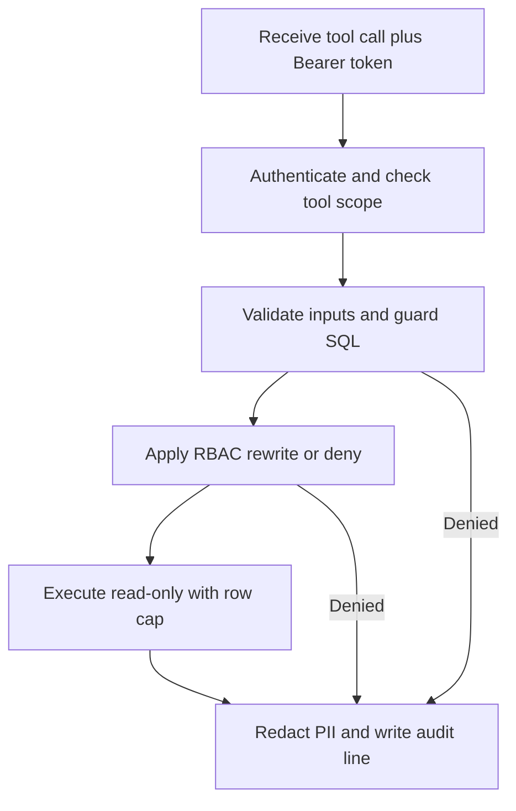

# Read-only guards, RBAC and PII masking

This page owns the cross-cutting safety rules every query path must satisfy: read-only connections, SQL validation, role-based access with masking, and PII redaction. Enforcement lives in the shared `access-policy` package, the agent `ValidatedQueryExecutor` pre-checks described in [Workflow Architecture](./workflow-architecture.md), the gateway pipeline described in [MCP Server](../integrations/mcp-server.md), and the generation path in [Text to SQL](../use-cases/text-to-sql.md).

> Core invariant: prompting alone is never a safety layer. Every guarantee below is enforced in code — in the validator, in the agent gate, in the policy rewrite, at the connection, or in the redaction choke-point — so disabling or tricking the prompt does not lift the restriction.

## 1. Defense-in-depth layers

Safety is four independent checks that must all agree before data returns:

1. **Validator layer (before any MCP call).** The shared `sqlGuard` parses the candidate with `pgsql-parser` (real PostgreSQL grammar compiled to WASM, warmed once at startup), allows exactly one `SelectStmt`, rejects DDL/DML and dangerous functions, denies system schemas, and checks tables and columns against the catalog whitelist.
2. **Agent gate layer (still before any MCP call).** `localQuerySafetyGate` runs after `sqlGuard` and owns the agent-side extras: sensitive-column denial in any clause, unconditioned-join denial, large-table clarification, and a detail-query `LIMIT` clamp. The server remains authoritative.
3. **Policy layer (on the server, before execution).** Bearer authentication resolves a server-built principal, a scope gate checks the tool's required scope, zod validates inputs, then `ColumnScopePolicy` rewrites or denies the SQL (masking, row predicates, fail-closed resolution).
4. **Connection and output layers (during and after execution).** The only database identity runs `BEGIN READ ONLY` with a 30-second timeout and bounded cursor reads; every result row, semantic chunk, resource read, audit line, and error message passes a shared PII/error redaction choke-point.

Turning off any one layer still leaves the others blocking: a validator bypass still faces the policy rewrite and the database's own read-only rejection.

## 2. Read-only connections

The agent never opens its own database handle. All access goes through the `db-tools` MCP server over an authenticated client, and the agent, policy, and app packages are forbidden by lint from importing `pg`, `pg-cursor`, or `mcp-server` internals — only the gateway and its operator loader plus the `apps/api` state-store DAO may touch the driver.

Each execution borrows a pooled `agent_ro` client and follows a fixed contract:

- `BEGIN READ ONLY`, then `SET LOCAL statement_timeout = '30s'`.
- Bounded read through `pg-cursor`: `read(maxRows + 1)` detects overflow; over-limit results return `truncated = true` instead of streaming unbounded rows. `maxRows` must be an integer in `1..1000`.
- `ROLLBACK` plus client `release()` in `finally`, so teardown failures never mask the original error and connections never leak.
- Zero-row results still recover column names with a cheap `SELECT * FROM (...) AS _cols LIMIT 0` probe in the same read-only transaction.

Timeouts surface as a distinct `TIMEOUT` code mapped from PostgreSQL cancel code `57014`; write attempts that slipped the guard map to `FORBIDDEN_STATEMENT` via `25006` (read-only transaction) or `42501` (insufficient privilege). Runtime data errors (class `22`, residual class `42`) map to repairable `SQL_EXECUTION_ERROR`; connection and resource classes stay retryable `INTERNAL_ERROR`; unknown codes fail safe to `INTERNAL_ERROR`.

## 3. SQL validator (`sqlGuard`)

Every candidate statement passes `sqlGuard` locally in the agent and independently again on the server, reusing the parsed AST downstream so the pipeline never parses twice.

Allowed shape:

- Exactly **one** statement in the parse result; empty input is `INVALID_SQL`.
- Root node is `SelectStmt`, which covers plain `SELECT`, `WITH`, and set operations such as `UNION`.
- Referenced tables and columns exist in the schema catalog (exact match first, lowercase fallback for PG folding); unknown names are `UNKNOWN_TABLE`. CTE names, FROM-subquery outputs, table aliases, and `ORDER BY`/`GROUP BY` alias resolution are handled explicitly; unknown qualifiers and unresolvable references deny fail-closed.

Denylist (absolute bans):

- All DDL/DML statement tags: `InsertStmt`, `UpdateStmt`, `DeleteStmt`, `MergeStmt`, `CopyStmt`, `TruncateStmt`, plus transaction/session tags (`TransactionStmt`, `VariableSetStmt`, `VariableShowStmt`, `DiscardStmt`), DDL tags (`CreateStmt`, `DropStmt`, `AlterStmt`, `AlterTableStmt`, `RenameStmt`, `GrantStmt`, `CommentStmt`), and execution/introspection tags (`ExplainStmt`, `PrepareStmt`, `ExecuteStmt`, `CallStmt`, `DoStmt`, `ListenStmt`, `NotifyStmt`, `LockStmt`, `VacuumStmt`, `CheckPointStmt`, `ReindexStmt`, `ClusterStmt`). DML nested inside CTEs such as `WITH x AS (DELETE ... RETURNING *) SELECT ...` is caught because the tags are denied anywhere in the walked tree.
- `SELECT INTO` (via `intoClause`) and `FOR UPDATE`-style locking clauses.
- Dangerous functions matched on the lowercased last segment of `FuncCall.funcname`, so schema-qualified and any-case spellings are caught: `pg_sleep`, `pg_read_file`, `pg_ls_dir`, `pg_logdir_ls`, `dblink`, `dblink_exec`, `lo_import`, `lo_export`, `lo_unlink`, `set_config`, `pg_terminate_backend`, `pg_cancel_backend`, `pg_reload_conf`, `pg_execute_server_program`, `nextval`, `setval`, `currval`. Everything not listed passes — the function check is deny-by-exception.
- System schemas `pg_catalog`, `information_schema`, `pg_toast` are denied explicitly even if a future catalog listed them.
- Multi-statement payloads such as `SELECT 1; DROP TABLE orders` fail the single-statement rule.

Error behavior is part of the guard: parse failures return `INVALID_SQL` with a cursor position for self-repair; policy denials use the frozen 12-code contract (`SCOPE_DENIED`, `FORBIDDEN_STATEMENT`, `FORBIDDEN_FUNCTION`, `SENSITIVE_COLUMN_DENIED`, `UNKNOWN_TABLE`, `TIMEOUT`, and others). Only these sanitized codes reach the repair prompt — never raw driver errors, connection strings, or secrets.

## 4. Agent-side safety gate

`localQuerySafetyGate` is a pure, DB-free pre-check that runs after `sqlGuard` and before any MCP call. Its verdicts are `pass` (with possibly clamped SQL), `deny`, or `needs_clarification`.

- **Sensitive columns:** denies with `SENSITIVE_COLUMN_DENIED` when any catalog-marked sensitive column of a scanned table appears in `guard.columns`, which already collects named refs from every clause (projection, `WHERE`, `JOIN ON`, `GROUP BY`, `HAVING`, `ORDER BY`, function and aggregate args). This is intentionally stricter than the server: the agent gate blocks even projection reads that the server would mask.
- **Joins:** denies any `JoinExpr` with no `ON`/`USING` condition (both `CROSS JOIN` and condition-less inner joins parse this way) and any comma-separated `FROM` list, which is an implicit cross join. `NATURAL JOIN` is left to the server-side guard.
- **Large tables:** when a scanned table has any `large`-flagged column (currently `order_items`), and the query has neither a `WHERE` filter nor an aggregate (`FuncCall`, `GROUP BY`, `HAVING`), the gate returns `needs_clarification` asking for a filter, an aggregate, or a smaller table.
- **Detail-query clamp:** non-aggregate queries pass with `clampLimit(sql, 200)` — an existing `LIMIT` at or under the cap is untouched, a larger or `ALL` limit is tightened, an offset-only query gains a `LIMIT 200`, otherwise `LIMIT 200` is appended. Non-numeric limits are left for the server rather than producing invalid SQL.
- **Timeout simplification:** a `TIMEOUT` gets exactly one forced retry that drops the `ORDER BY` tail and tightens the limit to 50, then re-passes guard plus gate before any MCP call.

Only `REPAIRABLE_CODES` (`INVALID_SQL`, `UNKNOWN_TABLE`, `SQL_EXECUTION_ERROR`) retry with repair feedback; hard security codes (`SCOPE_DENIED`, `SENSITIVE_COLUMN_DENIED`, `FORBIDDEN_STATEMENT`, `FORBIDDEN_FUNCTION`, `UNAUTHORIZED`) map to a `restricted` terminal status and never enter the repair loop.

## 5. Validate-policy-execute decision path

The required server order is authenticate, then scope, then zod, then `sqlGuard`, then `AccessPolicy` (reusing the guard AST with no double parse), then the read-only executor, then PII scan plus exactly one audit line. Non-SQL tools skip the middle stages vacuously; the audit stage always runs, including on denials.

*Caption: Server pipeline order from authentication through guard and policy to redacted audit.*

Concretely:

- Unknown tools are `INVALID_PARAMS`; missing or bad tokens are `UNAUTHORIZED` before any SQL is read; a client with only `schema:read` calling `run_query` is `SCOPE_DENIED`. Field paths — never values — are echoed on zod failures.
- `run_query` and `sample_rows` run the shared `runSqlStages` (guard, policy, `executeReadOnly` on the rewritten SQL, `redactRow` per row, `maskedColumns` echoed back). `sample_rows` is synthesized as `SELECT * FROM "table" LIMIT n` with `n <= 5`.
- `explain_query` runs guard plus policy, then `EXPLAIN (FORMAT JSON)` on the rewritten SQL and returns `estimatedCost` plus `estimatedRows`. Inputs containing `ANALYZE` are rejected without running; unparseable plans are `INTERNAL_ERROR`. There is no server-side cost threshold or automatic human pause — cost-driven approval, if any, is a caller/workflow decision made from the returned estimate.
- The agent executor always calls `explain_query` before `run_query` on the gate-approved SQL (both budget-checked), then `run_query` with `maxRows: 200`, then at most one `sample_rows` probe (`n=5`) as a zero-row diagnostic when attempt one with filters returns empty.

## 6. RBAC and PII masking in code

Each caller acts under a server-built principal. Example roles: a southern regional sales lead restricted to southern rows, a marketing specialist with nationwide aggregates but no unmasked contact details, an HR staffer who may see salary data, and an administrator. Role comes from the verified Bearer token mapped through `policies/mcp_clients.yaml` — never from the utterance — so claiming to be an administrator has no effect.

### 6.1 Policy files and scopes

Access is declared in YAML and validated at boot with strict `zod` schemas; any violation (malformed YAML, wrong version, empty names, unknown scopes, extra keys, duplicate client or token names, missing token env values) throws so the server never boots half-secured. Tokens live only in the environment variables named by `tokenEnv`, are compared with `timingSafeEqual`, and are never logged. `X-Run-Id`, `X-User-Id`, and `X-Role-Scope` headers are transport telemetry only, never proof.

- `policies/mcp_clients.yaml` maps each client to `role`, `scopes`, and an optional `rowScope` (`column` plus `value`; today `sales_south` is scoped to `region_group = Nam`). Valid scopes are exactly `schema:read`, `data:read`, `data:sensitive`.
- `policies/sensitive_columns.yaml` declares the sensitive registry (today `customers.phone`, `customers.email`, `customers.address`, `employees.salary`; version literal `1`). The catalog builder merges these flags with the `information_schema` columns and marks `large` tables (today `order_items`); an empty catalog throws instead of serving nothing as something.
- Tool-to-scope mapping requires `schema:read` for `list_tables` and `describe_table`, and `data:read` for `explain_query`, `run_query`, `sample_rows`, and `search_semantic_layer`. Callers without `data:sensitive` get masked — not raw — sensitive output.

### 6.2 Rewrite, fail-closed resolution, and indirect-leak blocking

`ColumnScopePolicy` rewrites SQL before execution:

1. Resolves every column reference to `table.column` with clause (`projection`, `where`, `join`, `group`, `having`, `order`, `funcarg`, `aggregate`), expanding `*`, aliases, joins, and single-level CTEs.
2. Without `data:sensitive`, a sensitive column in the projection is replaced with a masking fragment that preserves the output column name: `left("qual"."col", 3) || '****'` for text-like types, `CAST(NULL AS <type>)` for other typed columns. Star lists that would expose sensitive columns are spliced item-by-item; stars over only non-sensitive columns stay byte-identical.
3. Without `data:sensitive`, a sensitive column anywhere else — `WHERE`, `JOIN`, aggregate, scalar function, or ordering — denies with `SENSITIVE_COLUMN_DENIED`. Probing with `WHERE phone LIKE '090%'` or averaging a restricted salary column therefore fails even though the caller never sees the raw value.
4. Anything that cannot be resolved unambiguously on a table with sensitive columns denies fail-closed with `SENSITIVE_COLUMN_DENIED` or `FORBIDDEN_STATEMENT`: ambiguous unqualified columns, unknown qualifiers, non-enumerable subquery outputs (star, unaliased expression, set operation inside the subquery), multi-level CTEs, and `LATERAL` over sensitive tables.
5. Row predicates are AND-ed per query level using that level's alias or bare name (equality on the scoped column). Opaque or ambiguous placement over a scoped table denies instead of guessing.
6. Every rewrite is deparsed, re-parsed, and re-guarded; a rewrite that fails to render, re-parse, or re-guard denies instead of running.

Metadata and search respect the same principal: `describe_table` exposes column `sensitive` and `large` flags plus keys so callers can avoid what they may not see; `search_semantic_layer` and resource reads withhold `## ... [restricted_pii]` sections from callers without `data:sensitive`.

Denials identify themselves as permission decisions (`SCOPE_DENIED`, `SENSITIVE_COLUMN_DENIED`) so the agent says access was denied for that role instead of pretending no data exists.

## 7. Prompt-injection defenses

Query results are treated as untrusted data: rows are scanned and masked before display but never followed as instructions. The remaining defenses are code enforcement, not prompt wording:

- **SQL injection in the question** (for example appending a drop-table fragment) is blocked by the single-statement validator and the read-only connection.
- **Privilege escalation** (for example a marketing role requesting bulk customer phones or another employee's salary) is blocked by scope checks, column policy, and the post-execution scan.
- **Injection inside data** (for example a product name telling the model to disclose phone numbers) is contained because tool output is rendered as masked data, never executed.
- **Hanging or exploding queries** (for example an embedded sleep function or unconstrained join) are blocked by the function denylist, the agent join check, `EXPLAIN` estimation, and the database `statement_timeout`.
- **Fabrication pressure** (for example demanding data for a future year) is handled by returning `no_data`/`cannot_answer` with the missing table or column named, never an invented estimate.
- **Impersonation** (for example claiming administrator rights) has no effect because scopes come from the token-to-client map alone.

## 8. Observability without leaking data

Every run carries a run ID that joins the agent trace to the server audit log. Each tool call records client, scope, tool, parameters, returned row count, duration, decision (`allow`/`deny`), error code on denial, `explainCost`, and `piiHits`; resource reads are audited under `resource:<uri>` the same way.

Leak prevention is centralized:

- `sanitizeError` is the single choke-point for driver errors: it strips DSN credentials, `host=` assignments, IPv4 literals, `user "..."` fragments, filesystem paths (detail/hint only, never the message where `/` may be division), and stack-frame lines; runs the shared PII redactor over the composed message; caps at 500 characters; and maps PostgreSQL SQLSTATEs to the frozen contract codes.
- `redactPII` masks Vietnamese phone shapes (mobile `03/05/07/08/09`, landline `02X`, international `+84`, with separators between any digits) and standard email shapes with `[MASKED_PHONE]` / `[MASKED_EMAIL]`, returning a hit flag; `redactRow` applies it to every string cell of each result row.
- `auditCall` appends exactly one synchronous JSONL line per call: SQL string literals are collapsed to `'?'` (shapes, never values), then the whole line is PII-scrubbed. Traces and logs must never contain unmasked PII values, literal PII inside logged SQL parameters, or connection secrets.

## 9. Configuration and operations

- Declare clients, tokens, scopes, row predicates, and sensitive columns in YAML under `policies/` and validate at boot; fail startup on invalid config or missing token env values.
- Authenticate every MCP request with a Bearer token mapped to `{clientId, scopes, role}` plus optional `rowScope`; share input/output shapes from a single contracts package so scope and error-code drift is a type error.
- Keep the parser warm: run one `SELECT 1` parse at server boot (and in test setup) so per-call overhead stays at tens of milliseconds; never use the synchronous parse on a request path.
- Enforce the MCP boundary in lint plus code review: the agent reaches the database only through the MCP client, never a direct import.
- Cap outputs by contract: `run_query` defaults to 200 rows and rejects `maxRows` outside `1..1000`; `sample_rows` caps at 5; over-limit reads set `truncated` rather than streaming.

## 10. Focused tests that matter

- **Validator matrix:** valid selects, DDL/DML in every clause position (including inside CTEs), multi-statements, `SELECT INTO`, locking clauses, banned functions (including qualified and mixed-case spellings), unknown tables and columns, system-schema access, alias and subquery resolution edges.
- **Connection proof:** attempt a write as the agent identity directly and assert the database rejects it with its native read-only error.
- **Scope matrix:** `schema:read` calling `run_query`, missing or bad tokens, masked versus raw salary access by role, `ANALYZE` in `explain_query`, and wildcard selects over sensitive tables.
- **Indirect-leak cases:** filtered, aggregated, concatenated, and alias-renamed sensitive columns, plus unresolvable shapes over sensitive tables asserting fail-closed denial.
- **Agent-gate cases:** large-table scans with and without filters/aggregates, unconditioned and comma joins, `LIMIT` clamping (including `ALL`, oversized, offset-only, and parameter forms), and the single TIMEOUT simplification.
- **Leak scan:** pattern plus policy cross-check over every result, chunk, trace, and audit line asserting zero raw leaks while in-scope accuracy stays above target.
