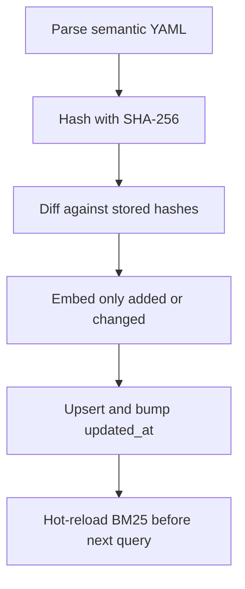
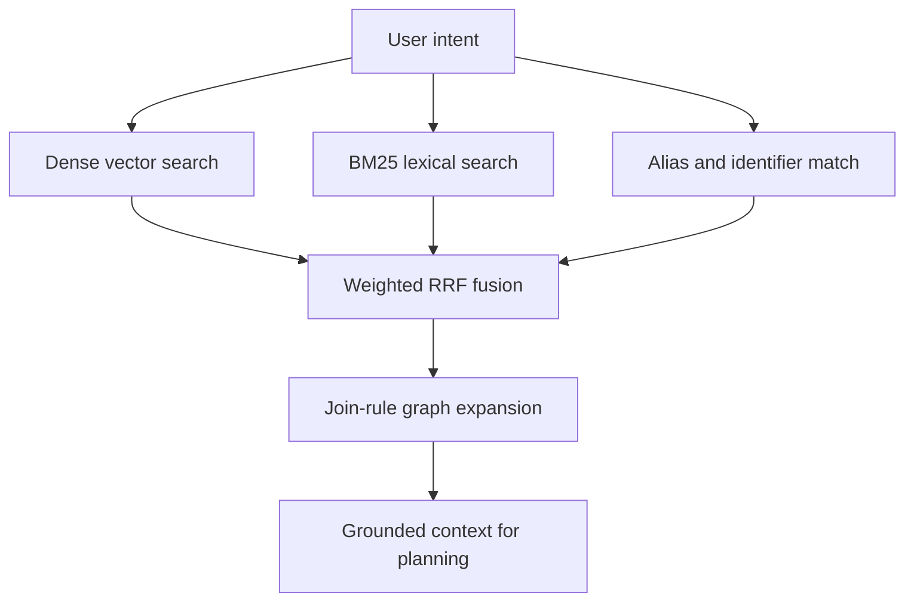
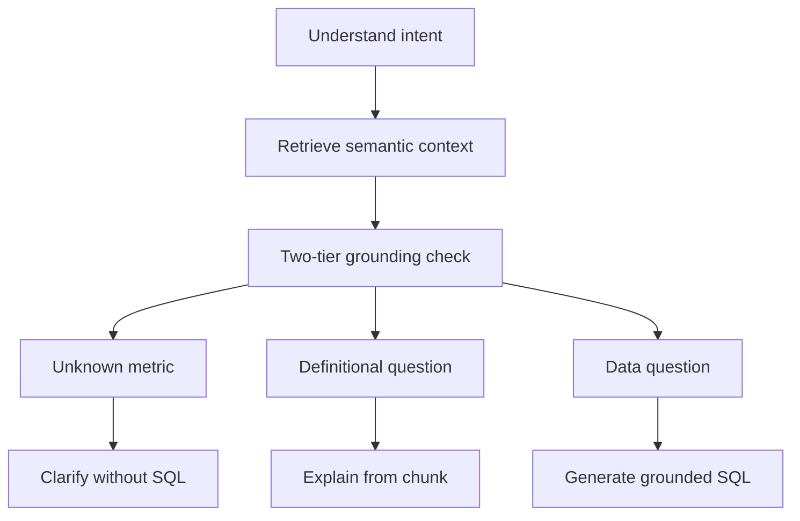

# Semantic layer and retrieval

This page owns the knowledge corpus, the chunking and indexing pipeline, hybrid retrieval with citations, and UC-02 acceptance behavior. It is the K3 (RAG) harness that grounds business language in schema, formulas, and safe join paths before SQL generation.

The normative spec is PRD §2.3 plus the UC-02 plan: the corpus covers the data dictionary, metric definitions, canonical joins, few-shot examples, and the business event log, and the agent uses retrieved context either to generate grounded SQL or to answer definitional questions directly. Related runtime, data, and verification details live in [Workflow Architecture](./workflow-architecture.md), [Database and Seeding](../data/database-and-seeding.md), [Eval and Safety Harness](../evals/eval-and-safety-harness.md), and [Text to SQL](../use-cases/text-to-sql.md).

> Status note: no agent, loader, or index code has landed yet. Paths, schemas, and thresholds below are the planned contract from the PRD and UC-02 plan, not inspected implementation.

## 1. Responsibility and position in the loop

The semantic layer answers one question: which tables, columns, metric formulas, join warnings, examples, and business events apply to this user turn. It sits between intent understanding and SQL planning in the reference workflow `understand -> retrieve semantic (RAG) -> plan -> generate SQL`.

It has three duties:

1. **Business-to-schema grounding.** Resolve non-schema terms such as net revenue, active customers, or successful orders into authoritative formulas, status filters such as `orders.status = 'delivered'`, and safe join paths that avoid fan-out double counting when `orders` meets `order_items` or `payments`.
2. **Direct definitional answers.** Answer what a metric means from the retrieved chunk without running SQL.
3. **Refusal with guidance.** Refuse to invent a formula for an undefined business metric and ask for clarification instead.

The layer is read-only over the knowledge base. It never writes the business database, never edits user data, and never bypasses the SQL validator, cost gate, or access policy.

## 2. Knowledge corpus

The corpus is authored as modular YAML under `semantic/` over the localized e-commerce schema (`customers`, `orders`, `order_items`, `products`, `categories`, `sellers`, `payments`, `reviews`, `regions`, `channels`, `employees`, `promotions`). It has six document types, one YAML entry per chunk:

| `doc_type` | File | Contents |
|---|---|---|
| `table` | `semantic/tables.yaml` | One chunk per table: business purpose, primary key, grain such as one row per order, and scale including the million-row `order_items` table. |
| `column` | `semantic/columns.yaml` | One chunk per important or tricky column: data type, sample values, enum meanings such as why canceled orders are excluded from revenue, and sensitivity. |
| `metric` | `semantic/metrics.yaml` | At least 10-12 business metrics, each with canonical name, multilingual aliases, business formula, SQL template, and caveats. Required set includes net revenue, gross merchandise value, active customers defined as at least one delivered order in the last 90 days, average order value, return rate, cancellation rate, repeat-customer rate, new customers, on-time delivery rate, and revenue per seller. |
| `join_rule` | `semantic/joins.yaml` | Canonical join paths plus explicit anti-fanout warnings, for example that `payments` has multiple rows per `order_id` so `SUM(order_items.price)` must not run in a single flat join without pre-aggregating `payments` in a CTE. |
| `example` | `semantic/examples.yaml` | 15-20 few-shot `{question, sql, cited_metrics, tables}` pairs covering time comparisons, CTEs, and multi-table joins. They must be fully disjoint from the 30-plus graded questions in `evals/questions/`. |
| `event` | `semantic/events.yaml` | Short dated business events with start and end dates plus affected regions and channels, such as promotional campaigns, warehouse incidents, and regional sales suspensions. Shared with periodic reporting and anomaly analysis. |

Complementary PRD requirements: the dictionary describes each table and column with type, sample values, business meaning, and sensitive-column flags; each metric carries name, aliases, business formula, sample SQL, and notes; join rules name the correct path and the duplicate-count trap; few-shots differ from the graded set; the event log is short dated prose.

## 3. Chunk metadata contract

Every stored chunk carries the PRD §2.3 minimum plus multi-table and lifecycle fields so join expansion and hot reload work:

| Field | Meaning |
|---|---|
| `chunk_id` | Stable identifier such as `metric:net_revenue`, `table:orders`, `column:orders.status`, or a dated `event:` id. Citations reference this id or a `table.column` identifier. |
| `doc_type` | One of `table`, `column`, `metric`, `join_rule`, `example`, `event`. |
| `table` | Primary table name, or null when not table-bound. |
| `tables` | All involved tables for join expansion, for example `["orders", "order_items"]`. |
| `metric_name` | Canonical metric name for metric chunks, null otherwise. |
| `aliases` | English plus Vietnamese synonyms used by the exact-match leg, for example net sales mapping to net revenue. |
| `sensitivity` | `public`, `internal`, or `restricted_pii`. PII columns such as customer phone, email, address and employee salary are marked restricted and aligned with the sensitive-column policy. |
| `additive` | Optional flag consumed by multi-step attribution: true for additive measures such as revenue and order counts, false for ratios such as average order value and return rate. |
| `updated_at` | ISO timestamp bumped on every upsert; the BM25 hot-reload check compares it before each retrieval. |

YAML authoring is validated at build time against shared Zod schemas in `packages/contracts`, with a `semantic:lint` step.

## 4. Chunking, indexing, and hot reload

Chunking is by semantic unit, not by fixed-token window, so a metric name is never split from its formula: one YAML entry equals one self-contained chunk stored in PostgreSQL.

*Caption: Incremental indexing flow from YAML parse through hash diff to hot reload.*

The incremental algorithm is:

1. Parse `semantic/*.yaml` into chunk inputs and compute `content_hash = sha256(canonicalJson(chunk))`.
2. Select stored `(chunk_id, content_hash)` pairs.
3. Diff into `unchanged` (hashes equal, skip any embedding call), `toUpsert` (new or modified, batch-embed only these), and `toDelete` (removed from YAML, delete by id).
4. Upsert with conflict handling on `chunk_id`, refreshing `content`, `metadata`, `content_hash`, `embedding`, and `updated_at`.
5. Return a summary `{added, updated, skipped, deleted, embeddingTokens, estimatedCostUsd, durationMs}` so an edit to one metric visibly reports `updated: 1, skipped: N-1`.

Cross-process synchronization matters because indexing may run from a CLI while the web or API process holds an in-memory BM25 index. Before each `retrieve()` the retriever runs a lightweight `MAX(updated_at)` plus count check, or listens for a database notification, and when the stored maximum is newer or the count changed it refreshes the BM25 index and the citation catalog in place without restarting the server. The web admin flow exposes the same path as a Re-index Changed Chunks button backed by `POST /api/semantic/reindex`.

Operations entry points are `pnpm semantic:lint` for validation, `pnpm semantic:index` for incremental indexing, and the reindex API for the UI. The backing store uses the `vector` extension with an HNSW index for cosine search and shares its PostgreSQL instance with access-policy storage.

## 5. Hybrid retrieval

Pure vector search misses exact column names and short acronyms such as AOV and GMV, while pure keyword search misses paraphrased intent. The planned retriever therefore fuses three legs:

1. **Dense vector leg.** Cosine search over stored embeddings.
2. **Lexical BM25 leg.** Lowercased, diacritic-preserving plus ASCII-normalized tokenization with stopword removal, scored with Okapi BM25 parameters `k1 = 1.2, b = 0.75` over indexed `content + metric_name + aliases + table + tables`.
3. **Deterministic alias and identifier leg.** Normalized substring and exact-token match against `metric_name`, `aliases`, `table.column`, and `chunk_id`. An exact alias hit ranks first in this leg and flags `aliasMatched = true`.

Ranks fuse with weighted Reciprocal Rank Fusion with `k = 60` and default weights `1.0` dense, `1.0` BM25, `1.5` alias. After the top results are known, automatic join-rule expansion collects table names from the top metric, table, and column chunks and pulls in any `join_rule` whose table list overlaps at least two of those tables, so the generator never misses a fan-out warning.

*Caption: Three-leg hybrid retrieval fusing into ranked context with join-rule expansion.*

The exposed tool is `search_semantic_layer`, which reads only the dictionary, metric definitions, and event log. Retrieval benchmarking uses a dedicated set of at least 20 queries with calibrated dense thresholds and tuned fusion weights.

## 6. Agent integration and unknown-term guardrail

Retrieval runs as a LangGraph node immediately after intent understanding, with a three-route conditional edge:

*Caption: Retrieve-then-route decision from grounding check to clarify, explain, or generate SQL.*

The guardrail depends on two-tier extraction during understanding:

- `requested_metrics`: business KPIs and composite formulas such as net revenue, active customers, or an unknown indicator.
- `schema_entities`: plain tables, columns, dimensions, and filter literals such as orders, a city, or a month.

Basic queries with an empty `requested_metrics` list match only `table` and `column` chunks and proceed to SQL generation, so ordinary table and filter questions never trigger false refusals.

For each requested metric the node requires one of: an exact or substring alias match, a dense score above the calibrated threshold (default `0.60`, tuned per embedding model on validation queries) plus a structured grounding confirmation that the chunk actually defines the metric, or an explicit user-supplied formula. If any requested metric is unmatched, the turn routes to `status: "cannot_answer"` with a polite clarification listing the closest available dictionary metrics. It never invents a formula or a number. This is also the defense for forced-hallucination prompts that ask the agent to estimate a missing measure such as marketing cost.

Definitional questions bypass SQL generation entirely: the agent synthesizes the explanation from the retrieved metric or column chunk, including business formula, SQL template, caveats, and verified citations.

## 7. Citations

Every SQL answer carries dual verified citations: a `citations` array in the shared `SQLAnswer` schema and a prepended `-- @citations: ...` header comment on line one of the SQL text.

The deterministic validator enforces:

1. **Catalog membership.** Every cited id exists in the cached catalog of valid chunk ids and `table.column` identifiers.
2. **Context grounding.** Every cited id was present in the retrieved context or verified schema for the current turn.
3. **Metric coverage.** Any turn that uses a defined business metric includes at least one `metric:` citation.
4. **Dual formatting.** The SQL header, the `citations` array, and the answer prose all carry the same verified ids.
5. **Bounded self-correction.** Failed validation returns a structured error to the agent loop for up to two retries with the exact valid ids.

The shared schema also carries `requested_metrics` and `schema_entities` in the intent plus token and cost telemetry (`prompt_tokens`, `completion_tokens`, `embedding_tokens`, `estimated_cost_usd`, `latency_ms`).

## 8. Acceptance and evaluation

UC-02 passes on five recall-gated and behavior-gated criteria:

| # | Criterion | What is measured |
|---|---|---|
| 1 | Recall at 5 at least 0.85 | Correct definition chunk in the top five on at least 15 definition and metric queries; the plan targets 0.90 on a 20-query benchmark. |
| 2 | Execution-accuracy lift at least 15 percentage points | Metric-dependent graded questions run with the semantic layer on versus off via an `enableSemanticLayer` flag; both numbers are reported. |
| 3 | 100% valid citations | Every cited `metric_id` or `table.column` exists in the knowledge base, checked by the automated validator. |
| 4 | Unknown terms clarify without hallucination | Undefined indicators trigger an explicit missing-definition response plus a follow-up question, while simple table queries still pass. |
| 5 | Incremental reindex changes behavior | Editing one definition and reindexing changes subsequent answers to use the new formula while re-embedding only the changed chunk. |

Token, cost, and latency telemetry is required on every run, and regression evaluation compares a dense-only baseline against the full hybrid plus join-expansion plus few-shot configuration.

The five mandatory eval cases are: querying a metric through an alias, a multi-table query that needs the fan-out join rule, a direct definition question, an undefined business term including a request to guess a missing number, and a live definition edit followed by incremental reindex and immediate reuse of the new formula. Traces record run id, tool calls, retrieved chunk ids, telemetry, and masked PII.

## 9. Configuration, boundaries, and failure modes

Key configuration lives in the corpus YAML files, the contracts schemas, environment embedding-model selection, the dense similarity threshold, RRF weights, and the BM25 parameters. The layer exposes `semantic://data-dictionary` with role-filtered sensitivity flags and `semantic://metrics` with canonical definitions for the MCP server, plus a `getMetricSpec` helper returning formula, SQL template, additive flag, and valid drill-down dimensions for attribution and scheduled analysis.

Invariants to preserve when changing this area:

- Never split one semantic unit across chunks; fixed-token windowing breaks metric-to-formula binding.
- Never skip the hash diff: full re-embedding on every edit defeats the incremental-indexing guarantee.
- Never serve stale BM25 state after `updated_at` advances; the hot-reload check must run before retrieval.
- Never let alias matching alone approve an unrelated dense hit; unmatched metrics must clarify.
- Never emit a citation that is not in the catalog and the current context; repair through the retry loop instead.
- Keep few-shot examples disjoint from graded questions, and keep gold SQL and results hidden from the agent at run time.

Common failures are alias collisions across metrics, threshold miscalibration after an embedding-model swap, missing join-rule expansion when a new table is added without updating the join corpus, and stale in-memory indexes when the notification or timestamp check is disabled.
