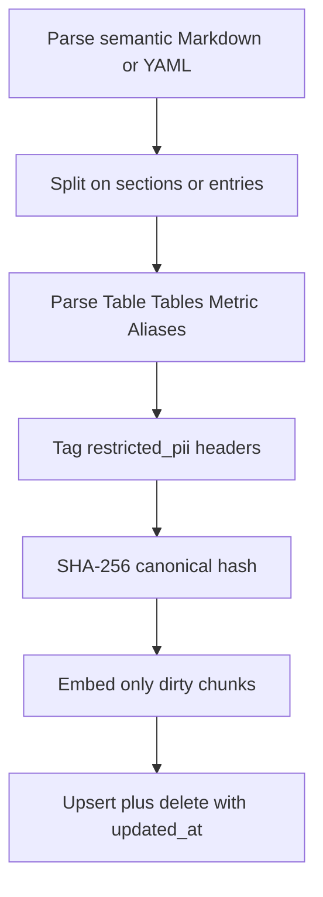
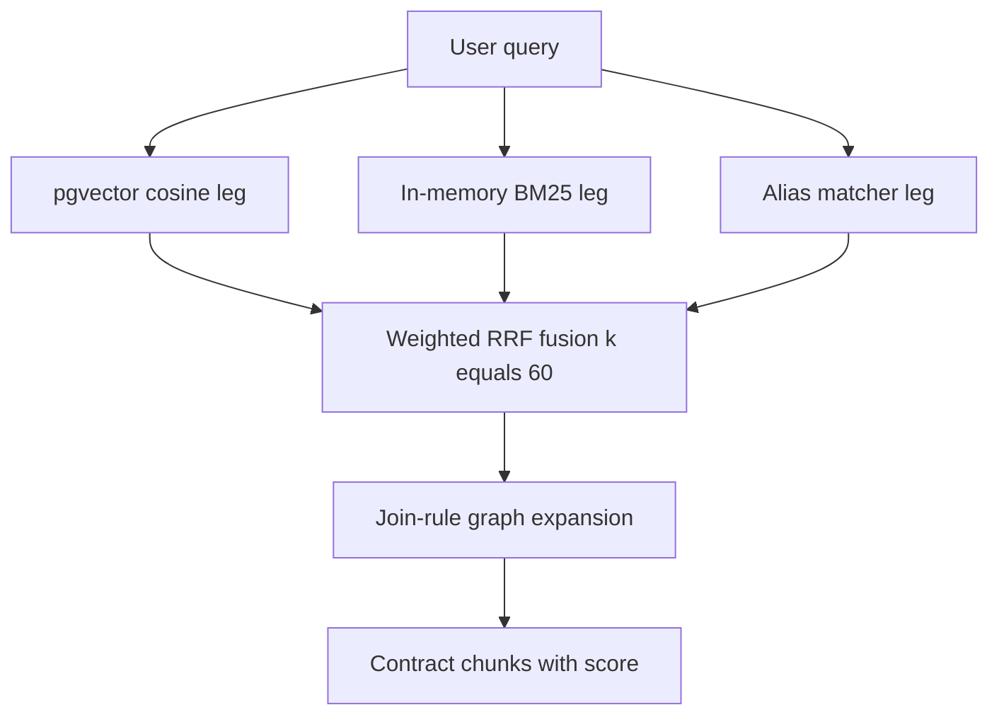

# Semantic layer and retrieval

This page owns the versioned semantic corpus, the chunking and incremental-indexing pipeline, the hybrid retrieval path that grounds business language in tables, metrics, and join warnings before SQL generation, and the LangGraph grounding and citation gates that decide what may proceed to SQL synthesis. Runtime, data, and verification details live in [Workflow Architecture](./workflow-architecture.md), [Database and Seeding](../data/database-and-seeding.md), and [Text to SQL](../use-cases/text-to-sql.md).

> Implementation status: the YAML plus Markdown indexer, embedder, three-way retriever (dense plus BM25 plus alias), weighted RRF helper, join-rule expansion, hot-reload catalog, chunk table, gateway tool, gateway resources, LangGraph `retrieveSemantic` node with the two-tier grounding gate, deterministic citation validator, and text-to-SQL entry wiring are built. Recall, execution-accuracy lift, and reindex acceptance thresholds remain eval criteria, not runtime checks.

## 1. Responsibility and position in the loop

The semantic layer answers one question: which tables, columns, metric definitions, and business events apply to this user turn. The agent reaches it only through the MCP gateway — never by opening the database directly — via the `search_semantic_layer` tool and the `semantic://data-dictionary` and `semantic://metrics` resources.

It has three duties:

1. **Business-to-schema grounding.** Resolve non-schema terms such as revenue or average order value into authoritative tables, metric definitions, and fan-out warnings before SQL planning.
2. **Direct definitional answers.** Serve the dictionary and metric text itself so definitional questions can be answered from retrieved chunks without running SQL.
3. **Refusal by omission.** Withhold `restricted_pii` chunks and resource sections from principals lacking `data:sensitive`, instead of leaking them and redacting later.

The layer is read-only at query time. It never writes the business database, never edits user data, and every tool or resource call still passes authentication, scope checks, zod validation, PII redaction, and audit in the fixed gateway pipeline. Access-control and redaction guarantees are detailed in [Safety and Access Control](./safety-and-access-control.md); the gateway transport is detailed in [MCP Server](../integrations/mcp-server.md).

## 2. Knowledge corpus

The canonical indexed corpus is the six versioned YAML files in `semantic/` (parsed by `chunkYaml`): `tables.yaml` (12 table chunks), `columns.yaml` (22 column chunks), `metrics.yaml` (12 metric chunks with additive flags and SQL formulas), `joins.yaml` (7 join-rule chunks), `examples.yaml` (18 few-shot question plus SQL chunks), and `events.yaml` (10 campaign and holiday event chunks). Entry counts are asserted by the corpus chunker tests; YAML entries carry explicit `chunkId`, `docType`, `table` and `tables`, `metricName`, `aliases`, `sensitivity`, optional `additive`, and `content` plus structured fields (`formula`, `sql`, `caveats`, `question`, `citedMetrics`, dates, affected regions and channels, grain, primary key, and related column metadata) that the indexer folds into both content and stored metadata.

The two versioned Markdown files at the repository root are retained as fallback defaults and as the gateway resource source:

- `semantic/data_dictionary.md` — twelve seeded business tables (`regions`, `channels`, `categories`, `sellers`, `products`, `customers`, `employees`, `promotions`, `orders`, `order_items`, `payments`, `reviews`) with grain, primary keys, aliases, and join rules. It carries no row counts, no example values, and no query fragments.
- `semantic/metrics.md` — six canonical metric definitions (`revenue_vnd`, `order_count`, `average_order_value`, `freight_share`, `review_score_avg`, `compensation_cost`) with the tables each derives from and Vietnamese plus English aliases. It carries no formulas, no thresholds, and no query fragments.

Markdown chunking is by section: every `## ` heading starts one self-contained chunk, and preamble text before the first heading is skipped. The leading `Table:` / `Tables:` / `Metric:` / `Aliases:` lines populate metadata columns and stay in the stored content so lexical search still matches them. A header ending in `[restricted_pii]` marks the whole section restricted — currently `employees` in the dictionary and `compensation_cost` in metrics — while the YAML corpus marks restriction per entry (`table:employees`, `metric:compensation_cost`, and the four restricted columns `customers.phone`, `customers.email`, `customers.address`, `employees.salary`). The dictionary additionally marks `order_items` as the `large` table that must be filtered before a full scan, and marks review text as untrusted user input wrapped in untrusted-data delimiters.

*Caption: Corpus indexing flow from section split to incremental upsert.*

## 3. Chunk metadata contract

The `ParsedChunk` shape carries `chunkId`, `docType`, `table`, `tables`, `metricName`, `aliases`, `sensitivity`, optional `additive`, optional `metadata`, and `content`. The Markdown chunk id is `source:slug`, where source is the file basename (`data_dictionary`, `metrics`) and slug is the lowercased, dash-joined heading (the slugger preserves Vietnamese `à–ỹ` characters). A heading with a single `Tables:` entry derives `table` from it; a `Table:` entry derives `tables` from it, so both columns are always populated together. The YAML chunker accepts `chunkId`/`chunk_id`/`id`, `docType`/`doc_type`, `table`, `tables` (array or comma string), `metricName`/`metric_name`/`metric`, `aliases` (array or comma string), `sensitivity`, and `content`/`body`/`description`/`text`, with the same table-to-tables derivation and slug fallback (`title` or `name` or metric or table or `chunk-index`). Every chunk leaving either chunker passes `validateChunkMetadata` against `SemanticChunkMetadataSchema` and throws on mismatch, so only contract-compliant chunks reach the indexer.

Storage is snake_case in `semantic.semantic_chunks`: `chunk_id`, `doc_type`, `table_name`, `tables`, `metric_name`, `aliases`, `sensitivity`, plus `additive`, `metadata`, `content`, `content_hash`, `updated_at`, `embedding`, and a generated `fts` column. Multi-value columns are stored as comma-joined text (`orders,order_items`) and split back into arrays at the contract boundary. The `additive` boolean from YAML metrics (for example `true` for `net_revenue`, `false` for `active_customers`) is persisted on both `INSERT` and `UPDATE`, and `metadata` stores the validated contract fields merged with the structured YAML extras (other keys are re-rendered as `Label: value` lines appended to content when absent, so formulas and SQL templates remain lexically searchable).

The frozen `SearchSemanticLayer` wire contract takes `{ query, topK }` with `query` required from 1 to 2000 characters and `topK` defaulting to 5 and capped at 20. It returns `chunks` where each chunk carries `chunkId`, `docType` enumerating all six UC-02 values (`table`, `column`, `metric`, `join_rule`, `example`, `event`), `table`, `tables`, `metricName`, `content`, `score`, plus optional `aliasMatched` and `denseScore` set by the 3-way fusion path. The YAML corpus exercises all six types today, so `column`, `join_rule`, `example`, and `event` chunks validate without a contract change.

## 4. Chunking, hashing, and incremental indexing

The pure Markdown chunker exports `chunkMarkdown(source, text, docType)` for unit tests: split on `## ` headings, parse the leading metadata lines, derive `table` and `tables` from each other when only one is present, slug the heading for the id, and drop empty sections. The pure YAML chunker exports `chunkYaml(source, text, docType)` with array-or-string `tables`/`aliases` handling, sensitivity normalization to `public`/`internal`/`restricted_pii`, explicit-id or slug-fallback ids, structured-field rendering (`Formula`, `SQL`, `Caveats`, `Question`, `Grain`, and related labels) into content, and the same derivation plus empty-content filtering. The pure hasher exports `contentHash(chunk)` as `sha256` over the canonical JSON of id, type, table fields, metric name, aliases, sensitivity, optional `additive`, and content, so formula, alias, and additivity edits all change the hash.

`indexCorpus({ dbUrl, query, embedder, files })` implements the incremental path:

1. Read each file, splitting Markdown with the file basename as source and parsing YAML when the path ends in `.yaml`/`.yml`.
2. Select stored `(chunk_id, content_hash)` pairs.
3. Delete stored ids absent from the current corpus via `chunk_id = ANY($1)` and count them as `deleted`.
4. Keep chunks whose stored hash differs or is missing; count all others as `skipped`.
5. Embed only the dirty chunks in one batch call.
6. `INSERT` new ids and `UPDATE` changed ids (type, table fields, metric, aliases, sensitivity, `additive`, `metadata` JSONB, content, hash, embedding, `updated_at`), returning `{ added, updated, skipped, deleted, embeddingTokens, estimatedCostUsd, durationMs }`.

Token and cost telemetry is heuristic (`ceil(content.length / 4)` per dirty chunk at 0.02 USD per million tokens) plus wall-clock `durationMs`; a clean re-run reports zero embedding tokens. Every parsed chunk is Zod-validated before hashing, so malformed `docType` or sensitivity values fail the index run rather than landing silently.

The operator entry point is the indexer module itself run with `tsx` (`pnpm semantic:index`) against `INDEXER_DATABASE_URL`, using `discoverDefaultFiles()` and the environment-selected embedder. Discovery returns the six YAML files in canonical order (`tables`, `columns`, `metrics`, `joins`, `examples`, `events`) whenever any `semantic/*.yaml`/`*.yml` exists, and falls back to the two `DEFAULT_FILES` (`semantic/data_dictionary.md` as `table`, `semantic/metrics.md` as `metric`) only when no YAML file is present. The indexer connects as the `indexer` role over a two-connection pool and logs `added`, `updated`, `skipped`, `deleted`, plus the token, cost, and duration telemetry.

## 5. Embedders

The shared `Embedder` interface returns fixed-dimension vectors. Two implementations exist:

- **Fake embedder.** Deterministic 1536-dimension L2-normalized vectors from FNV-1a hashing plus a mulberry32 stream mapped to `[-1, 1]`. Repeat calls are byte-identical, so every unit test and CI run works without a key.
- **OpenAI-compatible embedder.** Calls an operator endpoint selected from `EMBEDDING_MODEL_ID`, `OPENAI_COMPATIBLE_BASE_URL`, and `EMBEDDING_API_KEY`, with dimension from `EMBEDDING_DIM` defaulting to 1536.

`selectEmbedderFromEnv` picks the OpenAI endpoint only when both a model id and an API key are set; otherwise it returns the fake with a boot warning, so fake embeddings in production are always a conscious choice.

## 6. Storage, indexes, and roles

`semantic.semantic_chunks` is created under `SET ROLE owner` with `chunk_id` as primary key, `embedding vector(1536)`, `content_hash` for incremental dedup, and `updated_at` as the reload watermark. A generated `tsvector` column built as `to_tsvector('simple', semantic.immutable_unaccent(content))` is retained in DDL with a GIN index; the `immutable_unaccent` SQL wrapper exists because the `unaccent()` extension function is `STABLE` while generated columns require an `IMMUTABLE` expression. The live `hybridSearch` path does not query that `fts` column — lexical matching is done by the in-memory Okapi BM25 index described below — so the column and index are currently unused reserve capacity.

Two indexes serve the dense leg and the reserve lexical column: an HNSW cosine index on the embedding (`m = 16`, `ef_construction = 64`) and a GIN index on the generated `fts` column. The `vector` and `unaccent` extensions are created as superuser before any role-scoped DDL.

Role grants are the read boundary. The `agent_ro` role used by the gateway has `USAGE` on the `semantic` schema plus chunk-only `SELECT` on `semantic_chunks` — no default privileges, so future semantic tables stay invisible. The `indexer` role holds full write grants on present and future `semantic` tables and zero rights on `public`.

## 7. Hybrid retrieval

`hybridSearch(query, embedder, text, topK, allowRestricted)` fuses three legs with weighted Reciprocal Rank Fusion at `k = 60` and weights `[1.0, 1.0, 1.5]`:

1. **Dense vector leg.** Cosine search (`embedding <=> $1::vector`) over rows with non-null embeddings, selecting `1 - distance` as `dense_score` and ordering by distance. It fetches `max(topK * 3, topK)` candidates.
2. **Lexical BM25 leg.** In-memory Okapi BM25 (`Bm25Retriever` with `k1 = 1.2`, `b = 0.75`) over a hot-reloaded catalog of `content` plus `metric_name`, `aliases`, `table_name`, and `tables`. Tokenization lowercases, preserves Vietnamese diacritics while also emitting ASCII-folded variants, splits `_`/`.`/`-` compounds into sub-tokens, and removes Vietnamese plus English stopwords. The leg returns at most `max(topK * 3, topK)` hits ordered by BM25 score.
3. **Deterministic alias leg.** `matchAliases` checks normalized query forms (lowercased, ASCII-folded, underscore-aware spaced variants) against `metric_name`, `aliases`, `chunk_id` plus its suffix and spaced form, and `table_name` with exact-first then longest-phrase then `chunk_id` ordering. Any exact or word-boundary substring hit (minimum two characters) ranks in this leg and sets `aliasMatched = true` on the fused chunk.

Unless `allowRestricted` is true, all three legs exclude `sensitivity = 'restricted_pii'`. Rank lists are fused by the pure `fuseRRF` helper: each hit contributes `weight / (60 + rank)` per leg it appears in with default weights `W_DENSE = 1.0`, `W_BM25 = 1.0`, `W_ALIAS = 1.5`, results sort by fused score with first-seen order breaking ties, and the list truncates to `topK`. `rrfScore` recomputes the same number for the returned `score` field, and the pure boundary mapper `toContractChunk` converts each fused storage row to the camelCase contract shape, splitting comma-joined `tables` and attaching `aliasMatched` plus `denseScore` whenever they are defined. Those two signals are what the agent-side grounding gate consumes: `aliasMatched` proves an exact alias hit and `denseScore` carries the cosine similarity for threshold comparison.

*Caption: Three-way hybrid retrieval fusing vector, BM25, and alias ranks with RRF and join expansion.*

Automatic join-rule graph expansion runs after fusion: `expandJoinRules` collects tables from the top-5 fused chunks, finds `join_rule` rows whose tables overlap with at least two of those tables, and injects them while keeping the result within `topK` — appending when there is room, otherwise replacing the lowest non-join tail entry. Candidates sort by overlap descending, then fused score, then id.

The BM25 catalog is cross-process hot-reloaded. Before each search, `hybridSearch` probes `MAX(updated_at)` plus `COUNT(*)`; when either differs from the cache it reloads the full catalog, rebuilds the in-memory BM25 index, and refreshes the citation catalog (`chunk_id`, `metric:`, `table:`, bare table, and `column:`-stripped ids). A mockable query function plus a vector-row fallback keeps unit tests DB-free when the watermark probe is unavailable.

## 8. Gateway exposure

The `search_semantic_layer` tool is registered in `TOOL_SPECS`/`TOOL_SCOPES` (defined in `constants.ts` and re-exported through `tools.ts`) with description `Hybrid vector plus full-text search over the versioned semantic corpus`, requires the `data:read` scope, and takes `{ query, topK }` with `topK` defaulting to 5 and capped at 20. In the fixed pipeline it runs after bearer authentication, scope check, and zod validation; because it carries no client SQL it skips the guard and policy stages vacuously. The handler derives `allowRestricted` from the `data:sensitive` scope, calls the injected search function (production: `hybridSearch` over the `agent_ro` pool with the environment-selected embedder), runs `redactPII` over every returned chunk body while counting hits, and always writes exactly one audit line including on denials.

The two resources `semantic://data-dictionary` and `semantic://metrics` are served from the checked-in Markdown files. Resource reads require the `schema:read` scope, withhold every `## ` section whose header ends in `[restricted_pii]` unless the principal holds `data:sensitive`, then apply the same PII redaction and audit as tool calls.

## 9. Agent grounding and citation contract

The UC-02 grounding contract is implemented in `packages/agent`: `semantic/retrieveSemantic.ts` owns the retrieve node, `validators/citationValidator.ts` owns deterministic citations, and `subgraphs/textToSql.ts` owns entry-time re-gating plus header injection. The root graph stays generic: its `retrieve` node delegates to the injected `RootGraphDeps.retrieve` seam, and the text-to-SQL entry is registered through the UC registry.

### Retrieve node

`createRetrieveSemantic({ search, topK })` builds the node. Production resolves MCP transport identity (`mcpUrl`, `token`, `runId`, `userId`, `roleScope`) from `RootRuntime.config` and calls `search_semantic_layer` with `{ query: state.question, topK }`; hosts and tests inject `search` directly. Defaults are `RETRIEVE_TOP_K = 8` and `UNKNOWN_TERM_DENSE_THRESHOLD = 0.6`.

Control flow:

- Basic queries pass through with `{}` and no search when `requestedMetrics` is empty and `queryMode` is not `definition_lookup`.
- Otherwise the node searches, emits a `retrieve/tool_call` span with the chunk count, and maps each contract chunk to checkpointed state via `toStateChunk` (`chunkId`, `score`, `text`, plus `aliasMatched`/`denseScore` when set). Checkpointed `semanticChunks` therefore carry the trust signals, not just ids and text.
- Missing MCP transport while metrics need grounding (or while a definition lookup runs) fails closed to `status: error` without speculating.
- Empty retrieval for a metric question fails closed to `cannot_answer` with zero SQL.
- A user-supplied formula (`formula:`, `define X as`, `custom formula` in the question) bypasses the unknown-term gate.
- Ungrounded terms short-circuit to `cannot_answer` with the closest valid metrics and zero SQL; grounded turns return `{ semanticChunks }` and emit `retrieve/node_done` with `gate: unknown_term`, `definition_lookup`, or `data_query`.

### Two-tier unknown-term guardrail

Intent extraction splits `requestedMetrics` (business KPIs) from `schemaEntities` (plain tables, columns, filter literals), so empty metric lists never falsely refuse basic table queries. `isMetricGrounded(term, chunks, threshold, allTerms)` and `checkUnknownTerms(requestedMetrics, chunks)` enforce the gate:

- Only `metric`/`column` chunks (by `docType` or `chunkId` prefix) can ground a term.
- A grounding chunk must be trusted via exact alias (`aliasMatched === true`) or calibrated dense similarity (`denseScore >= 0.60`).
- Single-metric questions accept a trusted match directly; multi-metric questions additionally require text overlap between the term and `chunkId` plus `metricName` plus content (substring, metric-token, or `>= 2`-token/`>= 50%`-token overlap), so one retrieval cannot ground an unrelated co-asked term.
- `closestMetrics` suggests up to `CLOSEST_METRICS_LIMIT = 5` retrieved `metric:*` ids (else top chunk ids) for the `cannot_answer` clarification, which lists the ungrounded terms plus available metrics and invites the user to pick one or supply an explicit formula. Unit tests pin the NPS and forced-hallucination (`chi phí marketing`) short-circuits.

### Definition fast-path

`definition_lookup` still searches, but the synthesis split is explicit: the retrieve node only persists `semanticChunks` (the `definition_lookup` test asserts no status change at this stage), and the text-to-SQL entry owns synthesis. `handleDefinitionLookup` answers from the first five chunk snippets with their scores plus a `Citations:` line over retrieved `metric:*` ids, sets `sql: null`, runs zero executor calls, and returns `cannot_answer` only when no chunks were retrieved. `buildDefinitionAnswer` in the retrieve module is the pure helper for the same answer shape.

### Deterministic citations

`validators/citationValidator.ts` is pure (no model, no I/O) and enforces three rules in `validateCitations({ citations, sql, requestedMetrics, retrievedChunkIds, catalogIds })`:

1. Every citation exists in the catalog (`citation_unknown`).
2. Every citation was retrieved this turn (`citation_not_retrieved`), with `column:orders.status` versus `orders.status` and `metric:net_revenue` versus `net_revenue` interop in `expandRetrieved`.
3. Metric queries (`requestedMetrics.length > 0`) cite at least one `metric:*` chunk (`citation_missing_metric`).

On success it deterministically prepends (or replaces) a sorted, deduped `-- @citations: id1, id2` first-line header via `ensureCitationHeader` (`parseCitationHeader` reads it back). `deriveCitations` builds the minimal valid set from retrieved ids — preferring retrieved `metric:*` (up to 5), else top retrieved ids — so the harness fills omissions from grounding rather than letting the model invent ids. `repairCitations` retries at most `CITATION_REPAIR_LIMIT = 2` times, and only for `citation_unknown`/`citation_not_retrieved` by swapping bad ids for derived ones; `citation_missing_metric` never repairs when no `metric:*` was retrieved.

The entry seam `withCitationHeader` applies this per turn without a fake full catalog: it derives citations from `state.semanticChunks` ids, validates retrieved-this-turn plus `metric:*` coverage, repairs up to twice, and returns `null` on persistent failure so the caller fails closed to `cannot_answer` instead of shipping an unverified header. A column-only retrieval on a metric query therefore still runs the executor once but then refuses to answer. Downstream, the UC-03 claim validator consumes retrieved `event:*` chunk ids as `eventIds` for causal gating: causal language passes only with an `event:*` evidence pointer, an event id named in the claim, or a row-backed non-time dimension value.

## 10. Configuration, invariants, and focused tests

Key configuration is the six YAML corpus files plus two Markdown fallback and resource files, the `INDEXER_DATABASE_URL` write URL, the embedder environment (`EMBEDDING_MODEL_ID`, `OPENAI_COMPATIBLE_BASE_URL`, `EMBEDDING_API_KEY`, `EMBEDDING_DIM`), the retrieve default `topK = 8` versus the gateway contract default 5 and cap 20, the grounding threshold `0.6`, the repair limit `2`, the closest-metrics limit `5`, the fixed `RRF_K = 60` with weights `[1.0, 1.0, 1.5]`, the BM25 parameters `k1 = 1.2` and `b = 0.75`, and the HNSW build parameters.

Invariants to preserve when changing this area:

- Never split one semantic unit across chunks; fixed-token windowing breaks metric-to-definition binding.
- Never skip the content-hash diff: re-embedding everything on every edit defeats the incremental guarantee.
- Never skip the delete pass: removed sections must leave the table or stale definitions keep grounding answers.
- Never serve `restricted_pii` chunks or resource sections to principals without `data:sensitive`; the retriever filter, alias filter, BM25 filter, join-expansion filter, and the section filter must agree.
- Never change the embedding dimension without DDL plus full reindex; the column is fixed at 1536.
- Never bypass the snake_case to camelCase boundary mapper; storage text with commas must split into clean arrays, and `aliasMatched` plus `denseScore` must only appear when the fusion path sets them.
- Never persist semantic chunks without their trust signals; dropping `aliasMatched`/`denseScore` from `semanticChunks` blinds the unknown-term gate.
- Never let a metric query ship SQL without a verified `metric:*` citation; fail closed to `cannot_answer` on persistent `citation_missing_metric`.
- Never assume Postgres FTS is the lexical leg; the GIN/`fts` column is reserve DDL while `hybridSearch` uses in-memory BM25 plus the alias matcher.

Common failures are an unset indexer URL, an OpenAI embedder missing model or key, dimension mismatch after an endpoint change, missing MCP transport identity at retrieve time, and assuming join-rule expansion or alias matching can be skipped for short queries.

Focused tests live in the DB-free semantic unit suite: fake-embedder shape, determinism, and normalization; weighted RRF ordering at `k = 60` with stable tie-breaking and `topK` truncation plus alias-weight boost; BM25 diacritic folding, sub-token expansion, Okapi scoring, and `allowRestricted` filtering; alias exact-versus-substring ranking and `aliasMatched` propagation through `hybridSearch`; join-rule injection and tail replacement at `topK`; cross-process hot-reload of the BM25 index and citation catalog on watermark change; resource section filtering with and without `data:sensitive`; storage-to-contract mapping; corpus chunking with metadata parsing and restricted-header tagging; and the 6-type YAML corpus suite proving canonical discovery order, per-type chunk counts and sensitivities, deterministic `canonicalJson` and `contentHash` behavior, first-run bulk insert plus second-run full skip, single-chunk re-embed on metric edit, and stale-delete reporting via `chunk_id = ANY($1)`. The live suite replays the same incremental index and fused retrieval plus the `data:sensitive` split against real role grants when database URLs are present. Agent tests pin the grounding gate (`uc02retrieve`: threshold value, no-search passthrough, alias and dense grounding, multi-term attribution, NPS and forced-guess short-circuits with zero SQL, definition passthrough, fail-closed transport and empty-retrieval cases), the citation validator (`uc02citation`: header injection and parsing, column-variant interop, three rejection codes, `<= 2` repair, unrepairable metric-missing case), and entry integration (`uc02entry`: NPS short-circuit with zero executor calls, definition answer with zero executor calls, SQL header plus validator pass, empty-chunk and column-only fail-closed paths).
