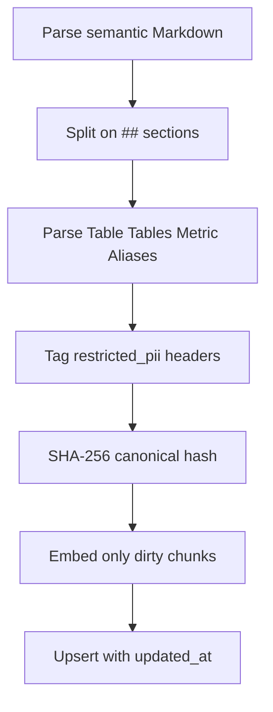
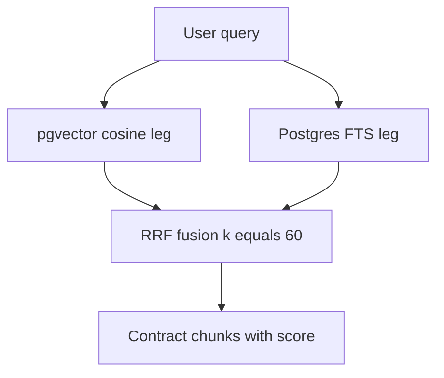

# Semantic layer and retrieval

This page owns the versioned semantic corpus, the chunking and incremental-indexing pipeline, and the hybrid retrieval path that grounds business language in tables, metrics, and join warnings before SQL generation. The normative UC-02 design (six YAML document types, three-way retrieval with join expansion, LangGraph guardrail, dual citations) lives in the UC-02 plan; what has landed is the MCP-02 slice described here. Runtime, data, and verification details live in [Workflow Architecture](./workflow-architecture.md), [Database and Seeding](../data/database-and-seeding.md), and [Text to SQL](../use-cases/text-to-sql.md).

> Implementation status: the indexer, embedder, two-leg retriever, RRF helper, chunk table, gateway tool, and gateway resources are built. The three-leg BM25 plus alias matcher, join-rule graph expansion, LangGraph `retrieveSemantic` node with two-tier grounding, deterministic citation validator, and UC-02 eval gates are still plan, not code.

## 1. Responsibility and position in the loop

The semantic layer answers one question: which tables, columns, metric definitions, and business events apply to this user turn. The agent reaches it only through the MCP gateway — never by opening the database directly — via the `search_semantic_layer` tool and the `semantic://data-dictionary` and `semantic://metrics` resources.

It has three duties:

1. **Business-to-schema grounding.** Resolve non-schema terms such as revenue or average order value into authoritative tables, metric definitions, and fan-out warnings before SQL planning.
2. **Direct definitional answers.** Serve the dictionary and metric text itself so definitional questions can be answered from retrieved chunks without running SQL.
3. **Refusal by omission.** Withhold `restricted_pii` chunks and resource sections from principals lacking `data:sensitive`, instead of leaking them and redacting later.

The layer is read-only at query time. It never writes the business database, never edits user data, and every tool or resource call still passes authentication, scope checks, zod validation, PII redaction, and audit in the fixed gateway pipeline.

## 2. Knowledge corpus

The corpus is two versioned Markdown files at the repository root, not the six YAML files from the UC-02 plan:

- `semantic/data_dictionary.md` — twelve seeded business tables (`regions`, `channels`, `categories`, `sellers`, `products`, `customers`, `employees`, `promotions`, `orders`, `order_items`, `payments`, `reviews`) with grain, primary keys, aliases, and join rules. It carries no row counts, no example values, and no query fragments.
- `semantic/metrics.md` — six canonical metric definitions (`revenue_vnd`, `order_count`, `average_order_value`, `freight_share`, `review_score_avg`, `compensation_cost`) with the tables each derives from and Vietnamese plus English aliases. It carries no formulas, no thresholds, and no query fragments.

Chunking is by Markdown section: every `## ` heading starts one self-contained chunk, and preamble text before the first heading is skipped. The leading `Table:` / `Tables:` / `Metric:` / `Aliases:` lines populate metadata columns and stay in the stored content so lexical search still matches them. A header ending in `[restricted_pii]` marks the whole section restricted — currently `employees` in the dictionary and `compensation_cost` in metrics. The dictionary additionally flags `order_items` as the `large` table that must be filtered before a full scan, and marks review text as untrusted user input wrapped in untrusted-data delimiters.

*Caption: Markdown corpus indexing flow from section split to incremental upsert.*

## 3. Chunk metadata contract

The `ParsedChunk` shape carries `chunkId`, `docType`, `table`, `tables`, `metricName`, `aliases`, `sensitivity`, and `content`. The chunk id is `source:slug`, where source is the file basename (`data_dictionary`, `metrics`) and slug is the lowercased, dash-joined heading. A heading with a single `Tables:` entry derives `table` from it; a `Table:` entry derives `tables` from it, so both columns are always populated together.

Storage is snake_case in `semantic.semantic_chunks`: `chunk_id`, `doc_type`, `table_name`, `tables`, `metric_name`, `aliases`, `sensitivity`, plus `additive`, `metadata`, `content`, `content_hash`, `updated_at`, `embedding`, and a generated `fts` column. Multi-value columns are stored as comma-joined text (`orders,order_items`) and split back into arrays at the contract boundary. The wire contract is camelCase (`chunkId`, `docType`, `table`, `tables`, `metricName`, `content`, `score`) with `docType` still enumerating all six UC-02 values even though only `table` and `metric` chunks are indexed today. The `additive` column exists in DDL for future attribution math but the current indexer leaves it unset, and `metadata` is always written as an empty JSON object.

## 4. Chunking, hashing, and incremental indexing

The pure chunker exports `chunkMarkdown(source, text, docType)` for unit tests: split on `## ` headings, parse the leading metadata lines, derive `table` and `tables` from each other when only one is present, slug the heading for the id, and drop empty sections. The pure hasher exports `contentHash(chunk)` as `sha256` over the canonical JSON of id, type, table fields, metric name, aliases, sensitivity, and content.

`indexCorpus({ dbUrl, embedder, files })` implements the incremental path:

1. Read each file, split into chunks with the file basename as source.
2. Select stored `(chunk_id, content_hash)` pairs.
3. Keep chunks whose stored hash differs or is missing; count all others as `skipped`.
4. Embed only the dirty chunks in one batch call.
5. `INSERT` new ids and `UPDATE` changed ids (type, table fields, metric, aliases, sensitivity, content, hash, embedding, `updated_at`), returning `{ added, updated, skipped }`.

There is currently no delete pass: chunks removed from Markdown stay in the table until explicitly cleaned. There is no embedding-token, cost, or duration telemetry in the returned summary, and no `semantic:lint` Zod step — the metadata lines are parsed leniently.

The operator entry point is the indexer module itself run with `tsx` against `INDEXER_DATABASE_URL`, using `DEFAULT_FILES` (`semantic/data_dictionary.md` as `table`, `semantic/metrics.md` as `metric`) and the environment-selected embedder. The indexer connects as the `indexer` role over a two-connection pool and logs `added`, `updated`, and `skipped`.

## 5. Embedders

The shared `Embedder` interface returns fixed-dimension vectors. Two implementations exist:

- **Fake embedder.** Deterministic 1536-dimension L2-normalized vectors from FNV-1a hashing plus a mulberry32 stream mapped to `[-1, 1]`. Repeat calls are byte-identical, so every unit test and CI run works without a key.
- **OpenAI-compatible embedder.** Calls an operator endpoint selected from `EMBEDDING_MODEL_ID`, `OPENAI_COMPATIBLE_BASE_URL`, and `EMBEDDING_API_KEY`, with dimension from `EMBEDDING_DIM` defaulting to 1536.

`selectEmbedderFromEnv` picks the OpenAI endpoint only when both a model id and an API key are set; otherwise it returns the fake with a boot warning, so fake embeddings in production are always a conscious choice.

## 6. Storage, indexes, and roles

`semantic.semantic_chunks` is created under `SET ROLE owner` with `chunk_id` as primary key, `embedding vector(1536)`, `content_hash` for incremental dedup, and `updated_at` as the reload watermark. Full-text search uses a generated `tsvector` column built as `to_tsvector('simple', semantic.immutable_unaccent(content))`; the `immutable_unaccent` SQL wrapper exists because the `unaccent()` extension function is `STABLE` while generated columns require an `IMMUTABLE` expression.

Two indexes serve the two retrieval legs: an HNSW cosine index on the embedding (`m = 16`, `ef_construction = 64`) and a GIN index on the generated `fts` column. The `vector` and `unaccent` extensions are created as superuser before any role-scoped DDL.

Role grants are the read boundary. The `agent_ro` role used by the gateway has `USAGE` on the `semantic` schema plus chunk-only `SELECT` on `semantic_chunks` — no default privileges, so future semantic tables stay invisible. The `indexer` role holds full write grants on present and future `semantic` tables and zero rights on `public`.

## 7. Hybrid retrieval

`hybridSearch(query, embedder, text, topK, allowRestricted)` fuses exactly two legs with unweighted Reciprocal Rank Fusion at `k = 60`:

1. **Dense vector leg.** Cosine search (`embedding <=> $1::vector`) over rows with non-null embeddings, ordered by distance.
2. **Lexical FTS leg.** `WHERE fts @@ plainto_tsquery('simple', semantic.immutable_unaccent($1))` ordered by `ts_rank`, so Vietnamese diacritics match through the same unaccent wrapper used at index time.

Each leg fetches `max(topK * 3, topK)` candidates. Unless `allowRestricted` is true, both legs add `AND sensitivity != 'restricted_pii'`. Rank lists are fused by the pure `fuseRRF` helper: each hit contributes `1 / (60 + rank)` per leg it appears in, results sort by fused score with first-seen order breaking ties, and the list truncates to `topK`. `rrfScore` recomputes the same number for the returned `score` field, and the pure boundary mapper converts each fused storage row to the camelCase contract shape, splitting comma-joined `tables`.

*Caption: Two-leg hybrid retrieval fusing vector and full-text ranks with RRF.*

This is intentionally narrower than the planned three-way retriever: there is no in-memory Okapi BM25 leg with `k1 = 1.2, b = 0.75`, no deterministic alias or identifier leg with weights `1.0, 1.0, 1.5` and `aliasMatched` flag, no calibrated dense threshold, and no automatic join-rule graph expansion. Those remain UC-02 plan items.

## 8. Gateway exposure

The `search_semantic_layer` tool is registered with description `Hybrid vector plus full-text search over the versioned semantic corpus`, requires the `data:read` scope, and takes `{ query, topK }` with `topK` defaulting to 5 and capped at 20. In the fixed pipeline it runs after bearer authentication, scope check, and zod validation; because it carries no client SQL it skips the guard and policy stages vacuously. The handler derives `allowRestricted` from the `data:sensitive` scope, calls the injected search function, runs `redactPII` over every returned chunk body while counting hits, and always writes exactly one audit line including on denials.

The two resources `semantic://data-dictionary` and `semantic://metrics` are served from the checked-in Markdown files. Resource reads require the `schema:read` scope, withhold every `## ` section whose header ends in `[restricted_pii]` unless the principal holds `data:sensitive`, then apply the same PII redaction and audit as tool calls.

## 9. UC-02 grounding contract (planned)

The following UC-02 behaviors are specified in the UC-02 plan but have no implementation in the agent package, whose root graph still exposes only a generic injectable `retrieve` hook and whose checkpointed state carries only a minimal `chunkId plus score plus text` semantic entry:

- **Three-route retrieve-then-decide node.** After intent understanding, a `retrieveSemantic` node would route to unknown-metric clarification (`cannot_answer` without inventing a formula), definitional fast-path (synthesize from the chunk without SQL), or grounded SQL generation with formulas and join rules injected.
- **Two-tier unknown-term guardrail.** Intent extraction would split `requested_metrics` (business KPIs) from `schema_entities` (plain tables, columns, filter literals) so empty metric lists never falsely refuse basic table queries, while unmatched metrics require an exact or substring alias hit, a dense score above the calibrated threshold plus a grounding confirmation, or an explicit user-supplied formula.
- **Deterministic dual citations.** Every SQL answer would carry a `citations` array plus a prepended `-- @citations: ...` SQL header comment, validated against the chunk catalog and current context for catalog membership, context grounding, and metric coverage, with up to two self-correction retries.
- **Acceptance and eval gates.** Recall at 5 of at least 0.85, execution-accuracy lift of at least 15 points with the layer on versus off, 100% valid citations, clarification without hallucination on unknown terms, and incremental reindex visibly changing behavior while re-embedding only the changed chunk — measured with token, cost, and latency telemetry over disjoint few-shot and graded question sets.

Coding agents must not assume any of these exist in code paths today; implement against the gateway tool and resources above and treat the plan as the spec for the missing pieces.

## 10. Configuration, invariants, and focused tests

Key configuration is the two Markdown corpus files, the `INDEXER_DATABASE_URL` write URL, the embedder environment (`EMBEDDING_MODEL_ID`, `OPENAI_COMPATIBLE_BASE_URL`, `EMBEDDING_API_KEY`, `EMBEDDING_DIM`), the contract `topK` default and cap, the fixed `RRF_K = 60`, and the HNSW build parameters.

Invariants to preserve when changing this area:

- Never split one semantic unit across chunks; fixed-token windowing breaks metric-to-definition binding.
- Never skip the content-hash diff: re-embedding everything on every edit defeats the incremental guarantee.
- Never serve `restricted_pii` chunks or resource sections to principals without `data:sensitive`; the retriever filter and the section filter must agree.
- Never change the embedding dimension without DDL plus full reindex; the column is fixed at 1536.
- Never bypass the snake_case to camelCase boundary mapper; storage text with commas must split into clean arrays.
- Never invent a third retrieval leg, join expansion, guardrail, or citation validator in documentation without landing the code first.

Common failures are an unset indexer URL, an OpenAI embedder missing model or key, dimension mismatch after an endpoint change, stale chunks after deleting a Markdown section (no delete pass), and assuming alias matching or join-rule expansion exists.

Focused tests live in the DB-free semantic unit suite: fake-embedder shape, determinism, and normalization; RRF ordering at `k = 60` with stable tie-breaking and `topK` truncation; resource section filtering with and without `data:sensitive`; storage-to-contract mapping; and corpus chunking with metadata parsing and restricted-header tagging.
