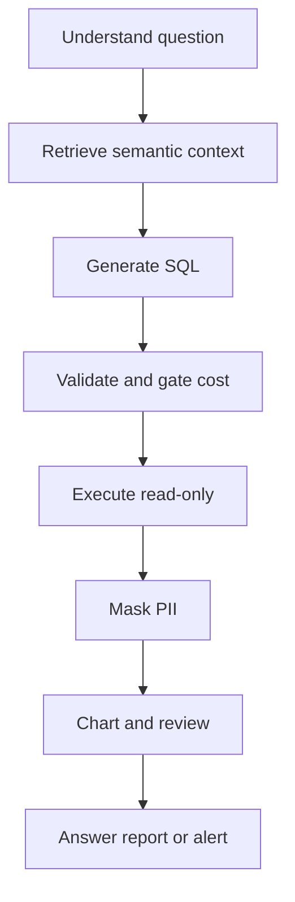

# Agent workflow and harness architecture

This page owns the reference agent loop and the shared harness that makes it safe and observable. The normative contract is the reference diagram in [PRD §2.4](../../docs/prd.md) (`docs/prd.md:115-144`), the tool and skill contracts in [PRD §4.1–§4.2](../../docs/prd.md) (`docs/prd.md:507-525`), and the safety and observability contracts in [PRD §4.3–§4.4](../../docs/prd.md) (`docs/prd.md:527-542`). The buildable synthesis is [Architecture](../../docs/architecture.md) (`docs/architecture.md:1-36`).

Detailed ownership of neighboring concerns lives in [Semantic Layer](./semantic-layer.md), [MCP Server](../integrations/mcp-server.md), [Text to SQL](../use-cases/text-to-sql.md), [Eval and Safety Harness](../evals/eval-and-safety-harness.md), and [Quickstart](../quickstart.md).

## 1. Ownership: agent equals model plus harness

The system is defined as `agent = model + harness`: the language model proposes, the harness disposes (`AGENTS.md:20-22`, `docs/architecture.md:9-22`). The model supplies language understanding, planning, SQL drafting, chart choice, and prose. The harness supplies everything that makes those outputs trustworthy:

- LangGraph workflow with typed state, branching, interrupts, and bounded retries (`docs/prd.md:121-140`).
- Database tools over a read-only connection, exposed through MCP (`docs/prd.md:141-143`).
- Reusable skills, semantic index, checkpointer and memory, role-based access control plus PII policy, trace and audit log, guardrails, and eval runner (`docs/prd.md:141-143`, `docs/prd.md:507-542`).

Course rules reinforce this split: the team must build its own agent and must not wrap a hosted text-to-SQL or BI agent product (`docs/prd.md:58-61`); LangGraph is the recommended workflow framework (`docs/prd.md:64-65`); prompting alone is never accepted as a safety layer.

Current package ownership is fixed in the agent guide (`AGENTS.md:49-56`): `contracts` owns shared validation shapes, `mcp-server` owns all database I/O, `access-policy` owns pure policy and redaction, `agent` owns the graph plus the shared `ValidatedQueryExecutor`, `api` owns run and thread identity plus persistence, and `web` owns the UI.

## 2. Implementation status: shell today, graph in Phase 5

The workflow on this page is still a reference architecture. The full LangGraph.js graph has not landed: `packages/agent` exports only a shell marker stating that the graph lands in Phase 5 (`packages/agent/src/index.ts:3-6`).

What has landed is the monorepo foundation (`docs/architecture.md:5`):

- Frozen shared contracts in `packages/contracts` with a single version constant (`packages/contracts/src/index.ts:8`). Changes are additive-only after the freeze; breaking changes need a major version bump plus approval from every affected owner (`packages/contracts/README.md:6-19`).
- Shell packages for `agent`, `mcp-server`, and `access-policy` that establish import direction without behavior (`packages/agent/src/index.ts:1-6`, `packages/mcp-server/src/index.ts:1-6`, `packages/access-policy/src/index.ts:1-6`).
- An enforced import boundary: agent code must not import the database driver or server internals (`eslint.config.mjs:9-41`).
- A toolchain beyond wiki scripts. The root scripts cover wiki workflows plus `typecheck`, `lint`, `test`, and interface generation (`package.json:13-24`):

```json
"typecheck": "tsc -b",
"lint": "eslint .",
"test": "vitest run",
"docs:interface": "tsx scripts/generate-interface.mjs"
```

Build and runtime entrypoints follow `AGENTS.md:34-47`: Node 24 with pnpm 11.25, `pnpm install --frozen-lockfile`, local `.env` from `.env.example`, root gate `pnpm typecheck && pnpm lint && pnpm test`, scoped `pnpm --filter @se373/<pkg> test`, and `pnpm docs:interface` after any contracts change.

Upstream callers of the future graph are the API host and scheduled triggers; downstream callees are the model via structured output and the MCP server via the MCP client. Until Phase 5, callers can only depend on the frozen contract shapes, not on graph nodes.

## 3. Reference runtime loop

The planned loop runs inside one LangGraph workflow per user turn or scheduled run (`docs/prd.md:121-140`). The shared execution primitive for every SQL query is the `ValidatedQueryExecutor`: selective describe, generation, local pre-check, `run_query`, then bounded repair, with `retryable` guiding client retry and a repairable flag guiding the repair loop (`AGENTS.md:103-105`).

| Stage | Responsibility | Normative source |
|---|---|---|
| `understand` | Extract metric, dimensions, filters, and time range from the question. | `docs/prd.md:122`, `docs/prd.md:194-202` |
| `retrieve semantic (RAG)` | Resolve business terms to tables, columns, metric formulas, and safe join paths; answer definitional questions directly when no SQL is needed. | `docs/prd.md:122`, `docs/prd.md:235-242` |
| `plan` | Decompose why-questions into an ordered drill-down list (region, channel, category, product; order count times average value). | `docs/prd.md:122-124`, `docs/prd.md:323-328` |
| `generate SQL` | Emit one candidate `SELECT` or `WITH` statement as structured output. | `docs/prd.md:126`, `docs/prd.md:196-202` |
| `validate (sqlGuard, policy, RBAC)` | Parse, allow only one read-only statement, check tables and columns, apply role policy before any execution. | `docs/prd.md:126`, `docs/prd.md:509-515` |
| `estimate cost (EXPLAIN)` | Estimate cost without executing; hold over-threshold queries for approval. | `docs/prd.md:129-130`, `docs/prd.md:380-388` |
| `approval gate` | Pause with `interrupt`, present SQL plus estimate plus cheaper alternative, resume on approve or replan on reject. | `docs/prd.md:130`, `docs/prd.md:380-400` |
| `execute (read-only)` | Run on the read-only identity with timeout and row cap; retry through a bounded fix loop. | `docs/prd.md:132`, `docs/prd.md:200-201` |
| `fix (bounded)` | Diagnose syntax, schema, empty-result, or timeout errors from sanitized codes and regenerate, at most 3 SQL attempts. | `docs/prd.md:132-133`, `docs/prd.md:201-202` |
| `mask PII` | Rewrite or mask sensitive columns and rows before display; scan results again before output. | `docs/prd.md:135`, `docs/prd.md:408-414` |
| `chart + insight` | Choose a chart type and write 2–4 insights, each number traceable to a query cell. | `docs/prd.md:135`, `docs/prd.md:260-274` |
| `review (Reviewer agent)` | Have a separate read-only reviewer check joins, filters, metric use, and claim support before answering. | `docs/prd.md:137`, `docs/prd.md:353-362` |
| `answer / report / alert` | Return a table plus short answer, a periodic report, or a scheduled alert. | `docs/prd.md:139`, `docs/prd.md:204-214` |



*Caption: Reference request flow from understanding through validation, gated execution, masking, and verified answer.*

UC-01 exercises the single-question path through this loop with at most 3 SQL generations and at most 2 structured-output repairs (`docs/prd.md:211-222`). UC-05 exercises the multi-step path with baseline confirmation, plan approval, branching drill-down, and attribution math (`docs/prd.md:323-335`). UC-02 plugs retrieval and citations into the loop before generation (`docs/prd.md:237-242`).

## 4. Shared tools and frozen contracts

All data access goes through the `db-tools` surface defined in [PRD §4.1](../../docs/prd.md) (`docs/prd.md:507-521`). At least one tool must be a genuine external dependency such as PostgreSQL, DuckDB, SQLite, a messaging API, or the filesystem (`docs/prd.md:521`).

| Tool | Access | Planned contract |
|---|---|---|
| `list_tables`, `describe_table`, `get_schema` | Metadata read | Return only tables and columns the role may see; flag sensitive columns; fetch only related tables, not the full schema at once. |
| `sample_rows` | Data read | At most 5 rows with sensitive columns already masked; used for filter and empty-result diagnosis. |
| `validate_sql` | No database access | Parse with SQL grammar; require exactly one `SELECT` or `WITH` statement; denylist dangerous functions; verify tables and columns exist. |
| `explain_query` | Plan read | Run `EXPLAIN` without `ANALYZE`; return cost and estimated row count. |
| `run_query` | Data read | Read-only identity; `statement_timeout`; row cap; RBAC and masking applied before execution. |
| `search_semantic_layer` | Knowledge read | Read-only over dictionary, metric definitions, and event log. |
| `render_chart` | Local only | Accept only spec JSON; never execute model-generated code. |
| `send_alert` | Network | Only allowlisted channels and recipients; retry, timeout, and 24-hour duplicate suppression. |
| `run_python` (optional) | Sandboxed execution | Only for pandas-style processing; no network, temp-directory files only. |

The UC-01 plan unifies these names with the MCP server (`docs/UC-plan/UC01.md:40-52`): the agent calls them through an MCP client and never opens a direct database handle, while the server revalidates independently before execution.

The frozen Zod shapes already encode the key bounds. `ListTablesInput` is a strict empty object so scope filtering stays server-side (`packages/contracts/src/tools.ts:8-10`). `DescribeTableOutput` carries a per-column `sensitive` flag plus primary and foreign keys (`packages/contracts/src/tools.ts:44-49`). `ExplainQueryOutput` returns non-negative cost and row estimates (`packages/contracts/src/tools.ts:61-65`). `RunQueryInput` caps `maxRows` at 1 through 1000 with default 200, and `RunQueryOutput` returns columns, rows, counts, truncation, masked columns, and duration (`packages/contracts/src/tools.ts:71-87`). `SampleRowsInput` caps `n` at 5 (`packages/contracts/src/tools.ts:91-94`). The focused contract test parses table outputs, checks the sensitive flag, and rejects unknown input keys (`packages/contracts/test/tools.test.ts:21-40`).

Errors are 11 frozen codes with `retryable` derived from the code (`packages/contracts/src/errors.ts:6-34`). Only timeout, rate-limited, and internal errors are retryable; scope, policy, syntax, and schema errors are not. The focused error test checks timeout retryability, scope denial, unknown-code rejection, and the 11-code count (`packages/contracts/test/errors.test.ts:4-29`).

Answers are bounded in code today. `SQLAnswer` allows at most 3 attempts and at most 50 preview rows, uses a four-value status enum, and requires token and latency telemetry (`packages/contracts/src/answers.ts:27-55`). The focused schema test rejects a fourth attempt and a 51-row preview (`packages/contracts/test/schemas.test.ts:41-57`).

## 5. Skills

The system needs at least two reusable skills, each as a directory with a Markdown or YAML contract covering name, description, when to use, inputs and outputs, steps, constraints, examples, and final check (`docs/prd.md:523-525`). A skill must not contain a script that runs arbitrary commands or connects with a different database account. Suggested skills are `text-to-sql`, `pii-safe-query`, `anomaly-alert`, `root-cause-analysis`, `sql-review`, and `weekly-report`.

Skills used by the seed use cases:

- `text-to-sql` (UC-01): structured intent plus bounded repair, clarification, and empty-result diagnosis (`docs/prd.md:216`, `docs/UC-plan/UC01.md:211-213`).
- `root-cause-analysis` (UC-05): baseline check, decomposition plan, branching execution, and contribution math (`docs/UC-plan/UC05.md:111-147`).
- `pii-safe-query`, `sql-review`, `anomaly-alert`, `weekly-report`: policy rewrite, independent review, scheduled detection, and periodic reporting (`docs/prd.md:416`, `docs/prd.md:360-362`, `docs/prd.md:465`, `docs/prd.md:491`).

Skills stay declarative: Markdown or YAML contracts only, no runnable scripts, no database connections, no credentials (`AGENTS.md:60-65`). This keeps the model guidance auditable and prevents a skill from smuggling ambient authority into the proposal plane.

## 6. State, persistence, lifecycle, and human-in-the-loop

Short-term analysis state is a structured record such as `{metric, dimensions, filters, time_range, last_sql, last_result_ref}` kept per session in a checkpointer such as LangGraph plus SQLite, with resume after restart and context compaction once a long session passes the configured threshold (`docs/prd.md:303-304`). Long-term per-user memory stores preferences such as preferred region or units, is viewable, editable, deletable, expires, and never stores query results or PII (`docs/prd.md:305`).

Multi-step analysis keeps a task state where each step is `todo`, `doing`, `done`, `skipped`, or `failed`, with branching on contribution share, a depth cap such as 4 levels, a query cap such as 20, bounded per-step retry that marks `failed` and continues on other branches, and a checkpoint after each step so resume skips completed queries (`docs/prd.md:332-334`, `docs/prd.md:341-344`).

Both paths use `interrupt` for human control: plan review before heavy queries in UC-05 (`docs/prd.md:335`) and cost approval before expensive execution in UC-07 (`docs/prd.md:380-400`). On approve the workflow resumes at the pause point without regenerating SQL; on reject it proposes an alternative or stops rather than resubmitting the same query (`docs/prd.md:395`).

Persistence ownership sits outside the agent package: the API host injects durable checkpoint and application-state stores and mints thread and run identity per request (`AGENTS.md:55`). The agent graph therefore treats state as injected ports, not as owned tables, which keeps resume, audit linkage, and role separation testable.

## 7. Guardrails and security consequences

Four invariants hold on every query path regardless of prompt content:

- **Read-only invariant.** The agent connects with a read-only identity — a PostgreSQL user with only `SELECT`, or read-only open mode for DuckDB and SQLite — and DDL and DML are blocked at the connection layer, not just in the prompt; a violation zeroes the affected use case (`docs/prd.md:50`, `docs/prd.md:62`, `docs/prd.md:509-515`).
- **Validator denylist.** `validate_sql` allows only one `SELECT` or `WITH` statement with existing tables and columns, and absolutely bans DDL and DML (`INSERT`, `UPDATE`, `DELETE`, `DROP`, `ALTER`, `CREATE`, `GRANT`), multi-statement payloads, and dangerous system functions such as `pg_sleep`, `COPY`, `pg_read_file`, and `ATTACH`; banned queries are never offered for approval (`docs/prd.md:390`, `docs/prd.md:509-515`).
- **Timeout and row limit.** Every execution carries a database-level `statement_timeout` such as 30 seconds plus a preview cap such as 1,000 rows on trial runs and 50 rows in the answer, with an automatic `LIMIT` for unbounded results (`docs/prd.md:200`, `docs/prd.md:225`, `docs/prd.md:388-396`).
- **Policy before cost.** Sensitive-column and row-scope checks run before cost estimation; cost approval never overrides a validator or policy denial (`docs/prd.md:389`, `docs/prd.md:408-414`).

Cost gating uses `EXPLAIN (FORMAT JSON)` on PostgreSQL, `EXPLAIN` on DuckDB, or `EXPLAIN QUERY PLAN` plus table counts on SQLite, pauses over-threshold scans such as full scans above one million rows, blocks cartesian joins (unapprovable above roughly ten million rows), and audit-logs every decision (`docs/prd.md:380-400`). RBAC rewrites SQL in code with row filters and column masking, denies out-of-scope access with an explicit permission reason, and blocks indirect inference through aggregates or filter probing (`docs/prd.md:408-426`). Prompt-injection strings in data or questions are treated as untrusted data, never as instructions (`docs/prd.md:529-538`).

The import boundary makes bypass structurally harder today: ESLint forbids `pg` and `pg-cursor` imports in agent code and forbids importing MCP server internals or the server package, forcing all database access through the MCP client (`eslint.config.mjs:9-41`). The guide shows the allowed `mcp.call("run_query", ...)` pattern and marks a direct `pg` client as a violation (`AGENTS.md:111-122`). Configuration consequences follow: database credentials and role grants live in server-side environment and grants, never in agent prompts, skills, logs, or traces.

## 8. Trace and audit

Every run carries a run ID and a trace recorded as LangSmith or self-written JSONL, including user and role, each node, each tool call with arguments, results, and timing, every generated SQL version including failures, `EXPLAIN` cost, applied RBAC policy, skill invocations, token and estimated cost, errors, and approval decisions (`docs/prd.md:540-542`, `docs/UC-plan/UC01.md:209`). Traces and logs must not contain unmasked PII values, connection strings, passwords, or file paths.

The frozen trace envelope already requires run, thread, user, role, node, type, timestamp, and duration (`packages/contracts/src/trace.ts:7-17`); the focused schema test rejects an empty run ID (`packages/contracts/test/schemas.test.ts:70-83`). Operationally, traces stay redacted with no raw PII values in trace or audit sinks (`AGENTS.md:66`).

Traces are the primary evidence for evals: self-repair rate, cost-estimate ranking, reviewer precision and recall, PII-leak checks, and per-question token, cost, and latency reporting all read from them (`docs/prd.md:567-581`).

## 9. Extension seams and failure behavior

Planned extension seams, with the contract and policy seams already usable while the graph is still unimplemented:

- Add a new skill directory following the §4.2 contract without changing the core loop.
- Add a corpus document type or metric alias and reindex only the changed chunk.
- Add a new role scope or sensitive column in the policy file; the rewrite and masking layers pick it up without prompt changes.
- Add a cheaper-alternative strategy to the approval gate or a new chart type behind `render_chart` validation.
- Add an additive contract field or schema with one owner review; breaking changes require a version bump and all affected owners (`packages/contracts/README.md:6-19`).

Characteristic failures the harness is designed to contain: fan-out double counting on multi-row joins, wrong metric definitions, PII leakage, runaway cartesian queries, hallucinated numbers for unanswerable questions, and injected instructions in data. The corresponding mitigations are canonical join rules with pre-aggregation, semantic citations, code-enforced RBAC and masking, `EXPLAIN` gating with timeouts, `cannot_answer` with explicit missing-table reasons, and treating retrieved rows as data (`docs/prd.md:111`, `docs/prd.md:220-227`, `docs/prd.md:404-426`, `docs/prd.md:529-538`).

The agent shell test guards the current seam minimally by asserting the shell marker is a non-empty string (`packages/agent/test/shell.test.ts:4-9`). Once Phase 5 lands, that focused test should be replaced by graph, executor, and gate tests rather than kept alongside them.
