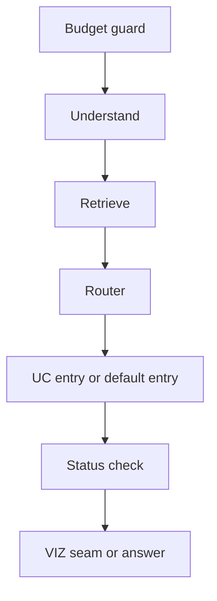

# Agent workflow architecture

This page owns the agent runtime: the frozen LangGraph root, the use-case (UC) registry overlay, the router, run budgets, the text-to-SQL runtime, human-in-the-loop (HITL) resume, checkpointing, and span emission from question to synthesized answer.

Detailed ownership of neighboring concerns lives in [Semantic Layer](./semantic-layer.md), [MCP Server](../integrations/mcp-server.md), [Safety and Access Control](./safety-and-access-control.md), [Text to SQL](../use-cases/text-to-sql.md), and [Quickstart](../quickstart.md).

## 1. Ownership: agent owns the graph and the executor

The system is `agent = model + harness`: the model proposes, the harness disposes. The model supplies language understanding, planning, SQL drafting, and prose. The harness supplies the LangGraph workflow with typed state and bounded retries, database access through MCP, skills, semantic retrieval, checkpointer and memory, role-based access control, trace and audit output, and guardrails.

Package ownership is fixed: `agent` owns the root graph plus the shared `ValidatedQueryExecutor`; it never imports `pg`, `pg-cursor`, or MCP server internals directly, so all database I/O flows through the MCP client. The checkpointer port takes only a connection string for the same reason: checkpoint payloads stay plain JSON and serializable (`packages/agent/src/state.ts:16-21`, `packages/agent/src/ports/checkpoints.ts:1-30`).

## 2. Frozen root topology and dependency seams

The frozen root builder compiles `START -> budgetGuard -> understand -> retrieve -> router -> (ucEntry | defaultEntry) -> statusCheck -> (vizSeam | answer) -> END` (`packages/agent/src/graph.ts:114-205`). UC owners must not edit this topology; they extend it through the registry and injected seams.

Injection stays explicit through `RootGraphDeps` (`packages/agent/src/graph.ts:35-50`):

- `checkpointer` defaults to in-memory `MemorySaver`; the durable `PostgresSaver` is injected by the host and never falls back silently.
- `retrieve` defaults to a no-op; the executor describe path is injected.
- `ucHandlers` merges over the registry table at build time and never edits `graph.ts`.
- `viz` defaults to a no-op; the visualization owner injects the renderer.
- `synthesize` defaults to keep-or-derive; the model factory injects the zero-tools writer.
- `emitSpan` defaults to a no-op sink; the tracer wires the redacted writer.
- `textToSql` carries the intent and SQL model plus executor seams; production uses real models, tests inject fakes.

Edges encode the governance rules. A tripped `budgetGuard` short-circuits directly to `answer`, so no model or MCP I/O runs after the trip. The router dispatches only to registry overlay entries by allowlist: when `overlay.has(state.ucId)` it takes `ucEntry`, otherwise it takes `defaultEntry`. The `statusCheck` sends `ok` and `no_data` through the VIZ seam and synthesizes `needs_clarification`, `restricted`, `cannot_answer`, and `error` with partial findings.

## 3. Registry overlay and router

The registry is the sole file the frozen root builder reads for UC wiring (`packages/agent/src/subgraphs/registry.ts:31-50`). `registerUC`, `getUcEntry`, `isKnownUc`, and `listUcIds` manage the table, `DEFAULT_ROUTE_ID` is `tracer`, and the build fails when no default route is present (`packages/agent/src/graph.ts:80-97`). The per-graph text-to-SQL entry always overwrites the import-time registry entry so production transport and trace dependencies come from run time.

Explicit `ucId` values stick when registered; otherwise `routeQuestionToUc` classifies the question (`packages/agent/src/graph.ts:154-197`, `packages/agent/src/router.ts:59-75`). Definitional and formula lookups stay on the default route, diagnostic Why and variance questions with directional change or comparison route to `root-cause-analysis`, and everything else falls back to the default route. Transport identity comes from `RunnableConfig.configurable` populated by the host, never from prompt text; the tracer default entry fails closed when any of `mcpUrl`, `token`, `runId`, `userId`, `roleScope`, `threadId`, or `tracesDir` is missing (`packages/agent/src/subgraphs/registry.ts:140-164`).

The tracer default route preserves the demo chain — propose SQL, `list_tables`, `run_query` capped to the preview limit, deterministic answer — writing the same span events so the demo path keeps passing while real subgraphs land (`packages/agent/src/subgraphs/registry.ts:174-294`). `runTracerGraph` builds the frozen root and invokes it on the demo question with per-call run identity headers (`packages/agent/src/graph.ts:228-269`).

## 4. Ask-to-synthesize flow with span emission

A text-to-SQL run flows from question to synthesized answer through budgeted, traced steps:

1. `budgetGuard` seeds one persistent absolute deadline and stops before any I/O when already tripped.
2. `understand` loads the `text-to-sql` skill contract and proposes a serializable intent with one budgeted LLM call, emitting an `llm_call` span with model, token counts, and cost.
3. `retrieve` supplies semantic chunks through the injected retriever.
4. `router` resolves the UC entry by allowlist.
5. `ucEntry` runs definition fast-path, unknown-term, and clarification gates, then the executor (`describe_table`, `explain_query`, `run_query`, bounded repair), forwarding executor spans through the root emitter with tool names collected.
6. `statusCheck` routes `ok` and `no_data` through `vizSeam`; all other statuses skip visualization.
7. `answer` synthesizes from handler output or derives from the capped preview.

Span emission is uniform: every implementation receives a `RootRuntime` with a span sink plus the LangGraph runnable config, and `SpanEvent` plus `SpanEmitter` standardize node, type, duration, payload, parent span, and attempt (`packages/agent/src/state.ts:182-198`). The text-to-SQL entry copies live counters into an executor-local `BudgetState`, runs, then writes back only the deltas so the root reducer stays additive (`packages/agent/src/subgraphs/textToSql.ts:561-638`).

*Caption: Root request flow from budget governance through routed entry to gated synthesis.*

## 5. State, invariants, and bounds

Shared root state is plain JSON only: no pool, class instance, function, or `pg` import may enter the schema because checkpoint payloads serialize verbatim into `PostgresSaver` rows (`packages/agent/src/state.ts:16-21`). Checkpointed preview rows are capped at `RESULT_PREVIEW_MAX = 50`; the full up-to-1000-row buffer lives in transient RAM outside state (`packages/agent/src/constants.ts:8-9`).

`AgentStateSchema` carries question, `ucId`, structured intent with metric, dimensions, filters, time range, requested metrics, schema entities, and query mode, semantic chunks, capped `resultPreview`, columns, SQL, tables used, tools called, answer status defaulting to `no_data`, answer text, additive budget and telemetry reducers, run and thread identity, nullable VIZ spec, nullable pending clarification with a 0-to-2 clarification-attempts counter, and nullable UC-05 `analysisPlan` plus `rootCauseAnswer` (`packages/agent/src/state.ts:115-172`). Budget and telemetry use `ReducedValue` reducers so concurrent node writes add counters instead of overwriting limits and deadlines.

Run-level budgets default to 20 LLM calls, 60000 tokens, and a 120000 ms creation window (`packages/agent/src/constants.ts:11-19`). The executor budget module is pure and DB-free: `createBudgetState` builds the mutable counters plus the absolute deadline epoch, `checkBudget` trips on `llm-calls`, `tokens`, or `deadline` without mutating state, `recordLlmCall` records a completed call, and `estimateTokens` supplies the conservative fallback when the provider omits usage (`packages/agent/src/queryExecutor/budgets.ts:28-81`).

## 6. Text-to-SQL runtime

The text-to-SQL overlay is the first real UC overlay. Its `understand` node loads the skill contract and proposes the intent with one budgeted LLM call; its entry handles `definition_lookup` from retrieved chunks with no executor or MCP, short-circuits unknown requested metrics before any MCP, normalizes schema entities to bare table names, and maps every executor outcome onto `AgentState` with the preview capped to 50 rows (`packages/agent/src/subgraphs/textToSql.ts:236-297`, `packages/agent/src/subgraphs/textToSql.ts:428-483`). Production MCP calls strip identity from tool arguments and send it as transport headers; fakes keep observing it inside arguments (`packages/agent/src/subgraphs/textToSql.ts:138-157`).

The entry order is definition lookup, unknown-term gate, ambiguous-metric clarification (at most two turns), identity and transport check, candidate-table normalization, executor run, large-query time-range clarification, and result mapping with budget deltas. Unknown MCP failure shapes fail closed as non-repairable errors, and the zero-row path runs only on the first attempt with a filter present before concluding `no_data`.

## 7. HITL resume and checkpointing

Human-in-the-loop state rides the same checkpointer. `pendingClarification` carries the offered options for `needs_clarification`; `requestClarification` requires a non-empty question and two to four options with attempts 0 to 2, `makeThreadId` builds `chat:{userId}:{sessionId}` fail-closed on empty parts or over-length ids, and `isSameThread` gates resume to the same thread (`packages/agent/src/hitl.ts:20-36`, `packages/agent/src/hitl.ts:58-95`, `packages/agent/src/state.ts:164-167`).

`pauseForApproval` and `pauseForClarification` wrap LangGraph `interrupt` so approval suspends inside the node, and `resumeDecision` builds `Command({ resume: value })` for invocation on the same `thread_id` — never a fresh input object, because fresh inputs re-run generation and can double-execute side effects (`packages/agent/src/hitl.ts:111-122`). A resume response is accepted only when it exactly matches a presented option, and metric disambiguation is limited to two selections.

Durable memory is built by the host through `createCheckpointer`, which takes only a connection string, pins the schema to `langgraph`, runs `setup()` exactly once so the four checkpoint tables exist before the first invoke, and throws at factory time on unreachable hosts, bad credentials, or missing schema rights — never catching and continuing to `MemorySaver` (`packages/agent/src/ports/checkpoints.ts:42-72`). The factory rejects the read-only `agent_ro` URL before touching the network because checkpoints require the `harness_state` owner (`packages/agent/src/ports/checkpoints.ts:80-93`). `MemorySaver` remains the default for unit tests and the demo path; `PostgresSaver` is the crash-safe host path with identical JSON state.

## 8. Failure behavior and extension seams

Characteristic failures the harness is designed to contain: fan-out double counting on multi-row joins, wrong metric definitions, PII leakage, runaway cartesian queries, hallucinated numbers for unanswerable questions, and injected instructions in data. The corresponding mitigations are join rules with pre-aggregation, semantic citations, code-enforced access control and masking, `EXPLAIN` gating with timeouts, `cannot_answer` with explicit missing-table reasons, and treating retrieved rows as data.

Planned extension seams, with the registry and port seams already usable:

- Add a new UC handler through `registerUC` without editing the frozen root builder.
- Add a new skill directory following the skill contract without changing the core loop.
- Inject a new retriever, VIZ renderer, or synthesizer through `RootGraphDeps`.
- Add a new role scope or sensitive column in the policy; the rewrite and masking layers pick it up without prompt changes.
- Add an additive contract field or schema with one owner review; breaking changes need a version bump and all affected owners.

## 9. Focused tests

Representative focused tests pin each seam without live credentials:

- Root graph seam and allowlist routing with injected doubles (`packages/agent/test/graph.test.ts:40-103`).
- Executor core path with canned proposals and a stub MCP caller (`packages/agent/test/executor.test.ts:108-200`).
- Local safety-gate matrix for sensitive columns, aggregates, and joins.
- Checkpointer factory fail-fast and `agent_ro` rejection.
- HITL interrupt plus resume on `MemorySaver` without re-running completed work.
