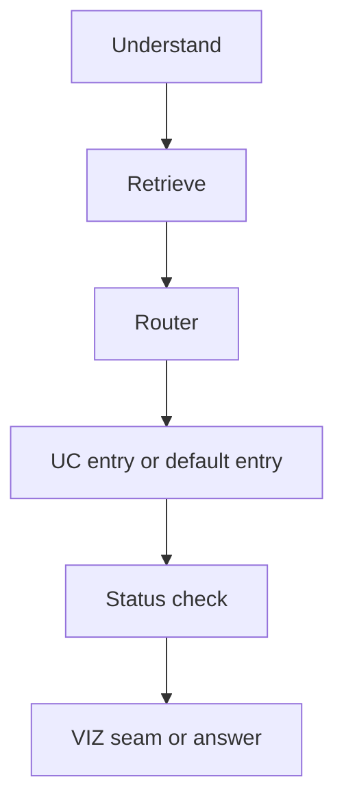

# Agent workflow and harness architecture

This page owns the reference agent loop and the shared harness that makes it safe and observable. The normative product contract is the reference diagram in [PRD §2.4](../../docs/prd.md) and the tool, skill, safety, and observability contracts in [PRD §4.1–§4.4](../../docs/prd.md). The buildable synthesis is [Architecture](../../docs/architecture.md).

Detailed ownership of neighboring concerns lives in [Semantic Layer](./semantic-layer.md), [MCP Server](../integrations/mcp-server.md), [Eval and Safety Harness](../evals/eval-and-safety-harness.md), [Safety and Access Control](./safety-and-access-control.md), and [Quickstart](../quickstart.md).

## 1. Ownership: agent equals model plus harness

The system is defined as `agent = model + harness`: the model proposes, the harness disposes. The model supplies language understanding, planning, SQL drafting, chart choice, and prose. The harness supplies everything that makes those outputs trustworthy:

- LangGraph workflow with typed state, branching, and bounded retries.
- Database tools over a read-only connection, exposed through MCP.
- Reusable skills, semantic index, checkpointer and memory, role-based access control plus PII policy, trace and audit log, guardrails, and eval runner.

Course rules reinforce this split: the team must build its own agent and must not wrap a hosted text-to-SQL or BI agent product; LangGraph is the recommended workflow framework; prompting alone is never accepted as a safety layer.

Package ownership is fixed: `contracts` owns shared validation shapes, `mcp-server` owns all database I/O, `access-policy` owns pure policy and redaction, `agent` owns the graph plus the shared `ValidatedQueryExecutor`, `api` owns run and thread identity plus persistence, and `web` owns the UI.

## 2. Public surface: shell marker plus state, graph, and registry

`packages/agent` no longer exports only a placeholder. Its public surface is the shell marker plus the frozen shared modules (`packages/agent/src/index.ts:3-15`):

```ts
export const AGENT_SHELL =
  "Agent shell: LangGraph.js root graph skeleton (AGENT-01) with registry seam; services land in sibling plans";
export * from "./state.js";
export * from "./graph.js";
export * from "./subgraphs/registry.js";
```

`AGENT_SHELL` records the skeleton stage, `AgentShellError` re-exports the contracts `DbToolError`, and the barrel comment assigns ownership: shared state, the frozen root builder with its dependency-injection point, and the registry seam are owned here, while sibling plans satisfy the `RootGraphDeps` hooks without editing `graph.ts`.

Upstream callers of the graph are the API host and scheduled triggers; downstream callees are the model through structured output and the MCP server through the MCP client. Until per-UC subgraphs land, callers depend on the frozen contract shapes and the registry seam, not on UC node internals.

## 3. Implemented root graph and registry seam

The frozen root builder compiles `understand -> retrieve -> router -> (ucEntry | defaultEntry) -> statusCheck -> (vizSeam | answer) -> END` (`packages/agent/src/graph.ts:73-160`). The router dispatches only to registry entries by allowlist; unknown `ucId` values fall through to the default route. `ok` and `no_data` continue to the VIZ seam; clarification-gate (`needs_clarification`), policy-restricted (`restricted`), and error outcomes synthesize with partial findings.

Injection stays explicit through `RootGraphDeps` (`packages/agent/src/graph.ts:36-49`):

- `checkpointer` defaults to in-memory `MemorySaver`; the durable `PostgresSaver` is injected by the host and never falls back silently.
- `retrieve` defaults to a no-op; the executor describe path is injected.
- `ucHandlers` merges over the registry table at build time and never edits `graph.ts`.
- `viz` defaults to a no-op; the VIZ owner injects the renderer.
- `synthesize` defaults to keep-or-derive; the model factory injects the zero-tools writer.
- `emitSpan` defaults to a no-op sink; the tracer wires the redacted writer.

The registry is the sole file the frozen builder reads for UC wiring (`packages/agent/src/subgraphs/registry.ts:16-45`). `registerUC`, `getUcEntry`, `isKnownUc`, and `listUcIds` manage the table, `DEFAULT_ROUTE_ID` is `tracer`, and the build fails when no default route is present (`packages/agent/src/graph.ts:97-100`). Transport identity comes from `RunnableConfig.configurable` populated by the host, never from prompt text; the default entry fails closed when any of `mcpUrl`, `token`, `runId`, `userId`, `roleScope`, `threadId`, or `tracesDir` is missing (`packages/agent/src/subgraphs/registry.ts:64-88`).

The tracer default route preserves the demo chain — propose SQL, `list_tables`, `run_query` capped to the preview limit, deterministic answer — writing the same span events so the demo path keeps passing while real subgraphs land (`packages/agent/src/subgraphs/registry.ts:98-200`). `runTracerGraph` builds the frozen root and invokes it on the demo question with per-call run identity headers (`packages/agent/src/graph.ts:181-228`).



*Caption: Implemented root request flow from understanding through routed entry to gated synthesis.*

## 4. State, budgets, and memory ports

Shared root state is plain JSON only: no pool, class instance, function, or `pg` import may enter the schema because checkpoint payloads serialize verbatim into `PostgresSaver` rows (`packages/agent/src/state.ts:9-13`). Checkpointed preview rows are capped at `RESULT_PREVIEW_MAX = 50`; the full up-to-1000-row buffer lives in transient RAM outside state (`packages/agent/src/state.ts:15-16`).

Run-level budgets default to 20 LLM calls, 60000 tokens, and 120000 ms (`packages/agent/src/state.ts:18-23`). `AgentStateSchema` carries question, `ucId`, structured intent with metric, dimensions, filters, and time range, semantic chunks, capped `resultPreview`, columns, SQL, tables used, tools called, answer status defaulting to `no_data`, answer text, additive budget and telemetry reducers, run and thread identity, nullable VIZ spec, and nullable pending clarification (`packages/agent/src/state.ts:93-141`).

Runtime wiring is injected ports, not owned tables. `RootRuntime` hands every implementation a span sink plus the LangGraph runnable config; `RetrieveFn`, `UcEntryHandler`, `VizFn`, and `SynthesizeFn` share one `(state, runtime)` signature, and `SpanEvent` plus `SpanEmitter` standardize node, type, duration, payload, parent span, and attempt (`packages/agent/src/state.ts:151-184`).

Durable memory is built by the host through `createCheckpointer`, which takes only a connection string, pins the schema to `langgraph`, runs `setup()` exactly once so the four checkpoint tables exist before first invoke, and throws at factory time on unreachable hosts, bad credentials, or missing schema rights — never catching and continuing to `MemorySaver` (`packages/agent/src/ports/checkpoints.ts:42-72`). The factory rejects the read-only `agent_ro` URL before touching the network because checkpoints require the `harness_state` owner (`packages/agent/src/ports/checkpoints.ts:80-93`).

Short-term analysis state and multi-step task state (`todo`, `doing`, `done`, `skipped`, `failed`) persist in that checkpointer with resume, branching on contribution share, depth and query caps, per-step retry that marks `failed` and continues, and `interrupt`-based human review of plans and costly queries.

## 5. Shared execution primitive: ValidatedQueryExecutor and safety gate

Every agent SQL query uses the same primitive: selective describe, generation, local pre-check, `run_query`, then bounded repair (`packages/agent/src/queryExecutor/executor.ts:1-10`). The model seam is a narrow structured-output interface returning `SqlProposal` with SQL plus tables used, and the MCP seam is one `call(tool, args)` method that throws `DbToolError` on tool failure with per-call run identity inside args (`packages/agent/src/queryExecutor/executor.ts:52-73`).

Total attempts are hard-capped at `MAX_ATTEMPTS = 3`, and a `TIMEOUT` retry tightens to `TIMEOUT_RETRY_LIMIT = 50` rows after dropping the `ORDER BY` tail, always re-passing the local gates before any MCP call (`packages/agent/src/queryExecutor/executor.ts:38-43`). The safety-gate cap for non-aggregate detail queries is `DETAIL_QUERY_LIMIT = 200` (`packages/agent/src/queryExecutor/safetyGate.ts:16-22`).

Order inside the executor is selective `describe_table` for candidate tables only, structured SQL proposal, local `sqlGuard` plus `LocalQuerySafetyGate`, `explain_query` and `run_query`, then the repair loop with one `TIMEOUT` simplification and a single-pass zero-row diagnostic (`packages/agent/src/queryExecutor/executor.ts:292-350`). Describe failures return immediately because the catalog they would build is the repair loop ground truth. Unknown MCP failure shapes fail closed as non-repairable `INTERNAL_ERROR`; the server `cursorPosition` is preserved so repair feedback can point at it (`packages/agent/src/queryExecutor/executor.ts:194-226`). Policy-restricted codes (`SCOPE_DENIED`, `SENSITIVE_COLUMN_DENIED`, `FORBIDDEN_STATEMENT`, `FORBIDDEN_FUNCTION`, `UNAUTHORIZED`) map to `restricted`; everything else maps to `error` (`packages/agent/src/queryExecutor/executor.ts:175-187`).

The agent-side gate runs after `sqlGuard` and before any MCP call: server-side access policy remains authoritative (`packages/agent/src/queryExecutor/safetyGate.ts:1-7`). It denies any catalog-marked sensitive column referenced in any clause, denies `JoinExpr` nodes with no `ON` or `USING` condition and comma-separated `FROM` lists as implicit cross joins, and routes large-table scans to clarification (`packages/agent/src/queryExecutor/safetyGate.ts:57-100`).

## 6. Shared frozen contracts

Contracts evolve additive-only after the freeze: adding optional fields, schemas, or widening enum members needs one code-owner review, while removing or renaming fields, tightening types, changing enum members, or changing error codes needs a `CONTRACTS_VERSION` major bump plus approval from every affected UC owner (`packages/contracts/README.md:8-19`). The single version constant is `CONTRACTS_VERSION = "1.0.0"` (`packages/contracts/src/index.ts:12`). All fields are canonical `camelCase`; snake-case variants are not added and consumers map them at their own boundary (`packages/contracts/README.md:21-28`).

Errors are 12 frozen codes. Only `TIMEOUT`, `RATE_LIMITED`, and `INTERNAL_ERROR` are retryable; only `INVALID_SQL`, `UNKNOWN_TABLE`, and `SQL_EXECUTION_ERROR` are repairable, computed by `dbToolError()` from `RETRYABLE_CODES` and `REPAIRABLE_CODES` with an optional non-negative `cursorPosition` (`packages/contracts/src/errors.ts:8-59`). Routing is transport retry with backoff for transient codes, bounded repair with sanitized code plus cursor for SQL diagnostics (at most 3 attempts), and immediate hard abort on attempt 1 for hard security and policy codes (`packages/contracts/README.md:54-64`). The error test pins the 12-code count, timeout retryability, and scope-denial non-retryability (`packages/agent/test/executor.test.ts:1-80`, `packages/contracts/test/errors.test.ts:34-36`).

`SQLAnswer` carries structured intent with metric, dimensions, filters, and time range, nullable SQL, tables used, citations defaulting to empty, attempts capped at 3, result preview capped at 50 rows, non-empty answer text, a six-value status enum (`ok`, `no_data`, `cannot_answer`, `needs_clarification`, `restricted`, `error`), and telemetry with prompt, completion, and embedding tokens plus cost and latency (`packages/contracts/src/answers.ts:27-57`). The schema test rejects a fourth attempt and a 51-row preview (`packages/contracts/test/schemas.test.ts:41-57`). The `AgentResponse` union adds `insight_report`, `analysis_plan`, `root_cause`, and `anomaly_alert` envelope variants around the same status core.

Trace identity is `runId`, `threadId`, `userId`, `role`, node, type, timestamp, and duration, with optional `spanId`, `parentSpanId`, and `attempt` so older writers stay valid (`packages/contracts/src/trace.ts:7-22`). The schema test rejects an empty run ID (`packages/contracts/test/schemas.test.ts:70-83`). Trace and audit sinks must remain redacted of raw PII values.

## 7. Boundaries, identity, trace, and skills

Import boundaries make bypass structurally harder. ESLint forbids `pg`, `pg-cursor`, and MCP server internals in `packages/agent`, `packages/access-policy`, and `apps/api` (with only the `apps/api` store DAO and its test excepted because that DAO legitimately owns `pg`), forcing all database access through the MCP client (`eslint.config.mjs:22-57`). The web UI carries the driver ban plus the MCP server ban plus a contracts-only workspace rule, so it imports shared types from `@shared/contracts` only (`eslint.config.mjs:68-118`).

Per-call MCP identity travels as headers, not tool arguments: the long-lived client forks `Authorization Bearer` plus `X-Run-Id`, `X-User-Id`, and `X-Role-Scope` from `RunnableConfig.configurable` through a hook, so prompt-injected headers can never reach the transport (`packages/agent/src/mcpClient.ts:1-10`).

Every span is stamped with a random UUID and delegated to the redacted trace writer; payloads carry counts and column names only, never cell values (`packages/agent/src/telemetry/spans.ts:1-10`). `appendTraceEvent` redacts row payloads, validates against `TraceEventSchema`, scans the serialized line for residual PII, appends one JSON line per event under `traces/<runId>.jsonl`, and returns the span ID plus file and redaction flag (`packages/agent/src/traces/writer.ts:73-87`). `writeTraceEvent` keeps the graph and tracer call sites on the same redacted path (`packages/agent/src/traces/writer.ts:94-99`).

Skills stay declarative Markdown contracts validated against canonical sections, loaded at node entry and emitted as `skill_call` spans with no runnable scripts, database connections, or credentials.

## 8. Extension seams and failure behavior

Planned extension seams, with the contract and policy seams already usable:

- Add a new skill directory following the skill contract without changing the core loop.
- Add a corpus document type or metric alias and reindex only the changed chunk.
- Add a new UC handler through `registerUC` without editing the frozen root builder.
- Add a new role scope or sensitive column in the policy file; the rewrite and masking layers pick it up without prompt changes.
- Add a cheaper-alternative strategy to the approval gate or a new chart type behind `render_chart` validation.
- Add an additive contract field or schema with one owner review; breaking changes need a version bump and all affected owners.

Characteristic failures the harness is designed to contain: fan-out double counting on multi-row joins, wrong metric definitions, PII leakage, runaway cartesian queries, hallucinated numbers for unanswerable questions, and injected instructions in data. The corresponding mitigations are canonical join rules with pre-aggregation, semantic citations, code-enforced RBAC and masking, `EXPLAIN` gating with timeouts, `cannot_answer` with explicit missing-table reasons, and treating retrieved rows as data.

## 9. Focused tests

Representative focused tests pin each seam without live credentials:

- Root graph seam and allowlist routing with injected doubles (`packages/agent/test/graph.test.ts:31-100`).
- Executor core path with canned proposals and a stub MCP caller (`packages/agent/test/executor.test.ts:1-80`).
- Local safety-gate matrix for sensitive columns, aggregates, and joins (`packages/agent/test/safetyGate.test.ts:83-100`).
- Twelve-code error surface and retryability (`packages/contracts/test/errors.test.ts:34-36`).
- Answer attempt and preview bounds plus trace identity rejection (`packages/contracts/test/schemas.test.ts:41-57`, `packages/contracts/test/schemas.test.ts:70-83`).
- Checkpointer factory fail-fast and `agent_ro` rejection (`packages/agent/test/ports.test.ts`).
