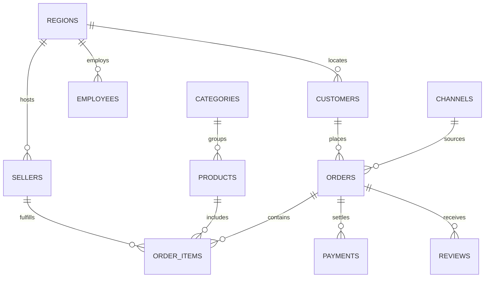
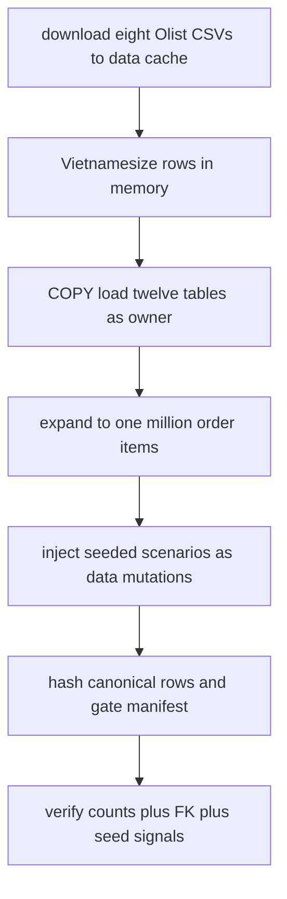

# Business database and seeded scenarios

This page owns the Olist-VN business database the Analytics Agent queries: where the source bytes come from, how they are Vietnamesized, what the `public.*` schema and role grants look like, how `packages/data` loads and verifies the database, and how seeded drift, anomaly, and injection fixtures stay hidden from the agent.

> Read boundary: this page documents loader scripts and schema files only. It never reproduces ignored data dumps (`data/*.csv`, `data/*.parquet`, `data/*.db`, `data/*.sqlite`, `data/*.duckdb`), `packages/data/src/seeds.json` payloads, `data/seed_manifest*.json` checksums, `data/seeded_scenarios.md`, or `evals/**` gold content. See `.openwikiignore` for the full boundary.

## 1. Responsibility and scope

The business database is a fictional Vietnamese e-commerce database derived from the public Olist datasets. It is the only external data system the agent queries. Text-to-SQL grounding, metric definitions, costly-query gating, RBAC and masking, MCP tools, and eval scoring all depend on it.

Key boundaries:

- Single implemented target is PostgreSQL 16 with `pgvector` in Docker (`docker/docker-compose.yml`), database `chosen`. DuckDB and SQLite remain allowed spec targets, but the loader, grants, and verifier described here target PostgreSQL.
- Agent access is read-only by connection grants, not by prompt. The agent connects as `agent_ro` (`SELECT` on `public.*` plus `semantic.chunks` only); validators and prompts are additional layers.
- All personal data is synthetic output of a seeded Faker instance. Real customer PII must never enter the repository.
- Seeded scenario causes and expected results are hidden from the agent, its retrieval index, and its few-shot examples.

Related behavior lives in [Semantic Layer](../agent/semantic-layer.md), [Eval and Safety Harness](../evals/eval-and-safety-harness.md), and [MCP Server](../integrations/mcp-server.md). The normative product spec is [PRD](../../docs/prd.md).

## 2. Source datasets and pinned download

The build starts from eight Olist publisher CSVs plus the category-translation CSV, fetched at load time over HTTPS from `olist/work-at-olist-data` into the git-ignored `data/.cache/`. No Kaggle token or browser step is required, and no CSV is ever committed.

`packages/data/src/download.ts` is the trust boundary:

- The `OLIST_FILES` registry pins every file by exact byte size, git blob SHA-1, and SHA-256, with a per-file `bom` flag for the translation CSV.
- Every downloaded byte stream is verified against the pinned table before parsing. Any mismatch throws fail-fast naming the file.
- Cache resolution follows explicit-argument beats `OLIST_CACHE_DIR` beats compiled-in default; `cachePathFor` rejects any name outside the registry so a caller cannot be tricked into reading or writing an arbitrary path.
- The 61 MB geolocation dump is intentionally excluded; sellers already carry city and state.

## 3. Vietnamesization transforms

`packages/data/src/transform.ts` holds pure data-in, data-out transforms with no `pg` or filesystem imports, so use-case owners can read every mapping without touching loader or database code. The only randomness in the pipeline flows through `createSeededFaker(seed)`; `Math.random` and `Date.now` are never used.

| Step | Implementation |
|---|---|
| Geography | 27 Olist state codes map deterministically to Vietnamese provinces via `STATE_TO_PROVINCE`; `regionOfProvince` groups the 34 post-merger provinces into `Bắc`, `Trung`, `Nam`. Every fourth customer and seller is reassigned through a fixed weighted spread cycle so all 34 provinces, including the scenario provinces, carry real base volume. |
| Catalog | 71 English category names map to Vietnamese via `CATEGORY_VI_BY_EN`; blank names, `pc_gamer`, and the long kitchen-preparer code use explicit fallbacks, anything else becomes `Khác`. Product display names are synthesized as Vietnamese category plus sequence number. |
| Currency | `brlToVnd` converts `round(BRL * 5150 / 1000) * 1000` with rate `5150`, so prices, freight, and payment values are integer VND. |
| Time | `shiftOrderDate` adds 2905 days (415 weeks, weekday-preserving) in UTC, preserving clock time; results before `2025-01-01` are clipped so the dataset spans 2025-01 through 2026-09 and September 2026 scenarios land in-window. |
| People and channels | Customer names, phones, emails, and addresses plus employee names and salaries come from the single seeded Faker with locale chain `[vi, en, base]`. Order channels are five fixed rows: Shopee, Lazada, TikTok Shop, Website, and store. |
| Order status | Eight measured Olist statuses fold to `delivered`, `shipped`, or `canceled`; `returned` never comes from Olist and is reserved for anomaly injection. Unknown statuses throw fail-fast. |

## 4. Schema and role layer

DDL lives in `docker/initdb/`, never in the loader. `03_public.sql` creates the 12 FK-linked `public.*` business tables under `SET ROLE owner`. Conventions are `TEXT` ids (Olist hex strings), `INT` VND amounts, and `TIMESTAMPTZ` event dates. The PII columns `customers.phone`, `customers.email`, `customers.address`, and `employees.salary` match `policies/sensitive_columns.yaml`.



*Caption: core retail tables and foreign-key relationships in public schema.*

Notes on the diagram and DDL:

- `regions` (`province` primary key, `region_group` check), `channels`, `categories`, `sellers`, `products`, `customers`, `employees`, `promotions` (30 deterministic monthly rows, standalone with no FKs), `orders`, `order_items` (identity primary key `order_item_id`), `payments`, and `reviews` make up the 12 tables loaded in FK-safe `LOAD_ORDER`.
- Indexes cover every FK plus `orders.purchase_date` and `orders.status`; `reviews` defaults empty title and message; `promotions` enforces `ends_on >= starts_on` and `discount_pct` range.
- The known fan-out trap is intentional: one order can have many payment rows, so naive `orders` joins `payments` double-count unless pre-aggregated in a CTE.

Roles and grants span `01_roles.sql` and `02_schemas.sql`:

- Four login roles: `owner` (DDL and load only), `agent_ro` (MCP `SELECT`), `indexer` (RAG CLI writes to `semantic.*` only), and `harness_state` (owns `semantic`, `langgraph`, and `app_state`).
- `agent_ro` holds `CONNECT`, `USAGE` on `public` and `semantic`, and `SELECT` on present and future `public` tables via `ALTER DEFAULT PRIVILEGES`. It holds no `TEMP`, no `CREATE`, no sequence usage, and only the single chunk-table grant in `semantic`. The `default_transaction_read_only` and timeout settings are defense in depth; the grant absence is the real enforcement and is covered by an override-path denial matrix.
- `indexer` holds zero rights on `public`, `langgraph`, or `app_state`; `harness_state` holds zero grants on `public` or `semantic` reads plus `CREATE` on the database itself so `PostgresSaver` setup can own its schemas.
- All role passwords in `01_roles.sql` are loopback-only dev defaults that must match the `:-` defaults in `docker/docker-compose.yml`. The container binds `127.0.0.1:${POSTGRES_PORT:-5433}:5432` with a `pgdata` volume, an `initdb` bind-mount, and a `pg_isready` healthcheck. Changing a password requires `down -v` because initdb reruns only on an empty volume.

## 5. Loader pipeline

Entry points are `pnpm data:load` (`tsx packages/data/src/load.ts`) for the load and `pnpm db:up` (`docker compose -f docker/docker-compose.yml up -d`) to start PostgreSQL first. The loader requires `OWNER_DATABASE_URL` and fails fast when it is unset. `packages/data/src/copy.ts` provides the owner pool, transactional `withOwnerTx` helper with rollback and credential-redacting error formatting, and chunked `COPY <table> (<columns>) FROM STDIN` ingestion where table and column names come from the internal `TABLE_LOADERS` registry, never from user input.



*Caption: load then verify flow from publisher bytes to checked database.*

Control flow inside `buildDataset` and `loadTables`:

- Stream-parse each cached CSV with `csv-parse`, build an in-memory working set in `LOAD_ORDER` (parents before children), and filter child rows against surviving parents with per-class skip counters.
- Static tables need no CSV: 34 region rows mirrored from `transform.ts`, five channel rows, and 30 promotions cycling 2025-01 through 2026-09.
- `TRUNCATE ... RESTART IDENTITY` resets a full twelve-table load in one statement; partial `--tables=` loads are iteration-only, skip the manifest gate, and require a later full load before verify.
- `COPY` runs in 50,000-row chunks inside one transaction per table, then reads back `SELECT ... ORDER BY pk` to confirm the written count before hashing.
- Scale is `full` by default (nine expansion passes plus top-up to 1,000,000 `order_items`, about six minutes) or `--scale=small` (one pass plus 60,000 target, under two minutes). Scale is recorded in `dataset_version`, and each scale pins its own manifest file.

Expansion clones whole orders with new surrogate ids, jittered clock time on the same calendar date, and plus or minus 5% money jitter, all drawn from the single seeded Faker. Seeded injection runs strictly after expansion as data mutations (deletes, updates, inserts, never DDL), ordered so proportional cuts are engineered against final post-expansion baselines: September synthesis first, then the AOV price cut, then spikes and flips, then the proportional drift cuts, with a final cascade deleting item-less orders together with their orphaned payments and reviews.

Seed declarations live in `packages/data/src/seeds.json` and are validated by `packages/data/src/seeds.ts`: strict `version: 1` schema with at least three UC-05 scenarios, five UC-10 anomalies, and three injections. Each entry carries a dimension filter, period, magnitude, `SELECT`-only `reference_sql`, and optional payload. UC owners edit the JSON file; no loader code change is needed for new scenarios.

## 6. Determinism and reload gate

`packages/data/src/manifest.ts` records per-table row counts plus a SHA-256 over canonical `ORDER BY pk` CSV (with `DATE` kept as raw text so the hash is timezone-independent). The loader refuses to finish when any overlapping table disagrees with the committed manifest for that scale (`data/seed_manifest.json` for full, `data/seed_manifest.small.json` for small), then merges fresh rows over the stored file. The single `SEED_DATA` Faker seed (default 42) plus the same pinned publisher bytes always yield byte-identical manifests.

## 7. Verifier

`pnpm data:verify` (`tsx packages/data/src/verify.ts`) connects as owner, runs `SELECT` and `COUNT` only, and exits 0 on full pass or 1 naming the first failing assertion. `runChecks` is pure over manifest plus seeds plus client, so unit tests drive it with a stub client and no database. Every check is a single-pass aggregate:

- Per-table row counts match the manifest for the active scale.
- Eleven FK orphan checks return zero (customers, sellers, and employees against regions; products against categories; orders against customers and channels; items against orders, products, and sellers; payments and reviews against orders).
- Every seeded scenario still returns its designed magnitude: UC-05 drift ratios inside negative bands, the returns-surge count above a scale-aware floor, UC-10 spike ratios and week-over-week drops against their bands, and every injection payload present in `public.products`. Entries without a registered assertion rule fail closed.

## 8. One-command load and verify

```bash
pnpm db:up
pnpm data:load
pnpm data:verify
pnpm data:load --scale=small && pnpm data:verify --scale=small
```

Use `pnpm db:reset` (`down -v` plus `up -d`) only when intentionally wiping the volume, such as after a password change. `OWNER_DATABASE_URL` points at the `owner` role URL from the compose-file comment block; agent code never imports the operator-only `copy.ts` path. Partial `pnpm data:load --tables=orders,order_items` speeds iteration but leaves the stored manifest untouched.

## 9. Operations, invariants, and failure behavior

- Read-only by grants. `agent_ro` cannot write, create temp tables, or advance sequences; session defaults can be overridden by `SET`, so the missing grants are the enforcement point.
- No real PII ever. Every phone, email, address, and salary is Faker output. A violation zeroes the related use case and requires purging the data.
- Hidden means hidden. Gold questions, seeded causes, and injection payloads are excluded from agent retrieval and few-shot examples. `packages/data/test/seedHiding.test.ts` scans agent, app, skills, eval, docs, policy, semantic, and script trees for any committed scenario id, payload, or manifest path pointer and fails the build on a leak.
- Scale and sensitivity invariants: at least one table holds one million or more rows at full scale; fake PII columns are marked `restricted_pii` in the semantic layer and masked or denied by scope in the MCP server; `orders.status` semantics and the payments fan-out trap are part of the contract the semantic layer depends on.
- Regenerability: a fresh checkout with the recorded source, license, and transform steps rebuilds the database from the loader alone. If the load and manifest disagree, the loader refuses to finish rather than silently accepting drift.

## 10. Extension points and focused tests

- Add a scenario by appending to `seeds.json` and teaching `verify.ts` its assertion band; the strict Zod schema enforces shape, minima, and `SELECT`-only reference SQL at load time.
- Change a Vietnamesization mapping in `transform.ts` (`PROVINCES`, `STATE_TO_PROVINCE`, category map, rate, shift days, status fold) and both the loader and verifier pick it up; `REGION_ROWS` in `load.ts` must stay in sync with `PROVINCES`.
- Adjust grants only in `docker/initdb/02_schemas.sql` with the matching default-privileges entries; the live role-proof tests assert the full allow and deny matrix.
- Focused tests: `packages/data/test/verify.test.ts` covers manifest hashing and gating, the seeds validation matrix, province-list sync, stub-client verifier helpers, and a skipped-if-no-DB live leg; `shell.test.ts` guards the package shell marker; `roles.live.test.ts` proves the grant matrix against a live database.
