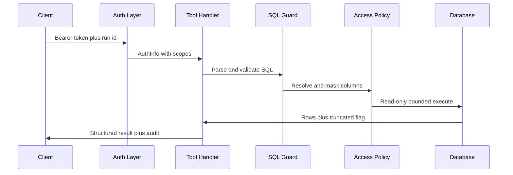

# Database MCP server and operator software

> Status: planned, not implemented. No `packages/mcp-server`, `apps/web`, `policies/`, or `evals/uc09` code has landed; the repository is still in initial setup with only wiki tooling and specs. Everything below is the planned contract from UC-09 in the PRD and the UC-09 TypeScript plan, not inspected runtime code.

This page owns the UC-09 `db-tools` MCP server (tools, resources, scoped auth, independent validation, logging) plus the operator surfaces (Web, CLI, Notebook) and the external-client demo. Cross-cutting safety rules live in [Safety and Access Control](../agent/safety-and-access-control.md), the agent loop that calls this server lives in [Workflow Architecture](../agent/workflow-architecture.md), and grading of its eval suite lives in [Eval and Safety Harness](../evals/eval-and-safety-harness.md).

## 1. Responsibility and ownership boundary

All database access in the system goes through exactly one MCP server, `db-tools`. The server validates SQL, enforces scope, masks sensitive data, and writes audit records independently of the agent, so an outside client faces the same controls as the analyst agent.

Planned ownership split from the UC-09 monorepo layout:

| Area | Planned path | Role |
|---|---|---|
| MCP server | `packages/mcp-server/src/server.ts` | `McpServer` plus `StreamableHTTPServerTransport` on Express, `registerTool` and `registerResource` |
| Auth | `packages/mcp-server/src/auth.ts` | Token verifier mapping Bearer tokens to client identity, role, and scopes |
| SQL guard | `packages/mcp-server/src/sqlGuard.ts` | Independent validator built on `pgsql-parser` |
| Column resolution | `packages/mcp-server/src/resolveColumns.ts` | Expand `*`, aliases, joins, and one-level CTEs to `table.column` |
| Executor | `packages/mcp-server/src/db.ts` | `pg.Pool` for the read-only role with timeout and bounded cursor |
| Errors | `packages/mcp-server/src/errors.ts` | Canonical error codes plus message sanitization |
| Audit | `packages/mcp-server/src/audit.ts` | JSONL audit with redaction and run-id linkage |
| Shared contracts | `packages/contracts` | Shared zod schemas and types for tool I/O and error codes |
| Agent client | `packages/agent` | LangGraph.js agent using an MCP client, never importing server internals |
| Policy config | `policies/mcp_clients.yaml`, `policies/sensitive_columns.yaml` | Declared clients, scopes, and sensitive columns, validated at startup |
| Interface doc | `docs/mcp_interface.md` | Generated tool and resource schemas, scopes, codes, and examples |
| Eval | `evals/uc09/cases.jsonl`, `evals/uc09/runUc09.ts` | About 24 cases plus baseline and regression runs |
| Traces | `traces/uc09/` | At least one success trace plus blocked-call traces |

The agent package must not import `mcp-server/src/db` directly; a planned ESLint `no-restricted-imports` rule enforces the MCP boundary.

## 2. Tools

The planned server exposes five tools with zod input and output schemas shared through `packages/contracts`:

| Tool | Scope needed | Planned behavior |
|---|---|---|
| `list_tables` | `schema:read` | List tables the caller role may see; sensitive columns flagged `sensitive` |
| `describe_table` | `schema:read` | Describe one table; rejects unknown or out-of-whitelist names with `UNKNOWN_TABLE`; wrong types fail zod with `INVALID_PARAMS` |
| `explain_query` | `schema:read` plus `data:read` for full use | Run `EXPLAIN` without `ANALYZE`; return estimated cost and row count, never execute |
| `run_query` | `data:read`, plus `data:sensitive` when touching sensitive columns | Full guard plus policy plus bounded read-only execution; return `columns`, `rows`, `rowCount`, `truncated`, `maskedColumns`, `durationMs` as `structuredContent` with a JSON text fallback |
| `sample_rows` | `data:read` | Return at most 5 rows with sensitive columns already masked; `n = 50` is rejected by the zod maximum |

The main `run_query` flow is planned as ten steps: Bearer auth, scope check, zod parameter check, SQL parse, access-policy rewrite, read-only cursor execution, post-execution PII scan, audit write, and structured response.

## 3. Resources

The planned server exposes two resources via `registerResource`:

| Resource URI | Content |
|---|---|
| `semantic://data-dictionary` | Table and column dictionary in Vietnamese, with sensitive columns hidden or flagged according to the caller role |
| `semantic://metrics` | Metric definitions and sample SQL used by semantic resolution |

Both are readable in MCP Inspector in the demo. They expose only metadata and definitions, never raw row data.

## 4. Scoped auth and role mapping

Authentication is planned at the HTTP layer with the SDK `requireBearerAuth` middleware calling a custom verifier. The verifier looks up the Bearer token in `policies/mcp_clients.yaml` and returns `AuthInfo` with `clientId`, `scopes`, and `extra.role`. Each tool handler then calls `requireScope(authInfo, ...)` for its required scope.

Planned scopes:

| Scope | Grants | Typical holder |
|---|---|---|
| `schema:read` | `list_tables`, `describe_table`, metadata reads | Reviewer agent, least-privilege outside client |
| `data:read` | `run_query`, `sample_rows`, `explain_query` execution path | Analyst agent, reviewer doing small check queries |
| `data:sensitive` | Unmasked values for columns listed in `sensitive_columns.yaml` | HR role viewing salary; withheld from marketing and regional roles |

Example mappings: the analyst agent carries `schema:read` plus `data:read`, with `data:sensitive` added only for the HR role; the reviewer agent carries only `schema:read` plus `data:read`; an outside demo token may carry only `schema:read`, so any `run_query` call fails with `SCOPE_DENIED` and `isError: true`. Missing or wrong tokens fail at the middleware with HTTP 401 and `UNAUTHORIZED`. Static tokens live in `.env`; JWT with expiry is an optional hardening step.

## 5. Independent server-side SQL checks

The server repeats every check locally instead of trusting the agent. The TypeScript plan uses `pgsql-parser` (real PostgreSQL grammar compiled to WASM, loaded once at startup) rather than `sqlglot`, with `node-sql-parser` only as a fallback for the validate step.

Allowed shape:

- Exactly one element in `stmts`.
- Root key is `SelectStmt`, which covers plain `SELECT`, `WITH`, and set operations such as `UNION`.
- Every referenced table and column exists in the whitelist; system schemas are rejected.

Absolute bans, never sent for approval:

- DDL and DML: `InsertStmt`, `UpdateStmt`, `DeleteStmt` anywhere including inside CTEs such as `WITH x AS (DELETE ... RETURNING *) SELECT ...`; multi-statement payloads such as `SELECT 1; DROP TABLE orders`; `intoClause` (`SELECT INTO`); `lockingClause` (`FOR UPDATE`).
- Denylisted functions found by recursive `FuncCall` scan: `pg_sleep`, `pg_read_file`, `dblink`, `set_config`, plus `COPY` and `ATTACH` handling.
- Cartesian joins without a condition and bare `CROSS JOIN` between large tables are blocked or forced into repair.

Column policy is a separate `AccessPolicy` interface with a `ColumnScopePolicy` implementation. `resolveColumns` handles the common cases (`FROM` plus alias, `JOIN`, `SELECT *` and `t.*`, one-level CTEs). Projection references to sensitive columns without `data:sensitive` are rewritten in the AST to masking expressions and deparsed back to SQL; sensitive references in `WHERE`, `JOIN`, aggregates, function arguments, or string concatenation, plus any unresolvable reference touching a sensitive table, fail closed with `SENSITIVE_COLUMN_DENIED`. A post-execution regex scan for phone numbers and emails masks anything that slipped through and sets a `piiScanHit` flag.

## 6. Execution and connection lifecycle

Execution uses a dedicated `agent_ro` PostgreSQL role with only `SELECT`, `default_transaction_read_only = on`, and timeouts. Each `run_query` borrows a client from `pg.Pool` and runs `BEGIN READ ONLY`, then `SET LOCAL statement_timeout = '30s'`, then opens a `pg-cursor` and reads `maxRows + 1` rows, then rolls back. The extra row detects overflow: over-limit results are truncated with `truncated = true` rather than streamed unboundedly. The client is always released in a `finally` block. Database cancel code `57014` maps to `TIMEOUT`; over-limit truncation is not an error.

The three defense layers are independent by design: validator, read-only database role, and post-execution PII scan. The eval plan explicitly disables the guard in one test to prove the database layer alone still rejects a write with its native read-only error.

*Caption: Planned scope-first request path from client auth through SQL guard, column policy, bounded execution, and audit.*

## 7. Trace, audit, and error hygiene

Every call writes exactly one audit line to `logs/mcp_audit.jsonl` via `pino`, whether allowed, denied, or failed. Planned fields are client, scope, tool, parameters with PII literals replaced by placeholders, row count, duration, decision (`allowed`, `denied`, or `error`), and the caller `X-Run-Id` so the line joins to the LangGraph.js trace. `pino` redact removes DSN, password, host, and file paths; SQL literals with PII are redacted before logging.

Error hygiene uses a single `DbToolError` class and `sanitizeError` mapper. Planned codes include `UNAUTHORIZED`, `SCOPE_DENIED`, `INVALID_PARAMS`, `INVALID_SQL` (with a cursor position hint for self-repair), `FORBIDDEN_STATEMENT`, `FORBIDDEN_FUNCTION`, `UNKNOWN_TABLE`, `SENSITIVE_COLUMN_DENIED`, `TIMEOUT`, `RATE_LIMITED` (optional), and `INTERNAL_ERROR`. PostgreSQL codes such as syntax, undefined table, cancel, and read-only violations map to these internal codes. Client-facing messages never contain connection strings, passwords, hosts, file paths, or stack traces; full detail stays in the redacted server log. Configuration files are validated with zod at startup and a bad config prevents the server from starting.

## 8. Operator software display duties

Operator software is worth up to 2.5 points and may be a Web app, a Notebook-style app, or an interactive CLI. The recommended Web app must display progress and results for every submitted use case. Planned duties relevant to this page:

- **Progress streaming:** question-and-answer frame with live step stream (dictionary lookup, SQL generation, repair attempt, review), result table, chart, and a view-SQL button.
- **SQL display:** every answer shows the final SQL plus prior failed attempts already recorded in the trace.
- **Review display:** when the reviewer agent is submitted, each verdict and its findings with evidence and suggestions are shown beside the answer.
- **Approval queue:** when costly-query gating is submitted, over-threshold queries pause in a queue showing SQL, estimated cost, estimated rows, block reason, and a cheaper alternative, with Approve, Reject, and Use-cheaper-option actions.
- **Role switch:** when role access is submitted, a role selector reissues the scoped token so the same question demonstrates masking and row filtering for different roles.
- **Eval dashboard:** execution accuracy overall and by difficulty, repair success rate, reviewer precision and recall, cost-block rate, PII leak count, anomaly hit rate, plus token, cost, and latency averages.
- **Management screens:** data-dictionary and metric-definition administration, plus scheduled alert and periodic-report views.

The UC-09 plan adds a realtime audit table filtered by client, tool, and decision with drill-down into one call, reusing shared types from `packages/contracts`. Notebook form keeps each question as a cell with SQL, result, and chart and supports saving and sharing the session. CLI form supports asking, printing tables, exporting charts to files, and approving queries inline on the terminal.

## 9. External-client demo and independence proof

Because enforcement lives on the server, any MCP client with a valid token can connect. The planned demo uses MCP Inspector (`npx @modelcontextprotocol/inspector`) to list and call all five tools and read both resources, plus a standalone `scripts/externalClient.ts` script that uses only the SDK `Client` and never imports agent code. The demo shows a valid query succeeding and a `DELETE FROM orders` attempt failing with `FORBIDDEN_STATEMENT` and no table change, proving the guard does not depend on agent cooperation.

## 10. Configuration and operations

| Item | Planned handling |
|---|---|
| Monorepo | `pnpm` workspaces with `apps/web`, `apps/api` (SSE stream from agent to Web), `packages/contracts`, `packages/mcp-server`, `packages/access-policy`, `packages/agent` |
| Commands | `pnpm db:up`, `pnpm data:load`, `pnpm --filter mcp-server dev` with `tsx watch`, `pnpm test` with `vitest`, `pnpm eval --uc 09` writing `results/uc09.json`, `pnpm typecheck` plus `pnpm lint` in CI |
| Parser startup | Load `pgsql-parser` WASM once at boot to keep per-call overhead within the 50 ms budget excluding database time |
| Strictness | `strict: true` in `tsconfig`; tool I/O schemas shared via `packages/contracts`; optional per-client rate limiting and JWT expiry as stretch goals |

## 11. Focused tests and eval

Interface documentation is generated from zod schemas (via `zod-to-json-schema` or `z.toJSONSchema`) into `docs/mcp_interface.md` and reviewed by the owner of the text-to-SQL path. Unit coverage targets at least 30 `vitest` cases for the SQL guard plus masking cases for projection, `WHERE` probing, aggregates, concatenation, aliased CTEs, nested CTEs with fail-closed behavior, and the privileged HR path.

The UC-09 eval file plans about 24 cases: one valid call per tool, `sample_rows` overflow, scope exceedance, missing or wrong token, masking and indirect-leak probes, outside DDL and DML attempts, multi-statement and CTE-hidden writes, denylisted functions, slow-query timeout, bad parameters, unknown-table injection strings, connection-failure hygiene (output must not match host, user, or password patterns), and a final audit-completeness pass asserting one fully populated redacted line per request with zero raw PII. The suite runs twice as baseline and regression with a comparison report, targeting full pass, zero executed bans, and zero PII leaks in outputs and logs.
