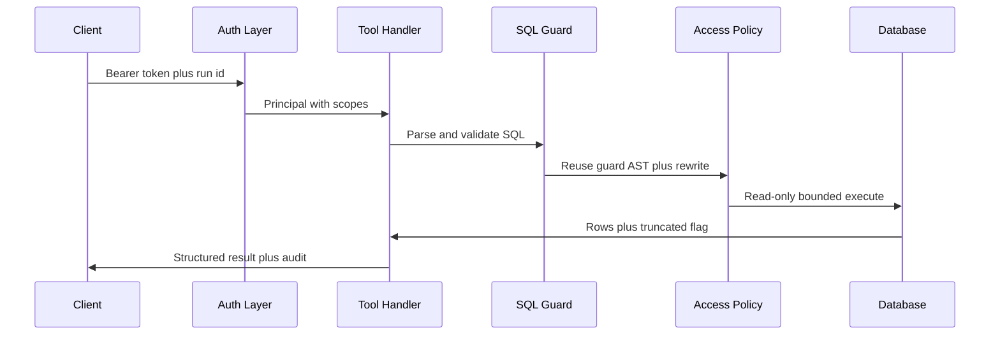

# Database MCP server and gateway

The `db-tools` MCP gateway is the only database path. Every tool call and resource read funnels through the fixed 7-stage pipeline in `packages/mcp-server/src/pipeline.ts`, which is the single entry point every handler calls with load-bearing stage order that is never skipped — auth, scope, zod, `sqlGuard`, `AccessPolicy` reusing the guard AST with no double parse, read-only executor, then PII scan plus exactly one audit line. Non-SQL tools skip stages 4–6 vacuously; the audit stage always runs, including on denials.

Cross-cutting safety rules live in [Safety and Access Control](../agent/safety-and-access-control.md), the agent loop that calls this gateway lives in [Workflow Architecture](../agent/workflow-architecture.md), and seeding plus the schema the catalog mirrors live in [Database and Seeding](../data/database-and-seeding.md).

## 1. Responsibility and ownership boundary

All database access goes through one gateway. The agent, policy, and app packages are forbidden by lint from importing `pg`, `pg-cursor`, or `mcp-server` internals — only the gateway and its operator loader plus the `apps/api` state-store DAO may touch the driver, so an outside client faces the same controls as the analyst agent.

| Area | Path | Role |
|---|---|---|
| Gateway entry | `packages/mcp-server/src/pipeline.ts` | `executeToolCall` and `executeResourceRead` with `GatewayDeps` |
| HTTP host | `packages/mcp-server/src/server.ts` | `McpServer` plus `StreamableHTTPServerTransport` over Express, `registerTool` and `registerResource` |
| Tool specs | `packages/mcp-server/src/tools.ts` | Per-tool scope, zod input schema, `needsSql` flag |
| Auth | `packages/mcp-server/src/auth.ts` | Token verifier mapping Bearer tokens to client identity, role, and scopes |
| Config | `packages/mcp-server/src/config.ts` | Strict zod loaders for `policies/mcp_clients.yaml` and sensitive columns, token resolution from env |
| Catalog | `packages/mcp-server/src/catalog.ts` | Boot-time `information_schema` snapshot merged with sensitive flags |
| Executor | `packages/mcp-server/src/executor.ts` | `pg` pool for the read-only role with timeout and bounded cursor |
| Errors | `packages/mcp-server/src/errors.ts` | Single `sanitizeError` choke-point and PG-code map |
| Audit | `packages/mcp-server/src/audit.ts` | JSONL audit with literal masking and PII redaction |
| Semantic search | `packages/mcp-server/src/semantic/` | Chunker, embedder selection, hybrid retriever backing `search_semantic_layer` |
| Shared contracts | `packages/contracts` | Zod schemas for tool I/O and error codes |
| Interface doc | `docs/mcp_interface.md` | Generated from `@shared/contracts` via `z.toJSONSchema()` |
| Policy files | `policies/mcp_clients.yaml`, `policies/sensitive_columns.yaml` | Declared clients, scopes, row scope, and sensitive columns, validated at startup |

## 2. Tool surface

The gateway serves six tools declared in `TOOL_SPECS`. Each spec names the server-side scope the pipeline enforces, the strict zod input schema applied at stage 3, and whether the call carries client SQL through stages 4–6.

| Tool | Scope needed | Behavior |
|---|---|---|
| `list_tables` | `schema:read` | List catalog tables as `name` plus `schema`; no SQL stages |
| `describe_table` | `schema:read` | Describe one public table with columns, primary key, and foreign keys; unknown names return `UNKNOWN_TABLE` |
| `explain_query` | `data:read` | Return planner cost and row estimate without running; requests containing `ANALYZE` are rejected |
| `run_query` | `data:read`, plus `data:sensitive` only via policy for sensitive columns | Full guard plus policy plus bounded read-only execution; returns `columns`, `rows`, `rowCount`, `truncated`, `maskedColumns`, `durationMs` |
| `sample_rows` | `data:read` | Build `SELECT * FROM "table" LIMIT n` server-side after a catalog lookup; `n` defaults to 5 and is capped at 5 by the contract |
| `search_semantic_layer` | `data:read` | Hybrid vector plus full-text search over the versioned semantic corpus, role-filtered by `data:sensitive` |

`sample_rows` never accepts raw SQL: the pipeline looks up the table in the built catalog and synthesizes a quoted `SELECT` with the validated `n`. `search_semantic_layer` never touches stages 4–6; it calls the injected `search` function with `allowRestricted` derived from the principal, then redacts PII per chunk.

Input and output shapes are frozen in `@shared/contracts` and rendered to `docs/mcp_interface.md`. Representative bounds are `sql` up to 20000 chars, `run_query.maxRows` 1–1000 defaulting to 200, `sample_rows.n` 1–5 defaulting to 5, and table names 1–128 chars.

## 3. Resources

The gateway registers two role-filtered Markdown resources:

| Resource URI | Content |
|---|---|
| `semantic://data-dictionary` | Table and column dictionary loaded from `semantic/data_dictionary.md` |
| `semantic://metrics` | Metric definitions loaded from `semantic/metrics.md` |

Reads go through the same auth, scope, and audit path as tools. The required scope is `schema:read`; principals without `data:sensitive` get sections whose `## ` header ends with `[restricted_pii]` stripped before delivery, and the remaining text passes the shared PII redactor. Unknown URIs return `INVALID_PARAMS`.

## 4. Seven-stage pipeline

`executeToolCall` is the only tool path; `executeResourceRead` is the parallel resource path. Stage order is load-bearing.

*Caption: Scope-first request path from client auth through SQL guard, column policy, bounded execution, and audit.*

Stages for tools:

1. **Tool lookup.** Unknown tool names deny immediately with `INVALID_PARAMS`.
2. **Auth.** `authenticateRequest` resolves the Bearer token against resolved clients into a server-built principal plus `runId`, `userId`, and `roleScope`. Missing or wrong tokens deny with `UNAUTHORIZED`.
3. **Scope.** `requireScope` checks the tool's entry in `TOOL_SCOPES` against the principal. A metadata-only token calling `run_query` fails with `SCOPE_DENIED`.
4. **Zod.** The tool spec's input schema validates `args`. Only field paths are echoed, never values.
5. **SQL guard plus policy.** SQL-carrying tools call `sqlGuard` once with the catalog, then `ColumnScopePolicy.check` with the reused `ast`. The deparse output is re-parsed and re-guarded fail-closed inside the policy.
6. **Executor.** `executeReadOnly` runs the rewritten SQL through the injected session factory with `maxRows` bounds.
7. **PII scan plus audit.** Result rows, semantic chunks, and resource text pass `redactRow` or `redactPII`; the `finish` wrapper then writes exactly one audit line with `allow` or `deny`.

`list_tables` returns catalog table names directly. `describe_table` and `sample_rows` first resolve the named table with `findTable` and deny with `UNKNOWN_TABLE` on miss. `explain_query` rejects any SQL matching `ANALYZE`, runs guard plus policy, then executes `EXPLAIN (FORMAT JSON)` on the rewritten SQL and parses `Total Cost` and `Plan Rows` from the plan. `run_query` and `sample_rows` share `runSqlStages`. Every `catch` funnels through `sanitizeError`.

## 5. Scoped auth and role mapping

Authentication happens twice: once at the HTTP layer before MCP dispatch, and again inside the pipeline so direct calls cannot bypass it. Tokens live only in environment variables named by `tokenEnv` and are compared with `timingSafeEqual`; they are never logged. `X-Run-Id`, `X-User-Id`, and `X-Role-Scope` headers are transport-only telemetry and run correlation — scopes always come from the YAML map.

Configured scopes:

| Scope | Grants | Typical holder |
|---|---|---|
| `schema:read` | `list_tables`, `describe_table`, metadata and resource reads | Least-privilege outside client, reviewer |
| `data:read` | `run_query`, `sample_rows`, `explain_query`, `search_semantic_layer` | Analyst, reviewer doing small checks |
| `data:sensitive` | Unmasked values for columns listed in `sensitive_columns.yaml`, plus restricted semantic sections | HR and admin roles |

The checked-in registry maps `sales_south` to `schema:read` plus `data:read` with a `region_group = Nam` row scope, `marketing` to the same scopes without row scope, and `hr` plus `admin` to all three scopes. Failing the HTTP-layer check returns HTTP 401; failing inside the pipeline returns an MCP error payload carrying the stringified `DbToolError`.

## 6. Configuration and boot

`createGatewayApp` loads both YAML files, resolves every `tokenEnv` from `process.env`, initializes the audit sink defaulting to `logs/mcp_audit.jsonl`, builds the catalog from `information_schema` unless a test override is injected, warms the SQL guard once, selects the embedder, and wires the hybrid search closure with the agent read-only pool.

Boot fails closed: malformed YAML, wrong version, empty client list, unknown scopes, extra keys, duplicate `clientId` or `tokenEnv`, or any missing or empty token variable throws before the server listens. Catalog boot also fails closed on an empty table list so the server never serves nothing as something.

The catalog merges `information_schema` tables, columns, and primary plus foreign keys with the sensitive flags and marks `order_items` as a large table needing a filter before a full scan.

## 7. Independent server-side SQL and policy checks

The server repeats every check locally instead of trusting the agent. `sqlGuard` uses `pgsql-parser` (real PostgreSQL grammar compiled to WASM, warmed once at startup) and hands its AST downstream so the policy stage never parses twice. The root must be a single `SelectStmt`; denied statement tags cover DML and writes including CTE-hidden writes, transactions and session state, DDL and privilege changes, and execution or introspection escapes. Denylisted functions are found by recursive `FuncCall` scan and system schemas are rejected.

`ColumnScopePolicy` is pure with no DB or network I/O. It resolves columns, masks sensitive projection values while preserving output names, ANDs row-scope predicates per query level, and fail-closes on ambiguous unqualified columns, unknown qualifiers, non-enumerable subquery outputs, multi-level CTEs, and lateral joins over sensitive tables. `explain_query` never runs `ANALYZE` by regex gate; `run_query` returns the policy's `maskedColumns` alongside rows.

## 8. Execution and connection lifecycle

All execution goes through `executeReadOnly` with an injected `SessionFactory`. The production factory checks out one pooled `agent_ro` client per call, runs `BEGIN READ ONLY` plus `SET LOCAL statement_timeout = '30s'`, strips trailing semicolons, reads `maxRows + 1` rows through `pg-cursor`, derives the truncated flag from the extra row, recovers column names with a `LIMIT 0` probe when zero rows carry no keys, then rolls back and releases in a `finally` block. Rollback failures are ignored so the original error is preserved. `maxRows` outside 1–1000 is rejected before checkout.

The defense layers are independent by design: validator, read-only database role and transaction, and post-execution PII scan. PG `57014` maps to `TIMEOUT`, read-only violations and privilege errors map to `FORBIDDEN_STATEMENT`, syntax errors map to `INVALID_SQL`, undefined table or column maps to `UNKNOWN_TABLE`, data exceptions and residual semantic errors map to repairable `SQL_EXECUTION_ERROR`, and connection or resource errors map to retryable `INTERNAL_ERROR`.

## 9. Trace, audit, and error hygiene

Every tool call writes exactly one audit line via `auditCall`; every resource read does the same with `resource:<uri>` as the tool name. The sink is a synchronous `pino` destination so the line hits disk before the handler returns, and tests inject an in-memory sink instead.

Recorded fields are timestamp, `runId`, `userId`, role, `clientId`, scopes, tool, params, row count, duration, decision (`allow` or `deny`), plus `errorCode`, `explainCost`, and `piiHits` when applicable. SQL string literals are masked to `'?'` so the trail keeps shapes, never values, and the whole line passes the shared PII redactor before the single write.

Error hygiene uses one `DbToolError` type and the `sanitizeError` choke-point. DSN fragments, `host=` assignments, IPv4 literals, failing usernames, filesystem paths in detail or hint text only, stack-frame lines, and echoed PII are all redacted, and the composed message is capped at 500 chars. Cursor position is attached only for `INVALID_SQL`. Client messages never carry connection strings, passwords, hosts, file paths, or stack traces.

## 10. HTTP transport and MCP wiring

`createGatewayApp` returns an Express app. `GET /healthz` reports liveness, `POST /mcp` authenticates first and rejects without a valid Bearer before any MCP dispatch, and `GET /mcp` returns `INVALID_PARAMS` directing callers to `POST /mcp`. Because the SDK transport instance is single-use, each POST builds a fresh `McpServer` plus `StreamableHTTPServerTransport` pair for true stateless semantics and closes it after handling the request.

Tool handlers return MCP content with the JSON-stringified result or an `isError` payload carrying the stringified error plus its code. Resource handlers throw the stringified error on denial and otherwise return Markdown contents. The default port is 8081 via `MCP_PORT`, and the server name is `se373-mcp-gateway` version `1.0.0`. `docs/mcp_interface.md` is generated from the contract schemas and must not be hand-edited.

## 11. Operator surfaces

Operator software is split across two hosts with different maturity:

- **API host (implemented).** `apps/api` wires the agent root graph, span emitter, and persistence ports behind sanitized SSE: `POST /api/ask` mints run context, maps the UI persona to an MCP principal through the server-side registry, streams allowlisted schema-validated events, and `POST /api/runs/:runId/resume` resumes on the same thread. Boot fails fast when `HARNESS_STATE_DATABASE_URL` is absent and never falls back to memory.
- **Web UI (shell).** `apps/web` still exports only a shell marker for the planned Vite plus React chat UI. It may import only shared contract types and is lint-forbidden from importing the DB driver, agent, access-policy, or MCP server packages.

Because enforcement lives on the server, any MCP client with a valid token gets identical controls. Use MCP Inspector against `POST /mcp` to list and call all six tools and read both resources; a `DELETE` attempt still fails with `FORBIDDEN_STATEMENT` with no table change, proving the guard does not depend on agent cooperation.

## 12. Focused tests

The gateway suite stays DB-free with a stub session factory that records begin, bodies, rollback, and release, plus a stub catalog and fake deterministic embeddings:

- `packages/mcp-server/test/pipeline.test.ts` covers the seven-stage matrix: stage order, auth, scopes, zod bounds, guard, policy masking with row scope and denials, bounded reads, PII scan, and exactly-once audit.
- `packages/mcp-server/test/errors.test.ts` covers the `sanitizeError` choke-point and PG-code mapping.
- `packages/mcp-server/test/semantic.test.ts` covers chunking, fake embeddings, and hybrid retrieval without keys.
- `packages/mcp-server/test/shell.test.ts` pins the remaining shell marker.
- `packages/mcp-server/test/live.test.ts` exercises the real read-only path when a database is available.

Run the focused suites with `pnpm --filter mcp-server test` and regenerate the interface doc with `pnpm docs:interface` rather than editing it by hand.
