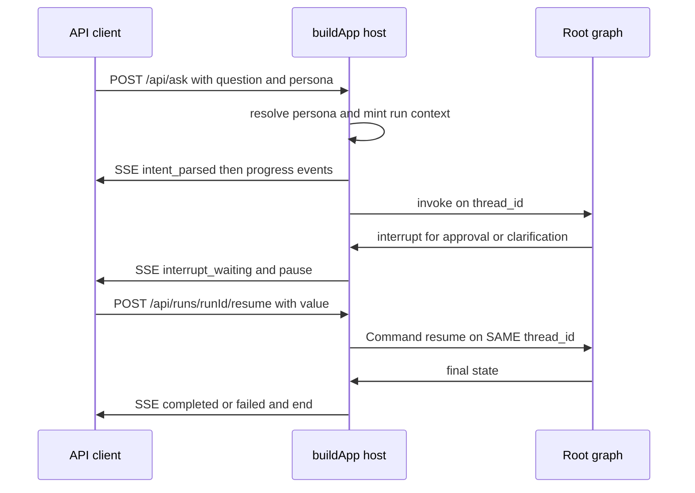

# Repository operations

This page owns the operational layer coding agents must not break: toolchain,
`pnpm` entrypoints, workspace and quality gates, the API SSE and resume host,
persistence ports, inference-provider and fetch-patch session-header
configuration, scheduled wiki CI, and the expected submission layout. It is a
TypeScript monorepo (`packages/*`, `apps/*`) implementing the
`agent = model + harness` thesis: the LLM proposes, deterministic code disposes
through policy, validation, and audit (see [Workflow architecture](../agent/workflow-architecture.md)).
Start with [Quickstart](../quickstart.md) for the task-routing map.

## 1. Toolchain

- Node.js `>=24.0.0` and pnpm `>=10`; the repository pins `pnpm@11.25.0` through
  `packageManager` and activates it with Corepack (`package.json:8-12`).
- Local activation sequence is `corepack enable`,
  `corepack prepare pnpm@11.25.0 --activate`, then
  `pnpm install --frozen-lockfile` (`README.md:13-16`).
- Wiki engine is [`openwiki`](https://github.com/langchain-ai/openwiki) `0.7.2`,
  pinned in `package.json:42` plus `pnpm-lock.yaml` (`README.md:40-43`).
- Wiki CI runs on Node `24` with `pnpm/action-setup` version `11.25.0` and
  `actions/setup-node` with the pnpm cache
  (`.github/workflows/openwiki-update.yml:30-40`).
- General CI uses a shared `setup-js` composite action for checkout plus install
  and then splits gates into `typecheck`, `lint`, `policy`, `test`, `docs`,
  `db`, and `secrets` jobs behind one required `gate` check
  (`.github/workflows/ci.yml:19-33`, `.github/workflows/ci.yml:177-195`).
- `pnpm-workspace.yaml:16-18` defines the workspace globs `apps/*` and
  `packages/*`; it is not a second package definition. Build approvals live in
  `allowBuilds`: `true` for `better-sqlite3`, `esbuild`, and
  `@launchql/protobufjs`, and explicit `false` for `@openuidev/lang-core` so its
  install-time telemetry never runs (`pnpm-workspace.yaml:1-14`). Shared
  dependency versions live in the `catalog:` section so workspace packages
  reference them with `catalog:` instead of repeating ranges, plus a
  `minimumReleaseAgeExclude` pin for `@openuidev/react-ui`
  (`pnpm-workspace.yaml:23-48`).

## 2. Build and runtime entrypoints

### 2.1 Harness operator scripts

The canonical operator loop is defined in `README.md:13-27` and implemented in
`package.json:14-22`:

| Command | What it does |
|---|---|
| `pnpm db:up` | Start Postgres 16 plus pgvector on `127.0.0.1:5433` from `docker/docker-compose.yml` (`package.json:14`, `docker/docker-compose.yml:27-41`) |
| `pnpm db:reset` | Drop the volume and restart the loopback database (`package.json:15`) |
| `pnpm data:load` | Full Olist-VN seed, about one million `order_items` in a few minutes (`package.json:18`, `packages/data/src/load.ts:21-27`) |
| `pnpm data:load --scale=small` | CI-speed seed with the same foreign-key graph and seed scenarios, smaller volumes (`packages/data/src/load.ts:21-27`, `.github/workflows/ci.yml:137-138`) |
| `pnpm data:verify` | Pin the loaded volume to `data/seed_manifest.json`; with `--scale=small` pin to `data/seed_manifest.small.json` (`packages/data/src/verify.ts:1-7`, `packages/data/src/load.ts:25-27`) |
| `pnpm demo:tracer` | End-to-end proof: gateway plus host, seven PII-clean trace events (`package.json:16`, `scripts/demo-tracer.ts:1-15`) |
| `pnpm trace:show <runId>` | Offline G4 trace viewer over redacted `traces/<runId>.jsonl` plus `logs/mcp_audit.jsonl` with no DB or network I/O (`package.json:17`, `scripts/trace-show.ts:1-5`) |
| `pnpm eval --uc uc09` or `--all` | Live harness evaluation; needs the database plus gateway environment (`README.md:25`) |
| `pnpm skills:check` | Declarative-skills invariant: no runnable scripts, no credentials (`package.json:22`, `scripts/skills-check.ts:1-7`) |
| `pnpm external-client` | External MCP client probe over Streamable HTTP (`package.json:18`) |

The loader owns writes through owner transactions and `COPY`; the verifier
connects as owner and runs `SELECT`/`COUNT` only with zero DDL. Schema DDL lives
in `docker/initdb`, not in the loader (`packages/data/src/load.ts:1-15`,
`packages/data/src/verify.ts:1-7`). Document the loader and schema files;
never document ignored data dumps such as `data/*.csv`, `*.parquet`, `*.db`,
`*.sqlite`, or `*.duckdb` (`.openwikiignore:23-29`).

External MCP clients connect to the gateway over Streamable HTTP with a
per-role bearer token whose value stays in `.env` and whose env-var name is
resolved through `policies/mcp_clients.yaml` (`README.md:29-31`,
`policies/mcp_clients.yaml:1-4`).

Dataset attribution: the seeded business data derives from the Olist Brazilian
E-commerce dataset, localized to Vietnamese with synthetic `vi_VN` PII, used
under the CC BY-NC-SA license for non-commercial course use (`README.md:33-36`).

### 2.2 Wiki scripts

Every `wiki:*` script preloads the session-header patch with Node `--import`
before invoking the OpenWiki CLI (`package.json:22-26`):

| Command | Invocation | Purpose |
|---|---|---|
| `pnpm wiki:init` | `node --import ./scripts/openwiki-fetch-patch.mjs ./node_modules/openwiki/dist/cli/cli.js code --init` | First wiki generation (`package.json:22`, `README.md:63-64`) |
| `pnpm wiki:update` | `... cli.js code --update` | Interactive wiki update (`package.json:23`, `README.md:63-64`) |
| `pnpm wiki:update:print` | `... cli.js code --update --print` | Non-interactive update; the same command CI runs (`package.json:24`, `README.md:55-60`) |
| `pnpm wiki:dry-run` | `... cli.js --dry-run` | Validate without writing (`package.json:25`, `README.md:63-64`) |
| `pnpm wiki:visualize` | `... cli.js visualize` | Static-site export under `docs/openwiki-visualizer` (`package.json:26`, `README.md:63-67`) |

The canonical local run is copy `.env.example` to `.env`, fill in the API key
variable, then run `pnpm wiki:update:print` (`README.md:55-60`). The brief every
OpenWiki run reads is `openwiki/INSTRUCTIONS.md`; the read boundary is
`.openwikiignore` (`README.md:66-67`).

### 2.3 Quality, workspace, and interface scripts

| Command | Invocation | Purpose |
|---|---|---|
| `pnpm typecheck` | `tsc -b` | Typecheck all project references in `tsconfig.json:4` against the strict ESM `nodenext` base in `tsconfig.base.json:2-15` (`package.json:27`) |
| `pnpm build` | `tsc -b` | Emit project-reference builds (`package.json:28`) |
| `pnpm clean` | `tsc -b --clean` | Remove project-reference outputs (`package.json:29`) |
| `pnpm lint` | `eslint .` | Lint with `eslint.config.mjs:4-5` ignores for `node_modules/`, `**/dist/`, and `coverage/` (`package.json:31`) |
| `pnpm test` | `tsc -b && vitest run` | Typecheck then run the Vitest workspace (`package.json:32`, `vitest.workspace.ts:2-10`) |
| `pnpm check:workspace` | `node scripts/check-workspace.mjs` | Verify `workspace:*` links, `exports` entrypoints, `CONTRACTS_VERSION`, symlinks, and project references (`package.json:30`, `scripts/check-workspace.mjs:1-9`) |
| `pnpm docs:interface` | `tsx scripts/generate-interface.mjs` | Regenerate [`docs/mcp_interface.md`](../../docs/mcp_interface.md) from the frozen Zod schemas in `packages/contracts`; never hand-edit the output (`package.json:33`, `docs/mcp_interface.md:1-3`, `scripts/generate-interface.mjs:73-78`) |
| `pnpm semantic:index` | `tsx packages/mcp-server/src/semantic/index.ts` | Build or refresh the semantic retrieval index used by the MCP gateway (`package.json:34`) |

The root gate is `pnpm typecheck && pnpm lint && pnpm test`; scoped iteration
uses `pnpm --filter @shared/<pkg> test`, and contracts changes must include a
regenerated `docs/mcp_interface.md` (`AGENTS.md:40-44`, `AGENTS.md:124-130`).
CI runs the same gates as separate jobs plus interface-drift, live-database,
workspace, skills, and secrets checks behind one `gate` status check
(`.github/workflows/ci.yml:19-102`, `.github/workflows/ci.yml:104-195`).

## 3. Type, lint, and test boundaries

- `tsconfig.base.json:2-15` selects strict TypeScript on `ES2022` with ESM
  `nodenext` module and module resolution, plus `esModuleInterop`,
  `skipLibCheck`, declarations, source maps, `resolveJsonModule`, and
  `isolatedModules`. `tsconfig.json:1-4` extends that base and references the
  seven workspace projects: `contracts`, `agent`, `mcp-server`, `access-policy`,
  `data`, `api`, and `web`.
- `vitest.workspace.ts:2-10` runs one project per package: `packages/contracts`,
  `packages/agent`, `packages/mcp-server`, `packages/access-policy`,
  `packages/data`, `apps/api`, and `apps/web`. CI's `test` job runs
  `pnpm exec vitest run` directly because the separate `typecheck` job already
  covers `tsc -b` (`.github/workflows/ci.yml:80-84`).
- `eslint.config.mjs:22-58` bans `agent`, `access-policy`, and `api` code from
  importing the `pg` driver, the `pg-cursor` driver, and `mcp-server`
  internals, with a carve-out for the `apps/api` AppStateStore DAO and its test
  (`eslint.config.mjs:15-27`). This enforces the architecture rule that only
  the MCP gateway, the operator data loader, and the AppStateStore host own the
  driver while agent, policy, and API code reach data through the MCP client or
  injected ports.
- `eslint.config.mjs:68-119` gives `apps/web` the driver ban plus the MCP-server
  ban plus the contracts-only workspace rule: the UI must take shared types
  from `@shared/contracts` only and must not import `@shared/agent`,
  `@shared/mcp-server`, `@shared/access-policy`, `@shared/api`, or
  `@shared/data`. The rule is intentionally enumerated deny-by-default so a new
  workspace package cannot slip through silently; adding a workspace package
  means extending the web `paths` list and the shared catalog
  (`eslint.config.mjs:61-67`, `pnpm-workspace.yaml:23-45`).
- `scripts/check-workspace.mjs:34-71` enforces the pnpm linking contract: every
  intra-`@shared` dependency must be `workspace:*`, every `packages/*` library
  with `src/index.ts` must expose `exports["."].default` as `./dist/index.js`,
  and every direct workspace dependency must be covered by a `tsconfig`
  project reference. It also pins `CONTRACTS_VERSION` (defined in
  `packages/contracts/src/constants.ts` and re-exported from
  `packages/contracts/src/index.ts`) to
  `packages/contracts/package.json` and verifies per-consumer
  `node_modules/@shared/*` symlinks resolve
  (`scripts/check-workspace.mjs:74-99`,
  `scripts/check-workspace.mjs:101-123`).
- `scripts/skills-check.ts:77-94` enforces the declarative-skills invariant:
  any executable file under `skills/` fails the gate, and while no `SKILL.md`
  exists it exits zero with a no-skills-yet message. When skills exist it
  rejects key blocks, URLs, and DSN connection strings and validates the eight
  canonical D-14 headings (`scripts/skills-check.ts:17-30`).
- `pnpm docs:interface` resolves Zod through the contracts package so it never
  depends on root hoisting, reads the frozen schemas from
  `packages/contracts/src/index.ts`, and writes `docs/mcp_interface.md` with a
  do-not-hand-edit header (`scripts/generate-interface.mjs:13-18`,
  `scripts/generate-interface.mjs:141-144`, `docs/mcp_interface.md:1-3`).
  CI regenerates the interface and fails on drift with
  `git diff --exit-code -- docs/mcp_interface.md`
  (`.github/workflows/ci.yml:98-102`).
- `packages/contracts/test/zod-singleton.test.ts:14-27` pins the single-Zod-copy
  invariant: the lockfile must hold exactly one distinct `zod@4` version key so
  schema identity holds across contracts. The one documented exception is
  `zod@3.25.76` pulled by the UC-03 web stack (`@ag-ui/core` via
  `@openuidev/react-headless`) for its own protocol validation; any further
  `zod@3` line fails the test and forces review.

## 4. API host: SSE and resume endpoints

The full host is `apps/api/src/index.ts:1-14` (`buildApp`). It wires the root
graph, span emitter, and persistence ports behind sanitized SSE. Persona
mapping and run identity live in `apps/api/src/principals.ts`; the wire
sanitization gate lives in `apps/api/src/sse.ts`; persistence construction
lives in `apps/api/src/ports.ts` (see next section).

*This diagram shows the ask, interrupt, and resume SSE lifecycle on one thread.*

- `POST /api/ask` validates `question` as a non-empty string, resolves the UI
  persona through the server-side registry, mints D-13 run context
  (`runId` plus `threadId`), stores it write-once keyed by `runId`, opens an
  SSE stream (`intent_parsed` with `phase: starting`), invokes the root graph
  with fresh budgets, and either streams `interrupt_waiting` on `__interrupt__`
  or streams `completed` (`apps/api/src/index.ts:366-526`).
- Persona resolution is fail-closed: unknown personas throw
  `UnknownPersonaError` (400 `INVALID_PARAMS`, never a default role or admin);
  scopes and `rowScope` come only from `policies/mcp_clients.yaml`, and every
  `tokenEnv` named there must be present via `assertTokensPresent` or boot
  throws before listening (`apps/api/src/principals.ts:199-247`). `evalOnly`
  clients are validated for shape and uniqueness, then dropped: no persona
  maps to them and the host never requires their token at boot
  (`apps/api/src/principals.ts:109-153`).
- Run identity mints `runId` with `randomUUID` on every ask; `threadId` is the
  validated client-supplied `chat:{userId}:{sessionId}` value or a minted
  `chat:{userId}:{runId}` value, capped at 255 characters
  (`apps/api/src/principals.ts:260-287`, `apps/api/src/constants.ts:17-18`).
  The persona table is static (`sales_south`, `regional_manager_south`,
  `marketing`, `hr`, `data_admin`) in `apps/api/src/constants.ts:9-15`.
- `POST /api/runs/:runId/resume` requires a JSON object body carrying a
  non-null `value` (else 400), looks up the in-memory run or rehydrates it from
  the trace header (else 404), opens a new SSE stream (`intent_parsed` with
  `phase: resuming`), records metadata-only `approval_decided`, and issues
  `new Command({ resume: value })` on the SAME `thread_id` so checkpointed
  state continues without re-running (`apps/api/src/index.ts:569-694`,
  `apps/api/test/resume.test.ts:124-179`).
- Resume is restart-proof: `rehydrateRun` reads only the first line of
  `traces/<runId>.jsonl`, enforces `runId` match plus `threadId` shape plus
  registry role and token presence, and falls through to 404 on malformed or
  mismatched lines — a trace line can never inject identity
  (`apps/api/src/index.ts:705-756`,
  `apps/api/test/resume.test.ts:198-254`). `buildResumeInvokeOptions` mints a
  fresh `randomUUID` for the LangSmith root run while keeping
  `configurable.runId` on the JSONL `runId`, because checkpointing keys on
  `configurable.thread_id` (`apps/api/src/index.ts:788-806`).
- Resume values are metadata-only: allowlisted protocol tokens
  (`approve`, `yes`, `reject`, and similar) are recorded verbatim; anything
  else becomes `provided` plus length. Neither the raw value nor its hash
  enters a span, and the trace file never contains free-form secrets
  (`apps/api/src/index.ts:184-213`,
  `apps/api/test/resume.test.ts:339-393`).
- `POST /api/semantic/reindex` is admin-only: any persona other than
  `data_admin` (role `admin`) gets 403 `SCOPE_DENIED`; success proxies to the
  MCP gateway `/reindex` via `defaultReindex` (`apps/api/src/index.ts:528-567`).
  `GET /healthz` returns `{ ok: true }` for probes
  (`apps/api/src/index.ts:289-291`).
- The compatibility `createTracerApi` slice keeps the pre-01-14 UUID-thread
  shape and five-event stream pinned by `tracer.test.ts` and is not the
  operator path (`apps/api/src/index.ts:808-978`).

### SSE sanitization gate

- The host allowlist is exactly the nine contracts event names
  (`intent_parsed`, `schema_retrieved`, `sql_generated`, `sql_repaired`,
  `query_running`, `viz`, `completed`, `failed`, `interrupt_waiting`),
  re-exported from `@shared/contracts` so the two lists cannot drift
  (`apps/api/src/constants.ts:1-4`, `apps/api/src/sse.ts:35-47`,
  `apps/api/test/sse.test.ts:97-99`).
- `emitSseEvent` validates every emit against its per-event Zod schema before
  writing; a mismatch degrades to a `failed` event and raw payloads never reach
  the wire (`apps/api/src/sse.ts:195-233`,
  `apps/api/test/sse.test.ts:77-95`).
- Payload builders are construction-based allowlists: `intent_parsed` carries
  metric shape without filter values, `schema_retrieved` carries table names
  plus count, `sql_generated` carries statement metadata without SQL text,
  and only `displayableSql` may add a literal-free order-status demo proposal
  after the gateway accepts the query (`apps/api/src/sse.ts:73-134`).
- `displayableSql` is vocabulary-locked (`select`, `status`, `count`,
  `orders`, and similar) with length, charset, comment, and alias checks;
  anything outside returns `null` and the event carries `withheld: true`
  (`apps/api/src/sse.ts:107-120`,
  `apps/api/test/sse.test.ts:50-66`).
- The wire tripwire is defense-in-depth, not the canonical trace redactor: a
  VN-mobile (`0` plus nine digits) or `@`-email shape in free-text answer or
  error message degrades the emit to `failed` or `[withheld]`
  (`apps/api/src/sse.ts:56-71`, `apps/api/src/sse.ts:136-167`). For the
  gateway, MCP server, and trace ownership behind these events see
  [MCP server](../integrations/mcp-server.md) and
  [Root cause and anomaly](../use-cases/root-cause-and-anomaly.md).

## 5. Persistence ports

- `createHostPorts(env)` builds both host ports from
  `HARNESS_STATE_DATABASE_URL` only: the PostgresSaver checkpointer via the
  agent ports barrel plus the `AppStateStore` DAO. It throws fail-fast when
  the variable is absent so the host never boots on `MemorySaver`
  (`apps/api/src/ports.ts:29-42`, `apps/api/src/index.ts:993-1002`).
- `createCheckpointer(conn)` takes a connection string only (never a pool),
  calls `PostgresSaver.fromConnString(conn, { schema: "langgraph" })`, then
  awaits `setup()` exactly once so the four checkpoint tables exist before the
  first invoke; any setup failure throws at boot
  (`packages/agent/src/ports/checkpoints.ts:54-72`). It rejects the
  read-only `agent_ro` URL before touching the network because checkpoint
  writes require the `harness_state` owner
  (`packages/agent/src/ports/checkpoints.ts:80-93`).
- `AppStateStore` is the `app_state.alert_history` DAO as `harness_state` with
  zero grants on `public.*`, constructed from the same connection string with
  an injectable pool seam for DB-free unit tests
  (`apps/api/src/store/alertStore.ts:70-88`). All queries are parameterized;
  fingerprints are SHA-256 over canonical
  `recipientId|metric|dimensionKey|date|direction` field order through one
  helper so DAO rows and UC-10 dedup checks cannot diverge
  (`apps/api/src/store/alertStore.ts:36-55`). The owned pool is capped at two
  connections, and a duplicate fingerprint violates the primary key (23505):
  the caller treats that as already-sent, never as a retryable transport
  error (`apps/api/src/store/alertStore.ts:87-120`).
- Write-after-send contract: call `hasFingerprint(fp)` before sending (24-hour
  dedup check), then call `recordSent(row)` only after `send_alert` succeeds —
  never speculatively, never inside the send path — so retries of failed sends
  are never falsely suppressed (`apps/api/src/ports.ts:12-14`,
  `apps/api/src/store/alertStore.ts:90-120`). The `pg` driver lives only in
  `apps/api` (this DAO) per the ESLint ban; the agent package reaches it only
  through injected ports.

## 6. Environment and provider configuration

The template is [`.env.example`](../../.env.example); the real `.env` is never
committed (`.env.example:1-3`, [`.gitignore`](../../.gitignore):5-10). In CI the
same values come from Actions secrets, not from a committed file
(`.env.example:1-3`).

Required inference settings:

- `OPENWIKI_PROVIDER=openai-compatible` (`.env.example:6`,
  `.github/workflows/openwiki-update.yml:66`).
- `OPENAI_COMPATIBLE_BASE_URL=https://opencode.ai/inference/go/openai/v1`
  (`.env.example:15`, `.github/workflows/openwiki-update.yml:68`).
- `OPENWIKI_MODEL_ID=muse-spark-1.3-contributor` (`.env.example:17`,
  `.github/workflows/openwiki-update.yml:69`).
- `OPENWIKI_OPENAI_COMPATIBLE_USE_RESPONSES_API=true` (`.env.example:21`,
  `.github/workflows/openwiki-update.yml:70`).

The flag must stay `true`: OpenCode Go serves this model only on the Responses
API at `POST {base}/responses`; `false` routes to `/chat/completions` and Go
answers `ModelProtocolUnsupported`, surfaced as HTTP 401 that looks like bad
auth (`.env.example:18-21`, `README.md:69-77`,
`.github/workflows/openwiki-update.yml:59-60`).

CI additionally sets
`OPENWIKI_OPENAI_COMPATIBLE_REASONING_EFFORT_SUPPORTED=true` and
`OPENWIKI_REASONING_EFFORT=xhigh` to select the xhigh reasoning variant; a
`#xhigh` model-ID suffix is not used because `#` fails OpenWiki model-ID
validation (`.github/workflows/openwiki-update.yml:61-72`). Optional LangSmith
tracing (`LANGSMITH_API_KEY`, `LANGCHAIN_PROJECT`, `LANGCHAIN_TRACING_V2`) and
the telemetry opt-out (`OPENWIKI_TELEMETRY_DISABLED=1`) are documented in
`.env.example:30-36`; the workflow leaves telemetry enabled with a commented
opt-out (`.github/workflows/openwiki-update.yml:55-57`).

Harness runtime configuration lives in the same template but is separate from
wiki inference (`.env.example:38-88`):

- Postgres loopback URLs: `DATABASE_URL` and `OWNER_DATABASE_URL` for owner work,
  plus `AGENT_RO_DATABASE_URL` for the read-only gateway role,
  `INDEXER_DATABASE_URL` for the semantic indexer role, and
  `HARNESS_STATE_DATABASE_URL` for API checkpoint and alert-history state, all on
  `127.0.0.1:5433` (`.env.example:44-53`). Compose provides dev-default
  passwords for `postgres`, `owner`, `agent_ro`, `indexer`, and
  `harness_state`; those literals must match `docker/initdb/01_roles.sql` and
  must never be reused outside loopback development
  (`docker/docker-compose.yml:10-19`).
- Ports are loopback-only: `MCP_PORT=8081`, `API_PORT=3001`
  (`.env.example:56-58`).
- Bearer-token principals: static gateway tokens live only in the environment
  under names resolved by `policies/mcp_clients.yaml` (for example
  `MCP_TOKEN_SALES_SOUTH`, `MCP_TOKEN_MARKETING`, `MCP_TOKEN_HR`,
  `MCP_TOKEN_ADMIN`); the YAML file records scopes and row-scope predicates but
  never token values (`.env.example:53-74`,
  `policies/mcp_clients.yaml:1-4`).
- Two Actions secrets are required for wiki automation: `OPENCODE_GO_API_KEY`
  mapped to `OPENAI_COMPATIBLE_API_KEY`, and `OPENWIKI_PR_TOKEN` for PR
  creation and merging (`.env.example:7-11`,
  `.github/workflows/openwiki-update.yml:67`,
  `.github/workflows/openwiki-update.yml:99-103`).

## 7. Fetch-patch session header

OpenCode Go requires `x-opencode-session` on every request, otherwise it returns
`400 MissingSessionID`. OpenWiki builds its client with only `{ baseURL }` and
sends no such header, so [`scripts/openwiki-fetch-patch.mjs`](../../scripts/openwiki-fetch-patch.mjs)
patches global `fetch` via Node `--import` preload (`README.md:78-80`,
`scripts/openwiki-fetch-patch.mjs:1-20`,
`.github/workflows/openwiki-update.yml:49-53`).

Behavior contract (`README.md:78-85`,
`scripts/openwiki-fetch-patch.mjs:26-36`):

- Scope is `opencode.ai` requests only; other hosts pass through unchanged
  (`scripts/openwiki-fetch-patch.mjs:74-81`,
  `scripts/openwiki-fetch-patch.mjs:96-113`).
- Value shape is opaque `ses_` plus 32 lowercase hexadecimal characters; it never
  contains PII (`scripts/openwiki-fetch-patch.mjs:11-14`,
  `scripts/openwiki-fetch-patch.mjs:41-42`).
- Resolution order: reuse a valid `OPENWIKI_OPENCODE_SESSION_ID` override when
  set (invalid values throw); otherwise derive deterministically in GitHub
  Actions as `ses_<sha256(openwiki|repo|run_id|sha|job)[0:32]>`, stable within
  the run and unique across runs; otherwise generate a random per-process value
  locally (`scripts/openwiki-fetch-patch.mjs:44-70`,
  `.env.example:23-28`).
- One CLI run uses one process-wide value, matching Go's routing plus
  prompt-cache granularity: same conversation reuses the value, different runs
  get different values (`scripts/openwiki-fetch-patch.mjs:26-33`).
- Existing header values are never overwritten, matching upstream pass-through
  behavior (`scripts/openwiki-fetch-patch.mjs:35-36`,
  `scripts/openwiki-fetch-patch.mjs:103-110`).
- The module logs one opaque stderr prefix for traceability and never logs the
  API key (`scripts/openwiki-fetch-patch.mjs:115-119`).

Failure modes: missing or bypassed preload causes every Go call to 400; a
`false` Responses-API flag causes 401 `ModelProtocolUnsupported`; a malformed
override fails fast before any request (`scripts/openwiki-fetch-patch.mjs:57-70`,
`.env.example:18-21`).

## 8. Scheduled wiki CI and ownership

Workflow file: [`.github/workflows/openwiki-update.yml`](../../.github/workflows/openwiki-update.yml).

- Triggers: daily schedule `0 8 * * *` (08:00 UTC) plus `workflow_dispatch` for
  on-demand runs (`.github/workflows/openwiki-update.yml:3-7`).
- Permissions are `contents: write` and `pull-requests: write`
  (`.github/workflows/openwiki-update.yml:9-11`). Concurrency group
  `openwiki-update` with `cancel-in-progress: false`
  (`.github/workflows/openwiki-update.yml:13-15`).
- Checkout uses full history (`fetch-depth: 0`) so `openwiki code --update` can
  diff `HEAD` against the commit it last documented; a shallow clone would run
  against an empty change summary
  (`.github/workflows/openwiki-update.yml:21-28`).
- Install and run steps: pnpm setup, Node 24 setup with pnpm cache,
  `pnpm install --frozen-lockfile`, then
  `node --import ./scripts/openwiki-fetch-patch.mjs ./node_modules/openwiki/dist/cli/cli.js code --update --print`
  (`.github/workflows/openwiki-update.yml:30-53`). The run step uses
  `continue-on-error: true` so later steps can still open a PR preserving pages
  completed before a failure (`.github/workflows/openwiki-update.yml:45-47`,
  `.github/workflows/openwiki-update.yml:108-114`).
- Docs-only PR scope: the workflow checks out any change to itself
  (`git checkout -- .github/workflows/openwiki-update.yml`) so auto-merge never
  touches executable CI, removes transient `openwiki/.run.json`, then stages
  only `openwiki,AGENTS.md` plus `CLAUDE.md` when that file exists
  (`.github/workflows/openwiki-update.yml:74-92`). Missing-path handling
  matters because `git add` fails on a missing path.
- Creation and merge: `peter-evans/create-pull-request` opens branch
  `openwiki/update` with the dedicated `OPENWIKI_PR_TOKEN`
  (`.github/workflows/openwiki-update.yml:94-115`). On success the workflow
  merges immediately with `gh pr merge --merge --admin --delete-branch`;
  `--admin` is needed because the token identity is a ruleset bypass actor and
  `gh pr merge --auto` would wait on the one code-owner review forever
  (`.github/workflows/openwiki-update.yml:116-128`). The workflow uses
  `--merge`; branch protection itself lists `merge`, `squash`, and `rebase` as
  allowed merge methods (`ruleset-main.json:31-33`,
  `.github/workflows/openwiki-update.yml:116-128`). The merge step validates
  the PR number with `[[ "$PR_NUMBER" =~ ^[0-9]+$ ]]` before merging
  (`.github/workflows/openwiki-update.yml:116-128`). On failure it disables
  auto-merge with `gh pr merge --disable-auto`, annotates the PR URL with a
  `::notice`, and propagates the failure with `exit 1`
  (`.github/workflows/openwiki-update.yml:133-148`).
- The default branch is protected and requires one code-owner review plus the
  `gate` status check, dismisses stale reviews on push, and requires
  conversation resolution; the `OPENWIKI_PR_TOKEN` identity is a ruleset bypass
  actor so the docs-only merge can use `--admin` without affecting human code
  PRs (`ruleset-main.json:31-47`,
  `.github/workflows/openwiki-update.yml:116-128`).
- Code ownership lives in [`.github/CODEOWNERS`](../../.github/CODEOWNERS):
  every change needs an owner from `@NDTruongDanh` or `@HungPham-VNU`, with a
  third owner `@nguyenhun11` on `packages/contracts/`, `packages/agent/`,
  `apps/api/`, `skills/`, and `evals/`. Per-path owners also cover
  `packages/mcp-server/`, `packages/access-policy/`, `apps/web/`, `policies/`,
  `packages/data/`, `docker/`, `semantic/`, and `data/`, plus UC-scoped
  validators, subgraphs, tests, and traces (notably UC-02/UC-03) and web chart
  files (`.github/CODEOWNERS:1-29`).
- Advisory PR review is separate from the required `gate`. Workflow file:
  [`.github/workflows/pr-review.yml`](../../.github/workflows/pr-review.yml).
  It runs on `pull_request` into `main` for `opened`, `synchronize`,
  `reopened`, and `ready_for_review` (skipping drafts), with `contents: read`
  plus `pull-requests: write` and per-PR concurrency that cancels superseded
  runs (`.github/workflows/pr-review.yml:20-37`). The review job reuses the
  shared JS setup action, calls OpenCode Go with the same
  `OPENCODE_GO_API_KEY` secret as OpenWiki (empty on fork PRs), and runs
  [`scripts/pr-review.mjs`](../../scripts/pr-review.mjs) with the Responses
  API at `POST {base}/responses`, model `muse-spark-1.3-contributor`, and
  `reasoning.effort: xhigh` (`.github/workflows/pr-review.yml:44-56`,
  `scripts/pr-review.mjs:30-33`, `scripts/pr-review.mjs:233-249`).
  [`scripts/pr-review.mjs`](../../scripts/pr-review.mjs) diffs `base...HEAD`
  against `docs/architecture.md` as the sole source of truth, excludes
  generated or vendor paths (`pnpm-lock.yaml`, `openwiki/`, `/dist/`,
  `/coverage/`, `.log`), truncates oversized diffs, and posts or updates one
  living `<!-- opencode-pr-review -->` comment stamped with the reviewed commit
  so the visible review always matches the newest push
  (`scripts/pr-review.mjs:35-43`, `scripts/pr-review.mjs:126-155`,
  `scripts/pr-review.mjs:273-316`, `scripts/pr-review.mjs:512-526`,
  `scripts/pr-review.mjs:548-601`). Missing keys, fork PRs, empty diffs, and
  API failures post a skip or error notice and exit zero, so the advisory
  review never blocks `gate`
  (`scripts/pr-review.mjs:16-17`, `scripts/pr-review.mjs:431-457`,
  `scripts/pr-review.mjs:499-510`).

## 9. Operator runbooks

- Boot the full API host only through the ports module: set
  `HARNESS_STATE_DATABASE_URL`, `MCP_URL` (or `MCP_PORT`), `API_PORT`, and
  every `MCP_TOKEN_*` named by `policies/mcp_clients.yaml`, then
  `await createHostPorts()` and `buildApp({ checkpointer, store, mcpUrl, ... })`.
  Missing `HARNESS_STATE_DATABASE_URL` or any bearer token fails fast before
  listening — the host never falls back to `MemorySaver`
  (`apps/api/src/ports.ts:29-42`, `apps/api/src/index.ts:993-1002`,
  `apps/api/src/principals.ts:199-211`). Direct execution defaults are
  `API_PORT=3001`, `MCP_PORT=8081`, `TRACES_DIR=traces`, and
  `MCP_URL=http://127.0.0.1:{MCP_PORT}/mcp` when `MCP_URL` is unset
  (`apps/api/src/index.ts:985-989`).
- Loopback bring-up order: `pnpm db:up`, then `pnpm data:load`
  (or `--scale=small` for CI), then `pnpm data:verify`; start the MCP gateway
  on `MCP_PORT=8081` and the API host on `API_PORT=3001`, and probe
  `GET /healthz` before asking (`package.json:14-20`,
  `apps/api/src/index.ts:289-291`). Use `pnpm db:reset` only when the volume
  must be dropped.
- Human-in-the-loop recovery: `POST /api/ask` returns `interrupt_waiting` when
  approval or clarification is needed; `POST /api/runs/:runId/resume` with
  `{ value }` continues the same `threadId`. Unknown `runId` is 404, a body
  without a usable `value` is 400, and a malformed trace header also falls
  through to 404 so the operator can distinguish bad input from unknown runs
  (`apps/api/test/resume.test.ts:124-152`,
  `apps/api/test/resume.test.ts:249-254`). After a host restart the same resume
  call rehydrates identity from `traces/<runId>.jsonl` against the same durable
  checkpointer (`apps/api/test/resume.test.ts:198-247`).
- Semantic maintenance: `POST /api/semantic/reindex` requires the `data_admin`
  persona; `pnpm semantic:index` rebuilds the gateway index directly. Both need
  the indexer role URL and gateway token environment
  (`apps/api/src/index.ts:528-567`, `package.json:34`).
- Regression scope for operational changes: while iterating run the affected
  Vitest file (`pnpm --filter @shared/api test <file>`); before done run
  `pnpm typecheck && pnpm lint && pnpm --filter @shared/<pkg> test`; run full
  `pnpm test` when touching shared `packages/*`. Contracts, SSE, resume, and
  zod-singleton legs are the API-surface guards
  (`AGENTS.md:124-132`, `apps/api/test/sse.test.ts:49-99`,
  `apps/api/test/resume.test.ts:339-393`,
  `packages/contracts/test/zod-singleton.test.ts:14-27`).

## 10. Configuration and security consequences

- Treat the database as read-only over the `agent_ro` role with
  `statement_timeout`: the gateway connects as `agent_ro` with `SELECT`-only
  grants and `BEGIN READ ONLY`, and the guard blocks DDL, DML, and dangerous
  functions before the database would reject them (`AGENTS.md:89-90`,
  `docker/docker-compose.yml:21-26`).
- Treat bearer tokens as local-only: per-role MCP tokens and the OpenCode Go
  key live in untracked `.env` or Actions secrets and never in
  `policies/mcp_clients.yaml`, logs, or traces (`.env.example:1-11`,
  `policies/mcp_clients.yaml:1-4`, `AGENTS.md:91-92`). PRs opened with the
  default `GITHUB_TOKEN` do not trigger most `pull_request` workflows, so wiki
  automation uses the dedicated `OPENWIKI_PR_TOKEN` with `Contents` and
  `Pull requests` read plus write
  (`.github/workflows/openwiki-update.yml:99-103`).
- Treat PII as fake but still redacted: seeded `vi_VN` Faker values are
  filtered by the sensitive-column set (`customers.phone`, `customers.email`,
  `customers.address`, `employees.salary`) and by regex PII scanning on query
  rows, trace events, and audit sinks (`policies/sensitive_columns.yaml:5-14`,
  `AGENTS.md:91-92`, `scripts/demo-tracer.ts:1-15`).
- Treat untrusted data as data: query rows are delimited in prompts and
  synthesis nodes run with no tools bound; treat gold data as hidden by keeping
  eval cases, seeded scenarios, and injection rows out of prompts and out of
  OpenWiki indexing (`AGENTS.md:93-97`, `.openwikiignore:31-39`).
- General CI scans every pull request and `main` push with `gitleaks` and keeps
  loopback database passwords as committed dev-only defaults that must never be
  reused for real tokens or deployed environments
  (`.github/workflows/ci.yml:163-175`,
  `.github/workflows/ci.yml:107-121`,
  `docker/docker-compose.yml:10-19`).
- New workspace packages are an extension seam with three obligations: add the
  `apps/*` or `packages/*` path if outside the current globs, reference shared
  dependencies through the pnpm `catalog:` instead of repeating ranges, and
  extend the ESLint `no-restricted-imports` guards so the new package cannot
  silently bypass DB and contract boundaries (`pnpm-workspace.yaml:16-45`,
  `eslint.config.mjs:61-67`, `scripts/check-workspace.mjs:34-71`).

## 11. Expected repository and submission layout

The PRD submission contract (`docs/prd.md:591-604`) defines the layout agent
code grows into; this operations page does not duplicate per-UC design:

- Repository must contain source code, `README` with setup, dataset source and
  license, and load instructions, plus `.env.example`, `AGENTS.md`, `data/`
  loader and transform scripts (no large re-downloadable data files),
  `semantic/` data dictionary and event log, `policies/` RBAC and masking
  rules, `skills/`, `evals/` questions and EX grader plus runner, and `docs/`
  architecture diagrams (`docs/prd.md:591`).
- Technical report must cover the `agent = model + harness` architecture,
  database source and Vietnamesization plus seeded data, submitted-UC list with
  the K1–K8 coverage table, per-UC design, failure-mode mitigations, eval and
  regression results, safety analysis, limitations, and AI-use transparency
  (`docs/prd.md:592-601`).
- Remaining deliverables are the ownership table, a demo video of at most 15
  minutes covering every submitted UC, and at least one successful sample trace
  per UC (`docs/prd.md:602-604`).
- Current repository evidence for these paths is [`README.md`](../../README.md),
  [`package.json`](../../package.json), [`docs/prd.md`](../../docs/prd.md),
  [`docs/architecture.md`](../../docs/architecture.md), `packages/data/src/load.ts`
  and `verify.ts` for the `data/` contract, [`semantic/data_dictionary.md`](../../semantic/data_dictionary.md),
  [`policies/mcp_clients.yaml`](../../policies/mcp_clients.yaml),
  [`openwiki/INSTRUCTIONS.md`](../INSTRUCTIONS.md),
  [`.openwikiignore`](../../.openwikiignore), and the workflow files above. Large
  publisher CSVs stay in untracked `data/.cache/` and seeded or gold signals
  (`evals/`, seed fixtures, manifests, trace and audit payloads) stay out of
  the wiki index (`.openwikiignore:31-39`, [`.gitignore`](../../.gitignore):20-30).

The implemented harness uses TypeScript with LangGraph.js for the workflow,
within the Python-recommended-or-TypeScript plus LangGraph-recommended-or-justified
PRD allowance (`docs/prd.md:56-65`, `AGENTS.md:20-22`). Per-UC plans and the
architecture specification already assume that shape; consult the architecture
and UC-plan documents before adding a new framework or dependency
(`AGENTS.md:73-74`).

## 12. Coding-agent operating rules

- Audience and scope: this wiki is code documentation for coding agents that
  build and modify the repository; optimize for entrypoints, commands, paths,
  and invariants, covering the LangGraph workflow, read-only guards, semantic
  index, memory, guardrails, eval runner, and traces
  (`openwiki/INSTRUCTIONS.md:3-10`).
- Taxonomy: organize by system and workflow such as `agent/`, `data/`,
  `use-cases/`, and `evals/`, not by mirroring source directories; keep
  [Quickstart](../quickstart.md) as the task-routing map
  (`openwiki/INSTRUCTIONS.md:25-30`).
- Grounding: ground material claims in inspected source with `repo://` evidence
  and `file:line` citations; document loader scripts and schema files, never
  ignored data dumps such as `data/*.csv|*.parquet|*.db|*.sqlite|*.duckdb`;
  never reproduce secrets or generated run state
  (`openwiki/INSTRUCTIONS.md:39-44`). Language is English only, including for
  concepts sourced from Vietnamese PRD and UC-plan documents
  (`openwiki/INSTRUCTIONS.md:46-47`).
- Read boundary: [`.openwikiignore`](../../.openwikiignore) excludes `.env`
  files except `.env.example`, generated wiki state
  (`openwiki/.run.json`, `openwiki/.page-manifest.json`), dependencies and
  build output, and data dumps (`.openwikiignore:6-29`).
  [`.gitignore`](../../.gitignore) likewise excludes `.env` and
  `openwiki/.run.json` (`.gitignore:5-10`).
- [`AGENTS.md`](../../AGENTS.md) marks the generated `openwiki/` index as
  optional just-in-time context, directs retrieval use, treats source and tests
  as authoritative, and forbids hand-editing generated pages unless explicitly
  asked in favor of updating source and letting OpenWiki regenerate
  (`AGENTS.md:5-14`).

## Related pages

- [Quickstart](../quickstart.md): one-command setup, command table, and task-routing map.
- [Workflow architecture](../agent/workflow-architecture.md): LangGraph loop, state, and harness ownership.
- [Eval and safety harness](../evals/eval-and-safety-harness.md): one-command eval runs, EX scoring, regression, and safety cases.
- [MCP server](../integrations/mcp-server.md): DB I/O ownership, tool contracts, and the generated interface this page's `docs:interface` entrypoint refreshes.
