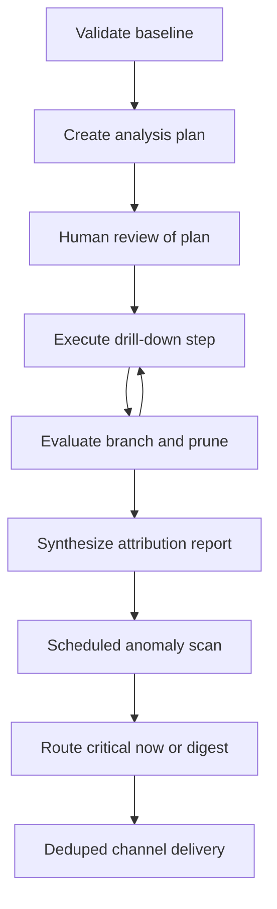

# Multi-step root-cause and scheduled anomaly alerts (UC-05, UC-10)

This page owns the submitted UC-05 / UC-10 pair: on-demand hierarchical diagnosis of a business fluctuation and scheduled statistical detection with channel delivery. UC-05 covers knowledge areas K4 and K5, UC-10 covers K2 and K5 (`repo://docs/prd.md#L321-L323`, `repo://docs/UC-plan/UC05.md#L5-L6`, `repo://docs/UC-plan/UC10.md#L3-L4`).

The shared runtime and safety contract lives in [Agent workflow and harness architecture](../agent/workflow-architecture.md). The shared validated SQL loop lives in [Natural-language query with self-repair](./text-to-sql.md). Seeded fixtures and load rules live in [Business database and seeding](../data/database-and-seeding.md). Grading, regression, and safety cases live in [Eval runner, metrics, and regression](../evals/eval-and-safety-harness.md).

> Implementation status: the frozen root graph, registry seam, redacted trace writer, hierarchical span emitter, validated SQL path, durable HITL, checkpoint, host-resume, and alert-dedup persistence seams exist in code. The RCA and alert zod contracts have also landed, and the UC-05 drill-down orchestrator has now landed as `packages/agent/src/subgraphs/rootCauseAnalysis.ts` (intent parsing, baseline validation, plan creation, HITL review gate, budgeted execute/evaluate loop, waterfall synthesis, date-guarded MCP, per-step checkpoint writes, and resume rehydration) registered under `RCA_UC_ID` and routed by `routeQuestionToUc`. On the UC-10 side the pure-code statistical detector (`packages/agent/src/alerts/anomalyDetector.ts`), subscription loader (`packages/agent/src/alerts/subscription.ts` plus re-export in `packages/agent/src/alerts/index.ts`), validated `config/subscriptions.yaml` with five ANOM-01..05 subscriptions, and both domain skill directories have also landed. Still planned with no implementation files are the scheduled runner (`node-cron` 07:00 plus `pnpm alert:run --manual`), the MCP series fetcher, the LLM drill-down node, severity routing/digest, and the `sendAlert` channel sender with retry and queue.

## 1. Responsibilities

UC-05 answers a why-question such as why net revenue in September 2026 fell versus August (`repo://docs/prd.md#L323-L328`):

1. Confirm the phenomenon with real delta math; if revenue did not fall, report the false premise and stop.
2. Build a decomposition plan across business dimensions and formula splits.
3. Execute the plan step by step, checkpointing after each step and branching into high-contribution children or stopping.
4. Conclude with ranked contributing factors, each with value, share, and evidence SQL.

UC-10 runs on a schedule, for example every morning at 07:00 or manually in a demo, and per subscribed metric times slice (`repo://docs/prd.md#L458-L464`, `repo://docs/UC-plan/UC10.md#L36-L44`):

1. Compute tracked metrics registered by users, for example daily net revenue by region or return rate by province.
2. Detect anomalies in code with z-score over the prior 28 days, week-over-week comparison, or an absolute threshold.
3. Drill down 1–2 extra dimensions to localize the segment, then compose a short alert.
4. Deliver through a chosen channel with deduplication, severity routing, retry, and queueing.

UC-05 is interactive and analyst-driven; UC-10 is scheduled and code-first with the language model used only after an anomaly is found (`repo://docs/UC-plan/UC10.md#L40-L44`).

## 2. UC-05 analysis-plan workflow

### 2.1 Plan state and caps

The plan is persisted as task state, for example `analysis_plan.json`, where every step carries status `todo` / `doing` / `done` / `skipped` / `failed` (`repo://docs/prd.md#L332`). The UC-05 plan models this as `RCAState` with `question`, `metric_name`, current and baseline windows, delta fields, `plan: PlanStep[]`, `total_queries_count`, `max_queries_limit`, and `max_depth_limit` (`repo://docs/UC-plan/UC05.md#L89-L109`).

Hard budget invariants (`repo://docs/prd.md#L333-L334`, `repo://docs/UC-plan/UC05.md#L141-L142`, `repo://docs/UC-plan/UC05.md#L243-L248`):

- Branching: expand or keep drilling into branches that dominate the total move; the PRD example threshold is a branch contributing at least 50% of the drop, while the UC-05 skill operationalizes child expansion at absolute contribution at least 30% (`repo://docs/prd.md#L333`, `repo://docs/UC-plan/UC05.md#L12-L12`, `repo://docs/UC-plan/UC05.md#L136-L136`).
- Depth cap: for example 4 levels such as region to channel to category to product.
- Query cap: for example 20 queries per analysis; hitting depth or query budget stops expansion and the report must disclose the unexplored remainder (`repo://docs/prd.md#L342`).
- Formula decomposition complements dimensional drill-down, for example revenue equals order count times average order value (`repo://docs/UC-plan/UC05.md#L9-L12`).

The contract half of that plan state has landed and the orchestrator that enforces it has now also landed. `StepStatusSchema` pins the five step states, `PlanStepSchema` pins `stepId`, `axis`, `dimensionOrFactor`, `dimensionPath`, `parentId`, `depth` capped at 4, `delta` plus `contributionPct`, nullable `sql`, and `retryCount` capped at 2, and `AnalysisPlanSchema` pins the question, metric name and type, direction, formula components, both periods, baseline and current values with deltas, validity flag, steps, `totalQueriesCount` with `maxQueriesLimit` defaulting to 20 and `maxDepthLimit` defaulting to 4, `drilldownThreshold` defaulting to 30.0, and unexplored branches plus residual (`repo://packages/contracts/src/rca.ts#L6-L124`). `RootCauseAnswerSchema` pins the verified attribution report with `mathVerified`, `mathDiffRatio`, `primaryCauses`, and markdown (`repo://packages/contracts/src/rca.ts#L149-L166`). The agent state carries both payloads as nullable checkpointed fields (`repo://packages/agent/src/state.ts#L168-L171`), and the envelope exposes them as `analysis_plan` and `root_cause` response kinds (`repo://packages/contracts/src/answers.ts#L151-L163`).

`createPlan` implements the Node 2 contract (`repo://packages/agent/src/subgraphs/rootCauseAnalysis.ts#L1344-L1456`): it returns `null` on an invalid baseline, builds 3 horizontal region steps for `additive` metrics (one per candidate region at depth 0), and builds a two-axis tree for `ratio` metrics (2 formula steps for numerator/denominator plus one region step per candidate), seeding `totalQueriesCount` from the baseline run and pinning `maxQueriesLimit: 20`, `maxDepthLimit: 4`, and `drilldownThreshold: 30.0`. Focused legs pin 3 steps for the additive September-drop case and 5 steps with both `formula` and `dimension` axes for the AOV case (`repo://packages/agent/test/rootCauseAnalysis.test.ts#L128-L185`).

### 2.2 Baseline validation and attribution math

Every run starts with a baseline check: fetch baseline and current metric values, compute absolute and percentage delta, and abort with actual numbers when the premise is false, for example revenue actually rose (`repo://docs/prd.md#L325-L325`, `repo://docs/prd.md#L343-L343`, `repo://docs/UC-plan/UC05.md#L8-L8`, `repo://docs/UC-plan/UC05.md#L159-L164`).

`validateBaseline` is Node 1 of the landed orchestrator (`repo://packages/agent/src/subgraphs/rootCauseAnalysis.ts#L1090-L1338`):

- It runs two baseline/current fetches through `fetchBaseline` in tests or through `ValidatedQueryExecutor` in production, using `buildBaselineQuery` reference SQL: net revenue sums delivered minus returned `price_vnd`, AOV divides delivered revenue by distinct delivered orders, and return rate divides returned by total orders (`repo://packages/agent/src/subgraphs/rootCauseAnalysis.ts#L1071-L1081`).
- Through the executor it wraps each run with the active period, target table, and allowed date column, passes a prompt containing the period dates plus `Reference SQL:`, and records `run_query` in `actualToolsCalled` (`repo://packages/agent/src/subgraphs/rootCauseAnalysis.ts#L1107-L1231`). Legs pin two tool calls, prompt dates, and date-filtered evidence SQL (`repo://packages/agent/test/rootCauseAnalysis.test.ts#L225-L277`).
- Generated SQL is fail-closed on the period: missing or wrong date bounds throw before any value is accepted, via `verifySqlDateFilter` (`repo://packages/agent/src/subgraphs/rootCauseAnalysis.ts#L1158-L1162`, `repo://packages/agent/src/subgraphs/rootCauseAnalysis.ts#L1217-L1221`).
- Significance and direction follow the spec: absolute percentage below `MIN_SIGNIFICANT_DELTA_PCT` (1.0%) returns invalid with `isSignificant: false` and a no-data style message; an explicit `decrease`/`increase` premise that disagrees with the sign returns invalid with a false-premise message naming the true direction and formatted values; otherwise it returns valid with `resolvedDirection` derived from the stated direction or, for neutral questions, from the sign (`repo://packages/agent/src/subgraphs/rootCauseAnalysis.ts#L1254-L1338`).

Per-branch contribution is delta-branch divided by total delta times 100. The summed contribution of reported causes must reconcile with the total change within 5%, checked automatically (`repo://docs/prd.md#L340-L340`, `repo://docs/UC-plan/UC05.md#L138-L138`, `repo://docs/UC-plan/UC05.md#L201-L202`). The calculator must also surface offsetting moves, for example one region up 100M VND while another drops 300M VND for a net 200M VND drop (`repo://docs/UC-plan/UC05.md#L253-L255`). Causes must come from executed SQL evidence; inventing causes outside query data is forbidden (`repo://docs/UC-plan/UC05.md#L144-L144`).

`verifyWaterfallAttribution` implements the K7 gate (`repo://packages/agent/src/subgraphs/rootCauseAnalysis.ts#L1905-L1972`): it sums disjoint leaf deltas plus signed residual (disjoint skipped deltas plus unanalyzed parent remainder, falling back to signed `residualOtherAbs` only when no signed data exists), compares strictly signed difference against `absDeltaTotal`, and passes when `mathDiffRatio <= 0.05`. `identifyPrimaryRoot causes` selects nodes with at least 50% absolute contribution or the top 3 by impact (`repo://packages/agent/src/subgraphs/rootCauseAnalysis.ts#L1978-L2005`), and `synthesizeReport` combines disjoint leaves, waterfall verification, primary causes, and the five-section Vietnamese markdown report into a schema-validated `RootCauseAnswer` (`repo://packages/agent/src/subgraphs/rootCauseAnalysis.ts#L2111-L2145`).

Semantic metric definitions are resolved through the semantic layer so additive flags and canonical formulas are correct before attribution math; additive revenue and order counts can be summed, ratios such as average order value and return rate cannot (`repo://docs/UC-plan/UC05.md#L230-L234`).

### 2.3 Human-in-the-loop and checkpoint resume

After the decomposition plan is created and before heavy drill-down SQL runs, the planned workflow pauses with a LangGraph `interrupt` so the user can view, approve, add, or remove dimensions (`repo://docs/prd.md#L335-L335`, `repo://docs/UC-plan/UC05.md#L13-L13`, `repo://docs/UC-plan/UC05.md#L166-L182`). The planned API shape is view plus resume, for example `GET /rca/plan/{thread_id}` and `POST /rca/plan/{thread_id}/resume` (`repo://docs/UC-plan/UC05.md#L236-L241`).

The interrupt and resume primitives for that pause have landed generically. `pauseForApproval` wraps LangGraph `interrupt` and must be called inside a node; `resumeDecision` builds the `Command({ resume: value })` that continues on the same thread id, never a fresh input object that would re-run generation and double-execute side effects (`repo://packages/agent/src/hitl.ts#L106-L122`). Thread identity is the stable `chat:{userId}:{sessionId}` form with fail-closed validation and a 255-character limit, and resume requires the same thread id (`repo://packages/agent/src/hitl.ts#L16-L36`). The pattern is proven DB-free on `MemorySaver`: interrupt suspends, same-thread resume completes without re-running the completed node, while a fresh thread starts clean (`repo://packages/agent/test/resume.test.ts#L85-L100`).

The UC-05 review gate uses that primitive with `action: review_analysis_plan` carrying both `plan` and `currentPlan` (`repo://packages/agent/src/subgraphs/rootCauseAnalysis.ts#L2393-L2400`). String `APPROVE` continues to execution, object payloads with `steps`/`updated_plan`/`currentPlan`/`plan` are schema-parsed as `MODIFY`, `REJECT`/`CANCEL`/`DENY` variants stop with a user-rejection message, and anything else returns an explicit invalid-decision error (`repo://packages/agent/src/subgraphs/rootCauseAnalysis.ts#L2401-L2477`). When no execution backend exists (no `fetchStepMetrics`, `executeSteps`, executor, or MCP transport) the gate is skipped and the entry returns the plan with `todo` steps; `skipHitlReview` bypasses the interrupt in tests and live baseline runs (`repo://packages/agent/src/subgraphs/rootCauseAnalysis.ts#L2384-L2391`, `repo://packages/agent/src/subgraphs/rootCauseAnalysis.ts#L2479-L2488`).

Durable resume for that pattern is provided by the host: `createCheckpointer` builds a `PostgresSaver` on schema `langgraph` from `HARNESS_STATE_DATABASE_URL` only, runs `setup()` once at boot, fails fast without falling back to `MemorySaver`, and rejects the read-only `agent_ro` URL (`repo://packages/agent/src/ports/checkpoints.ts#L54-L72`). `createHostPorts` constructs both the checkpointer and the `AppStateStore` from the same env var and throws when it is absent (`repo://apps/api/src/ports.ts#L29-L42`). The Express host exposes `POST /api/runs/:runId/resume`, which rehydrates the stored run and invokes `new Command({ resume: value })` on the same thread (`repo://apps/api/src/index.ts#L569-L634`), with checkpoint identity carried by `configurableForRun` thread keys and `buildResumeInvokeOptions` (`repo://apps/api/src/index.ts#L762-L790`). The resume leg is pinned without a live database: asking pauses with `interrupt_waiting`, resuming on the same thread completes with the resume value and without re-running, and a restart rehydrates from the trace header over the same saver (`repo://apps/api/test/resume.test.ts#L124-L200`).

Run lifecycle around that resume is ask-owned. `POST /api/ask` resolves the persona to a principal, mints a fresh `randomUUID` run id plus a `chat:{userId}:{sessionId}` thread id, retains the `StoredRun` identity keyed by run id, and invokes the root graph with `configurable` carrying thread plus identity and trace directory (`repo://apps/api/src/index.ts#L366-L466`, `repo://apps/api/src/principals.ts#L278-L287`). An interrupt leaves `interrupt_waiting` on SSE plus one `approval_requested` span and no `run_done`; a non-interrupted run streams `completed` instead (`repo://apps/api/src/index.ts#L467-L504`, `repo://apps/api/test/resume.test.ts#L209-L249`).

Approval metadata is deliberately metadata-only. The host records `approval_decided` with `kind`, allowlisted `decision`, `reviewer`, `waitedMs` derived from the run's own trace file, and `valueLength`, while the raw resume value never enters a span and no hash of it is stored because an unsalted hash of a short value is brute-forceable (`repo://apps/api/src/index.ts#L150-L193`, `repo://apps/api/src/index.ts#L195-L240`, `repo://apps/api/src/index.ts#L615-L631`). Kind is open-ended: clarification options imply `clarification`, anything else stays generic `approval` so future gates need no shape change (`repo://apps/api/src/index.ts#L165-L174`). The legs pin both sides: allowlisted verdicts such as `approve` record verbatim while a secret degrades to `provided` plus length, with the canary absent from the trace file (`repo://apps/api/test/resume.test.ts#L209-L263`).

Each executed step writes a checkpoint. The RCA entry resumes from `state.analysisPlan` when present, else rehydrates the richest `__interrupt__` plan write for the thread (preferring the most completed plan via `AnalysisPlanSchema.safeParse`), and fails closed with an explicit restore error when a resume arrives without a recoverable plan (`repo://packages/agent/src/subgraphs/rootCauseAnalysis.ts#L2250-L2343`). During execution every completed step appends an `__interrupt__` write with `action: review_analysis_plan` plus `currentPlan`/`plan` under a `step_<stepId>` task id so a restart resumes without rerunning completed queries (`repo://packages/agent/src/subgraphs/rootCauseAnalysis.ts#L2490-L2534`). If the program stops after step 2 of a plan with at least 4 steps, a restart resumes from the last checkpoint without rerunning completed queries (`repo://docs/prd.md#L341-L341`, `repo://docs/UC-plan/UC05.md#L219-L219`, `repo://docs/UC-plan/UC05.md#L257-L260`). Child steps inherit parent filters, for example drilling into the Central region automatically adds the region predicate to deeper queries (`repo://docs/UC-plan/UC05.md#L245-L245`).

### 2.4 Step failure behavior

A failing query step retries with a bound, then is marked `failed` and the run continues on other branches without failing the whole analysis (`repo://docs/prd.md#L334-L334`, `repo://docs/UC-plan/UC05.md#L143-L143`, `repo://docs/UC-plan/UC05.md#L246-L247`). The landed loop retries each step at most 2 times (`retryCount` capped at 2), marks it `failed` with `errorMessage` after the third attempt, and continues the `todo` scan (`repo://packages/agent/src/subgraphs/rootCauseAnalysis.ts#L1644-L1794`). Query and depth exhaustion instead mark remaining `todo` steps `skipped` with `MAX_QUERIES_REACHED` or `MAX_DEPTH_REACHED` in `unexploredBranches` (`repo://packages/agent/src/subgraphs/rootCauseAnalysis.ts#L1594-L1613`). The skill contract allows at most 2 retries per query before marking the step failed and moving on.

## 3. UC-10 scheduled detection and alerting

### 3.1 Schedule, subscriptions, and isolation

Subscriptions declare `metric_id`, primary and suggested secondary dimensions, `recipient_id` and role, channel, digest preference, `absolute_threshold`, and `min_support`, validated with `zod` (`repo://docs/UC-plan/UC10.md#L68-L68`). That config has landed as `config/subscriptions.yaml` (version 1 with five subscriptions: return-rate, net-revenue, cancellation-rate, order-count, and review-score daily slices, each with `absoluteThreshold` and `minSupport`): `SubscriptionsConfigSchema` validates the file shape with camelCase defaults plus snake_case preprocessing, `MinSupportSchema` accepts either an integer floor of 15 or a `{ minOrders, minMetricTrimmedMean }` object, and `AlertChannelSchema` allowlists `webhook`, `email`, `telegram`, and `slack` (`repo://config/subscriptions.yaml#L1-L88`, `repo://packages/contracts/src/alert.ts#L13-L93`). `loadSubscriptionsConfig` parses YAML text through that schema with an explicit syntax error, and `loadSubscriptionsConfigFile` resolves `filePath ?? SUBSCRIPTIONS_PATH ?? DEFAULT_SUBSCRIPTIONS_PATH` (repo-root-relative) before reading (`repo://packages/agent/src/alerts/subscription.ts#L15-L33`); legs pin default-path loading, explicit-path override, env override, and malformed-YAML failure (`repo://packages/agent/test/subscription.test.ts#L8-L31`). The planned runner is still `node-cron` at 07:00 daily plus a manual CLI such as `pnpm alert:run --manual [--date X] [--flush-digest]` (`repo://docs/UC-plan/UC10.md#L15-L15`, `repo://docs/UC-plan/UC10.md#L69-L69`); no scheduler, runner script, or `alert:run` package script exists yet. Data is planned to be fetched as a 28-plus-7-day series through the shared `db-tools` MCP server without opening a separate pool, inheriting SQL guards, column scope policy, and audit (`repo://docs/UC-plan/UC10.md#L17-L17`, `repo://docs/UC-plan/UC10.md#L69-L69`).

The LangGraph workflow checkpoints per metric and per slice: one slice SQL or computation error is recorded as `failed` with a trace and the run continues on remaining slices (`repo://docs/prd.md#L470-L470`, `repo://docs/UC-plan/UC10.md#L74-L74`, `repo://docs/UC-plan/UC10.md#L142-L142`). The per-slice state tracks `subscriptionId`, `metric`, `dimensionKey`, `date`, `direction`, recipient, and `todo` / `doing` / `done` / `failed` / `skipped` status (`repo://docs/UC-plan/UC10.md#L50-L59`).

### 3.2 Statistical engine

Detection is plain code so normal days cost no language-model calls (`repo://docs/UC-plan/UC10.md#L40-L40`). The normative methods are z-score versus the prior 28 days, week-over-week comparison, or an absolute threshold (`repo://docs/prd.md#L461-L461`). That engine has landed as pure-code `detectAnomaly` in `packages/agent/src/alerts/anomalyDetector.ts` (re-exported from `packages/agent/src/alerts/index.ts`): trimmed 5–95% baseline, `sigma_eff` floor, `WoW%` with epsilon guard, support gating, and severity mapping per the UC-10 formulas below, operating only on numeric aggregates so hostile dimension labels cannot execute (`repo://packages/agent/src/alerts/anomalyDetector.ts#L125-L213`, `repo://packages/agent/src/alerts/index.ts#L1-L2`).

Robust z-score over a trimmed 28-day window (`repo://docs/UC-plan/UC10.md#L85-L96`):

```text
mu_trim   = trimmed_mean(x_t-28..t-1, p=5%)
sigma_raw = trimmed_std(x_t-28..t-1)
sigma_eff = max(sigma_raw, EPS, 0.05 * abs(mu_trim))
z         = (x_t - mu_trim) / sigma_eff
```

Trimming removes contamination from prior anomalies that would otherwise inflate variance. `EPS` is `1e-6`, or half the smallest currency unit such as 500 VND for money metrics, to avoid division by zero. Short histories use available points with an `insufficient_history` caveat. Ratios are compared per slice only, never summed across segments.

Week-over-week change is `(x_t - x_t-7) / max(abs(x_t-7), EPS) * 100%`, which absorbs day-of-week seasonality (`repo://docs/UC-plan/UC10.md#L100-L104`).

Small-sample guard (`repo://docs/UC-plan/UC10.md#L106-L113`): a slice is only tested when it has enough support, for example daily orders at least 15 or slice trimmed mean above a per-metric floor such as 500k VND per day for revenue. Under-supported slices are marked `skipped_insufficient_support` and do not count as false positives. All divisions use `max(denominator, EPS)`, and `sigma_eff` keeps the `0.05 * abs(mu)` floor. The landed mapping is exact: helpers `trimmedMean`/`trimmedStd` sort and cut `max(1, floor(n * trimRatio))` from each end, `calculateEffectiveSigma` returns `max(sigmaRaw, eps, 0.05 * abs(muTrim))`, `calculateWoW` divides by `max(abs(weekAgo), eps)`, and `isAbsoluteThresholdBreached` applies the `above`/`below` operator (`repo://packages/agent/src/alerts/anomalyDetector.ts#L41-L113`). `detectAnomaly` checks `supportCount < minSupport` (default 15) first and returns `skipped_insufficient_support` with `severity: none`, flags fewer than 14 history points as `insufficient_history` (statistical alert suppressed, absolute-threshold breach still `critical`), classifies `absZ >= 3.0` or `absWoW >= 50` as `critical` and `2.0 <= absZ < 3.0` as `warning`, and `detectAnomalyFromSeries` treats the last point as current (`repo://packages/agent/src/alerts/anomalyDetector.ts#L125-L233`).

### 3.3 Severity and routing

Severity bands (`repo://docs/UC-plan/UC10.md#L115-L120`, `repo://docs/prd.md#L471-L471`):

- `critical`: absolute z at least 3.0 or absolute week-over-week at least 50%; sent immediately.
- `warning`: absolute z from 2.0 up to 3.0; grouped into a digest.
- `info`: remaining notable cases such as light absolute-threshold crossings; grouped into a digest.

Normal days emit no alert but still record trace plus latency for false-positive measurement.

### 3.4 Drill-down and alert content

Only anomalous slices invoke the language-model drill-down: pick 1–2 secondary dimensions, generate localizing SQL, pass it through `sqlGuard`, column scope policy, and `EXPLAIN` before `run_query`, then extract the largest contributing segment (`repo://docs/UC-plan/UC10.md#L72-L73`, `repo://docs/UC-plan/UC10.md#L122-L126`).

Every alert must carry the six required fields: metric, current value, expected value, deviation with z plus week-over-week share, localized segment, and evidence SQL (`repo://docs/prd.md#L476-L476`, `repo://docs/UC-plan/UC10.md#L73-L73`, `repo://docs/UC-plan/UC10.md#L126-L126`). A `zod` validator rejects incomplete alerts with at most 2 retries before marking the slice `failed`.

The wire shape for that content has landed as a contract. `SendAlertInputSchema` requires `recipientId` plus optional `recipientRole`, a severity enum, `metric`, numeric `currentValue` and `expectedValue`, `deviation`, `drilldownSegment`, `evidenceSql`, and `message`, and the output carries `sent` plus the dedup `fingerprint` with an optional `queued` flag (`repo://packages/contracts/src/alert.ts#L8-L29`). Delivery itself (channels, retry, queue) stays owned by the host and UC-10 runner rather than the contract.

### 3.5 Deduplication, delivery, and retry

Deduplication key is `SHA256(recipient_id + metric + dimension_key + date + direction)`; omitting the recipient would wrongly suppress another recipient's alert (`repo://docs/UC-plan/UC10.md#L139-L139`). The same anomaly is not resent within 24 hours (`repo://docs/prd.md#L469-L469`). History is written to PostgreSQL `app_state.alert_history` only after `send_alert` succeeds; a rerun on the same day sees the fingerprint and skips as `skipped_duplicate` (`repo://docs/UC-plan/UC10.md#L76-L76`, `repo://docs/UC-plan/UC10.md#L140-L143`). Writing before success is forbidden because a later retry after a 5xx or timeout would be wrongly blocked as a duplicate.

The persistence half of that contract has landed. `AppStateStore.sha256Fingerprint` is the single canonical helper over the pipe-joined order `recipientId|metric|dimensionKey|date|direction`, and unit legs pin that any single field change flips the digest (`repo://apps/api/src/store/alertStore.ts#L42-L55`, `repo://apps/api/test/store.test.ts#L45-L66`). `hasFingerprint` is the pre-send `SELECT 1 ... WHERE fingerprint = $1` dedup check with fully parameterized SQL (`repo://apps/api/src/store/alertStore.ts#L90-L97`, `repo://apps/api/test/store.test.ts#L75-L100`). `recordSent` issues exactly one parameterized `INSERT INTO app_state.alert_history` and must be called only after the send succeeds, so failed sends are never falsely suppressed; a duplicate fingerprint surfaces as a `23505` primary-key conflict that the caller treats as already-sent (`repo://apps/api/src/store/alertStore.ts#L99-L120`, `repo://apps/api/test/store.test.ts#L103-L123`, `repo://apps/api/test/store.test.ts#L177-L187`). The table itself is `app_state.alert_history(fingerprint TEXT PRIMARY KEY, recipient_id, metric, dimension_key, alert_date, direction, sent_at)` owned by `harness_state` (`repo://docker/initdb/04_semantic_state.sql#L68-L82`).

Delivery itself is still planned: the UC-10 contract names `packages/agent/src/alerts/sendAlert.ts` with allowlisted Telegram, Slack, email, or mock webhook destinations, 10-second timeout, at most 3 attempts with exponential backoff; exhausted retries append to `failed_alerts_queue.jsonl` with an `ALERT_QUEUED` trace, and `--flush-digest` bundles `warning` and `info` items for demos (`repo://docs/UC-plan/UC10.md#L19-L19`, `repo://docs/UC-plan/UC10.md#L77-L77`, `repo://docs/UC-plan/UC10.md#L141-L141`).

### 3.6 Recipient-scoped policy

Policy is applied at SQL build time, not as post-hoc text filtering (`repo://docs/UC-plan/UC10.md#L128-L135`). Series and drill-down SQL inject row predicates from the recipient role, for example a southern-region lead gets a southern-region filter, and carry the MCP scope token (`schema:read` / `data:read` / `data:sensitive`). Without `data:sensitive`, phone, email, address, and salary columns are denied or masked inside `run_query`. Sample and explain calls go through the same guarded path, and a second PII regex scan runs before sending; matches block delivery with a `PII_BLOCKED` trace. Denials must state the permission reason and alert content must obey the recipient's scope (`repo://docs/prd.md#L479-L479`).

## 4. Plan-execute-checkpoint-alert lifecycle



*Caption: Branching diagnosis from baseline through human plan review and pruned execution into scheduled detection and severity-routed delivery.*

The UC-05 branch of the diagram is interactive and budget-capped; the UC-10 branch is scheduled and per-slice fault-isolated. Both persist checkpoints so resume skips completed work (`repo://docs/prd.md#L341-L341`, `repo://docs/prd.md#L470-L470`). The UC-05 orchestrator plus the generic checkpoint and dedup boxes and the UC-10 statistical detector plus subscription loader have implementations today; the UC-10 series fetcher, LLM drill-down, severity router/digest, scheduler, and channel sender nodes are still UC-plan contracts.

## 5. Registry extension: how UC-05 and UC-10 plug in without editing the root

UC-05 and UC-10 must not edit the frozen root builder. `buildRootGraph` compiles a fixed chain `START -> budgetGuard -> understand -> retrieve -> router -> (ucEntry | defaultEntry) -> statusCheck -> (vizSeam -> answer | answer) -> END` (`repo://packages/agent/src/graph.ts#L108-L200`). The router dispatches only by allowlist: when the merged overlay has `state.ucId` it takes `ucEntry`, otherwise it takes `defaultEntry` (`repo://packages/agent/src/graph.ts#L195-L197`). A tripped `budgetGuard` short-circuits directly to `answer` so no model or MCP I/O runs after the trip (`repo://packages/agent/src/graph.ts#L114-L132`, `repo://packages/agent/src/graph.ts#L187-L192`).

The extension contract is `RootGraphDeps` (`repo://packages/agent/src/graph.ts#L35-L50`): `checkpointer`, `retrieve`, `ucHandlers`, `viz`, `synthesize`, `emitSpan`, and `textToSql` seams. At build time the graph copies every registry entry into an overlay map and then merges `deps.ucHandlers` over it, so UC owners register handlers beside the registry and never touch `graph.ts` (`repo://packages/agent/src/graph.ts#L80-L92`). The overlay also pins the per-graph text-to-SQL entry over the import-time registry entry so production transport and trace dependencies come from run time (`repo://packages/agent/src/graph.ts#L90-L92`). The build fails when no `DEFAULT_ROUTE_ID` default route is present (`repo://packages/agent/src/graph.ts#L93-L97`).

The registry file is the sole file the frozen builder reads for UC wiring (`repo://packages/agent/src/subgraphs/registry.ts#L22-L31`). It exposes `registerUC`, `getUcEntry`, `isKnownUc`, and `listUcIds` over a module-level map (`repo://packages/agent/src/subgraphs/registry.ts#L33-L50`), with `DEFAULT_ROUTE_ID` re-exported from constants (`repo://packages/agent/src/subgraphs/registry.ts#L20-L20`, `repo://packages/agent/src/constants.ts#L36-L37`). The default route is always registered at import time plus the UC-05 entry: `registerUC(RCA_UC_ID, createRcaRuntime().entry)` (`repo://packages/agent/src/subgraphs/registry.ts#L294-L298`), so `isKnownUc(RCA_UC_ID)` holds without touching the root builder (`repo://packages/agent/test/rootCauseAnalysis.test.ts#L39-L42`). Transport identity comes from `RunnableConfig.configurable` populated by the host, never from prompt text; `readTracerContext` fails closed when any of `mcpUrl`, `token`, `runId`, `userId`, `roleScope`, `threadId`, or `tracesDir` is missing (`repo://packages/agent/src/subgraphs/registry.ts#L140-L164`). The tracer default entry preserves the demo chain — propose SQL, `list_tables`, `run_query`, deterministic answer — while real UC subgraphs land (`repo://packages/agent/src/subgraphs/registry.ts#L174-L260`), and `runTracerGraph` invokes that entry on the demo question with per-call identity headers (`repo://packages/agent/src/graph.ts#L220-L261`).

Routing into UC-05 is deterministic and definition-safe. `routeQuestionToUc` first excludes definitional/formula lookups to the default route, then routes Why/variance plus directional-change or comparison phrasing (Vietnamese and English) to `RCA_UC_ID`, and falls back to `DEFAULT_ROUTE_ID` otherwise (`repo://packages/agent/src/router.ts#L59-L75`). The stable key is `RCA_UC_ID = "root-cause-analysis"` (`repo://packages/agent/src/constants.ts#L33-L34`). The root builder also pre-routes an explicit `ucId` on state through the overlay before calling the classifier (`repo://packages/agent/src/graph.ts#L154-L161`).

For UC-05 this means the future orchestrator is now the registered `createRcaRuntime().entry` handler that owns `validate_baseline`, `create_plan`, `human_review`, `execute_step`/`evaluate_branch`, and `synthesize_report` internally, reusing the shared state, budget, and checkpointer channels. For UC-10 this means the future scheduler registers or invokes a runner entry that owns load, fetch, detect, drill-down, route, and history internally. Both reuse the same `(state, runtime)` signature with `RootRuntime` carrying the span sink plus run config (`repo://packages/agent/src/state.ts#L182-L190`). The root seam test pins this without a live database: injected `ucHandlers` run end to end, and a `registerUC` entry routes without touching the root builder (`repo://packages/agent/test/graph.test.ts#L32-L100`).

## 6. Trace evidence: redacted writer plus hierarchical spans

Every UC-05 branch decision and every UC-10 slice verdict must leave evidence that survives resume, audit, and eval grading. The single write path is `appendTraceEvent`, which mints `spanId` with `randomUUID`, runs a row-level `redactRow` first pass plus a stringify-and-scan `redactPII` backstop, validates the line against the shared trace contract, and appends one JSON line per event to `traces/<runId>.jsonl` (`repo://packages/agent/src/traces/writer.ts#L36-L87`). No inline mask remains; redaction-before-write is inherited by all callers (`repo://packages/agent/src/telemetry/spans.ts#L1-L6`). `writeTraceEvent` is the thin retained wrapper for the tracer call sites (`repo://packages/agent/src/traces/writer.ts#L94-L99`).

The hierarchical emitter binds that writer to run identity. `createSpanEmitter` takes `runId`, `threadId`, `userId`, `role`, and `tracesDir` and returns a base callable satisfying both the `SpanEmitter` and `SpanSink` sibling-plan shapes (`repo://packages/agent/src/telemetry/spans.ts#L178-L212`). `span(node, type, fn)` writes a `start` event, hands `fn` a child emitter bound to that start id, then writes an `end` event with an `ok` flag on both success and failure before rethrowing (`repo://packages/agent/src/telemetry/spans.ts#L215-L261`). Typed helpers standardize the three evidence kinds UC-05 and UC-10 need: `emitSkillCall` for skill loads, `emitLlmCall` for model calls, and `emitToolCall` carrying counts, column names, masking and row-scope metadata, and outcome codes — never cell values (`repo://packages/agent/src/telemetry/spans.ts#L263-L354`). Payloads therefore prove which skill, model, table, and row count produced a branch or alert without retaining PII.

Span linkage and redaction are pinned by focused tests with no network or database: nested spans share parent ids and propagate `attempt`, both sibling-plan shapes are satisfied by one emitter, executor spans flow through the same sink, and every listed phone and email shape returns marker-only text with source literals absent (`repo://packages/agent/test/spans.test.ts#L34-L100`, `repo://packages/agent/test/traces.test.ts#L41-L99`).

## 7. Guardrailed read-only queries shared by both use cases

UC-05 drill-down SQL and UC-10 series plus drill-down SQL must all flow through the same validated path documented in [Natural-language query with self-repair](./text-to-sql.md). `ValidatedQueryExecutor` is the only agent-side SQL path: selective `describe_table` for candidate tables, structured SQL proposal, local pre-check with `sqlGuard` then `LocalQuerySafetyGate`, `explain_query`, `run_query`, bounded repair, one `TIMEOUT` simplification, and a single-pass zero-row diagnostic (`repo://packages/agent/src/queryExecutor/executor.ts#L1-L10`, `repo://packages/agent/src/queryExecutor/executor.ts#L230-L267`, `repo://packages/agent/src/queryExecutor/executor.ts#L269-L300`). The narrow model and MCP seams keep tests offline (`repo://packages/agent/src/queryExecutor/executor.ts#L54-L71`).

UC-05 adds a date guard on top of that path. `createDateGuardedMcpCaller` wraps the MCP caller with the active period, allowed date columns, and target table; every `explain_query`/`run_query` whose SQL fails `verifySqlDateFilter` throws `INVALID_SQL` before reaching MCP/DB, while `describe_table` passes through (`repo://packages/agent/src/subgraphs/rootCauseAnalysis.ts#L152-L176`). Legs pin blocking of missing end dates, `created_at`-on-wrong-table filters, cross-table qualifiers, and aliased misbindings, plus pass-through of valid bounds (`repo://packages/agent/test/rootCauseAnalysis.test.ts#L300-L377`). `verifySqlDateFilter` parses with `pgsql-ast-parser` and requires every UNION branch and every top-level OR branch to bind the same date column to both period endpoints (supporting `BETWEEN`, paired range predicates, `< nextDay`, `to_char`/`date_trunc` month equality, CTE and subselect propagation, and qualifier checks against the target table), falling back to bare-WHERE text when the input is not full SQL (`repo://packages/agent/src/subgraphs/rootCauseAnalysis.ts#L710-L769`, `repo://packages/agent/src/subgraphs/rootCauseAnalysis.ts#L350-L466`). Step SQL inherits parent filters through `collectInheritedFilters` (nearest ancestor wins per dimension) and `buildStepQuery` joins only the needed dimension tables plus mandatory `purchase_date` bounds (`repo://packages/agent/src/subgraphs/rootCauseAnalysis.ts#L1475-L1498`, `repo://packages/agent/src/subgraphs/rootCauseAnalysis.ts#L1509-L1577`).

The agent-side gate runs after `sqlGuard` and before any MCP call: `sqlGuard` owns syntax, table, and column validity while the gate owns sensitive-column denial in any clause, cross and conditionless-join denial, large-table clarification, and detail-query `LIMIT` clamping (`repo://packages/agent/src/queryExecutor/safetyGate.ts#L1-L7`). Fail-closed denials are built through the contracts helper; the server-side access policy remains authoritative (`repo://packages/agent/src/queryExecutor/safetyGate.ts#L1-L7`). Hard caps travel with the run: at most 3 total attempts including the first try, a tighter `TIMEOUT_RETRY_LIMIT` of 50 on the simplification path, `DETAIL_QUERY_LIMIT` of 200 on detail queries, at most 50 checkpointed preview rows, and run budgets of 20 LLM calls, 60000 tokens, and a 120000 ms creation window (`repo://packages/agent/src/constants.ts#L9-L28`, `repo://packages/agent/src/queryExecutor/executor.ts#L165-L171`).

State and budget plumbing keeps that path checkpoint-safe. Shared root state is plain JSON only with no pool or `pg` import, because checkpoint payloads serialize verbatim into `PostgresSaver` rows; the full up-to-1000-row buffer lives in transient RAM while only the capped preview is checkpointed (`repo://packages/agent/src/state.ts#L12-L17`). `budgetGuard` seeds one persistent absolute deadline and stops before I/O when tripped, while generic UCs get an inline trip check (`repo://packages/agent/src/subgraphs/textToSql.ts#L50-L71`, `repo://packages/agent/src/graph.ts#L114-L132`).

## 8. Hidden seeded fixtures

Seeded fixtures are recorded in `data/seeded_scenarios.md` and hidden from the agent: at least 3 fluctuation scenarios, at least 5 anomaly points, and at least 3 rows containing injection strings (`repo://docs/prd.md#L86-L89`). The agent, semantic retrieval, and few-shot examples must never see that file, gold SQL, or expected results.

The illustrative patterns published in the spec are a September 2026 revenue drop of about 18% caused by one channel times one region times one category stopping sales from 05/09, and a single day with return orders spiking to about four times normal in Da Nang (`repo://docs/prd.md#L87-L88`, `repo://docs/UC-plan/UC05.md#L155-L157`, `repo://docs/UC-plan/UC10.md#L149-L149`). This page states only those published patterns, never secret rows.

## 9. Skill seams

Both use cases expose a reusable skill directory with name, description, when-to-use, inputs and outputs, steps, constraints, examples, and final check; skills must not contain scripts that run arbitrary commands or connect with a different database account (`repo://docs/prd.md#L523-L525`). The skill loader enforces the canonical eight-section list and emits a `skill_call` span when a node loads a skill (`repo://packages/agent/src/skills/loader.ts#L23-L60`, `repo://packages/agent/src/skills/loader.ts#L80-L119`, `repo://packages/agent/src/constants.ts#L65-L100`). The loader rejects missing skills, invalid front matter, absent sections, and unsafe names with path separators (`repo://packages/agent/src/skills/loader.ts#L85-L112`, `repo://packages/agent/test/skills.test.ts#L36-L82`).

- `root-cause-analysis` (UC-05): triggers on why-questions, inputs metric plus target and comparison periods, runs validated baseline, plan generation, human review, drill-down loop with contribution math, and verification plus synthesis under 20-query, 4-depth, bounded-retry, and no-fabrication constraints, returning causes plus shares plus evidence SQL (`repo://docs/UC-plan/UC05.md#L111-L147`). The executable counterpart has landed as the RCA runtime, and the skill contract has landed as `skills/root-cause-analysis/SKILL.md` (`repo://skills/root-cause-analysis/SKILL.md#L2-L33`).
- `anomaly-alert` (UC-10, mandatory): used for cron and manual runs, never for ad-hoc questions; inputs are `zod` `Subscription` and `Alert` shapes; steps are load, fetch via MCP, code detection, drill-down, route, and history; constraints are read-only access, allowlist, `min_support`, no invented numbers, and ignoring injected instructions in data; final check verifies six fields, recipient-scoped fingerprint, post-send history write, and token and cost trace (`repo://docs/prd.md#L465-L465`, `repo://docs/UC-plan/UC10.md#L167-L169`). The skill contract has landed as `skills/anomaly-alert/SKILL.md`, which pins loading `config/subscriptions.yaml` through `SubscriptionsConfigSchema`, the trimmed-mean z-score plus `WoW%` plus `min_support` detector, 1–2-dimension read-only drill-down with RBAC, and the six-field alert (`repo://skills/anomaly-alert/SKILL.md#L20-L58`).

Both skill directories now exist in the repository; the loader contract is exercised by loader tests plus the landed UC-05 and UC-10 skill specs. The landed RCA runtime remains the executable counterpart of the `root-cause-analysis` skill steps, and the landed `detectAnomaly` plus subscription loader are the executable counterpart of the `anomaly-alert` load-and-detect steps, but neither runtime replaces its skill directory.

## 10. Focused evals and acceptance

UC-05 needs at least 5 cases: 3 seeded scenarios, a false-premise question, an interrupted-then-resumed analysis, a user-edited plan before execution, and a mid-run query failure (`repo://docs/prd.md#L345-L345`). Acceptance is correct root dimension combination in at least 2 of 3 seeded scenarios, summed attribution within 5% of the total delta, resume without rerunning finished queries, correct stop at depth or query caps with uncovered work reported, and false-premise refusal without invented causes (`repo://docs/prd.md#L339-L343`).

The landed unit suite already covers the deterministic half of that matrix without a live database: Vietnamese intent parsing for additive drop, AOV ratio, and surge cases; valid versus false-premise versus insignificant baselines; additive versus ratio plan shapes; executor-backed baseline with tool tracking; reference-SQL builders; date-guard blocking and pass-through; strict date-filter edge cases; inherited filters and next-dimension chains; and waterfall math plus primary-cause selection (`repo://packages/agent/test/rootCauseAnalysis.test.ts#L44-L500`). The live baseline/planner path is exercised by `scripts/test-uc05-live.ts`, which boots a real MCP gateway, injects a fake SQL model, runs `createRcaRuntime().entry` end to end, and asserts `ok` status, `run_query` usage, and all-`todo` initial steps (`repo://scripts/test-uc05-live.ts#L15-L88`).

UC-10 needs at least 5 cases: spike up, drop down, normal day with no alert, same-day rerun, and channel failure (`repo://docs/prd.md#L481-L481`, `repo://docs/UC-plan/UC10.md#L159-L164`). Acceptance is detection of at least 4 of 5 seeded points, at most 3 false alarms over a normal week, six-field alerts, no duplicate resend on same-day rerun, bounded retry then queue with trace on channel errors, and recipient-scoped data with zero PII leak (`repo://docs/prd.md#L475-L479`). Detection rate and false-alarm counts plus token, cost, and latency averages are reported per run (`repo://docs/prd.md#L580-L581`, `repo://docs/UC-plan/UC10.md#L165-L165`).

The deterministic detector half is already pinned offline by `packages/agent/test/anomalyDetector.test.ts`: five ANOM-01..05 scenarios (return-rate spike, net-revenue drop, cancellation-rate spike, order-count spike, review-score drop) assert `critical` severity plus direction and z bounds, severity gating pins no-alert below `|z| < 2.0`, `warning` for `2.0–3.0`, suppression to `insufficient_history` under 14 points with absolute-threshold breach still alerting, trimmed-baseline resistance to a 10x contaminating outlier, `sigma_eff` flooring on flat series, injection-laden metadata producing pure-math results only, `skipped_insufficient_support` under `minSupport`, and zero-division plus `detectAnomalyFromSeries` edge cases (`repo://packages/agent/test/anomalyDetector.test.ts#L41-L438`). Same-day-rerun dedup, channel retry/queue, and PII/RBAC legs remain eval-plan contracts covered today only by the `AppStateStore` fingerprint/history legs.

## 11. Configuration and operations

- Scheduler: `node-cron` schedule plus manual CLI flags for date override and digest flush (`repo://docs/UC-plan/UC10.md#L69-L69`). Not implemented yet (no `alert:run` script or scheduler file).
- Subscriptions: `config/subscriptions.yaml` (version 1, five ANOM subscriptions) validated by `SubscriptionsConfigSchema`/`SubscriptionSchema`, including metric identifiers, candidate drill dimensions, recipient and role, channel, digest preference, and absolute plus support thresholds (`repo://docs/UC-plan/UC10.md#L68-L68`, `repo://config/subscriptions.yaml#L1-L88`, `repo://packages/contracts/src/alert.ts#L70-L93`). Loader is `loadSubscriptionsConfig`/`loadSubscriptionsConfigFile` with repo-root default path plus `SUBSCRIPTIONS_PATH` override (`repo://packages/agent/src/alerts/subscription.ts#L11-L33`).
- Semantic re-index: `POST /api/semantic/reindex` is admin-only. It resolves the caller through the same persona map, then requires `data_admin` with an `admin` role and returns `403 SCOPE_DENIED` otherwise; on success it delegates to the injected `reindex` hook or the default MCP `POST /reindex` forwarder and returns `{ added, updated, skipped, deleted }` counts (`repo://apps/api/src/index.ts#L104-L133`, `repo://apps/api/src/index.ts#L528-L567`).
- Persistence: LangGraph checkpointer on PostgreSQL for both the RCA plan and per-slice alert state; `app_state.alert_history` keyed by fingerprint replaces a separate SQLite store to avoid dual sources of truth (`repo://docs/UC-plan/UC10.md#L142-L143`). The checkpointer factory plus `AppStateStore` DAO plus `app_state.alert_history` DDL are the landed part of this bullet (`repo://packages/agent/src/ports/checkpoints.ts#L54-L72`, `repo://apps/api/src/store/alertStore.ts#L77-L120`, `repo://docker/initdb/04_semantic_state.sql#L74-L82`).
- Observability: every run records run ID, per-slice and per-run prompt and completion tokens, estimated cost, latency, tool calls, SQL versions, policy decisions, and approval or digest outcomes in JSONL traces; traces must not retain unmasked PII (`repo://docs/prd.md#L540-L542`, `repo://docs/UC-plan/UC10.md#L151-L151`).
- SSE sanitization on the run path: the host emits only the nine allowlisted event names, validates every envelope against its per-event zod schema and degrades to `failed` on mismatch, strips filter values and SQL literals from progress payloads, and blocks phone- or email-shaped free text through a defense-in-depth tripwire while canonical PII redaction stays in the trace writer (`repo://apps/api/src/sse.ts#L36-L46`, `repo://apps/api/src/sse.ts#L72-L177`, `repo://apps/api/src/sse.ts#L184-L218`).
- UI owned by UC-10: alert list with severity and recipient filters, run-now button, evidence SQL view, and digest and queue status (`repo://docs/UC-plan/UC10.md#L78-L78`, `repo://docs/UC-plan/UC10.md#L152-L152`).

Extension without changing the core loop: add drill dimensions or metric aliases in subscriptions and the semantic layer, add a recipient role with its row and column scope, or add a channel behind the allowlisted sender. Characteristic failures contained by design are false premises, budget overruns, single-slice errors, duplicate sends, channel outages, small-sample false positives, contaminated windows, and PII leakage through alerts.
