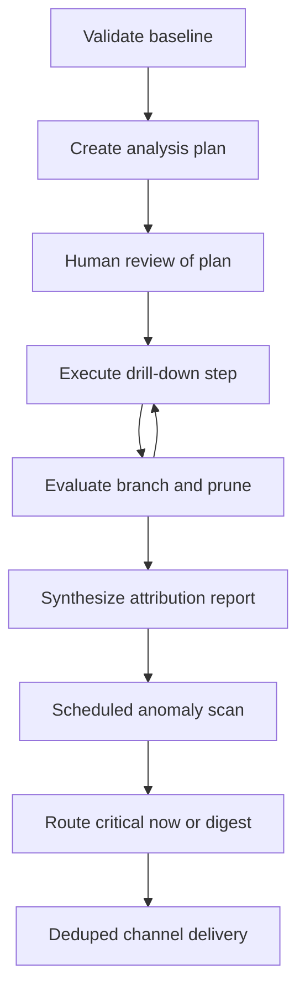

# Multi-step root-cause and scheduled anomaly alerts (UC-05, UC-10)

This page owns the submitted UC-05 / UC-10 pair: on-demand hierarchical diagnosis of a business fluctuation and scheduled statistical detection with channel delivery. UC-05 covers knowledge areas K4 and K5, UC-10 covers K2 and K5 (`repo://docs/prd.md#L321-L323`, `repo://docs/UC-plan/UC05.md#L5-L6`, `repo://docs/UC-plan/UC10.md#L3-L4`).

The shared runtime and safety contract lives in [Agent workflow and harness architecture](../agent/workflow-architecture.md). Seeded fixtures and load rules live in [Business database and seeded scenarios](../data/database-and-seeding.md). Grading, regression, and safety cases live in [Eval runner, metrics, and regression](../evals/eval-and-safety-harness.md).

> Implementation status: partially landed. The durable HITL, checkpoint, host-resume, and alert-dedup persistence seams exist in code (`repo://packages/agent/src/hitl.ts#L81-L92`, `repo://packages/agent/src/ports/checkpoints.ts#L54-L72`, `repo://apps/api/src/ports.ts#L29-L42`, `repo://apps/api/src/store/alertStore.ts#L42-L55`, `repo://docker/initdb/04_semantic_state.sql#L74-L82`). The UC-05 drill-down orchestrator, UC-10 statistical runner and sender (`packages/agent/src/alerts/*`, `config/subscriptions.yaml`, `pnpm alert:run`), and both domain skills are still the planned contract in `repo://docs/architecture.md#L258-L259` and have no implementation files yet.

## 1. Responsibilities

UC-05 answers a why-question such as why net revenue in September 2026 fell versus August (`repo://docs/prd.md#L323-L328`):

1. Confirm the phenomenon with real delta math; if revenue did not fall, report the false premise and stop.
2. Build a decomposition plan across business dimensions and formula splits.
3. Execute the plan step by step, checkpointing after each step and branching into high-contribution children or stopping.
4. Conclude with ranked contributing factors, each with value, share, and evidence SQL.

UC-10 runs on a schedule, for example every morning at 07:00 or manually in a demo, and per subscribed metric times slice (`repo://docs/prd.md#L458-L464`, `repo://docs/UC-plan/UC10.md#L36-L44`):

1. Compute tracked metrics registered by users, for example daily net revenue by region or return rate by province.
2. Detect anomalies in code with z-score over the prior 28 days, week-over-week comparison, or an absolute threshold.
3. Drill down 1–2 extra dimensions to localize the segment, then compose a short alert.
4. Deliver through a chosen channel with deduplication, severity routing, retry, and queueing.

UC-05 is interactive and analyst-driven; UC-10 is scheduled and code-first with the language model used only after an anomaly is found (`repo://docs/UC-plan/UC10.md#L40-L44`).

## 2. UC-05 analysis-plan workflow

### 2.1 Plan state and caps

The plan is persisted as task state, for example `analysis_plan.json`, where every step carries status `todo` / `doing` / `done` / `skipped` / `failed` (`repo://docs/prd.md#L332`). The UC-05 plan models this as `RCAState` with `question`, `metric_name`, current and baseline windows, delta fields, `plan: PlanStep[]`, `total_queries_count`, `max_queries_limit`, and `max_depth_limit` (`repo://docs/UC-plan/UC05.md#L89-L109`).

Hard budget invariants (`repo://docs/prd.md#L333-L334`, `repo://docs/UC-plan/UC05.md#L141-L142`, `repo://docs/UC-plan/UC05.md#L243-L248`):

- Branching: expand or keep drilling into branches that dominate the total move; the PRD example threshold is a branch contributing at least 50% of the drop, while the UC-05 skill operationalizes child expansion at absolute contribution at least 30% (`repo://docs/prd.md#L333`, `repo://docs/UC-plan/UC05.md#L12-L12`, `repo://docs/UC-plan/UC05.md#L136-L136`).
- Depth cap: for example 4 levels such as region to channel to category to product.
- Query cap: for example 20 queries per analysis; hitting depth or query budget stops expansion and the report must disclose the unexplored remainder (`repo://docs/prd.md#L342`).
- Formula decomposition complements dimensional drill-down, for example revenue equals order count times average order value (`repo://docs/UC-plan/UC05.md#L9-L12`).

No `RCAState`, `PlanStep`, or `packages/agent/src/subgraphs/uc05*` implementation exists yet; the only registered subgraph file is the frozen root seam in `repo://packages/agent/src/subgraphs/registry.ts#L16-L45`, so these shapes remain the planned contract.

### 2.2 Baseline validation and attribution math

Every run starts with a baseline check: fetch baseline and current metric values, compute absolute and percentage delta, and abort with actual numbers when the premise is false, for example revenue actually rose (`repo://docs/prd.md#L325-L325`, `repo://docs/prd.md#L343-L343`, `repo://docs/UC-plan/UC05.md#L8-L8`, `repo://docs/UC-plan/UC05.md#L159-L164`).

Per-branch contribution is delta-branch divided by total delta times 100. The summed contribution of reported causes must reconcile with the total change within 5%, checked automatically (`repo://docs/prd.md#L340-L340`, `repo://docs/UC-plan/UC05.md#L138-L138`, `repo://docs/UC-plan/UC05.md#L201-L202`). The calculator must also surface offsetting moves, for example one region up 100M VND while another drops 300M VND for a net 200M VND drop (`repo://docs/UC-plan/UC05.md#L253-L255`). Causes must come from executed SQL evidence; inventing causes outside query data is forbidden (`repo://docs/UC-plan/UC05.md#L144-L144`).

Semantic metric definitions are resolved through the semantic layer so additive flags and canonical formulas are correct before attribution math; additive revenue and order counts can be summed, ratios such as average order value and return rate cannot (`repo://docs/UC-plan/UC05.md#L230-L234`).

### 2.3 Human-in-the-loop and checkpoint resume

After the decomposition plan is created and before heavy drill-down SQL runs, the planned workflow pauses with a LangGraph `interrupt` so the user can view, approve, add, or remove dimensions (`repo://docs/prd.md#L335-L335`, `repo://docs/UC-plan/UC05.md#L13-L13`, `repo://docs/UC-plan/UC05.md#L166-L182`). The planned API shape is view plus resume, for example `GET /rca/plan/{thread_id}` and `POST /rca/plan/{thread_id}/resume` (`repo://docs/UC-plan/UC05.md#L236-L241`).

The interrupt and resume primitives for that pause have landed generically. `pauseForApproval` wraps LangGraph `interrupt` and must be called inside a node; `resumeDecision` builds the `Command({ resume: value })` that continues on the same thread id, never a fresh input object that would re-run generation and double-execute side effects (`repo://packages/agent/src/hitl.ts#L76-L92`). Thread identity is the stable `chat:{userId}:{sessionId}` form with fail-closed validation and a 255-character limit, and resume requires the same thread id (`repo://packages/agent/src/hitl.ts#L9-L32`). The pattern is proven DB-free on `MemorySaver`: interrupt suspends, same-thread resume completes without re-running the completed node, while a fresh thread starts clean (`repo://packages/agent/test/resume.test.ts#L85-L100`).

Durable resume for that pattern is provided by the host: `createCheckpointer` builds a `PostgresSaver` on schema `langgraph` from `HARNESS_STATE_DATABASE_URL` only, runs `setup()` once at boot, fails fast without falling back to `MemorySaver`, and rejects the read-only `agent_ro` URL (`repo://packages/agent/src/ports/checkpoints.ts#L42-L93`). `createHostPorts` constructs both the checkpointer and the `AppStateStore` from the same env var and throws when it is absent (`repo://apps/api/src/ports.ts#L29-L42`). The Express host exposes `POST /api/runs/:runId/resume`, which rehydrates the stored run and invokes `new Command({ resume: value })` on the same thread (`repo://apps/api/src/index.ts#L294-L317`).

Each executed step writes a checkpoint. If the program stops after step 2 of a plan with at least 4 steps, a restart resumes from the last checkpoint without rerunning completed queries (`repo://docs/prd.md#L341-L341`, `repo://docs/UC-plan/UC05.md#L219-L219`, `repo://docs/UC-plan/UC05.md#L257-L260`). Child steps inherit parent filters, for example drilling into the Central region automatically adds the region predicate to deeper queries (`repo://docs/UC-plan/UC05.md#L245-L245`).

### 2.4 Step failure behavior

A failing query step retries with a bound, then is marked `failed` and the run continues on other branches without failing the whole analysis (`repo://docs/prd.md#L334-L334`, `repo://docs/UC-plan/UC05.md#L143-L143`, `repo://docs/UC-plan/UC05.md#L246-L247`). The skill contract allows at most 2 retries per query before marking the step failed and moving on.

## 3. UC-10 scheduled detection and alerting

### 3.1 Schedule, subscriptions, and isolation

Subscriptions declare `metric_id`, primary and suggested secondary dimensions, `recipient_id` and role, channel, digest preference, `absolute_threshold`, and `min_support`, validated with `zod` (`repo://docs/UC-plan/UC10.md#L68-L68`). The planned runner is `node-cron` at 07:00 daily plus a manual CLI such as `pnpm alert:run --manual [--date X] [--flush-digest]` (`repo://docs/UC-plan/UC10.md#L15-L15`, `repo://docs/UC-plan/UC10.md#L69-L69`). Data is fetched as a 28-plus-7-day series through the shared `db-tools` MCP server without opening a separate pool, inheriting SQL guards, column scope policy, and audit (`repo://docs/UC-plan/UC10.md#L17-L17`, `repo://docs/UC-plan/UC10.md#L69-L69`). No `config/subscriptions.yaml`, scheduler, or `packages/agent/src/alerts/*` runner exists yet; the engine remains the Phase 5 planned row in `repo://docs/architecture.md#L259-L259`.

The LangGraph workflow checkpoints per metric and per slice: one slice SQL or computation error is recorded as `failed` with a trace and the run continues on remaining slices (`repo://docs/prd.md#L470-L470`, `repo://docs/UC-plan/UC10.md#L74-L74`, `repo://docs/UC-plan/UC10.md#L142-L142`). The per-slice state tracks `subscriptionId`, `metric`, `dimensionKey`, `date`, `direction`, recipient, and `todo` / `doing` / `done` / `failed` / `skipped` status (`repo://docs/UC-plan/UC10.md#L50-L59`).

### 3.2 Statistical engine

Detection is plain code so normal days cost no language-model calls (`repo://docs/UC-plan/UC10.md#L40-L40`). The normative methods are z-score versus the prior 28 days, week-over-week comparison, or an absolute threshold (`repo://docs/prd.md#L461-L461`). This engine is still planned code; the formulas below are the single normative source from the UC-10 plan.

Robust z-score over a trimmed 28-day window (`repo://docs/UC-plan/UC10.md#L85-L96`):

```text
mu_trim   = trimmed_mean(x_t-28..t-1, p=5%)
sigma_raw = trimmed_std(x_t-28..t-1)
sigma_eff = max(sigma_raw, EPS, 0.05 * abs(mu_trim))
z         = (x_t - mu_trim) / sigma_eff
```

Trimming removes contamination from prior anomalies that would otherwise inflate variance. `EPS` is `1e-6`, or half the smallest currency unit such as 500 VND for money metrics, to avoid division by zero. Short histories use available points with an `insufficient_history` caveat. Ratios are compared per slice only, never summed across segments.

Week-over-week change is `(x_t - x_t-7) / max(abs(x_t-7), EPS) * 100%`, which absorbs day-of-week seasonality (`repo://docs/UC-plan/UC10.md#L100-L104`).

Small-sample guard (`repo://docs/UC-plan/UC10.md#L106-L113`): a slice is only tested when it has enough support, for example daily orders at least 15 or slice trimmed mean above a per-metric floor such as 500k VND per day for revenue. Under-supported slices are marked `skipped_insufficient_support` and do not count as false positives. All divisions use `max(denominator, EPS)`, and `sigma_eff` keeps the `0.05 * abs(mu)` floor.

### 3.3 Severity and routing

Severity bands (`repo://docs/UC-plan/UC10.md#L115-L120`, `repo://docs/prd.md#L471-L471`):

- `critical`: absolute z at least 3.0 or absolute week-over-week at least 50%; sent immediately.
- `warning`: absolute z from 2.0 up to 3.0; grouped into a digest.
- `info`: remaining notable cases such as light absolute-threshold crossings; grouped into a digest.

Normal days emit no alert but still record trace plus latency for false-positive measurement.

### 3.4 Drill-down and alert content

Only anomalous slices invoke the language-model drill-down: pick 1–2 secondary dimensions, generate localizing SQL, pass it through `sqlGuard`, column scope policy, and `EXPLAIN` before `run_query`, then extract the largest contributing segment (`repo://docs/UC-plan/UC10.md#L72-L73`, `repo://docs/UC-plan/UC10.md#L122-L126`).

Every alert must carry the six required fields: metric, current value, expected value, deviation with z plus week-over-week share, localized segment, and evidence SQL (`repo://docs/prd.md#L476-L476`, `repo://docs/UC-plan/UC10.md#L73-L73`, `repo://docs/UC-plan/UC10.md#L126-L126`). A `zod` validator rejects incomplete alerts with at most 2 retries before marking the slice `failed`.

### 3.5 Deduplication, delivery, and retry

Deduplication key is `SHA256(recipient_id + metric + dimension_key + date + direction)`; omitting the recipient would wrongly suppress another recipient's alert (`repo://docs/UC-plan/UC10.md#L139-L139`). The same anomaly is not resent within 24 hours (`repo://docs/prd.md#L469-L469`). History is written to PostgreSQL `app_state.alert_history` only after `send_alert` succeeds; a rerun on the same day sees the fingerprint and skips as `skipped_duplicate` (`repo://docs/UC-plan/UC10.md#L76-L76`, `repo://docs/UC-plan/UC10.md#L140-L143`). Writing before success is forbidden because a later retry after a 5xx or timeout would be wrongly blocked as a duplicate.

The persistence half of that contract has landed. `AppStateStore.sha256Fingerprint` is the single canonical helper over the pipe-joined order `recipientId|metric|dimensionKey|date|direction`, and unit legs pin that any single field change flips the digest (`repo://apps/api/src/store/alertStore.ts#L42-L55`, `repo://apps/api/test/store.test.ts#L45-L66`). `hasFingerprint` is the pre-send `SELECT 1 ... WHERE fingerprint = $1` dedup check with fully parameterized SQL (`repo://apps/api/src/store/alertStore.ts#L90-L97`, `repo://apps/api/test/store.test.ts#L75-L100`). `recordSent` issues exactly one parameterized `INSERT INTO app_state.alert_history` and must be called only after the send succeeds, so failed sends are never falsely suppressed; a duplicate fingerprint surfaces as a `23505` primary-key conflict that the caller treats as already-sent (`repo://apps/api/src/store/alertStore.ts#L99-L120`, `repo://apps/api/test/store.test.ts#L103-L123`, `repo://apps/api/test/store.test.ts#L177-L187`). The table itself is `app_state.alert_history(fingerprint TEXT PRIMARY KEY, recipient_id, metric, dimension_key, alert_date, direction, sent_at)` owned by `harness_state` (`repo://docker/initdb/04_semantic_state.sql#L68-L82`).

Delivery itself is still planned: the UC-10 contract names `packages/agent/src/alerts/sendAlert.ts` with allowlisted Telegram, Slack, email, or mock webhook destinations, 10-second timeout, at most 3 attempts with exponential backoff; exhausted retries append to `failed_alerts_queue.jsonl` with an `ALERT_QUEUED` trace, and `--flush-digest` bundles `warning` and `info` items for demos (`repo://docs/UC-plan/UC10.md#L19-L19`, `repo://docs/UC-plan/UC10.md#L77-L77`, `repo://docs/UC-plan/UC10.md#L141-L141`).

### 3.6 Recipient-scoped policy

Policy is applied at SQL build time, not as post-hoc text filtering (`repo://docs/UC-plan/UC10.md#L128-L135`). Series and drill-down SQL inject row predicates from the recipient role, for example a southern-region lead gets a southern-region filter, and carry the MCP scope token (`schema:read` / `data:read` / `data:sensitive`). Without `data:sensitive`, phone, email, address, and salary columns are denied or masked inside `run_query`. Sample and explain calls go through the same guarded path, and a second PII regex scan runs before sending; matches block delivery with a `PII_BLOCKED` trace. Denials must state the permission reason and alert content must obey the recipient's scope (`repo://docs/prd.md#L479-L479`).

## 4. Plan-execute-checkpoint-alert lifecycle



*Caption: Branching diagnosis from baseline through human plan review and pruned execution into scheduled detection and severity-routed delivery.*

The UC-05 branch of the diagram is interactive and budget-capped; the UC-10 branch is scheduled and per-slice fault-isolated. Both persist checkpoints so resume skips completed work (`repo://docs/prd.md#L341-L341`, `repo://docs/prd.md#L470-L470`). Only the generic checkpoint and dedup boxes have implementations today; the branching, detection, drill-down, and routing nodes are still UC-plan contracts.

## 5. Hidden seeded fixtures

Seeded fixtures are recorded in `data/seeded_scenarios.md` and hidden from the agent: at least 3 fluctuation scenarios with known causes, at least 5 anomaly points, and at least 3 rows containing injection strings (`repo://docs/prd.md#L86-L89`). The agent, semantic retrieval, and few-shot examples must never see that file, gold SQL, or expected results.

The illustrative patterns published in the spec are a September 2026 revenue drop of about 18% caused by one channel times one region times one category stopping sales from 05/09, and a single day with return orders spiking to about four times normal in Da Nang (`repo://docs/prd.md#L87-L88`, `repo://docs/UC-plan/UC05.md#L155-L157`, `repo://docs/UC-plan/UC10.md#L149-L149`). This page states only those published patterns, never secret rows.

## 6. Skill seams

Both use cases expose a reusable skill directory with name, description, when-to-use, inputs and outputs, steps, constraints, examples, and final check; skills must not contain scripts that run arbitrary commands or connect with a different database account (`repo://docs/prd.md#L523-L525`). The skill loader enforces the canonical section list and emits a `skill_call` span when a node loads a skill (`repo://packages/agent/src/skills/loader.ts#L23-L60`).

- `root-cause-analysis` (UC-05): triggers on why-questions, inputs metric plus target and comparison periods, runs validated baseline, plan generation, human review, drill-down loop with contribution math, and verification plus synthesis under 20-query, 4-depth, bounded-retry, and no-fabrication constraints, returning causes plus shares plus evidence SQL (`repo://docs/UC-plan/UC05.md#L111-L147`). No `skills/root-cause-analysis/SKILL.md` file exists yet.
- `anomaly-alert` (UC-10, mandatory): used for cron and manual runs, never for ad-hoc questions; inputs are `zod` `Subscription` and `Alert` shapes; steps are load, fetch via MCP, code detection, drill-down, route, and history; constraints are read-only access, allowlist, `min_support`, no invented numbers, and ignoring injected instructions in data; final check verifies six fields, recipient-scoped fingerprint, post-send history write, and token and cost trace (`repo://docs/prd.md#L465-L465`, `repo://docs/UC-plan/UC10.md#L167-L169`). No `skills/anomaly-alert/SKILL.md` file exists yet; only `skills/answer-synthesis/SKILL.md` and `skills/text-to-sql/SKILL.md` are present.

## 7. Focused evals and acceptance

UC-05 needs at least 5 cases: 3 seeded scenarios, a false-premise question, an interrupted-then-resumed analysis, a user-edited plan before execution, and a mid-run query failure (`repo://docs/prd.md#L345-L345`). Acceptance is correct root dimension combination in at least 2 of 3 seeded scenarios, summed attribution within 5% of the total delta, resume without rerunning finished queries, correct stop at depth or query caps with uncovered work reported, and false-premise refusal without invented causes (`repo://docs/prd.md#L339-L343`).

UC-10 needs at least 5 cases: spike up, drop down, normal day with no alert, same-day rerun, and channel failure (`repo://docs/prd.md#L481-L481`, `repo://docs/UC-plan/UC10.md#L159-L164`). Acceptance is detection of at least 4 of 5 seeded points, at most 3 false alarms over a normal week, six-field alerts, no duplicate resend on same-day rerun, bounded retry then queue with trace on channel errors, and recipient-scoped data with zero PII leak (`repo://docs/prd.md#L475-L479`). Detection rate and false-alarm counts plus token, cost, and latency averages are reported per run (`repo://docs/prd.md#L580-L581`, `repo://docs/UC-plan/UC10.md#L165-L165`).

## 8. Configuration and operations

- Scheduler: `node-cron` schedule plus manual CLI flags for date override and digest flush (`repo://docs/UC-plan/UC10.md#L69-L69`). Not implemented yet.
- Subscriptions: `config/subscriptions.yaml` validated by `zod`, including metric identifiers from the semantic layer, candidate drill dimensions, recipient and role, channel, and thresholds (`repo://docs/UC-plan/UC10.md#L68-L68`). Not implemented yet.
- Persistence: LangGraph checkpointer on PostgreSQL for both the RCA plan and per-slice alert state; `app_state.alert_history` keyed by fingerprint replaces a separate SQLite store to avoid dual sources of truth (`repo://docs/UC-plan/UC10.md#L142-L143`). The checkpointer factory plus `AppStateStore` DAO plus `app_state.alert_history` DDL are the landed part of this bullet (`repo://packages/agent/src/ports/checkpoints.ts#L54-L72`, `repo://apps/api/src/store/alertStore.ts#L77-L120`, `repo://docker/initdb/04_semantic_state.sql#L74-L82`).
- Observability: every run records run ID, per-slice and per-run prompt and completion tokens, estimated cost, latency, tool calls, SQL versions, policy decisions, and approval or digest outcomes in JSONL traces; traces must not retain unmasked PII (`repo://docs/prd.md#L540-L542`, `repo://docs/UC-plan/UC10.md#L151-L151`).
- UI owned by UC-10: alert list with severity and recipient filters, run-now button, evidence SQL view, and digest and queue status (`repo://docs/UC-plan/UC10.md#L78-L78`, `repo://docs/UC-plan/UC10.md#L152-L152`).

Extension without changing the core loop: add drill dimensions or metric aliases in subscriptions and the semantic layer, add a recipient role with its row and column scope, or add a channel behind the allowlisted sender. Characteristic failures contained by design are false premises, budget overruns, single-slice errors, duplicate sends, channel outages, small-sample false positives, contaminated windows, and PII leakage through alerts.
