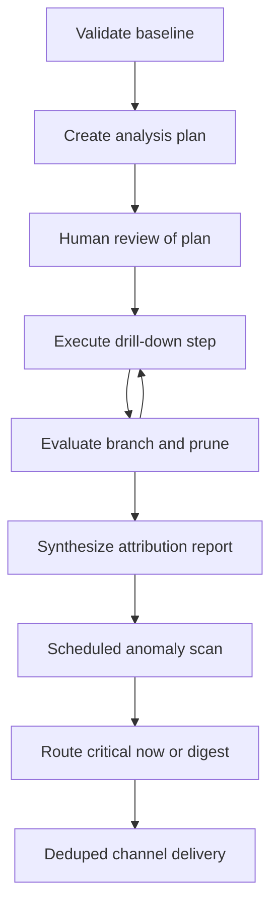

# Multi-step root-cause and scheduled anomaly alerts (UC-05, UC-10)

This page owns the submitted UC-05 / UC-10 pair: on-demand hierarchical diagnosis of a business fluctuation and scheduled statistical detection with channel delivery. UC-05 covers knowledge areas K4 and K5, UC-10 covers K2 and K5 (`docs/prd.md:167`, `docs/prd.md:172`, `docs/prd.md:186`).

The shared runtime and safety contract lives in [Agent workflow and harness architecture](../agent/workflow-architecture.md). Seeded fixtures and load rules live in [Business database and seeded scenarios](../data/database-and-seeding.md). Grading, regression, and safety cases live in [Eval runner, metrics, and regression](../evals/eval-and-safety-harness.md).

> Status note: planned design only — no agent, scheduler, detector, or alert-sender implementation has landed yet. Node names, thresholds, and file paths below are the planned contract from the PRD and UC plans, not inspected runtime code.

## 1. Responsibilities

UC-05 answers a why-question such as why net revenue in September 2026 fell versus August (`docs/prd.md:323-328`):

1. Confirm the phenomenon with real delta math; if revenue did not fall, report the false premise and stop.
2. Build a decomposition plan across business dimensions and formula splits.
3. Execute the plan step by step, checkpointing after each step and branching into high-contribution children or stopping.
4. Conclude with ranked contributing factors, each with value, share, and evidence SQL.

UC-10 runs on a schedule, for example every morning at 07:00 or manually in a demo, and per subscribed metric times slice (`docs/prd.md:458-464`):

1. Compute tracked metrics registered by users, for example daily net revenue by region or return rate by province.
2. Detect anomalies in code with z-score over the prior 28 days, week-over-week comparison, or an absolute threshold.
3. Drill down 1–2 extra dimensions to localize the segment, then compose a short alert.
4. Deliver through a chosen channel with deduplication, severity routing, retry, and queueing.

UC-05 is interactive and analyst-driven; UC-10 is scheduled and code-first with the language model used only after an anomaly is found (`docs/UC-plan/UC10.md:38-44`).

## 2. UC-05 analysis-plan workflow

### 2.1 Plan state and caps

The plan is persisted as task state, for example `analysis_plan.json`, where every step carries status `todo` / `doing` / `done` / `skipped` / `failed` (`docs/prd.md:332`). The UC-05 plan models this as `RCAState` with `question`, `metric_name`, current and baseline windows, delta fields, `plan: PlanStep[]`, `total_queries_count`, `max_queries_limit`, and `max_depth_limit` (`docs/UC-plan/UC05.md:89-109`).

Hard budget invariants (`docs/prd.md:333-334`, `docs/UC-plan/UC05.md:141-142`, `docs/UC-plan/UC05.md:243-248`):

- Branching: expand or keep drilling into branches that dominate the total move; the PRD example threshold is a branch contributing at least 50% of the drop, while the UC-05 skill operationalizes child expansion at absolute contribution at least 30% (`docs/prd.md:333`, `docs/UC-plan/UC05.md:12`, `docs/UC-plan/UC05.md:136`).
- Depth cap: for example 4 levels such as region to channel to category to product.
- Query cap: for example 20 queries per analysis; hitting depth or query budget stops expansion and the report must disclose the unexplored remainder (`docs/prd.md:342`).
- Formula decomposition complements dimensional drill-down, for example revenue equals order count times average order value (`docs/UC-plan/UC05.md:9-12`).

### 2.2 Baseline validation and attribution math

Every run starts with a baseline check: fetch baseline and current metric values, compute absolute and percentage delta, and abort with actual numbers when the premise is false, for example revenue actually rose (`docs/prd.md:325`, `docs/prd.md:343`, `docs/UC-plan/UC05.md:8`, `docs/UC-plan/UC05.md:159-164`).

Per-branch contribution is delta-branch divided by total delta times 100. The summed contribution of reported causes must reconcile with the total change within 5%, checked automatically (`docs/prd.md:340`, `docs/UC-plan/UC05.md:138`, `docs/UC-plan/UC05.md:201-202`). The calculator must also surface offsetting moves, for example one region up 100M VND while another drops 300M VND for a net 200M VND drop (`docs/UC-plan/UC05.md:253-255`). Causes must come from executed SQL evidence; inventing causes outside query data is forbidden (`docs/UC-plan/UC05.md:144`).

Semantic metric definitions are resolved through the semantic layer so additive flags and canonical formulas are correct before attribution math; additive revenue and order counts can be summed, ratios such as average order value and return rate cannot (`docs/UC-plan/UC02.md:53`, `docs/UC-plan/UC05.md:230-234`).

### 2.3 Human-in-the-loop and checkpoint resume

After the decomposition plan is created and before heavy drill-down SQL runs, the workflow pauses with a LangGraph `interrupt` so the user can view, approve, add, or remove dimensions (`docs/prd.md:335`, `docs/UC-plan/UC05.md:13`, `docs/UC-plan/UC05.md:166-182`). The planned API shape is view plus resume, for example `GET /rca/plan/{thread_id}` and `POST /rca/plan/{thread_id}/resume` (`docs/UC-plan/UC05.md:236-241`).

Each executed step writes a checkpoint. If the program stops after step 2 of a plan with at least 4 steps, a restart resumes from the last checkpoint without rerunning completed queries (`docs/prd.md:341`, `docs/UC-plan/UC05.md:219`, `docs/UC-plan/UC05.md:257-260`). Child steps inherit parent filters, for example drilling into the Central region automatically adds the region predicate to deeper queries (`docs/UC-plan/UC05.md:245`).

### 2.4 Step failure behavior

A failing query step retries with a bound, then is marked `failed` and the run continues on other branches without failing the whole analysis (`docs/prd.md:334`, `docs/UC-plan/UC05.md:143`, `docs/UC-plan/UC05.md:246-247`). The skill contract allows at most 2 retries per query before marking the step failed and moving on.

## 3. UC-10 scheduled detection and alerting

### 3.1 Schedule, subscriptions, and isolation

Subscriptions declare `metric_id`, primary and suggested secondary dimensions, `recipient_id` and role, channel, digest preference, `absolute_threshold`, and `min_support`, validated with `zod` (`docs/UC-plan/UC10.md:68`). The runner is `node-cron` at 07:00 daily plus a manual CLI such as `pnpm alert:run --manual [--date X] [--flush-digest]` (`docs/UC-plan/UC10.md:15`, `docs/UC-plan/UC10.md:69`). Data is fetched as a 28-plus-7-day series through the shared `db-tools` MCP server without opening a separate pool, inheriting SQL guards, column scope policy, and audit (`docs/UC-plan/UC10.md:17`, `docs/UC-plan/UC10.md:69`).

The LangGraph workflow checkpoints per metric and per slice: one slice SQL or computation error is recorded as `failed` with a trace and the run continues on remaining slices (`docs/prd.md:470`, `docs/UC-plan/UC10.md:74`, `docs/UC-plan/UC10.md:142`). The per-slice state tracks `subscriptionId`, `metric`, `dimensionKey`, `date`, `direction`, recipient, and `todo` / `doing` / `done` / `failed` / `skipped` status (`docs/UC-plan/UC10.md:50-59`).

### 3.2 Statistical engine

Detection is plain code so normal days cost no language-model calls (`docs/UC-plan/UC10.md:40`). The normative methods are z-score versus the prior 28 days, week-over-week comparison, or an absolute threshold (`docs/prd.md:461`).

Robust z-score over a trimmed 28-day window (`docs/UC-plan/UC10.md:85-96`):

```text
mu_trim   = trimmed_mean(x_t-28..t-1, p=5%)
sigma_raw = trimmed_std(x_t-28..t-1)
sigma_eff = max(sigma_raw, EPS, 0.05 * abs(mu_trim))
z         = (x_t - mu_trim) / sigma_eff
```

Trimming removes contamination from prior anomalies that would otherwise inflate variance. `EPS` is `1e-6`, or half the smallest currency unit such as 500 VND for money metrics, to avoid division by zero. Short histories use available points with an `insufficient_history` caveat. Ratios are compared per slice only, never summed across segments.

Week-over-week change is `(x_t - x_t-7) / max(abs(x_t-7), EPS) * 100%`, which absorbs day-of-week seasonality (`docs/UC-plan/UC10.md:100-104`).

Small-sample guard (`docs/UC-plan/UC10.md:106-113`): a slice is only tested when it has enough support, for example daily orders at least 15 or slice trimmed mean above a per-metric floor such as 500k VND per day for revenue. Under-supported slices are marked `skipped_insufficient_support` and do not count as false positives. All divisions use `max(denominator, EPS)`, and `sigma_eff` keeps the `0.05 * abs(mu)` floor.

### 3.3 Severity and routing

Severity bands (`docs/UC-plan/UC10.md:115-120`, `docs/prd.md:471`):

- `critical`: absolute z at least 3.0 or absolute week-over-week at least 50%; sent immediately.
- `warning`: absolute z from 2.0 up to 3.0; grouped into a digest.
- `info`: remaining notable cases such as light absolute-threshold crossings; grouped into a digest.

Normal days emit no alert but still record trace plus latency for false-positive measurement.

### 3.4 Drill-down and alert content

Only anomalous slices invoke the language-model drill-down: pick 1–2 secondary dimensions, generate localizing SQL, pass it through `sqlGuard`, column scope policy, and `EXPLAIN` before `run_query`, then extract the largest contributing segment (`docs/UC-plan/UC10.md:72-73`, `docs/UC-plan/UC10.md:122-126`).

Every alert must carry the six required fields: metric, current value, expected value, deviation with z plus week-over-week share, localized segment, and evidence SQL (`docs/prd.md:476`, `docs/UC-plan/UC10.md:73`, `docs/UC-plan/UC10.md:126`). A `zod` validator rejects incomplete alerts with at most 2 retries before marking the slice `failed`.

### 3.5 Deduplication, delivery, and retry

Deduplication key is `SHA256(recipient_id + metric + dimension_key + date + direction)`; omitting the recipient would wrongly suppress another recipient's alert (`docs/UC-plan/UC10.md:139`). The same anomaly is not resent within 24 hours (`docs/prd.md:469`). History is written to PostgreSQL `app_state.alert_history` only after `send_alert` succeeds; a rerun on the same day sees the fingerprint and skips as `skipped_duplicate` (`docs/UC-plan/UC10.md:76`, `docs/UC-plan/UC10.md:140-143`). Writing before success is forbidden because a later retry after a 5xx or timeout would be wrongly blocked as a duplicate.

Delivery uses `packages/agent/src/alerts/sendAlert.ts` with allowlisted Telegram, Slack, email, or mock webhook destinations, 10-second timeout, at most 3 attempts with exponential backoff; exhausted retries append to `failed_alerts_queue.jsonl` with an `ALERT_QUEUED` trace, and `--flush-digest` bundles `warning` and `info` items for demos (`docs/UC-plan/UC10.md:19`, `docs/UC-plan/UC10.md:77`, `docs/UC-plan/UC10.md:141`).

### 3.6 Recipient-scoped policy

Policy is applied at SQL build time, not as post-hoc text filtering (`docs/UC-plan/UC10.md:128-135`). Series and drill-down SQL inject row predicates from the recipient role, for example a southern-region lead gets a southern-region filter, and carry the MCP scope token (`schema:read` / `data:read` / `data:sensitive`). Without `data:sensitive`, phone, email, address, and salary columns are denied or masked inside `run_query`. Sample and explain calls go through the same guarded path, and a second PII regex scan runs before sending; matches block delivery with a `PII_BLOCKED` trace. Denials must state the permission reason and alert content must obey the recipient's scope (`docs/prd.md:479`).

## 4. Plan-execute-checkpoint-alert lifecycle



*Caption: Branching diagnosis from baseline through human plan review and pruned execution into scheduled detection and severity-routed delivery.*

The UC-05 branch of the diagram is interactive and budget-capped; the UC-10 branch is scheduled and per-slice fault-isolated. Both persist checkpoints so resume skips completed work (`docs/prd.md:341`, `docs/prd.md:470`).

## 5. Hidden seeded fixtures

Seeded fixtures are recorded in `data/seeded_scenarios.md` and hidden from the agent: at least 3 fluctuation scenarios with known causes, at least 5 anomaly points, and at least 3 rows containing injection strings (`docs/prd.md:86-89`). The agent, semantic retrieval, and few-shot examples must never see that file, gold SQL, or expected results.

The illustrative patterns published in the spec are a September 2026 revenue drop of about 18% caused by one channel times one region times one category stopping sales from 05/09, and a single day with return orders spiking to about four times normal in Da Nang (`docs/prd.md:87-88`, `docs/UC-plan/UC05.md:155-157`, `docs/UC-plan/UC10.md:149`). This page states only those published patterns, never secret rows.

## 6. Skill seams

Both use cases expose a reusable skill directory with name, description, when-to-use, inputs and outputs, steps, constraints, examples, and final check; skills must not contain scripts that run arbitrary commands or connect with a different database account (`docs/prd.md:523-525`).

- `root-cause-analysis` (UC-05): triggers on why-questions, inputs metric plus target and comparison periods, runs validated baseline, plan generation, human review, drill-down loop with contribution math, and verification plus synthesis under 20-query, 4-depth, bounded-retry, and no-fabrication constraints, returning causes plus shares plus evidence SQL (`docs/UC-plan/UC05.md:111-147`).
- `anomaly-alert` (UC-10, mandatory): used for cron and manual runs, never for ad-hoc questions; inputs are `zod` `Subscription` and `Alert` shapes; steps are load, fetch via MCP, code detection, drill-down, route, and history; constraints are read-only access, allowlist, `min_support`, no invented numbers, and ignoring injected instructions in data; final check verifies six fields, recipient-scoped fingerprint, post-send history write, and token and cost trace (`docs/prd.md:465`, `docs/UC-plan/UC10.md:167-169`).

## 7. Focused evals and acceptance

UC-05 needs at least 5 cases: 3 seeded scenarios, a false-premise question, an interrupted-then-resumed analysis, a user-edited plan before execution, and a mid-run query failure (`docs/prd.md:345`). Acceptance is correct root dimension combination in at least 2 of 3 seeded scenarios, summed attribution within 5% of the total delta, resume without rerunning finished queries, correct stop at depth or query caps with uncovered work reported, and false-premise refusal without invented causes (`docs/prd.md:339-343`).

UC-10 needs at least 5 cases: spike up, drop down, normal day with no alert, same-day rerun, and channel failure (`docs/prd.md:481`, `docs/UC-plan/UC10.md:159-164`). Acceptance is detection of at least 4 of 5 seeded points, at most 3 false alarms over a normal week, six-field alerts, no duplicate resend on same-day rerun, bounded retry then queue with trace on channel errors, and recipient-scoped data with zero PII leak (`docs/prd.md:475-479`). Detection rate and false-alarm counts plus token, cost, and latency averages are reported per run (`docs/prd.md:580-581`, `docs/UC-plan/UC10.md:165`).

## 8. Configuration and operations

- Scheduler: `node-cron` schedule plus manual CLI flags for date override and digest flush (`docs/UC-plan/UC10.md:69`).
- Subscriptions: `config/subscriptions.yaml` validated by `zod`, including metric identifiers from the semantic layer, candidate drill dimensions, recipient and role, channel, and thresholds (`docs/UC-plan/UC10.md:68`).
- Persistence: LangGraph checkpointer on PostgreSQL for both the RCA plan and per-slice alert state; `app_state.alert_history` keyed by fingerprint replaces a separate SQLite store to avoid dual sources of truth (`docs/UC-plan/UC10.md:142-143`).
- Observability: every run records run ID, per-slice and per-run prompt and completion tokens, estimated cost, latency, tool calls, SQL versions, policy decisions, and approval or digest outcomes in JSONL traces; traces must not retain unmasked PII (`docs/prd.md:540-542`, `docs/UC-plan/UC10.md:151`).
- UI owned by UC-10: alert list with severity and recipient filters, run-now button, evidence SQL view, and digest and queue status (`docs/UC-plan/UC10.md:78`, `docs/UC-plan/UC10.md:152`).

Extension without changing the core loop: add drill dimensions or metric aliases in subscriptions and the semantic layer, add a recipient role with its row and column scope, or add a channel behind the allowlisted sender. Characteristic failures contained by design are false premises, budget overruns, single-slice errors, duplicate sends, channel outages, small-sample false positives, contaminated windows, and PII leakage through alerts.
