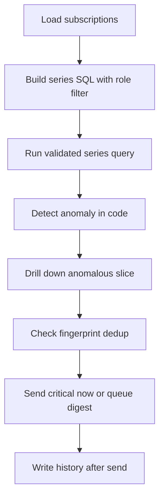

# Root cause and anomaly alerts

Periodic anomaly detection and alerting: every subscribed metric is scanned on schedule, statistically tested in code, localized with a drill-down query, then delivered once per recipient with retry and digest handling. The shared validated SQL path lives in [Natural-language query with self-repair](./text-to-sql.md). Seeded fixtures and load rules live in [Business database and seeding](../data/database-and-seeding.md). Grading and safety cases live in [Eval runner, metrics, and regression](../evals/eval-and-safety-harness.md). Repository operations live in [Repository operations](../operations/repository-operations.md).

Seeded anomaly fixtures are hidden from the agent and from retrieval. This page describes only the published mechanism (spike up, drop down, normal day with no alert, same-day rerun, channel failure) and never secret rows.

## 1. Subscriptions

Subscriptions declare one scan unit each: metric identifier, primary time dimension, suggested secondary drill dimensions, recipient and role, channel, digest preference, absolute threshold, and minimum support (`repo://docs/UC-plan/UC10.md#L68-L68`).

That config has landed as `config/subscriptions.yaml` with version 1 and five daily subscriptions covering return rate, net revenue, cancellation rate, order count, and review-score average (`repo://config/subscriptions.yaml#L1-L86`). Validation is `SubscriptionsConfigSchema` with camelCase defaults plus snake-case preprocessing, `MinSupportSchema` accepting either an integer floor of 15 or a `{ minOrders, minMetricTrimmedMean }` object, and `AlertChannelSchema` allowing `webhook`, `email`, `telegram`, and `slack` (`repo://packages/contracts/src/alert.ts#L13-L93`).

`loadSubscriptionsConfig` parses YAML text through that schema and throws an explicit syntax error on malformed input; `loadSubscriptionsConfigFile` reads an explicit path or falls back to the repo-root-relative `DEFAULT_SUBSCRIPTIONS_PATH` (`repo://packages/agent/src/alerts/subscription.ts#L9-L31`). There is no `SUBSCRIPTIONS_PATH` environment override in the current loader. Legs pin default-path loading, explicit-path override, and malformed-YAML failure (`repo://packages/agent/test/subscription.test.ts#L8-L31`).

## 2. Series fetch through the validated executor

Each run evaluates a 35-day window (28-day baseline plus 7-day week-over-week context) ending on the target date. `buildTimeSeriesQuery` builds one metric-specific daily series query returning `date`, `support_count`, and `value`, with recipient-role row predicates injected at build time (for example southern roles add a southern-region filter) (`repo://packages/agent/src/alerts/runner.ts#L105-L192`).

The runner never opens a separate pool. It calls `executeAlertQuery`, which forwards the deterministic proposal as `initialSql` through the shared `ValidatedQueryExecutor.run` with candidate tables and the run principal, inheriting selective describe, `sqlGuard`, local policy gates, `explain_query`, `run_query`, bounded repair, and server-side access policy (`repo://packages/agent/src/alerts/query.ts#L14-L67`). A `Restricted` or `error` executor outcome throws and becomes a per-subscription `failed` slice rather than crashing the run. The standard catalog for these queries is `DEFAULT_ANOMALY_CATALOG`, matching the shop schema without sensitive customer contact columns in the allowlisted series path (`repo://packages/agent/src/alerts/catalog.ts#L10-L60`).

## 3. Pure-code detector

Detection is deterministic code so normal days cost zero language-model calls (`repo://docs/UC-plan/UC10.md#L40-L44`). The landed `detectAnomaly` operates only on numeric aggregates, so hostile dimension labels cannot execute (`repo://packages/agent/src/alerts/anomalyDetector.ts#L140-L263`).

The formulas, translated from the plan, are:

```text
mu_trim   = trimmed_mean(history values, 5 percent each end)
sigma_raw = trimmed_std(history values)
sigma_eff = max(sigma_raw, eps, 0.05 * abs(mu_trim))
z         = (current - mu_trim) / sigma_eff
wow_pct   = (current - week_ago) / max(abs(week_ago), eps) * 100
```

Helpers `trimmedMean` and `trimmedStd` sort and cut `max(1, floor(n * trimRatio))` from each end, `calculateEffectiveSigma` applies the noise and signal-proportion floor, `calculateWoW` guards division with `max(abs(weekAgo), eps)` and returns `null` when the week-ago point is zero, and `isAbsoluteThresholdBreached` applies the `above` or `below` operator (`repo://packages/agent/src/alerts/anomalyDetector.ts#L41-L113`).

Gating order is support first, then statistics. A slice whose `supportCount` is below `minOrders` (default 15) returns `skipped_insufficient_support` with severity `none`, unless an explicit metric-mean floor is met. Fewer than 14 history points returns `insufficient_history` with statistical alerting suppressed, but an absolute-threshold breach still reports `critical`. Otherwise `abs(z) >= 3.0` or `abs(wow) >= 50` maps to `critical`, and `2.0 <= abs(z) < 3.0` maps to `warning`; anything else emits no alert. Direction is `spike` when current is at or above the trimmed mean and `drop` otherwise (`repo://packages/agent/src/alerts/anomalyDetector.ts#L140-L263`).

## 4. Drill-down on anomalies only

Only anomalous slices invoke the drill-down. `runDrillDownAnalysis` takes the first one or two suggested secondary dimensions from the subscription, builds a breakdown query with `buildDrillDownSql`, validates dimension names against the catalog, rejects sensitive columns, injects the same recipient-role filter, runs the query through `executeAlertQuery`, picks the top returned row as the contributing segment, and composes a strict six-field alert (`repo://packages/agent/src/alerts/drillDown.ts#L280-L411`).

The six required fields are metric, current value, expected value, deviation with z plus week-over-week share, localized segment, and evidence SQL. The composed candidate is parsed with `AnomalyAlertSchema` before dispatch, so an incomplete alert fails fast instead of sending a malformed message (`repo://packages/contracts/src/alert.ts#L101-L125`).

## 5. Fingerprint deduplication and write-after-send history

The canonical fingerprint is SHA-256 hex over the pipe-joined order `recipientId|metric|dimensionKey|date|direction`. The agent helper `calculateAlertFingerprint` and the host helper `sha256Fingerprint` implement the identical order so both sides compute the same digest; any single field change flips the digest, which isolates recipients from each other (`repo://packages/agent/src/alerts/fingerprint.ts#L12-L31`, `repo://apps/api/src/store/alertStore.ts#L42-L55`).

`dispatchAlert` derives the fingerprint from the alert (falling back to `drilldownSegment` or `overall` for the dimension key and the alert date or today), checks `hasFingerprint` before sending, and skips as `skippedDuplicate` when the fingerprint was already recorded (`repo://packages/agent/src/alerts/dispatcher.ts#L210-L280`). The host check is a fully parameterized `SELECT 1 ... WHERE fingerprint = $1 AND sent_at >= NOW() - INTERVAL '24 hours'` (`repo://apps/api/src/store/alertStore.ts#L90-L97`).

History is written only after successful delivery. `recordSent` issues exactly one parameterized `INSERT INTO app_state.alert_history` and must be called after the transport reports success, so retries of failed sends are never falsely suppressed; an expired 24-hour fingerprint is refreshed in place through the `ON CONFLICT ... WHERE sent_at < NOW() - INTERVAL '24 hours'` clause (`repo://apps/api/src/store/alertStore.ts#L99-L120`). The table is `app_state.alert_history(fingerprint PRIMARY KEY, recipient_id, metric, dimension_key, alert_date, direction, sent_at)` owned by `harness_state` (`repo://docker/initdb/04_semantic_state.sql#L68-L82`).

## 6. Digest dispatch with retry

Severity routing happens inside `dispatchAlert`. `critical` alerts send immediately. `warning` and `info` alerts are appended to the digest queue and return `queued` unless the run passes `flushDigest`, in which case they send on the same resilient path (`repo://packages/agent/src/alerts/dispatcher.ts#L280-L340`).

Immediate sends use a 10-second timeout with at most 3 attempts and bounded exponential backoff. Retryable failures are 5xx, 429, 408, timeouts, aborts, and network errors; other 4xx results break out without retry (`repo://packages/agent/src/alerts/dispatcher.ts#L100-L145`). Before any network attempt the dispatcher runs a second-pass PII scan over the message, segment, and evidence SQL with `redactPII`; a hit blocks delivery with `PII_BLOCKED` and never reaches history (`repo://packages/agent/src/alerts/dispatcher.ts#L240-L280`).

Exhausted retries append one JSON line to `failed_alerts_queue.jsonl` with an `ALERT_QUEUED` log and return `queued` with reason `RETRY_EXHAUSTED`, deliberately without writing history. `flushFailedAlertsQueue` can later resend those entries and only then record history (`repo://packages/agent/src/alerts/dispatcher.ts#L340-L456`). Non-critical digests persist separately in `pending_alert_digests.jsonl` through `JsonlDigestQueue`, while tests use the in-memory queue variants (`repo://packages/agent/src/alerts/dispatcher.ts#L146-L210`).

## 7. Scheduler and manual run

`runAnomalyRunner` owns the per-subscription loop with fault isolation: load subscriptions, optionally filter by one subscription id, fetch each 35-day series, run detection, drill down only on anomalies, dispatch, and continue past any single-slice error with a `failed` slice entry plus a `failures` record (`repo://packages/agent/src/alerts/runner.ts#L195-L330`). The result summarizes target date, manual flag, subscription counts, anomalies detected, alerts sent, queued, skipped-duplicate, blocked, failures, per-slice results, and flushed digest count.

Digest flushing is part of the same run: when `flushDigest` is set, queued digests are resent through the dispatcher with flushing enabled and the queue is cleared (`repo://packages/agent/src/alerts/runner.ts#L330-L380`). `scheduleAnomalyCron` schedules the next daily run with a wall-clock timer defaulting to 07:00 and returns a `stop` handle; unlike a cron daemon it cannot recover a missed run while the process is down (`repo://packages/agent/src/alerts/runner.ts#L400-L484`).

The manual entry is `pnpm alert:run`, wired as `tsx scripts/alert-run.ts` (`repo://package.json#L28-L28`). The script accepts `--manual`, `--date YYYY-MM-DD`, `--flush-digest`, and `--subscription <id>`, previews the loaded subscription count, runs the runner with a mock executor in demo mode, and prints totals plus per-slice severity and segment lines (`repo://scripts/alert-run.ts#L1-L60`, `repo://scripts/alert-run.ts#L60-L135`). Production callers inject their configured `ValidatedQueryExecutor`, principal, and durable `AppStateStore`-backed history store.



*Caption: Scheduled alert flow from subscription load through validated series query, code-only detection, drill-down, deduplicated severity-routed dispatch, and write-after-send history.*

## 8. Token cost and observability

Normal days emit no language-model traffic because detection is pure arithmetic. Model and token cost appears only when an anomaly triggers drill-down query planning or executor repair, plus whatever the shared executor and trace path records for that run.

The runner keeps cost visible without its own token counter: the result aggregates evaluated subscriptions, anomalies, sent, queued, duplicate-skipped, blocked, and failed slices, and every run accepts a `logger` hook for operational traces. The plan additionally requires per-slice and per-run prompt tokens, completion tokens, estimated cost, latency, tool calls, SQL versions, policy decisions, and approval or digest outcomes in JSONL traces without unmasked PII (`repo://docs/UC-plan/UC10.md#L140-L170`).

## 9. Focused test

The runner suite pins the end-to-end contract without a live database: a normal series produces zero anomalies and zero sends, a spike series produces one critical alert with drill-down and evidence, a same-day rerun against the same history store reports `alertsSkippedDuplicate`, one failing subscription does not crash the other slice, digest flushing delivers and clears the queue, and date validation plus regional scoping hold for review-score series (`repo://packages/agent/test/runner.test.ts#L60-L270`).
