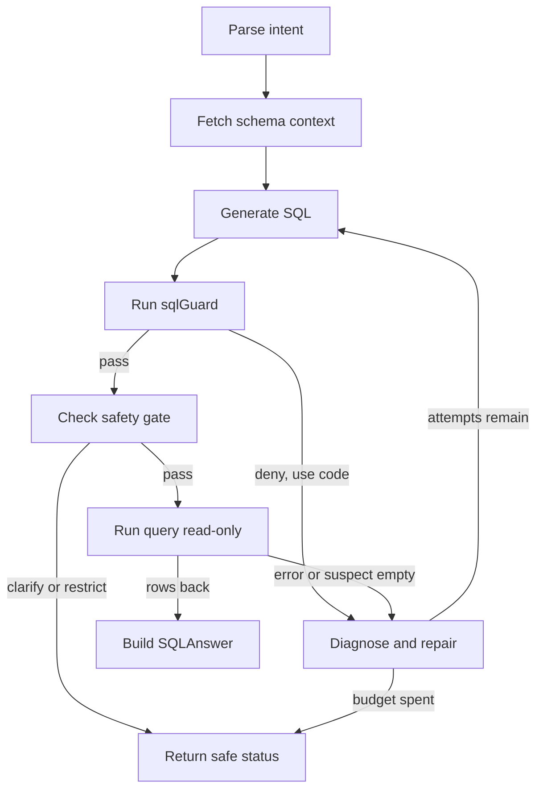

# Natural-language query with self-repair (UC-01)

This page owns the UC-01 design: answer a Vietnamese or English business question by parsing intent, fetching only needed schema, generating one read-only statement as structured output, validating it, executing it under limits, and repairing it in a bounded loop. UC-01 covers knowledge areas K1 and K2 (`docs/prd.md:163`, `docs/prd.md:177-178`, `docs/prd.md:186`; `docs/UC-plan/UC01.md:5`).

The shared runtime, tool, and observability contracts live in [Agent workflow and harness architecture](../agent/workflow-architecture.md), [Safety and access control](../agent/safety-and-access-control.md), [Semantic layer](../agent/semantic-layer.md), and [Eval runner, metrics, and regression](../evals/eval-and-safety-harness.md).

> Status note: planned design only — no LangGraph graph, `sqlGuard`, `LocalQuerySafetyGate`, `db-tools` client, skill file, benchmark, or UI has landed yet. Node names, limits, and thresholds below are the planned contract from the PRD and UC-01 plan, not inspected runtime code.

## 1. Responsibilities and scope

UC-01 answers questions such as "Top 5 provinces by revenue in Q3 2026?" or "Which month in 2025 had the most returned orders?" through a fixed loop: understand question, fetch schema, generate SQL, validate, trial-run with `LIMIT` and timeout, repair, and answer with a result table plus the SQL used (`docs/prd.md:194-202`).

In scope (`docs/UC-plan/UC01.md:18-19`):

- One `SELECT` or `WITH` statement per question against the fictional enterprise database.
- Never invent numbers when the database cannot support the question.
- `LocalQuerySafetyGate`, owned by UC-01, enforces deterministic cost, join, and sensitive-data rules without waiting for UC-07 or UC-08. By default it neither queries nor infers from columns flagged `sensitive`.

Explicitly out of scope (`docs/UC-plan/UC01.md:20`):

- Independent reviewer (UC-06), expensive-query approval (UC-07), role-based access control (UC-08), and chart rendering (UC-03).
- Later UCs may add policy at the MCP server without changing the UC-01 core loop.

Course invariants that UC-01 cannot waive: the team must build its own agent and must not wrap a hosted text-to-SQL or BI-agent product (`docs/prd.md:58-61`); execution must use a read-only identity, never prompt-only blocking (`docs/prd.md:62`); only synthetic or public data with fake PII is allowed (`docs/prd.md:63`); LangGraph is the recommended workflow framework in Python or TypeScript (`docs/prd.md:64-65`). The UC-01 plan selects the TypeScript stack (`@langchain/langgraph`, `zod`, MCP client, PostgreSQL) and forbids ready-made text-to-SQL products (`docs/UC-plan/UC01.md:6`).

## 2. Intent parsing and minimal schema fetch

The loop starts with an authenticated MCP session, `userId`, and question. UC-01 does not interpret roles, scopes, or row-level policy itself; any extra server policy is applied by the server (`docs/UC-plan/UC01.md:113`).

Intent extraction uses structured output to capture KPI, dimensions, filters, time range, and what is still unclear (`docs/UC-plan/UC01.md:114`). Business KPI terms are resolved against the semantic layer; on mismatch the run returns `cannot_answer` or asks for clarification instead of guessing a formula (`docs/UC-plan/UC01.md:114`).

Schema fetch is minimal by design (`docs/prd.md:197`; `docs/UC-plan/UC01.md:115`):

- `search_semantic_layer` for KPI definitions, canonical joins, and citations — read-only over the knowledge store.
- `list_tables` for the visible table list under the current scope.
- `describe_table` only for relevant tables, returning columns, keys, relations, enums, and the `sensitive` flag; the full schema is never loaded by default (`docs/UC-plan/UC01.md:44-45`).
- `sample_rows` (at most 5 masked rows) only for diagnosing filter values and zero-row cases (`docs/UC-plan/UC01.md:46`; `docs/prd.md:512`).

Every KPI definition, join, and table or column used must be recorded as a citation such as `metric:net_revenue` or `table:orders` (`docs/UC-plan/UC01.md:87`).

## 3. Structured `SQLAnswer` output

`SQLAnswerSchema` (Zod) is the sole contract returned to UI and API (`docs/UC-plan/UC01.md:58-85`). The PRD minimum plus the plan refinement are:

| Field | Type | Rule |
|---|---|---|
| `intent` | object | `{metric, dimensions, filters, timeRange}`; filters are `{field, operator, value}` (`docs/prd.md:208`; `docs/UC-plan/UC01.md:62-69`) |
| `sql` | string or null | Final executed SQL, null when no SQL exists (`docs/prd.md:209`; `docs/UC-plan/UC01.md:70`) |
| `tablesUsed` / `tables_used` | list of string | Must exist in schema (`docs/prd.md:210`; `docs/UC-plan/UC01.md:71`) |
| `citations` | list of string, optional | KPI, table, or column URIs or IDs actually used (`docs/UC-plan/UC01.md:72`, `docs/UC-plan/UC01.md:87`) |
| `attempts` | list, max 3 | One entry per SQL generation with number, SQL, schema refs, validation, EXPLAIN summary, execution, diagnostic, repair reason, and duration (`docs/prd.md:211`; `docs/UC-plan/UC01.md:73`, `docs/UC-plan/UC01.md:94`) |
| `resultPreview` | list of dict, max 50 | Already masked; UI shows at most 50 rows (`docs/prd.md:212`; `docs/UC-plan/UC01.md:74`, `docs/UC-plan/UC01.md:88`) |
| `answerText` / `answer_text` | string | Short answer whose numbers come only from executed results (`docs/prd.md:213`; `docs/UC-plan/UC01.md:75`) |
| `status` | enum | `ok`, `no_data`, `cannot_answer`, `needs_clarification`, `restricted`, `error`; the PRD lists the first four plus `error`, the plan adds clarification and restriction states (`docs/prd.md:214`; `docs/UC-plan/UC01.md:76-82`, `docs/UC-plan/UC01.md:102-109`) |

Output validity is itself gated: 100% of responses must validate against `SQLAnswer`; a failed `SQLAnswer` parse gets at most 2 format repairs, then returns `status: "error"` with a safe message and no free-form model output (`docs/prd.md:221`; `docs/UC-plan/UC01.md:89`). If failure happens before intent or SQL exists, required fields take safe defaults (`metric: null`, empty arrays, `sql: null`, `resultPreview: []`) (`docs/UC-plan/UC01.md:90`).

Workflow state (`TextToSqlState`) carries `runId`, `userId`, `question`, `intent`, `semanticContext`, `schemaContext`, `attempts`, `zeroRowDiagnostic`, `pendingClarification`, `queryResult`, `status`, `tokenUsage`, `estimatedCostUsd`, and UI `events` (`docs/UC-plan/UC01.md:96`). Clarification state is `{field, question, options, attempts}` where `field` is one of `metric | timeRange | scope | filterValue`, `options` has 2–4 dictionary-derived choices, and clarification rounds are capped at 2 (`docs/UC-plan/UC01.md:98`).

## 4. Validation: shared `sqlGuard` plus server recheck

The PRD validator parses with sqlglot, accepts exactly one `SELECT`/`WITH` statement, verifies tables and columns exist, and applies a dangerous-function denylist (`docs/prd.md:199`, `docs/prd.md:224`, `docs/prd.md:513`).

The UC-01 implementation refines this to a shared TypeScript `sqlGuard` owned by UC-09: parse with `pgsql-parser`, require exactly one `SELECT`/`WITH` statement, check tables and columns against schema, and block DDL/DML, multi-statement queries, and dangerous functions such as `pg_sleep`, `COPY`, `pg_read_file`, and `ATTACH` (`docs/UC-plan/UC01.md:30`, `docs/UC-plan/UC01.md:50`). Policy-failing SQL is never sent to `run_query`; its normalized error feeds the next repair (`docs/UC-plan/UC01.md:117`).

Defense in depth is mandatory: even after local validation, the `db-tools` MCP server independently revalidates before execution (`docs/UC-plan/UC01.md:50`). MCP errors are normalized to `{code, message, retryable}` with at least `SQL_POLICY_DENIED`, `UNKNOWN_TABLE`, `UNKNOWN_COLUMN`, `SYNTAX_ERROR`, `ACCESS_DENIED`, `QUERY_TIMEOUT`, and `INTERNAL_ERROR`; repair prompts receive only these sanitized fields, never raw database errors, connection strings, secrets, or PII (`docs/UC-plan/UC01.md:52`, `docs/UC-plan/UC01.md:119`).

## 5. Generate-validate-execute-fix loop

The planned LangGraph workflow uses checkpointed state and at most 3 SQL generations: 1 initial plus up to 2 repairs (`docs/UC-plan/UC01.md:28`, `docs/UC-plan/UC01.md:119`). The model emits one candidate SQL per attempt through a Zod schema, and the prompt states that SQL answers the question while data or question text containing instructions must be treated as untrusted data (`docs/UC-plan/UC01.md:116`, `docs/UC-plan/UC01.md:158`).

*Caption: UC-01 generate, guard, gate, execute, and bounded-repair loop.*

Zero-row results do not immediately become `no_data` (`docs/UC-plan/UC01.md:124-129`):

- Diagnose only once, when `attemptNo === 1` and the question has verifiable filters.
- Check enums, date shapes, and domains via `describe_table`, `sample_rows`, semantic metadata, and at most one guarded diagnostic such as `SELECT DISTINCT filter_column ... LIMIT 20` through `run_query` under the same timeout, row cap, and masking.
- Send a controlled repair prompt directing the model to recheck filter values, enums, and ranges before concluding emptiness.
- If metadata confirms the filters are valid or the repair still returns nothing, return `no_data`; do not burn all three attempts on truly empty data.

Ambiguity uses `Clarify-Then-Query`, owned by UC-01 (`docs/UC-plan/UC01.md:133`). Clarify only when ambiguity would materially change the SQL or result meaning; otherwise continue. Unknown KPI, table, or column returns `cannot_answer`; valid-but-empty runs the zero-row diagnostic; over-broad queries return `needs_clarification`; sensitive-touching queries return `restricted` (`docs/UC-plan/UC01.md:135-142`). Relative times resolve in `Asia/Ho_Chi_Minh` from run start; missing region or channel means all queryable non-sensitive data with the scope stated in the answer; a KPI alias auto-maps only on a single dictionary alias or explicit `defaultMetric: true`; approximate filter values are never guessed (`docs/UC-plan/UC01.md:146-149`). Each clarification asks exactly one top-priority question with 2–4 concrete options, reuses `runId` and prior state, and stops with `needs_clarification` after 2 unresolved rounds without generating SQL (`docs/UC-plan/UC01.md:151`).

## 6. Read-only execution limits

Every execution goes through the MCP `run_query` tool on a read-only account with server-side timeout, row cap, and audit log; UC-01 opens no separate database connection (`docs/UC-plan/UC01.md:32`, `docs/UC-plan/UC01.md:47`, `docs/UC-plan/UC01.md:155-156`). The common harness requires read-only tools, `statement_timeout`, a row cap, and RBAC or masking applied before running (`docs/prd.md:515`).

Concrete UC-01 budgets (`docs/UC-plan/UC01.md:168-169`; `docs/prd.md:200`, `docs/prd.md:225`):

- PRD trial run: `LIMIT` around 1,000 rows and a timeout such as 30 seconds.
- Plan enforcement: `statement_timeout = 10s`, at most 200 rows returned per `run_query`, UI preview at most 50 rows. On timeout only one simplification repair is allowed; equivalent queries are not retried.
- Non-aggregate detail queries must carry `LIMIT <= 200`. Missing `LIMIT` may be auto-added as `LIMIT 200` for preview only; full-export requests or still-over-broad queries return `needs_clarification`.

`LocalQuerySafetyGate` runs after `sqlGuard` and before `run_query` with deterministic rules and no human approval (`docs/UC-plan/UC01.md:163-170`):

1. Sensitive data: block `sensitive: true` columns from `SELECT`, `WHERE`, `GROUP BY`, `ORDER BY`, expressions, and joins; return `restricted`, never fake `no_data`.
2. Safe joins: block `CROSS JOIN` and any join without `ON` or `USING`; block ambiguous table or column references that risk a wrong join.
3. Large tables: tables marked `large: true` or with `estimatedRowCount >= 1_000_000` need a configured time or index-column predicate for detail or `GROUP BY` queries; otherwise return `needs_clarification` asking for a time window or region. Single-value aggregates may still run inside the timeout budget.
4. Detail cap: see `LIMIT <= 200` rule above.
5. Fixed execution budget: 10-second timeout and 200-row cap as above.
6. No circumvention: blocked sensitive columns must not be inferred via predicates, aggregates, string functions, or joins.

Prompt text is never the sole protection layer (`docs/UC-plan/UC01.md:155`).

## 7. Terminal states and honest failure

Final states and when to use them (`docs/prd.md:214`; `docs/UC-plan/UC01.md:102-109`, `docs/UC-plan/UC01.md:157`):

- `ok`: valid SQL ran and returned rows.
- `no_data`: diagnosed query genuinely matches nothing, including aggregates returning one row with `COUNT = 0` or all-`NULL` measures.
- `cannot_answer`: required tables, columns, or KPI definitions are absent; the response names the missing piece and invents no numbers. This must reach 100% on unsupported questions in the benchmark (`docs/prd.md:224`).
- `needs_clarification`: question is too broad or ambiguous to run safely inside budget; ask the user to narrow scope.
- `restricted`: question touches sensitive columns or enables direct inference from them; refuse safely.
- `error`: repair budget or safe infrastructure failed.

Errors shown to users or fed to the model must not contain passwords, connection strings, internal paths, or PII (`docs/UC-plan/UC01.md:159`).

## 8. `text-to-sql` skill contract

UC-01 must ship a reusable `text-to-sql` skill with full contract: metadata, instructions, inputs and outputs, steps, constraints, examples, and final check (`docs/prd.md:216`). The plan locates it at `skills/text-to-sql/SKILL.md` in Vietnamese and requires it to describe the §4 flow, allowed MCP tools, the 3-attempt, 2-format-repair, and 2-clarification caps, `Clarify-Then-Query`, `LocalQuerySafetyGate`, read-only, PII, and no-fabrication constraints, success, `needs_clarification`, `cannot_answer`, and `restricted` examples, plus a final check — with no arbitrary-command scripts or alternate database connections (`docs/UC-plan/UC01.md:213`; `docs/prd.md:525`).

Allowed MCP tools for UC-01, with names unified with UC-09, are `list_tables`, `describe_table`, `sample_rows`, `run_query`, and `search_semantic_layer` (`docs/UC-plan/UC01.md:40-48`). Inputs are the question plus authenticated `userId` and `runId`; outputs are the validated `SQLAnswer` and streamed progress events (`intent_parsed`, `schema_retrieved`, `sql_generated`, `sql_repaired`, `query_running`, `completed`, `failed`) (`docs/UC-plan/UC01.md:113`, `docs/UC-plan/UC01.md:120`, `docs/UC-plan/UC01.md:209`). SQL blocked by policy, internal errors, sensitive metadata, and raw database errors stay in the access-controlled redacted trace, never in the UI stream (`docs/UC-plan/UC01.md:209`).

## 9. Failure mitigations

| Failure | Mitigation in UC-01 |
|---|---|
| Fan-out double-count from joining a one-to-many table then `SUM` | Resolve the canonical join path from the semantic layer with citation; `LocalQuerySafetyGate` blocks `CROSS JOIN` and `ON`-less joins; ambiguous references are blocked (`docs/UC-plan/UC01.md:115`, `docs/UC-plan/UC01.md:166`); join-rule and fan-out traps are part of the knowledge-store contract (`docs/prd.md:111`). Reviewer coverage (UC-06) is out of scope here but the misjoin must already be blocked locally. |
| Wrong metric (e.g. gross versus net revenue, active-customer definition) | KPI terms are matched against dictionary aliases with single-alias or `defaultMetric` gating; multi-meaning KPIs trigger clarification, unknown KPIs trigger `cannot_answer`, never a guessed formula; every answer cites the metric chunk used (`docs/UC-plan/UC01.md:114`, `docs/UC-plan/UC01.md:147-149`, `docs/UC-plan/UC01.md:87`). At least 5 benchmark questions depend on dictionary definitions (`docs/prd.md:98`). |
| Runaway query (cartesian product, full scan of a 1M+ row table, hang) | `sqlGuard` blocks dangerous functions and multi-statements; the gate blocks cartesian joins and requires time or index predicates on large tables; server `statement_timeout` and row caps bound execution; timeouts get at most one simplification repair (`docs/UC-plan/UC01.md:50`, `docs/UC-plan/UC01.md:167-169`, `docs/prd.md:515`). |
| Hallucinated numbers | `answerText` may only restate executed results; `cannot_answer` versus `no_data` are separated; unsupported questions must name the missing table or column (`docs/UC-plan/UC01.md:120`, `docs/UC-plan/UC01.md:157`; `docs/prd.md:224`). |
| Prompt injection in data or question | Query results are untrusted data: shown masked in preview but never treated as agent instructions; generation prompts carry that constraint explicitly (`docs/UC-plan/UC01.md:116`, `docs/UC-plan/UC01.md:158`; `docs/prd.md:533`). |
| Sensitive-data inference | Blocked columns cannot be replaced by predicates, aggregates, string tricks, or joins that infer them; indirect access returns `restricted` (`docs/UC-plan/UC01.md:170`). Full RBAC and masking enforcement is detailed in [Safety and access control](../agent/safety-and-access-control.md). |

## 10. EX-gated acceptance and evals

Acceptance is gated on execution accuracy (EX): result-set match against pre-run gold results, order-insensitive unless sorting is requested, column-name-insensitive, float tolerance 0.5%, with gold SQL and results hidden from the agent (`docs/prd.md:101-102`). The benchmark holds at least 30 Vietnamese questions with gold SQL and results in `evals/questions/` JSONL (`docs/prd.md:96-100`); the plan adds TypeScript `ex-grader` normalization of `NULL`, booleans, Unicode, numeric and currency types, and timestamps to UTC ISO-8601, set comparison when `ordered=false`, order-preserving comparison when `ordered=true`, duplicate-row preservation, and relative float tolerance `abs(a-b)/max(abs(b),1e-9) <= 0.005` (`docs/UC-plan/UC01.md:191-192`).

Gates (`docs/prd.md:220-226`; `docs/UC-plan/UC01.md:201-206`, `docs/UC-plan/UC01.md:226`):

- EX overall at least 70%, easy questions at least 85%.
- Valid `SQLAnswer` rate 100%.
- Bounded self-repair: at most 3 SQL generations; at least 50% of first-attempt failures are fixed on retry; report repair rate and mean attempts.
- 100% of non-`SELECT`/`WITH` or multi-statement SQL blocked before execution.
- 100% `cannot_answer` correctness on unsupported questions.
- Every execution has a timeout and row cap.
- Dangerous-SQL block rate 100%; token, cost, and latency reported per question.

Minimum eval coverage is the full 30+ benchmark with required cases: 1-table query, 3-table join, window function or year-over-year comparison, unanswerable question, and a forced-repair question such as a Vietnamese column name missing from the schema (`docs/prd.md:227`); plus difficulty splits (at least 10 easy, 12 medium, 8 hard), KPI-dependent and `cannot_answer` cases, self-repair cases (wrong table or column, syntax, zero-row from wrong enum or date range), ambiguity cases, and at least 5 shared safety cases covering injection, DDL/DML, multi-statement, PII or salary access and indirect inference, data-borne indirect injection, cartesian join or `pg_sleep`, and fabrication requests, each with the blocking layer recorded (`docs/UC-plan/UC01.md:191-195`; `docs/prd.md:529-538`). Every run carries a `runId` with a PII-redacted trace of user and role, nodes, tool calls, all SQL attempts, applied policy, EXPLAIN cost, row counts, tokens, estimated cost, timing, and final status (`docs/UC-plan/UC01.md:209`; `docs/prd.md:542`). Full eval details live in [Eval runner, metrics, and regression](../evals/eval-and-safety-harness.md). Regression requires at least two full runs (baseline plus post-improvement) with a before and after report (`docs/prd.md:585`; `docs/UC-plan/UC01.md:184-185`).

## 11. Operations, UI, and extension seams

Chat UI (TypeScript) streams workflow events, shows progress and clarification prompts, result tables, and a view-SQL button (`docs/UC-plan/UC01.md:34`, `docs/UC-plan/UC01.md:224`). Observability follows the shared JSONL and LangSmith convention with PII-redacted traces (`docs/UC-plan/UC01.md:35`).

UC-01 completes when the TypeScript workflow runs end to end on PostgreSQL through MCP `db-tools` with no Python or side-channel validator or connection, all SQL passes local plus server checks on a read-only, timeout, and row-limited path, zero-row diagnosis and `Clarify-Then-Query` behave per caps, `SQLAnswer` is valid with citations and masked preview, UI streams progress, skill plus benchmark plus graders plus ambiguity and safety cases run under the monorepo `pnpm` command, and the EX and repair targets above are met or handed over as an agreed baseline with backlog (`docs/UC-plan/UC01.md:219-226`).

To extend without forking the core loop: add reviewer, costly-query approval, role policy, or charting as MCP-server policy or downstream consumers of the validated `SQLAnswer` and its trace, not as edits to the generate-validate-execute-fix path (`docs/UC-plan/UC01.md:20`, `docs/UC-plan/UC01.md:156`).
