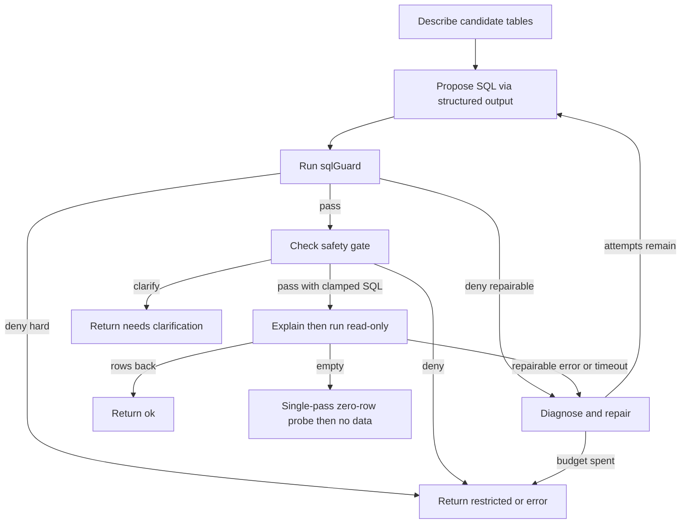

# Natural-language query with self-repair (UC-01)

This page owns the UC-01 loop: answer a Vietnamese or English business question by describing only needed tables, generating one read-only statement as structured output, validating it locally, executing it under limits, and repairing it in a bounded loop. UC-01 covers knowledge areas K1 and K2 (`docs/UC-plan/UC01.md:5`, `docs/prd.md:192`).

The shared runtime, tool, and observability contracts live in [Agent workflow and harness architecture](../agent/workflow-architecture.md), [Safety and access control](../agent/safety-and-access-control.md), [Semantic layer](../agent/semantic-layer.md), and [Eval runner, metrics, and regression](../evals/eval-and-safety-harness.md).

> Implementation status: the core validated execution path has landed in `packages/agent/src/queryExecutor/` (`executor.ts`, `safetyGate.ts`, `budgets.ts`), on top of the shared `sqlGuard` (`packages/access-policy/src/guard.ts`) and the frozen `SQLAnswer` / error / tool contracts (`packages/contracts/src/`). The upper UC-01 orchestration from the plan — intent extraction, semantic retrieval wiring, citation recording, `Clarify-Then-Query` with two clarification rounds, `SQLAnswer` assembly, `skills/text-to-sql/SKILL.md`, and the 30-question benchmark with `ex-grader` — is still planned and has no runtime file yet (`/skills` holds only `mermaid-diagrams` and `write-connector`; `/evals` is empty).

## 1. Responsibilities and scope

UC-01 answers questions such as "Top 5 provinces by revenue in Q3 2026?" or "Which month in 2025 had the most returned orders?" through a fixed loop: understand question, fetch schema, generate SQL, validate, trial-run with `LIMIT` and timeout, repair, and answer with a result table plus the SQL used (`docs/prd.md:194-202`).

In scope (`docs/UC-plan/UC01.md:18-19`):

- One `SELECT` or `WITH` statement per question against the fictional enterprise database.
- Never invent numbers when the database cannot support the question.
- `LocalQuerySafetyGate`, owned by UC-01, enforces deterministic cost, join, and sensitive-data rules without waiting for UC-07 or UC-08. By default it neither queries nor infers from columns flagged `sensitive`.

Explicitly out of scope (`docs/UC-plan/UC01.md:20`):

- Independent reviewer (UC-06), expensive-query approval (UC-07), role-based access control (UC-08), and chart rendering (UC-03).
- Later UCs may add policy at the MCP server without changing the UC-01 core loop.

Course invariants that UC-01 cannot waive: the team must build its own agent and must not wrap a hosted text-to-SQL or BI-agent product (`docs/prd.md:58-61`); execution must use a read-only identity, never prompt-only blocking (`docs/prd.md:62`); only synthetic or public data with fake PII is allowed (`docs/prd.md:63`); LangGraph is the recommended workflow framework in Python or TypeScript (`docs/prd.md:64-65`). The UC-01 plan selects the TypeScript stack (`@langchain/langgraph`, `zod`, MCP client, PostgreSQL) and forbids ready-made text-to-SQL products (`docs/UC-plan/UC01.md:6`).

## 2. Implemented entrypoint: `ValidatedQueryExecutor`

`ValidatedQueryExecutor` is the only agent-side SQL path (repo://packages/agent/src/queryExecutor/executor.ts#L1-L10). Coding agents must route every UC-01 query through it rather than calling MCP tools or opening database handles directly. Its narrow seams are stable for downstream wiring (repo://packages/agent/src/queryExecutor/executor.ts#L52-L73):

- `ChatModelLike`: structured output returning a parsed `SqlProposal` (`{sql, tablesUsed}` via `SqlProposalSchema` at repo://packages/agent/src/queryExecutor/executor.ts#L44-L50).
- `McpToolCaller.call(tool, args)`: one call method that returns the tool output or throws a `DbToolError`. Per-call run identity (`runId`, `userId`, `roleScope`) travels inside `args` so fakes and header-injecting callers observe it (repo://packages/agent/src/queryExecutor/executor.ts#L65-L73, repo://packages/agent/test/executor.test.ts#L146-L152).
- `ExecutorRunInput`: `question`, `candidateTables` (only these tables are ever described — never a full-schema sweep), `principal`, optional authoritative `catalog` override, and optional shared `budget` (repo://packages/agent/src/queryExecutor/executor.ts#L97-L110).
- `ExecutorResult`: discriminated union with `ok`, `no_data`, `needs_clarification`, `restricted`, `error`, and budget-trip `cannot_answer` (repo://packages/agent/src/queryExecutor/executor.ts#L118-L165).

The executor emits `ExecutorSpan` events (`describe`, `propose`, `repair`, `explain`, `run`, `diagnose` with attempt numbers) through the injected `SpanSink`; without a sink runs stay silent (repo://packages/agent/src/queryExecutor/executor.ts#L75-L89, repo://packages/agent/test/executor.test.ts#L89-L98). Lint forbids it from importing `pg`, `pg-cursor`, or `mcp-server/src` (repo://packages/agent/src/queryExecutor/executor.ts#L8-L10).

The hard cap on total attempts including the first try is `MAX_ATTEMPTS = 3` (repo://packages/agent/src/queryExecutor/executor.ts#L38-L39). The tighter cap the `TIMEOUT` simplification enforces on the retry is `TIMEOUT_RETRY_LIMIT = 50` (repo://packages/agent/src/queryExecutor/executor.ts#L41-L42).

## 3. Selective schema fetch and catalog ground truth

The run starts by describing candidate tables only, one budget-checked `describe_table` call per table (repo://packages/agent/src/queryExecutor/executor.ts#L315-L359). `DescribeTableOutputSchema` is validated with `safeParse`; a malformed shape fails closed to `INTERNAL_ERROR` without entering the repair loop (repo://packages/agent/src/queryExecutor/executor.ts#L338-L349). A `describe_table` throw is coerced via `asDbToolError` and returns immediately with `statusForError` mapping — the catalog it would have built is the repair loop's ground truth, so there is nothing to repair with (repo://packages/agent/src/queryExecutor/executor.ts#L334-L336).

The effective `SchemaCatalog` is the caller-supplied override when present (used for `large` flags the describe output cannot carry), otherwise built from the describe outputs with `large: false` defaults (repo://packages/agent/src/queryExecutor/executor.ts#L102-L107, repo://packages/agent/src/queryExecutor/executor.ts#L245-L269). `SchemaCatalog` itself is the frozen array-of-tables shape shared by the describe tool, the guard, and the pre-check, where `sensitive` marks PII-bearing columns and `large` marks tables needing a filter (repo://packages/contracts/src/catalog.ts#L1-L34).

Planned but not yet wired in the executor: `list_tables` for the visible table list, `search_semantic_layer` for KPI definitions and canonical joins with citations, intent extraction with structured output, and minimal-fetch discipline that loads only relevant tables (`docs/UC-plan/UC01.md:113-115`). The root `AgentState` already reserves `semanticChunks`, `intent`, `columns`, `sql`, `tablesUsed`, and `toolsCalled` channels for that wiring (repo://packages/agent/src/state.ts#L93-L112).

## 4. Local pre-check order: `sqlGuard` then safety gate

Every proposal passes two local checks in fixed order before any MCP `explain_query` or `run_query` call (repo://packages/agent/src/queryExecutor/executor.ts#L420-L466). Denial stops the run before any execution call, which the tests assert by checking the MCP call list contains only `describe_table` entries (repo://packages/agent/test/executor.test.ts#L159-L191, repo://packages/agent/test/executor.test.ts#L193-L210).

First, the shared TypeScript `sqlGuard` from `@shared/access-policy` (plan `docs/UC-plan/UC01.md:30`, code `repo://packages/agent/src/queryExecutor/executor.ts#L422-L441`):

- Parses with `pgsql-parser` (real PostgreSQL grammar compiled to WASM, warmed once at startup) and hands downstream stages the parsed `GuardAst` with no double parse (repo://packages/access-policy/src/guard.ts#L1-L37).
- Requires exactly one statement whose root is `SelectStmt` (covers plain `SELECT`, `WITH`, and set operations); denies all DDL/DML, transaction/session, and execution/introspection statement tags anywhere in the walked tree, including DML nested inside CTEs (repo://packages/access-policy/src/guard.ts#L39-L78).
- Checks tables and columns against the catalog, denies unknown names, denies system schemas `pg_catalog` / `information_schema` / `pg_toast`, denies dangerous functions by lowercased last segment (`pg_sleep`, `pg_read_file`, `dblink`, `set_config`, `nextval`, and others), and denies `SELECT INTO` and locking clauses (repo://packages/access-policy/src/denylist.ts#L13-L45, repo://packages/access-policy/src/guard.ts#L80-L200).

Policy-failing SQL is never sent to `run_query`; its normalized error feeds the next repair (repo://packages/agent/src/queryExecutor/executor.ts#L423-L440, `docs/UC-plan/UC01.md:117`).

Second, `localQuerySafetyGate` runs after `sqlGuard` and before any MCP call (repo://packages/agent/src/queryExecutor/safetyGate.ts#L1-L7, repo://packages/agent/src/queryExecutor/executor.ts#L442-L466). Its verdicts are `pass` (with possibly clamped SQL), `deny`, or `needs_clarification` (repo://packages/agent/src/queryExecutor/safetyGate.ts#L19-L22).

Defense in depth is mandatory: even after local validation, the `db-tools` MCP server independently revalidates through its fixed 7-stage pipeline (auth, scope, zod, `sqlGuard`, `AccessPolicy` reusing the same AST, read-only executor, PII scan plus audit) before execution (repo://packages/mcp-server/src/pipeline.ts#L1-L7, `docs/UC-plan/UC01.md:50`). MCP errors are normalized to `{code, message, retryable}` plus `repairable` and optional `cursorPosition`; repair prompts receive only these sanitized fields, never raw database errors, connection strings, secrets, or PII (repo://packages/contracts/src/errors.ts#L25-L59, repo://packages/agent/src/queryExecutor/executor.ts#L738-L744, `docs/UC-plan/UC01.md:52`).

## 5. `LocalQuerySafetyGate` rules

The gate is a pure agent-side TypeScript module owned by UC-01 with deterministic rules and no human approval (`docs/UC-plan/UC01.md:163`, repo://packages/agent/src/queryExecutor/safetyGate.ts#L1-L7):

1. Sensitive data: deny when a catalog-marked sensitive column of a scanned table appears anywhere in the query. `GuardSuccess.columns` already collects named refs from every clause (projection, `WHERE`, `JOIN ON`, `GROUP BY`, `HAVING`, `ORDER BY`, function and aggregate args), so one set-membership test covers all clauses (repo://packages/agent/src/queryExecutor/safetyGate.ts#L57-L82). Returns `SENSITIVE_COLUMN_DENIED`, mapped to `restricted`, never fake `no_data` (repo://packages/agent/src/queryExecutor/safetyGate.ts#L184-L194, repo://packages/agent/src/queryExecutor/executor.ts#L175-L187).
2. Safe joins: deny any `JoinExpr` with no `ON`/`USING` condition (`CROSS JOIN` and conditionless joins both parse to an unconditioned `JoinExpr`) and any comma-separated `FROM` list; `NATURAL JOIN` is left to the server-side guard (repo://packages/agent/src/queryExecutor/safetyGate.ts#L84-L112). Returns `FORBIDDEN_STATEMENT` (repo://packages/agent/src/queryExecutor/safetyGate.ts#L196-L202, repo://packages/agent/test/executor.test.ts#L183-L186).
3. Large tables: when a scanned table has any `large`-flagged column and the query has no `WHERE` filter and no aggregate, return `needs_clarification` asking for a filter, an aggregate, or a smaller table (repo://packages/agent/src/queryExecutor/safetyGate.ts#L114-L127, repo://packages/agent/src/queryExecutor/safetyGate.ts#L204-L218). The test injects a `large` catalog override and asserts no MCP run call happens (repo://packages/agent/test/executor.test.ts#L231-L258).
4. Detail cap: non-aggregate detail queries pass with `clampLimit(sql, 200)` where `DETAIL_QUERY_LIMIT = 200`; the clamp operates on the statement tail so inner subquery limits are untouched and already-compliant SQL passes through unchanged (repo://packages/agent/src/queryExecutor/safetyGate.ts#L16-L17, repo://packages/agent/src/queryExecutor/safetyGate.ts#L147-L178, repo://packages/agent/src/queryExecutor/safetyGate.ts#L220-L223). If `LIMIT` is missing the executor only auto-adds `LIMIT 200` for preview; full-export or still-over-broad requests return `needs_clarification` per plan (`docs/UC-plan/UC01.md:168`).
5. Fixed execution budget: every `run_query` uses `maxRows: 200` client-side; UI preview is capped at 50 rows by contract (repo://packages/agent/src/queryExecutor/executor.ts#L533-L537, repo://packages/contracts/src/answers.ts#L46-L47).
6. No circumvention: blocked sensitive columns cannot be inferred via predicates, aggregates, string functions, or joins; the plan reserves full RBAC and masking enforcement for UC-07/UC-08 with the server authoritative (repo://packages/agent/src/queryExecutor/safetyGate.ts#L1-L7, `docs/UC-plan/UC01.md:170`).

Prompt text is never the sole protection layer (`docs/UC-plan/UC01.md:155`).

## 6. Bounded repair, `TIMEOUT` simplification, and zero-row diagnostic

The repair loop allows at most `maxAttempts` total generations including the first try (default 3): one initial proposal plus up to two repairs (repo://packages/agent/src/queryExecutor/executor.ts#L362-L375, `docs/UC-plan/UC01.md:28`). The model emits one candidate SQL per attempt through `SqlProposalSchema`, and the retry prompt carries only the sanitized `code at position: message` feedback (repo://packages/agent/src/queryExecutor/executor.ts#L387-L393, repo://packages/agent/src/queryExecutor/executor.ts#L738-L744).

*Caption: UC-01 describe, propose, guard, gate, explain, execute, and bounded-repair loop.*

Only `REPAIRABLE_CODES` retry with feedback: `INVALID_SQL`, `UNKNOWN_TABLE`, `SQL_EXECUTION_ERROR` (repo://packages/contracts/src/errors.ts#L41-L45, repo://packages/agent/src/queryExecutor/executor.ts#L228-L230). Hard security codes (`SCOPE_DENIED`, `SENSITIVE_COLUMN_DENIED`, `FORBIDDEN_STATEMENT`, `FORBIDDEN_FUNCTION`, `UNAUTHORIZED`) and `INTERNAL_ERROR` abort on the current attempt; loop exhaustion surfaces the last error (repo://packages/agent/src/queryExecutor/executor.ts#L175-L187, repo://packages/agent/src/queryExecutor/executor.ts#L630-L639). `TIMEOUT` gets exactly one simplification rewrite: `simplifyForTimeout` drops the `ORDER BY` tail and tightens the limit via `clampLimit(sql, 50)`; the result re-passes guard plus gate before any MCP call (repo://packages/agent/src/queryExecutor/executor.ts#L232-L243, repo://packages/agent/src/queryExecutor/executor.ts#L642-L685).

`explain_query` runs before `run_query` on the gate-clamped SQL (both budget-checked); a malformed explain shape fails closed to `INTERNAL_ERROR` (repo://packages/agent/src/queryExecutor/executor.ts#L468-L521). `run_query` rows pass through untouched — no numeric coercion in the executor; that belongs to the grader (repo://packages/agent/src/queryExecutor/executor.ts#L523-L581, repo://packages/agent/test/executor.test.ts#L141-L142).

Zero-row results do not immediately retry the full loop (repo://packages/agent/src/queryExecutor/executor.ts#L583-L618, `docs/UC-plan/UC01.md:124-129`):

- Only when `attempt === 1` and the guard AST contains a `WHERE` clause, issue at most one capped `sample_rows` probe (`n = 5`) against the first scanned table (repo://packages/agent/src/queryExecutor/executor.ts#L692-L735).
- Unfiltered or aggregate empties conclude immediately with zero probes.
- Probe success or failure both conclude `no_data` with a diagnostic note; the executor never burns all three attempts on truly empty data.

Ambiguity handling (`Clarify-Then-Query` with at most two clarification rounds, single top-priority question with 2–4 dictionary-derived options, `Asia/Ho_Chi_Minh` relative-time resolution, single-alias or `defaultMetric` KPI auto-mapping) remains planned in `docs/UC-plan/UC01.md:133-151` and is not yet implemented in the executor — the executor's `needs_clarification` today covers only the large-table gate (repo://packages/agent/src/queryExecutor/safetyGate.ts#L204-L218).

## 7. Budgets, terminal states, and fail-closed errors

Every LLM and MCP call is preceded by `checkBudget`; a trip stops further calls and the run degrades to synthesis with partial findings (repo://packages/agent/src/queryExecutor/budgets.ts#L1-L5, repo://packages/agent/src/queryExecutor/executor.ts#L328-L329). Locked run-level limits are `maxLlmCalls: 20`, `maxTokens: 60000`, `runDeadlineMs: 120000` (repo://packages/agent/src/queryExecutor/budgets.ts#L7-L12), duplicated as `BUDGET_DEFAULTS` in the checkpointed root state so limits survive reduction (repo://packages/agent/src/state.ts#L18-L23). `checkBudget` is pure and never mutates state; `recordLlmCall` records count plus token usage after each proposal (repo://packages/agent/src/queryExecutor/budgets.ts#L60-L80). A trip returns `cannot_answer` with `budgetExceeded: true`, the `tripReason` (`llm-calls`, `tokens`, `deadline`), and `partials` (`tablesDescribed`, `lastSql`, `rowsFetched`) (repo://packages/agent/src/queryExecutor/executor.ts#L302-L313, repo://packages/agent/test/executor.test.ts#L260-L282).

Terminal mapping keeps policy denials as `restricted` and everything else as `error`, while unknown thrown shapes coerce to non-repairable `INTERNAL_ERROR` with the message truncated to 200 characters and the server `cursorPosition` preserved for repair feedback (repo://packages/agent/src/queryExecutor/executor.ts#L175-L187, repo://packages/agent/src/queryExecutor/executor.ts#L189-L226).

Final states and when to use them (`docs/prd.md:214`, `docs/UC-plan/UC01.md:102-109`):

- `ok`: valid SQL ran and returned rows.
- `no_data`: diagnosed query genuinely matches nothing, including aggregates returning one row with `COUNT = 0` or all-`NULL` measures.
- `cannot_answer`: required tables, columns, or KPI definitions are absent, or the run budget tripped; the response names the missing piece and invents no numbers.
- `needs_clarification`: question is too broad or over-broad to run inside budget; ask the user to narrow scope.
- `restricted`: question touches sensitive columns or enables direct inference from them; refuse safely.
- `error`: repair budget or safe infrastructure failed.

Errors shown to users or fed to the model must not contain passwords, connection strings, internal paths, or PII (repo://packages/mcp-server/src/pipeline.ts#L1-L7, `docs/UC-plan/UC01.md:159`). Every run carries `runId` with a PII-redacted trace of user and role, nodes, tool calls, all SQL attempts, applied policy, `EXPLAIN` cost, row counts, tokens, estimated cost, timing, and final status (`docs/UC-plan/UC01.md:209`).

## 8. Structured `SQLAnswer` contract and checkpointed state

`SQLAnswerSchema` (zod) is the sole contract returned to UI and API (`docs/UC-plan/UC01.md:58-85`, repo://packages/contracts/src/answers.ts#L36-L57). The frozen shape is:

| Field | Type | Rule |
|---|---|---|
| `intent` | object | `{metric, dimensions, filters, timeRange}`; filters are `{field, operator, value}` (repo://packages/contracts/src/answers.ts#L37-L42) |
| `sql` | string or null | Final executed SQL, null when no SQL exists (repo://packages/contracts/src/answers.ts#L43-L43) |
| `tablesUsed` | list of string | Must exist in schema (repo://packages/contracts/src/answers.ts#L44-L44) |
| `citations` | list of string | KPI, table, or column URIs or IDs actually used, defaults to `[]` (repo://packages/contracts/src/answers.ts#L45-L45) |
| `attempts` | list, max 3 | One entry per SQL generation with number, SQL, schema refs, validation, EXPLAIN summary, execution, diagnostic, repair reason, and duration (repo://packages/contracts/src/answers.ts#L7-L17, repo://packages/contracts/src/answers.ts#L46-L46) |
| `resultPreview` | list of dict, max 50 | Already masked; UI shows at most 50 rows (repo://packages/contracts/src/answers.ts#L47-L47) |
| `answerText` | string, min 1 | Short answer whose numbers come only from executed results (repo://packages/contracts/src/answers.ts#L48-L48) |
| `status` | enum | `ok`, `no_data`, `cannot_answer`, `needs_clarification`, `restricted`, `error` (repo://packages/contracts/src/answers.ts#L27-L34) |
| `telemetry` | object | `promptTokens`, `completionTokens`, `embeddingTokens`, `estimatedCostUsd`, `latencyMs` (repo://packages/contracts/src/answers.ts#L50-L56) |

Output validity is itself gated: 100% of responses must validate against `SQLAnswer`; a failed `SQLAnswer` parse gets at most 2 format repairs, then returns `status: "error"` with a safe message and no free-form model output (`docs/prd.md:221`, `docs/UC-plan/UC01.md:89`). If failure happens before intent or SQL exists, required fields take safe defaults (`metric: null`, empty arrays, `sql: null`, `resultPreview: []`) (`docs/UC-plan/UC01.md:90`). The executor does not yet assemble `SQLAnswer` — it returns the narrower `ExecutorResult` above; `SQLAnswer` assembly with citations and masked preview is still a UC-01 milestone (`docs/UC-plan/UC01.md:219-226`).

Checkpointed workflow state (`AgentState`) carries `question`, `ucId`, `intent`, `semanticChunks`, `resultPreview` (zod-max 50), `columns`, `sql`, `tablesUsed`, `toolsCalled`, `status`, `answerText`, additive `budget` and `telemetry` reducers, `runId`, `threadId`, `vizSpec`, and `pendingClarification` (repo://packages/agent/src/state.ts#L93-L141). Preview cap (`RESULT_PREVIEW_MAX = 50`) keeps checkpoint payloads small; the full up-to-1000-row buffer lives in transient RAM outside state (repo://packages/agent/src/state.ts#L15-L16). The frozen root graph (`understand -> retrieve -> router -> ucEntry/defaultEntry -> statusCheck -> vizSeam/answer`) dispatches only to registry entries; UC owners register handlers via `registerUC` and never edit `graph.ts` (repo://packages/agent/src/graph.ts#L27-L34, repo://packages/agent/src/subgraphs/registry.ts#L16-L21). The tracer default route preserves the demo chain until real UC subgraphs land (repo://packages/agent/src/subgraphs/registry.ts#L90-L97).

## 9. Failure mitigations

| Failure | Mitigation in UC-01 |
|---|---|
| Fan-out double-count from joining a one-to-many table then `SUM` | Resolve the canonical join path from the semantic layer with citation; `localQuerySafetyGate` blocks `CROSS JOIN` and `ON`-less joins; ambiguous references are blocked (repo://packages/agent/src/queryExecutor/safetyGate.ts#L84-L112, `docs/UC-plan/UC01.md:115`). Reviewer coverage (UC-06) is out of scope here but the misjoin must already be blocked locally. |
| Wrong metric (e.g. gross versus net revenue, active-customer definition) | KPI terms are matched against dictionary aliases with single-alias or `defaultMetric` gating; multi-meaning KPIs trigger clarification, unknown KPIs trigger `cannot_answer`, never a guessed formula; every answer cites the metric chunk used (`docs/UC-plan/UC01.md:114`, `docs/UC-plan/UC01.md:147-149`). At least 5 benchmark questions depend on dictionary definitions (`docs/prd.md:98`). |
| Runaway query (cartesian product, full scan of a 1M+ row table, hang) | `sqlGuard` blocks dangerous functions and multi-statements; the gate blocks cartesian joins and requires time or index predicates on large tables; server `statement_timeout` and row caps bound execution; timeouts get at most one simplification repair (repo://packages/agent/src/queryExecutor/executor.ts#L642-L685, repo://packages/mcp-server/src/tools.ts#L38-L64). |
| Hallucinated numbers | `answerText` may only restate executed results; `cannot_answer` versus `no_data` are separated; unsupported questions must name the missing table or column (repo://packages/agent/src/queryExecutor/executor.ts#L583-L618, `docs/prd.md:224`). |
| Prompt injection in data or question | Query results are untrusted data: shown masked in preview but never treated as agent instructions; generation prompts carry that constraint explicitly (`docs/UC-plan/UC01.md:116`, `docs/prd.md:533`). |
| Sensitive-data inference | Blocked columns cannot be replaced by predicates, aggregates, string tricks, or joins that infer them; indirect access returns `restricted` (`docs/UC-plan/UC01.md:170`). Full RBAC and masking enforcement is detailed in [Safety and access control](../agent/safety-and-access-control.md). |

## 10. EX-gated acceptance and evals

Acceptance is gated on execution accuracy (EX): result-set match against pre-run gold results, order-insensitive unless sorting is requested, column-name-insensitive, float tolerance 0.5%, with gold SQL and results hidden from the agent (`docs/prd.md:101-102`). The benchmark holds at least 30 Vietnamese questions with gold SQL and results in `evals/questions/` JSONL (`docs/prd.md:96-100`); only the row shape is frozen so far as `BenchmarkRowSchema` (`{id, question, difficulty, goldSql, goldResultPath, ordered, tags}`) (repo://packages/contracts/src/benchmark.ts#L7-L15). The plan adds TypeScript `ex-grader` normalization of `NULL`, booleans, Unicode, numeric and currency types, and timestamps to UTC ISO-8601, set comparison when `ordered=false`, order-preserving comparison when `ordered=true`, duplicate-row preservation, and relative float tolerance `abs(a-b)/max(abs(b),1e-9) <= 0.005` (`docs/UC-plan/UC01.md:191-192`).

Gates (`docs/prd.md:220-226`, `docs/UC-plan/UC01.md:201-206`):

- EX overall at least 70%, easy questions at least 85%.
- Valid `SQLAnswer` rate 100%.
- Bounded self-repair: at most 3 SQL generations; at least 50% of first-attempt failures are fixed on retry; report repair rate and mean attempts.
- 100% of non-`SELECT`/`WITH` or multi-statement SQL blocked before execution.
- 100% `cannot_answer` correctness on unsupported questions.
- Every execution has a timeout and row cap.
- Dangerous-SQL block rate 100%; token, cost, and latency reported per question.

Minimum eval coverage is the full 30+ benchmark with required cases: 1-table query, 3-table join, window function or year-over-year comparison, unanswerable question, and a forced-repair question such as a Vietnamese column name missing from the schema (`docs/prd.md:227`); plus difficulty splits (at least 10 easy, 12 medium, 8 hard), KPI-dependent and `cannot_answer` cases, self-repair cases (wrong table or column, syntax, zero-row from wrong enum or date range), ambiguity cases, and at least 5 shared safety cases covering injection, DDL/DML, multi-statement, PII or salary access and indirect inference, data-borne indirect injection, cartesian join or `pg_sleep`, and fabrication requests, each with the blocking layer recorded (`docs/UC-plan/UC01.md:191-195`, `docs/prd.md:529-538`). No benchmark, grader, or safety-driver results have landed yet — the deterministic `executor.test.ts` suite (candidate-only describe order, deny-without-run, sensitive deny, unknown-table error, large-table clarification, exhausted-budget trip) is the current executable coverage (repo://packages/agent/test/executor.test.ts#L103-L157, repo://packages/agent/test/executor.test.ts#L260-L282). Full eval details live in [Eval runner, metrics, and regression](../evals/eval-and-safety-harness.md). Regression requires at least two full runs (baseline plus post-improvement) with a before and after report (`docs/prd.md:585`).

## 11. Operations, UI, and extension seams

Chat UI (TypeScript) streams workflow events, shows progress and clarification prompts, result tables, and a view-SQL button (`docs/UC-plan/UC01.md:34`). Observability follows the shared JSONL and LangSmith convention with PII-redacted traces; `TraceEventSchema` requires `runId`, `threadId`, `userId`, `role`, `node`, `type`, timestamp, and duration, with optional span linkage (repo://packages/contracts/src/trace.ts#L7-L22, `docs/UC-plan/UC01.md:35`).

The executor's public surface is explicit named re-exports so the eval safety driver can drive the real `ValidatedQueryExecutor` plus the gate without relative imports (repo://packages/agent/src/queryExecutor/index.ts#L1-L26). The `text-to-sql` skill contract (metadata, instructions, inputs and outputs, steps, constraints, examples, final check) is still planned at `skills/text-to-sql/SKILL.md` with the §4 flow, allowed MCP tools (`list_tables`, `describe_table`, `sample_rows`, `run_query`, `search_semantic_layer`, plus `explain_query`), the 3-attempt, 2-format-repair, and 2-clarification caps, `Clarify-Then-Query`, gate, read-only, PII, and no-fabrication constraints — with no arbitrary-command scripts or alternate database connections (`docs/UC-plan/UC01.md:213`, `docs/prd.md:525`). The skill loader already enforces the eight canonical sections (name, description, when-to-use, inputs/outputs, steps, constraints, examples, final-check) for any skill that lands (repo://packages/agent/src/skills/loader.ts#L23-L64).

To extend without forking the core loop: add reviewer, costly-query approval, role policy, or charting as MCP-server policy or downstream consumers of the validated `SQLAnswer` and its trace, not as edits to the generate-validate-execute-fix path (`docs/UC-plan/UC01.md:20`). UC-01 completes when the TypeScript workflow runs end to end on PostgreSQL through MCP `db-tools` with no Python or side-channel validator or connection, all SQL passes local plus server checks on a read-only, timeout, and row-limited path, zero-row diagnosis and `Clarify-Then-Query` behave per caps, `SQLAnswer` is valid with citations and masked preview, UI streams progress, skill plus benchmark plus graders plus ambiguity and safety cases run under the monorepo `pnpm` command, and the EX and repair targets above are met or handed over as an agreed baseline with backlog (`docs/UC-plan/UC01.md:219-226`).
